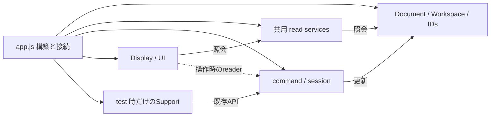

# Composition rootの残存責務と依存監査

## 基準と扱い

初回監査は2026-10-20、develop `f37edc6`（実装commit `b6e825f`）を基準とする。`app.js`のGit blobは`16e825cb801589c272ff4b648a89e5e0217138f5`。この監査では実装を変更していない。

これは現在の構造と次の判断の記録であり、全体完了を示す文書ではない。合意した目標と停止・検証条件は[再開手順](refactoring-policy-and-resume.md)、現在の配置は[実装map](implementation-map.md)を優先する。以後の実装では行番号より関数・owner名を使って現物を再確認する。

## 監査後の反映

最後の性能traceは生成ownerのConstraintCommitCommandへ統合し、Document reset／test supportへclear／readを直接接続した。続いて注記コピーの表示値変換を既存ClipboardTransferへ統合した。共有外観UIのControls／Paletteと起動時Document設定の組立てはAppearanceUIへ集約した。PropertiesのController／Viewの結線も既存PropertiesDisplayへ集約した。Canvas context menuの操作componentの結線はCanvasContextInteractionへ集約した。拘束・寸法開始準備はDrawOperationLifecycle、角度間隔寸法の開始はDimensionPlacementCommandへ統合した。Geometry削除時の操作終了手順もGeometryDeletionCommandへ統合した。拘束の共有装飾とSnapshot用metadataはConstraintPersistenceへ統合した。Annotation Parameter候補の読取り検証はParameterNamespaceへ統合した。Canvas描画診断五部品の組立ても既存CanvasRenderTestDriverへ集約した。Canvas pressの選択事前判断はCanvasSelectionInteractionのidentity選択へ統合した。Canvas表示基盤の六部品の構築はCanvasDisplayへ二段階で集約した。command panel／PNGと通常pointerの振分けはCanvasInputBindingへ統合した。五つのcommand inputの生成結線はCanvasCommandInputsへ集約した。press／hoverのhit結線と注記interaction hit判定はCanvasHitInteractionへ集約した。特殊寸法編集と対象選択の支援は既存DimensionValueCommandへ統合した。PointUsageをGeometryPresentationへ共有し、同factoryのroot binding参照を33→27へ削減した（app行数差0）。command targets／Sketch styleも共有し、同factoryのroot binding参照を27→23へ削減し、未使用の委譲二入口を除いた。GeometryDisplayへ四つの描画構築と点／編集ハンドルの接続を集約した。24個の明示portから各子へ限定APIを接続し、新stateや全app contextを持たない。CanvasDisplay.createRenderingへ共通content／PNG出力／対話描画器の接続も集約し、Surfaceの実行・状態復元と既存rendererの責務は維持した。同期済みscopeとSolver切替手順はEditingScopeBindingへ移管し、Block host復元中のWorkspaceとの参照差も維持した。通常矩形選択のguard・内部選択解除・query結果反映はCanvasSelectionInteractionへ統合した。Instance参照元の矩形入力の候補取得・command選択はInstanceCommandInputへ統合した。三つの固定拘束照会は既存ConstraintReferencesへ統合した。拘束の所属付与とモデル挿入はConstraintCommitCommandへ統合した。operandのSketch関係照会は既存SketchContextへ統合し、表示用のID補完と返却値の違いは維持した。app.jsのletは八つ、行数は3,088行。初回監査の集計・state表はf37edc6を保持し、最新集計は次の63c886c再監査節、以後の変更・検証・次の単位は再開手順section 8を参照する。

## 再監査（2026-10-20、63c886c）

基準はdevelop／origin/developの`63c886cfb553e57598f54a0555c4c9ec63469f71`。app.jsのblobは`881fd70a4785a78445236016d0c6b64d705a118a`。この再監査では実装・UI・保存形式を変更していない。旧f37edc6を同じPlaywright同梱Babel parserと集計条件で再解析し、下記旧表の全数値を再現してから比較した。

| 分類 | f37edc6 | 63c886c | 差 |
| --- | ---: | ---: | ---: |
| rootのcreate系構築（非空白） | 1,564 | 1,376 | -188 |
| test hooks（非空白） | 488 | 478 | -10 |
| call一文の関数（非空白） | 261 | 264 | +3 |
| その他（非空白） | 572 | 547 | -25 |
| 非空白合計 | 2,885 | 2,665 | -220 |
| 空白 | 502 | 497 | -5 |
| 物理行 | 3,387 | 3,162 | -225 |

rootの構築文は232→214、root関数は226のまま。一文callの関数は176→179、その他の非test関数は49→46（計249→227物理行）。構築Object直下の関数値は446→422、複数statementを持つものは47→38。これはapp内の分類であり、下位moduleへ集約したfactoryや関数がアプリ全体から消えたという意味ではない。memberのcreate系だけを数え、local関数のcreateCanvasWorkspace等は「その他」に入るという旧条件も維持した。

test hooksと一文callを仮に全て外しても、非空白`2665 - 478 - 264 = 1923`行が残る。小さな関数や結線の移動だけで200〜500行へ届くとは見積もれない。主対象は依然として1,376非空白行の構築と、その引数に残る実処理・相互依存である。

### 構築の内訳と広い契約

factoryのnamespaceを定義するsource folderで分類すると次のとおり。これは現在のowner位置を示す集計で、folder単位で一括移動する指示ではない。

| 定義元 | root構築文 | 非空白行 |
| --- | ---: | ---: |
| commands | 39 | 353 |
| editing | 51 | 278 |
| application | 27 | 255 |
| ui | 36 | 212 |
| その他（rendering／persistence／solver等とlocal method） | 61 | 278 |
| 合計 | 214 | 1,376 |

root構築文で参照される異なるroot binding数の上位はCanvasCommandInputs 63、CanvasContextInteraction 62、PropertiesDisplay.createWithController 57、GeometryDragFeature 49、PointerInteractionController 47、KeyboardInput 43。これはcallbackに捕捉された参照も含む静的な数であり、呼出し先の全依存やAPI引数数ではない。たとえばCanvasCommandInputsの64入口のうちglobal documentはroot binding数に含まれない。

GeometryPresentationのcommand targets／Sketch style／本体／line displayとGeometryRendererの本体／Layerの6構築は計24物理行でも、異なるroot参照の和集合は67。これらをそのまま67依存の新factoryへ包む案は採用しない。返すownerや行数が変わるだけで、構築契約が広いままになるためである。先に既存のPointUsage、command targets、Sketch style、GeometryReadServices等の責務が明確なAPIを共有できるか確認し、各子へ必要なAPIだけを接続する。初期化後のownerを早期に直接渡さず、必要なreaderと後段接続を残す。

### stateと初期化段階

再監査基準63c886cではroot letは9個で、初期化を除く代入はmodel 1、mode 20、lastPointerWorld 4、後段接続6個が各1。modeの20箇所のうち1箇所はtest support、19箇所は通常機能である。

| mode更新を持つowner群 | 代入箇所 |
| --- | ---: |
| SketchProjectionFeature、GeometryInstanceCommand、InstanceSourceCommand、BlockPlacementCommand、BasicDrawingTools.createSpline、FilletFeature、BlockEditingFeature.createCommands | 7 |
| DrawOperationLifecycle（selectMode／setMode） | 2 |
| ConstraintTargetCommand、DimensionPlacementCommand | 2 |
| ConstructionCommand | 1 |
| GeometryDeletionCommand、ClipboardCommand、SketchCommand.createInteractionReset、SketchMoveCommand、CanvasCommandCancellation | 5 |
| PngExport、DocumentEditingReset、test support | 3 |

lastPointerWorldの記録元はCanvasContextInteractionとPointerInteractionController、解除元はDocument用Canvas resetとSketch切替resetである。DrawingPreview.pointerやhoverと同じ値・解除時機とは仮定しない。後段接続のpngExportCommand／sketchMoveCommand／sketchContextController／commandPanel／derivedPanel／toolFlyoutsは操作stateの重複ではない。

同じroot構築文の引数から後段constを参照する箇所は121回で、全てfunction内の遅延参照だった。ただし静的な捕捉の検査であり、constructorがcallbackを即実行しないことまで保証しない。callbackをowner Objectへ置換する場合は、取得時機を個別に確認する。

- CanvasDisplay.createはviewport→navigation→Zoom listenerを構築し、TransientAuthoringを挟んでcreateWorkspaceを呼ぶ。surface.startは最後の起動段階に残る。
- DimensionDisplayの計測／配置／描画基盤は早期、Selection bounds／LayerのcreateTraversalは後段で、同じ計算ownerへ接続する。
- BlockEditingFeatureは早期のsession／projectionと後段createCommandsを分ける。AnnotationDisplayとGeometryPresentationのdrag／preview／exportは操作時に読む。
- bindClipboard→Sketch移動binding→Sketch／Canvas context controller→Canvas input／寸法入力→keyboard／各UI bindingの順がある。create時にlistenerを登録するmoduleもあり、全bind／startを一律に末尾へ移さない。
- DocumentEditingReset生成→test hooks→初期reset→UI／draw→言語／theme→runtime version→resize→surface.start→履歴／file checkpoint→DocumentFileFeature.startの最終段階を維持する。

### 次の実装単位と採用基準

最初にDimensionValueCommand.createへ渡すsubmitSpecialDistance／commitSpecialPropertyと編集対象選択のcallbackを分析する。同構築は38物理行で、特殊寸法の分岐、式の評価、例外、履歴をappが持つ。既存のDimensionValueCommandまたは寸法編集の限定ownerへ、Instance角度間隔／Annotation寸法／Annotation anchor距離の特別扱いを集める。単なるcallback fileを作らず、一般の値編集と特殊値編集の入口・適用結果を明確にする。

維持する契約は、特殊処理の非対象null／拒否false／成功の区別、対象kind・propertyによる短絡順、現在scopeでの式評価、Annotation側のnull constraint評価、setValue失敗時のhint、既存の履歴回数、pending解除／入力表示／UI更新を一般command側へ返す時機である。submitとProperties編集の異なる例外境界も一律化しない。仕様変更は行わない。

その次は、広い構築契約を既存ownerのAPIで減らしてから、描画・入力・編集のまとまった生成を整理する。単一の可変app context／Service Locatorを作らない。生成、相互接続、bind／startを分ける場合も既存順をテストし、phase分割そのものを新しい巨大bootstrapへの移動にしない。独立した操作・照会API、同じstate owner、必要な遅延参照が説明できる単位だけを採用する。

### 今回の検証と限界

今回の変更は監査／再開文書のみで、app.jsは3,162→3,162行（0行差）。Git blob、AST分類の和、旧値の再現、state代入元、選んだ構築群と初期化順を現物で照合した。監査用script／JSONは一時ディレクトリのcad-composition-current-audit.{cjs,json}へ出力し、packageや実装toolは追加していない。

基準コード63c886cは前単位で構文584ファイル・単体1,708件・関連E2E189件が成功済み。この監査ではそれらを再実行しておらず、全E2E成功の根拠にもしていない。mainは5ee5f3fで保留中。最新版の全体検証と未解決事項の確認がmain反映の条件である。

## 旧監査基準の大きさ（f37edc6）

以降は初回監査の記録である。既に実装した候補や古い次単位を現状へ適用せず、上の最新再監査と再開手順section 8を優先する。

既存Playwright同梱のBabel parserで`app.js`のIIFEを解析した。追加のpackageやparserは導入していない。次の表の非空白行は重複しない。

| 分類 | 非空白行 | 集計条件 |
| --- | ---: | --- |
| create系factoryの構築・接続 | 1,564 | IIFE直下の変数宣言／代入で、右辺が`create*` methodの呼出し。232文、物理1,565行 |
| `installTestHooks` | 488 | 条件付き生成と既存APIの組立て。内部のfactoryもこの分類に含める |
| call一文の関数 | 261 | IIFE直下の関数で、本体が一つのcallのreturnまたは実行だけ。176関数 |
| その他 | 572 | static依存、その他の関数・alias・起動・設定など |
| 合計 | 2,885 | 非空白行 |
| 空白行 | 502 | 物理行との区別のため別集計 |
| 物理行 | 3,387 | 今回の変更前後で同じ |

IIFE直下の関数は226個。上記call一文の関数とtest hooksを除く49関数は計249物理行である。ただし、実処理は関数宣言以外にも残る。create系factoryのObject引数直下には446個の関数値があり、うち47個は複数statementを持つ。したがって、factoryの全行を「単なる接続」とは扱わない。

call一文の分類には、委譲入口のほかfactory構築や引数を組み立てる関数も含む。既定引数を評価する時機や、後で生成されるconstを操作時に参照する役割もある。上記の分類は機械的な削除候補リストではない。

test hooksとcall一文の関数を仮に全て外しても、非空白2,136行が残る。空行整理や小関数の移動だけでは、200〜500行のcomposition rootには届かない。現在の主要な残作業は、実際の機能境界に沿った構築依存の集約と、残る更新責務の所有者を揃えることである。

## 状態と後段接続の区別

IIFE直下の`let`は10個。代入数は初期化を除き、test hooks内の代入も数える。

| 名前 | 代入箇所 | 現在の役割と次の判断 |
| --- | ---: | --- |
| `model` | 1 | Workspaceの現在scopeへの別名。`activateEditingScope`が`solver.model`とcacheも同期する。データの本来のownerはDocument／Workspace |
| `mode` | 23 | command・入力・resetが参照／更新する操作mode。うち1箇所はテスト用。開始・取消・resetの契約を揃えてから既存lifecycleとの統合を判断する |
| `lastPointerWorld` | 4 | Canvas移動・context menuから記録し、Document／Sketch切替で解除する最後のworld位置。hoverやpreviewのpointerと同一と仮定しない |
| `lastAuthoringPerformance` | 2 | 拘束確定の成功時に記録し、Document resetで解除するtrace。計測を作る`ConstraintCommitCommand`との所有境界を揃えられる |
| `pngExportCommand`、`sketchMoveCommand`、`sketchContextController`、`commandPanel`、`derivedPanel`、`toolFlyouts` | 各1 | 後段で作るcomponentへの接続参照。操作sessionをもう一組保持しているわけではない |

この表は`let`の監査であり、constが指すDocumentやcomponentへの書込みが存在しないという意味ではない。Selection・draft・Parameter・Document更新のcallbackは別に確認する。modeやpointerをgetter／setterだけの容器へ移すことは、責務分離の完了とはしない。

## 実処理が残る境界

| 現在の入口 | 適切な所有範囲と維持する契約 |
| --- | --- |
| `activateEditingScope` | Workspaceの切替、Sketch移動の終了、Solverのmodel接続、read／projection cache無効化の順。既存のDocument固定参照と現在scope参照を一括置換しない |
| `ensureModelState`、`serializeModel`、`historySnapshot` | 単位・Sketch・外観・Block・描画順の準備、snapshot、履歴からの名前／時刻除外。保存と履歴を同じmetadata方針へ統合しない |
| `DocumentSnapshot.constraintData`、`decorateSerializedConstraint` | 所属・reference metadataの付与と無効な値の短絡。codecの形式所有と現在編集scopeの適用を区別する |
| `GeometryDeletionCommand.endInteraction` | 削除時の入力／drag／mode解除。Document resetやSketch切替とは解除範囲が異なる |
| `ClipboardPayload.detachedAnnotation` | 表示中の文字・Leader geometry・anchor位置をコピー値へ反映する変換。元Annotationのmaterializationと取り違えない |
| `AnnotationCommand.validateParameter`等 | 仮の評価、戻し、確定、表示更新。単にcallbackを別fileへ移すのでなく、既存Parameter編集ownerとの依存を整理する |
| `refreshSketchMoveGeometry` | projection／read／Hatch cache、拘束再接続、解析と参照有効性の更新順 |
| `isBlankCommandPanelPoint`等 | ヒット照会と空白double clickの判定。通常の単一clickによる配置／選択を妨げない |

一方、Hatchのcontent／Layerは既存`HatchRenderer`で役割が分かれている。現時点では、それらを一つの薄い新fileへ包むだけの変更を優先しない。

## 初期化順を拘束している依存

| 先に生成するもの | 後で参照するもの | 現在維持している接続 |
| --- | --- | --- |
| `AnnotationSpatialQuery` | viewport、Annotationの文字layout／Leader geometry、Annotation drag | scale・layout・resize可否のcallback。生成時には評価しない |
| `ApplicationRefresh` | Annotation drag、PropertiesView、Tree、寸法入力 | 更新時に既存ownerへ委譲するcallback |
| `BlockEditingFeature` | viewport、Block履歴snapshot、後段のview／dialog | `readViewport`と履歴生成入口、後段の`createCommands` |
| `AnnotationDisplay` | Annotation command、Annotation drag | previewとresize可否の遅延reader |
| `DimensionDisplay`の基礎計算 | Dimension drag、hover、pending、PNG | 後段の`createTraversal`でreaderを受ける |
| `DocumentApplication`や既存reset callback | 全てのreset対象component | `DocumentEditingReset`は全owner生成後、test hooks／起動reset前に構築する |

後段constをcallbackから直接Objectへ置き換える際は、生成時のTDZを再確認する。「createは常に副作用がない」と全moduleへ一般化しない。既存の`start()`にもDOM登録・表示更新があり、一括で順序を変えない。

## 機能単位で束ねる方向

現状の主要な関係は次のとおり。矢印は全ての依存を列挙したものではない。

以後の構築単位では、既存のGeometryReadServices、viewport、Selection、namespace、ID ownerを再生成しない。静的な型やcodecは構築側で接続できるが、現在scope・preview・export状態は明示readerまたは狭いowner APIを使う。

- Document／編集scope／読込・履歴: Documentデータと編集sessionを区別し、保存と履歴、load成功後のresetを同一owner間で調整する。
- 描画・空間照会: 共有read ownerを使い、CanvasSurface、表示器、hit／boundsとPNGの接続を整理する。GeometryReadServicesをCanvas専用に閉じ込めない。
- Properties: 既存PropertySelection・PropertyEditingFeature・PropertiesDisplay・Palette・Controllerが共有する接続を機能境界として検討する。各commandやViewの状態を複製しない。
- Canvas入力・context menu: query／候補表示／対象選択／操作dispatchを既存ownerへ接続し、modeやpointerの更新契約と一緒に扱う。全commandを自由に操作できるcontextを渡さない。
- test hooks: 既存`src/testing/`の支援groupごとに生成・公開APIを揃える。通常機能をテスト専用実装へ移さず、production featureからtestingへ依存を反転させない。
- 起動: 上記の構築と、必要なbind／start、初回reset・表示・履歴・file session開始を明示的に接続する。

これらは必要な機能領域であり、固定のfile数・task数ではない。構築fileを増やすだけで同じ大量callbackを横流しする場合は、owner APIの切り方を再検討する。

## 初回監査で選んだ実装単位

最初に`lastAuthoringPerformance`の所有を、traceを作る`ConstraintCommitCommand`へ揃えるかを検証する。現在の書込みは同commandの`recordPerformance`通知とDocument reset、読取りはtest supportへの`readPerformance`一つである。

維持すべき点は、成功した確定のUI／draw／履歴が終わった時点だけ新traceを公開すること、失敗・冗長判定の短絡では以前のtraceを変えないこと、Document resetはnullへ戻すだけで追加通知しないこと、既存observerの契約とObject同一性を保つことである。計測値・Solver・性能基準は変更しない。単なる汎用state容器を新設せず、既存commandの処理と結果の保持を同じownerへ集める。

続いて、`ClipboardPayload.detachedAnnotation`など実処理の残るcallbackを既存ownerへ寄せる単位と、Properties／context menu等の機能組立てを検討する。前者だけを繰り返して200〜500行へ届くとは見積もらない。

## 数百行へ近づける際の判断

実現には、主に約1,500行の構築・接続を、上記の機能が狭いAPIを公開する形へ整理する必要がある。目標の行数は維持するが、現在の状態から到達を確約したり、全体完了と扱ったりしない。

集約の利点は、機能追加時の変更点と依存がまとまり、機能単位で生成／拒否／終了を検証できることである。代わりに、初期化順や共有ownerが構築fileの内側へ隠れやすい。明示した依存、生成とbind／startの段階、既存参照を使う境界テストが必要になる。

`app.js`全体を別のbootstrap fileへ移す、全stateと操作を渡すcontext／Service Locatorを作る、`mode`等をsetterだけへ移す、空行や既存テストの削減で数値を達成する、という方法は採用しない。

## 検証とリリースの扱い

この監査の基準実装では構文574ファイル、単体1,651件、関連E2E163件が成功している。これは全E2E成功の主張ではない。監査は文書のみで、今回これらを再実行していない。

再開後の全E2Eでは584件中583成功・1失敗の記録があり、middle-button panは178msで175ms未満の基準を超過した。変更前でも超過が再現しており、その後の限定した性能検証は成功しているが、最新実装の全体検証の代用にしない。現在mainは`5ee5f3f`で保留中。

残量50%未満で新たな分離を止める際も、最新コードの全体検証と未解決事項を確認する。mainの保留を解除するための検証を省略したことにはしない。main反映が可能になった場合はdevelop先行・main最後・直後のdevelop同期を守る。

監査後の実装では、code／spec／関連テスト／再開記録を一単位で更新し、Commit・Push・runtime-version再生成まで行う。数百行の組立て、状態owner、挙動・互換性、全体検証の全てが確認できるまで目標を未完了として継続する。
