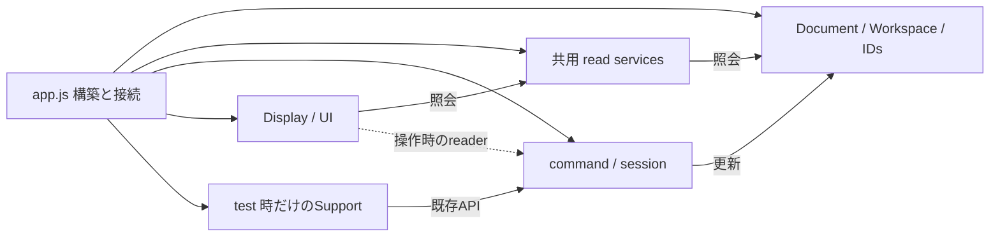

# Composition rootの残存責務と依存監査


## Selection編集の既存owner capabilityを通常生成へ接続（2026-11-12）

SelectionEditingFeature.prepare().createForDrawingは、既に受け取るinteractionからclearSelectionとisGeometryMode、presentationからupdateToolbar、persistenceからnormalizeGeometryInstanceを接続する。app.jsが同じ関数を別fieldで重ねて渡す責務を除く。新factory・global・可変slot・全体contextは追加せず、既存application ownerへ結線を集める。フォルダ配置は変更しない。

既存のdrawing分解とoptions rest copyの後、resetDrawing取得を従来位置で行う。copy済みoptionsで個別portが省略された場合だけ対応ownerの関数を一度取得する。明示ownのundefined／nullを含む上書きは維持し、未使用のowner getterは読まない。rest copyが継承fieldを除外する規則は維持する。関数を包装せず実関数を渡し、生成中に操作・scope読取・normalizeを実行しない。raw createForEditingによる個別注入は不変。

Deletion→Clipboardのnative生成順、実Selection／モデル／Commandの同一性、prepared Clipboardの完成公開と失敗時の以前のCommand保持は不変。Deletionが使うWorkspace.currentとClipboardが使うbound scopeを統合しない。UI・操作・履歴・保存形式v26とbind／start順は変更しない。SelectionEditingFeature.createForEditing以降の既存処理本体はソース照合で不変。

app.jsは1,168→1,167行（1行減）、非空白735→734行。root199文・360束縛、構築109文・422→421行、別名76行・bind35行・test hooks151行。四つの重複portを除き、新たな未束縛参照なし。行数目標200〜500行は未完了。

関連単体10件が成功。ownerの同じ実関数が遅延操作へ渡り、bare呼出しの引数・返値を保持すること、生成時の非実行、明示null／undefined時の未使用getter非評価、raw注入を確認した。native ClipboardSessionでcutが同じDeletionを使い、Workspaceのみの削除とbound model保持を維持することを検証した。

構文639ファイル・全単体2,664件・関連単体10件と通常ja/light・en/dark・test起動とcontest=1／test=0の計5条件が成功。関連E2E176件（5file、2.7m、exit 0）が成功。710入力と開始HEAD不変、filter三つ未設定、receipt exitCode 0／listeners 0、last-run passed／failedTests空を照合した。この単位では全E2E未実施。

## Document参照グラフの準備と解決関数の完成公開（2026-11-12）

DocumentWorkspace.prepareReferencesは実ConstraintReferencesを先に一度生成し、同じgraphのDocument生成入口を返す。app.jsは各既存機能の準備と表示生成を従来位置で行い、その後でprepared入口からDocumentWorkspaceを生成する。参照のgraph関数を実SketchContextへ接続し、Reference→Document→ReadContextというnative constructorの生成順を保つ。raw DocumentWorkspace.createによる個別graph関数の注入も維持する。

prepared DocumentのcreateReadContextは既存の実contextを生成し、完成したservices.reads.resolveGeometryRefを一度取得してから、参照graph向けにその実関数の完成参照だけを公開する。contextとそのcomponentは同じ実体を返し、model／配列／幾何を複製しない。公開前は元のresolveGeometryRef初期化前ReferenceError、Document／ReadContext生成やresolver取得失敗時は以前の完成参照を保つ。正常に取得したundefined／nullと未初期化を区別し、元のTypeErrorも維持する。

graph向けresolveGeometryRefは同じ名前・arity 1で、取得済みの実resolverをbare・一引数で呼び、refと返値・元例外をそのまま渡す。refや幾何結果をcacheしない。geometry readerは従来どおりWorkspace.currentを読み、最後のbound scopeへ置換しない。prepared graphは独立した参照ownerを持ち、そのgraphで最後に完成したread contextのresolverを使う。API containerを準備入口で結線し、各Document／Workspace／ID／query／serviceの実ownerは既存moduleに残す。

app.jsは1,168→1,168行（0行変化）、非空白735行。root199文・359→360束縛、構築422行・109文、別名76行・bind35行・test hooks151行は不変。preparedな生成入口の関数値が一つ増えるが、後段のresolveGeometryRefをroot callbackが読む依存は1→0となった。新file・global・汎用setter・registry・全体contextは追加せず、rootに可変参照・代入を追加しない。既存UI・操作・履歴・保存形式v26とbind／start順は不変。新たな未束縛参照なし。200〜500行の全体目標は未完了。

関連単体50件が成功。実派生参照の拘束graphとgeometry readerを使い、Workspace切替時に同じIDの新しい実Pointを解決し、bound scopeと混ざらないこと、独立した準備graphの分離とContext生成失敗時の保持を確認した。native constructor順と同じgraph関数の接続、coldなresolver取得と一度のcapture、receiver／引数・返値・元例外、constructor／reader getter失敗、invalid resolverのTypeErrorも検証した。ソース逆変換で既存Document・読取り・拘束本体と他のroot接続は不変。

構文639ファイル・全単体2,662件・関連単体50件と通常ja/light・en/dark・test起動とcontest=1／test=0の計5条件が成功。関連E2E193件（7file、4.3m、exit 0）が成功。710入力と開始HEAD不変、filter三つ未設定、receipt exitCode 0／listeners 0、last-run passed／failedTests空を照合した。この単位では全E2E未実施。


## 固定拘束queryを既存の結線済みscope照会へ接続（2026-11-12）

app.jsはConstraintReferences.createFixedStateのcurrentScopeへ既存DocumentWorkspace.readEditingScopeを直接渡す。editingScopeBinding.currentを読むroot callbackを除き、新しいfactoryや包装関数は追加しない。ConstraintReferencesは従来の関数portだけを受け、DocumentWorkspace／UIの新しい依存を持たない。比較には同じSelectionHighlight.sameConstraintDisplayElementを使う。

scope取得はquery操作時のまま、実bindingが指すmodelそのものを返す。Workspaceの直接activate／restoreとbinding切替の区別、未完成guard・元例外、裸のゼロ引数呼出しと返値を維持する。固定拘束の三query本体、enabledの厳密判定・最初の元拘束の返却・投影表示比較・endpointのraw Object同一性は変えない。readerの実体は既存の公開照会となり、root固有の別名関数を作らない。

新file・API・global・slot／model cache・registry・全体contextは追加しない。既存のDocument／Constraint／Selection owner、UI・操作・履歴・保存形式v26、初期化・bind／startの順は不変。フォルダ配置も既存ownerに合致しているため維持する。

app.jsは1,168→1,168行（0行変化）、非空白735行。root199文・359束縛、構築422行・109文、別名76行・bind35行・test hooks151行は不変。ASTでrootのeditingScopeBinding.current直接読取りは1→0か所となった。これはbound scopeの読取りの所有整理であり、他の後段依存や構築責務がすべてなくなったという意味ではない。新たな未束縛参照なし。200〜500行の全体目標は未完了。

関連単体52件が成功。実Document binding・固定拘束・SelectionHighlightを使い、旧callback経由と既存照会の直接接続で、Workspace切替／復元後の投影線・円弧端点の同一性判定・実拘束の返却・無効化・endpoint lock・getterの元例外が一致することを確認した。ソース照合で変更はrootの接続一か所のみ、ConstraintReferences／DocumentWorkspace／SelectionHighlightの本体は不変。

構文639ファイル・全単体2,660件・関連単体52件と通常ja/light・en/dark・test起動とcontest=1／test=0の計5条件が成功。関連E2E166件（5file、2.5m、exit 0）が成功。710入力と開始HEAD不変、filter三つ未設定、receipt exitCode 0／listeners 0、last-run passed／failedTests空を照合した。この単位では全E2E未実施。


## 保存準備とSketch移動の結線済みscope readerを共有（2026-11-12）

DocumentWorkspace.createPersistenceForWorkspaceはreadEditingScopeを省略した場合、同じDocument ownerの既存照会をcreatePersistenceへ渡す。現在形式の既定値取得→options展開→native persistence生成の順を保つ。明示own readerはundefined／nullを含めそのまま渡し、継承プロパティをoptions展開がコピーしない従来の規則も維持する。raw createPersistenceの直接注入は変更しない。

SketchEditingFeature.createForInteractionは保持済みDocumentWorkspaceから操作時に結線済みscopeを読む既定capabilityを、既存createへ接続する。createMove／createMoveWithInputはreader未指定の場合だけそのcapabilityを使い、明示own／継承readerとundefined／nullを優先する。reader名readEditingScope・arity 0、Docへのmember・ゼロ引数呼出し、返値と元例外、lookupをcommit時まで遅延することを保つ。raw createへの既定capabilityは任意であり、従来の個別reader注入と低水準生成APIを維持する。新しいwrapper層・input全体copy・未使用getterの評価は追加しない。

保存準備が使うbound scopeとwriterがsnapshotを取るWorkspace.current、移動queryが使うWorkspaceと再結線が使うbound scopeを混同しない。geometry／hatch cache無効化→bound scope読取→bundle生成→再結線→解析無効化→参照更新の順、Point／Selection／履歴一回、失敗時の復元、Command→Input生成→完成公開と明示bindは不変。native persistence／Move処理本体と公開owner、UI・保存形式v26は変えない。新file・global・可変slot／model cache・registry・全体contextを追加せず、フォルダ配置も維持する。

app.jsは1,168→1,168行（0行変化）、非空白735行。root199文・359束縛、構築422行・109文、別名76行・bind35行・test hooks151行は不変。二つのreadEditingScope中継を除き、rootがeditingScopeBinding.currentを直接読む箇所は3→1となった。残る一か所は固定拘束queryのcurrentScopeであり、全直接参照がなくなったとは扱わない。rootの後段可変参照・代入を追加せず、新たな未束縛参照なし。200〜500行の全体目標は未完了。

関連単体72件が成功。実保存writerの出力でWorkspaceとbound scopeの区別・v26を確認し、明示／継承／invalid readerの既存コピー規則も検証した。実Move CommandとInputの両入口で、省略と明示readerのPoint同一性・移動結果・refresh順・履歴一回が一致することを確認した。constructor中のscope非読取、Doc lookupのreceiver・ゼロ引数、未使用getter非評価とinvalid reader時の元の復元／履歴なしも確認した。ソース逆変換で既存保存・移動処理本体と他のroot接続は不変。

構文639ファイル・全単体2,659件・関連単体72件と通常ja/light・en/dark・test起動とcontest=1／test=0の計5条件が成功。関連E2E194件（7file、2.8m、exit 0）が成功。710入力と開始HEAD不変、filter三つ未設定、receipt exitCode 0／listeners 0、last-run passed／failedTests空を照合した。この単位では全E2E未実施。


## Parameter編集のWorkspaceと結線済みscope依存を整理（2026-11-12）

DocumentWorkspace.readEditingScopeは、既存の完成binding参照から現在の結線済みmodelそのものを返す。Hatch番号／Sketch配列の既定readerも同じ照会を使い、既存の初期化前ReferenceError・完成公開・失敗時の前回参照保持・raw binding生成の無公開を維持する。追加のslot・model copy・cacheは作らない。Workspaceを直接activate／restoreした場合とbinding.activateした場合の区別、実model／Solverの同一性も変えない。

ParameterEditingFeature.prepareForWorkspaceはcurrentNamespace未指定時に既存documentWorkspace.workspace.currentの実関数を一度取得し、名前空間準備と削除guardへそのまま渡す。currentScope未指定時は操作ごとにDocumentWorkspace.readEditingScopeをmember・ゼロ引数で呼ぶ遅延readerをParameterEditorへ渡す。reader名currentScope・arity 0、余分な引数の無視・返値／元例外を維持し、Feature生成時にはreadEditingScopeのlookupも行わない。NamespaceはWorkspaceの現在値、式参照候補は結線済みscopeを読む従来の違いを保持する。

明示currentNamespace／currentScopeはown／継承とundefined／nullを含め優先し、fallback ownerを読まない。ParameterEditor・ParameterApplication・DeletionGuard、既存のbinding／採番・外観reader・namespace更新・draftの確定／復元の全処理本体、raw生成API、UI・履歴・保存形式v26は不変。新file・global・registry・全体contextを追加しない。新しいscopeモデルではなく、既存Document ownerからの狭い照会を共有する。フォルダ配置も既存ownerに合致しているため維持する。

app.jsは1,169→1,168行（1行減）、非空白736→735行。root200→199文・360→359束縛、構築422行・109文、別名77→76行・bind35行・test hooks151行。currentParameterNamespaceの別名とParameter向けscope中継を除き、editingScopeBindingの初期化前root consumerは1→0か所となった。他の後段依存がすべて解消したという意味ではない。rootの後段可変参照・代入を追加せず、新たな未束縛参照なし。200〜500行の全体目標は未完了。

関連単体51件が成功。実Document binding照会のguard・scope切替・Workspace復元・再構築失敗時の保持を確認した。実ParameterEditorの式候補表示と名前空間準備／削除guardへ既定readerを接続し、Workspaceとbound modelの読取り先が混ざらないことを検証した。名前空間の関数同一性と一度の取得、scope readerのcold／live lookup・receiver／ゼロ引数・元例外、明示／継承overrideとinvalid値を保持することも確認した。ソース逆変換で既存Parameter・scope本体と他のroot接続は不変。

構文639ファイル・全単体2,655件・関連単体51件と通常ja/light・en/dark・test起動とcontest=1／test=0の計5条件が成功。関連E2E185件（7file、2.7m、exit 0）が成功。710入力と開始HEAD不変、filter三つ未設定、receipt exitCode 0／listeners 0、last-run passed／failedTests空を照合した。この単位では全E2E未実施。


## Hatch採番とSketch外観の結線済みscope照会をDocumentへ移管（2026-11-12）

DocumentWorkspaceは、同じWorkspaceで最後に完成したcreateEditingScopeの実EditingScopeBinding参照を保持し、既定のnextHatchIndexとcurrentSketchesをそのcurrentから操作時に読む。app.jsは二つの後段binding参照callbackを組み立てない。採番は既存DocumentIds／GeometryIds、外観解決はGeometryReadServices、現在scopeとSolverの結線はEditingScopeBindingが引き続き所有する。

binding→model queries→insertion→immutable cohort完成の従来順を保ち、全段階が成功してから実bindingの完成参照だけを公開する。最初の完成前は元のeditingScopeBinding初期化前ReferenceError、再構築失敗時は以前の完成参照を維持する。raw createScopeBindingでは公開しない。親／read context生成時にはscope・Sketch配列・Hatch番号を読まない。default callbackの名前nextHatchIndex／currentSketches・arity 0、実scopeのgetter receiver・返値／元例外と余分な引数の無視を保持する。実modelや配列のcopy・cacheは作らない。

Workspaceを直接activate／restoreしただけでは結線先を切り替えず、最後にboundとなったscopeのSketch配列・Hatch番号を使う。binding.activateが切り替えた実scopeを両方の読取りとSolverが共有する。予約処理はgeometry／attachments確保→Hatch番号読取→scope counter確保の元の順序を保ち、未初期化やgetter失敗時にも先行した予約を戻さない。明示readerはown／継承とundefined／nullを含め優先する。raw createGeometryReadServices／createScopeBindingと各native constructor本体、UI・操作・履歴・保存形式v26は不変。新file・global・汎用setter・registry・全体contextは追加しない。Document側の完成参照を一つ追加するが、scope値を二重所有しない。フォルダ配置は既存ownerに合致しているため維持する。

app.jsは1,170→1,169行（1行減）、非空白737→736行。root200文・360束縛、構築423→422行・109文、別名77行・bind35行・test hooks151行。ASTで初期化前のeditingScopeBinding参照は3→1か所となり、Hatch番号・Sketch配列の二中継がなくなった。Parameter編集向けの遅延scope readerは残る。rootの後段可変参照・代入を追加せず、新たな未束縛参照なし。200〜500行の全体目標は未完了。

関連単体46件が成功。実Hatch counter・外観reader・Workspace・Solverを使い、直接activate／restoreとbinding切替を区別した。未完成時の部分予約、native binding／query／insertion各段階での未公開と再構築失敗時の前回参照、raw binding生成の無公開、scope getterのreceiver／元例外、明示／継承readerと低水準生成APIの保持も確認した。ソース逆変換で既存scope・予約処理本体と他のroot接続は不変。

構文639ファイル・全単体2,652件・関連単体46件と通常ja/light・en/dark・test起動とcontest=1／test=0の計5条件が成功。関連E2E187件（7file、2.8m、exit 0）が成功。710入力と開始HEAD不変、filter三つ未設定、receipt exitCode 0／listeners 0、last-run passed／failedTests空を照合した。この単位では全E2E未実施。


## 重複拘束数の表示照会を解析ownerへ移管（2026-11-12）

SketchSolvingFeature.prepareのreadDuplicateCountは、既存の完成解析recordが保持する実contextのConstraintRedundancyから現在のcountを返す。app.jsはこの狭い照会をPresentationへ渡し、後段のconstraintRedundancyを捕捉するcallbackを組み立てない。countの保持・更新と拘束の分類は既存ConstraintRedundancy／ConstraintAnalysisに残し、表示側へ移さない。

完成解析recordには既存analysisと同じnative context参照を保持する。Contextは通常経路・注記drag付き経路ともimmutableな値プロパティのcohortであり、生成・公開時にredundancyやcountを先読みしない。readDuplicateCountはcount getterを実redundancy receiverで一回だけ読み、値・元例外をそのまま返す。最初のContext完成前は元のconstraintRedundancy初期化前ReferenceErrorを保ち、失敗したContext再構築では以前の完成recordを保持する。追加の可変slot・数値cacheやモデルsnapshotは作らない。

照会は現在のcached countを読むだけで、Workspace切替時にも解析を自動実行しない。通常のrefreshが件数を更新するまで以前の値を表示する従来の時機を維持する。戻り値の変換やゼロ補完はせず、callback名readDuplicateCount・arity 0と余分な引数の無視を保つ。既存のrefreshConstraintAnalysis、native context／solver／解析・重複判定の全本体、raw生成API、モデル・ID／scope／履歴・UI・保存形式v26は不変。新file・global・registry・全体contextは追加しない。既存の解析ownerに収まるためフォルダ配置も維持する。

app.jsは1,170→1,170行（0行変化）、非空白737行。root200文・359→360束縛、構築423行・109文、別名77行・bind35行・test hooks151行は不変。関数値を受け取るreadonly照会が一つ増えるが、既存の後段可変参照・代入は追加しない。ASTで旧constraintRedundancyの初期化前consumerは表示callback一か所だけと確認し、その遅延依存を所有者の完成recordへ移した。新たな未束縛参照なし。行数だけの削減は行わず、200〜500行の全体目標は未完了。

関連単体33件が成功。両native Context経路で実ConstraintRedundancyとApplicationFeedbackを接続し、cached countが0→1→Workspace置換後も1→通常refresh後0となること、表示messageとerror class、仮想注記scopeとWorkspaceの区別を確認した。構築中のcount／モデル非読取、live getterのreceiver・値／元例外、未初期化guard、準備／build／analysis取得失敗時の前回record保持、独立した準備ownerも検証した。ソース逆変換で既存解析・求解本体と他のroot接続は不変。

構文639ファイル・全単体2,649件・関連単体33件と通常ja/light・en/dark・test起動とcontest=1／test=0の計5条件が成功。関連E2E140件（5file、2.1m、exit 0）が成功。710入力と開始HEAD不変、filter三つ未設定、receipt exitCode 0／listeners 0、last-run passed／failedTests空を照合した。この単位では全E2E未実施。


## 実行バージョン表示の再表示参照をPresentationへ移管（2026-11-12）

PresentationFeature.createはrefreshVersionを未指定の場合、同じFeatureのcreateStartupが完成・公開した実RuntimeVersionViewへ言語変更時の再表示を委譲する。app.jsは表示Viewの後段束縛を持たず、再表示callbackを組み立てない。現在のRuntimeVersionView.renderをmember・ゼロ引数で呼び、返値と元例外をそのまま返す。default callbackの名前refreshVersion・arity 0、初期化前の元ReferenceErrorを維持する。

createStartupは実View生成→ApplicationSettingsの二つの設定関数取得→既存initialize関数と返却cohortの完成、という従来の生成順を保ち、その完成参照だけをprivateに公開する。native constructorや設定getterが失敗した場合は以前の完成Viewを保持し、明示undefined／nullの生成結果と未初期化を区別する。呼出し時のrender取得・receiver／引数／返値・例外、初期化のUI→描画→通知→言語→theme→バージョン読込→resize→surface開始の順を変えない。

明示したrefreshVersionはown／継承とundefined／nullを含め優先し、そのままApplicationSettingsへ渡す。raw createStartupの返すversionView／initializeも維持する。UIの完成参照をPresentationへ移すだけで、Git情報の検証・保持・DOM再表示はRuntimeVersionView、言語／theme・保存設定はApplicationSettingsが所有する。新file・global・model state／cache・registry・全体contextは追加しない。UI・操作・履歴・保存形式v26は不変。フォルダ配置は既存ownerに合致しているため変更しない。

app.jsは1,170→1,170行（0行変化）、非空白737行。root200文・360→359束縛、構築423行・109文、別名77行・bind35行・test hooks151行は不変。旧runtimeVersionViewのroot consumerは初期Presentationへ渡した再表示callback一か所だけであることをASTで確認し、その遅延依存を所有者内へ収めた。新たな未束縛参照なし。行数だけの削減は行わず、200〜500行の全体目標は未完了。

関連単体54件が成功。実ApplicationSettingsとRuntimeVersionViewの言語変更で、同じGit情報・dirty表示・unavailable表示が保持／翻訳されることを確認した。未完成時のguard、constructor中と設定getter中の公開時機、以前の完成View保持、実receiver・ゼロ引数・返値／元例外、明示／継承overrideを検証した。既存startupの初期化順・各段階失敗時の部分状態テストも実行した。ソース逆変換で再表示参照の所有以外の既存Startup／表示本体と他のroot接続は不変。

構文639ファイル・全単体2,647件・関連単体54件と通常ja/light・en/dark・test起動とcontest=1／test=0の計5条件が成功。関連E2E122件（5file、1.8m、exit 0）が成功。710入力と開始HEAD不変、filter三つ未設定、receipt exitCode 0／listeners 0、last-run passed／failedTests空を照合した。この単位では全E2E未実施。


## 幾何計算のorientation既定値を各機能へ接続（2026-11-12）

app.jsによるMIN_ORIENTATION_LENGTHの取出しと四つの生成先への指定をやめ、既存GeometryKernelの同じ定数を各機能の既定値にする。BasicDrawingTools.prepareGeometryForSolver・準備済みeditingのcreateCircleCenterCross、ConstraintEditing.prepareDimensionValuesのcreateForEditing、GeometryDragFeature.createForWorkspaceが対象。定数の値1e-9と、Solverから別途得る線分最小長の計算・許容誤差・求解の数値方針は変更しない。

位置引数の作図長は第二引数を省略した場合だけ既定にし、明示undefined／null／0／個別値を元のcreateLengthPolicyへそのまま渡す。Solver.minLineLengthを先に一度読み、次に省略時のKernel定数を取得して元のMath.max／fallbackを使う。object入力の三入口ではキーの存在で判定し、own／継承を問わず明示undefined／null／0／個別値を保持する。明示値があればKernel既定値を読まない。親Feature生成時に数値を先読み・cacheせず、従来の各生成段階で接続する。

個別GeometryCreation／CircleCenterCrossCommand／ConstraintSolvePreparation／GeometryDragPlan等の低水準生成APIと全計算・操作本体、native actor・scope／ID／Selection／履歴・部分失敗・UI・保存形式v26は不変。新file・global・state／guard・registry・全体contextや別の数値定数は追加しない。静的な幾何定義への依存を既存namespaceに明示し、個別検証の値注入を維持する。フォルダ配置は既存ownerに合致しているため変更しない。

app.jsは1,172→1,170行（2行減）、非空白739→737行。root200文・361→360束縛、構築424→423行・109文、別名78→77行。bind35行・test hooks151行は不変。新たな未束縛参照なし。行数差より、四つの数値既定値の中継をappから除く責務整理を成果とする。200〜500行の全体目標は未完了。

関連単体141件が成功。省略と元の定数注入が同じnative長さ・寸法編集・point dragを生むこと、live scopeと幾何同一性・履歴を維持すること、明示／継承値を保持し既定値を読まないことを検証した。Solver getter失敗時にKernelを読まない順序も確認した。ソース逆変換で既定値解決以外の計算・command本体と他のroot接続は不変。

構文639ファイル・全単体2,644件・関連単体141件と通常ja/light・en/dark・test起動とcontest=1／test=0の計5条件が成功。関連E2E152件（7file、14.3m、exit 0）が成功。710入力と開始HEAD不変、filter三つ未設定、receipt exitCode 0／listeners 0、last-run passed／failedTests空を照合した。この単位では全E2E未実施。

検証終了後、差分確認で検出したBasicDrawingTools単体file末尾の余分な改行一つだけを除去した。直前hashがE2E開始snapshotと一致し、trimEnd前後の実行ソースが同一であることを照合した。


## Sketch Treeの共有アイコンと固定操作の結線（2026-11-12）

SketchEditingFeature.prepareNavigationが返すediting.createTreeWithFixedControlsは、既存Toolbarの実アイコン生成→提供された固定操作factory→実Tree生成をまとめる。アイコンはToolbarへのmember・ゼロ引数呼出し、固定操作factoryはbare・一引数で呼ぶ。依存readerを各段階で呼び、固定操作のoperand→選択factoryの取出し→Tree依存取得という従来順序を保つ。Treeの生成・完成公開は既存createTreeForPresentationを使い、context menuのstartはappの従来位置に残す。

返すcohortは実icons・実Treeと後段の固定選択factoryそのものを保持する。固定操作／固定選択のstate・Solver・scopeは既存ConstraintEditingに残し、Treeに移さない。固定選択は同じ後段で一度生成する。rootの早期参照をASTで調べ、旧境界内のicons／operand参照はTree optionsだけで、固定選択factoryの外部consumerは後段のみと確認した。Tree optionsのreaderはroot公開前の二つの実actorを仮引数で受け、未完成root束縛を参照しない。

native TreeのController／View／Menuと固定操作・アイコン生成本体は不変。固定操作の先行公開をTree生成失敗時にも巻き戻さず、以前の完成Tree contextを保持する。scope／model／ID／Selection・UI・履歴・保存形式v26、raw生成APIを変えない。新file・global・state／guard・registry・全体contextは追加しない。生成順維持のため二つの依存readerを追加する負担はあるが、全アプリを渡さず同じTree構築段階に限定する。

app.jsは1,176→1,172行（4行減）、非空白739行は不変。root202→200文・362→361束縛、構築111→109文・424行。別名78行・bind35行・test hooks151行は不変。行数差は結線をまとめた際の区切り整理であり、実質の成果は三つの構築呼出しの順序を同じownerに置き、rootのoperand参照を除いたことである。新たな未束縛参照なし。200〜500行の全体目標は未完了。

関連単体83件が成功。実Treeへの固定解除portと同一actorの接続、bound viewと操作scopeの区別、実activation・menu起動、固定選択の後段初期化を確認した。icons→依存reader→固定操作→operand／選択factory取得→Tree依存reader→native Treeの順と各段階失敗時の先行公開・以前のTree保持も検証した。ソース逆変換で既存処理本体と他のroot接続は不変。

構文639ファイル・全単体2,640件・関連単体83件と通常ja/light・en/dark・test起動とcontest=1／test=0の計5条件が成功。関連E2E171件（8file、2.6m、exit 0）が成功。710入力と開始HEAD不変、filter三つ未設定、receipt exitCode 0／listeners 0、last-run passed／failedTests空を照合した。この単位では全E2E未実施。


## 共有確認ダイアログの所有とBlock command構築を整理（2026-11-12）

PresentationFeatureが共有ChoiceDialogの生成と要求入口を所有する。DocumentFileはPresentationのrequestChoiceへ接続し、rootの後段dialog参照を持たない。実dialogのshowをmember・一引数で呼び、Promise・結果・元例外を返す。生成前のReferenceError、生成失敗時の以前の完成参照、明示undefined／null生成後のTypeErrorを維持する。新しい状態はUIの完成参照だけで、選択肢・pending処理は既存ChoiceDialogに残す。

BlockEditingFeature.prepareCommandsWithViewのcreateWithSelectionは、実selection query→提供されたdialog factory→遅延command依存reader→既存command生成の順で接続する。factoryはbareゼロ引数、readerはbare二引数で同じqueryとdialogを受け、元のoptionsをそのまま既存createForFeatureへ渡す。完成した実queryと実commandsをimmutableなcohortで返す。root readerの仮引数が未完成のroot束縛を参照しないようにし、native dialogのlistener登録とcommand依存取得の前後関係を維持する。

旧境界の早期consumerはDocumentFileの遅延dialog要求一か所で、queryはcommand optionsだけが参照していた。dialog生成失敗時の以前の完成参照、command生成／updater取得失敗時の以前のupdater、既存の部分状態と元例外を維持する。native query・ChoiceDialog・Definition／Completion・Viewの本体と生の生成API、実actor同一性、scope／ID／UI・履歴・保存形式v26は不変。新file・global・registry・全体contextは追加しない。

app.jsは1,181→1,176行（5行減）、非空白740→739行。root204→202文・363→362束縛、構築425→424行・113→111文。別名78行・bind35行・test hooks151行は不変。行数差には不要になった区切りも含むが、成果はUI完成参照の所有移管とroot構築二文の統合である。新たな未束縛参照なし。200〜500行の全体目標は未完了。

関連単体80件が成功。実ChoiceDialogの表示・選択・取消・重複要求拒否、実Block commandとViewの共有・編集開始と取消復元を確認した。生成順、receiver／引数・返値・actor同一性、未完成時と各段階失敗時の公開状態も検証した。ソース逆変換で既存処理本体と他のroot接続は不変。

構文639ファイル・全単体2,638件・関連単体80件と通常ja/light・en/dark・test起動とcontest=1／test=0の計5条件が成功。関連E2E178件（7file、2.6m、exit 0）が成功。710入力と開始HEAD不変、filter三つ未設定、receipt exitCode 0／listeners 0、last-run passed／failedTests空を照合した。この単位では全E2E未実施。
## dragと入力の公開境界を整理（2026-11-12）

基準developはd9b997cd896474d19e60bcdb67befc7c3057c476。寸法Traversal→矩形選択の一括化は、旧rootでTraversal完成後・矩形選択生成前に公開されるdimensionLayerを早期CanvasRenderProbeが遅延参照するため見送った。診断のためだけに描画ownerへ新しい公開slotを増やさない。代わりにGeometry drag→拘束／寸法入力のlexical参照を照合し、入力完成前の実Geometry command consumerはゼロ、Geometry featureはcommand取出し一か所だけと確認した。実commandの取出しも同じ生成段階に残し、既存prepared ownerの完成公開を使って二生成を結線した。

GeometryDragFeature.prepareが返すcreateWithConstraintInputForWorkspaceは、既存の投影対応Geometry dragを完成・公開して実commandを取り出し、その後で提供された拘束／寸法入力factoryを呼ぶ。input factoryへは同じpointer・clearSnap・recordHistoryをbare・一引数で渡し、実Geometry feature／command・input・dimension draggingをimmutableなcohortで返す。app.jsはこの生成順とpointer／履歴の二重指定を担当せず、既存ownerの入口へ接続する。

GeometryのPlan／Solver／Editing／Command・Derived entry、ConstraintCommandInput→DimensionDragFeatureのnative生成順と全処理本体は不変。Geometry完成のprivate公開はinput生成前に行う。input factory／input取得／dragging取得が失敗したときも先行公開のGeometryを巻き戻さず、Geometry生成自体の失敗なら以前のprepared ownerを保持しinputを作らない。各actorと元例外・getterの読取順・実pointer・履歴callbackを維持する。rootのgeometryDragFeature／geometryDragは返却後の公開へ移るが、旧境界内のGeometry feature参照はcommandの取出しだけで、実commandを消費する外部callbackはなかった。早期のGeometry query／resetは従来から準備ownerを参照し、Dimension commandのroot公開位置は入力完成後のままである。rawの各生成API・寸法入力factory・mode／session／model／履歴／UI・保存形式v26を変えない。新file・global・可変slot／guard・registry・全体contextを追加しない。

app.jsは1,184→1,181行（3行減）、非空白742→740行。root206→204文・363束縛、構築426→425行・114→113文、別名79→78行。bind35行、test hooks151行は不変。rootの可変参照は追加せず、新たな未束縛参照なし。200〜500行の全体目標は未完了。

関連単体81件が成功。実Geometry dragの生成・Point操作と既存のConstraint／Dimension入力単体を実行した。新しい境界ではGeometryを先に公開すること、bare一引数と三つのport／返却actor同一性、input→draggingの取得順、生成時のscope／scale／pointer非読取、Point操作の履歴一回を確認した。native Geometry生成失敗・input生成／返却getter失敗での元例外・既存sessionと段階的公開の保持も確認した。ソース逆変換で既存Geometry／入力の本体と他のroot接続は不変。

構文639ファイル・全単体2,634件・関連単体81件と通常ja/light・en/dark・test起動とcontest=1／test=0の計5条件が成功。関連E2E180件（7file、4.7m、exit 0）が成功。710入力と開始HEAD不変、filter三つ未設定、receipt exitCode 0／listeners 0、last-run passed／failedTests空を照合した。この単位では全E2E未実施。

## 投影編集と作図構築の公開境界を整理（2026-11-12）

基準はdevelop 13651bdf774c901b78d53547164a32bf74e7d622。旧rootのGeometry・Projection editor・metadata二関数の全lexical参照を取得し、authoring完成前の同期関数consumerがConstructionだけであること、他のmetadata利用はPersistence・Solving・Properties・test支援の後段であることを照合した。Geometry実体のroot公開は移さない。以前の監査で見送った三段階の無条件な一括化をそのまま採用せず、Construction向けの完成capability公開をProjection Featureへ置き、editor→authoringの二段階だけをBasicDrawingToolsの準備済みGeometryへまとめた。以下の旧c4ef844監査は当時の境界として残す。

SketchProjectionFeature.createModelEditingForConstructionは既存の実Projection editorを生成し、完成した同期capabilityをConstruction向けに公開して同じeditorを返す。synchronizeConstructionMetadataはそのcapabilityだけを読み、未初期化時の元ReferenceErrorとbare・ゼロ引数・戻り値／元例外を保持する。同期関数は完成時に一度取得して保持し、raw createModelEditingは公開状態を変えない。計算と投影モデルの更新は既存SketchProjectionEditingが所有する。

BasicDrawingTools.prepareの準備済みGeometryが返すcreateAuthoringWithProjectionForEditingは、同じ実Geometryとreferencesで投影editorを完成・公開し、その後で既存の作図機能を一度生成する。返すcohortは実authoringと実projectionEditingを保持し、actorを複製・再生成しない。Geometryのroot公開は従来の位置のままとし、app.jsはこの段階の二つのfactoryを順に呼ぶ代わりに既存ownerの入口へ接続する。

AST参照を照合し、旧authoring完成前にmetadata同期を遅延参照する外部consumerはConstructionの一か所だけと確認した。rootのmetadata別名はcohort返却後に移るが、このconsumerは生成前から用意されたFeatureのguard付きportを使い、投影editor完成後・作図constructor中にも同期できる。未完成editor／同期capabilityの取得失敗では以前のcapabilityを保持し、作図の途中失敗では先行公開されたmetadataを戻さず、以前の完成済みauthoringを保持する。これは元の段階的公開であり、新しい一括rollbackを追加しない。rawの投影editor・Geometry／Authoring生成API、全native constructor本体と順序、model／ID／scope／Snap／commandの実体、UI・履歴・保存形式v26は不変。新file・global・model state・registry・全体contextは追加しない。Feature内の小さな完成capability参照を既存モデル状態と混同しない。

app.jsは1,186→1,184行（2行減）、非空白744→742行。root207→206文・363束縛、構築428→426行・115→114文。別名79行、bind35行、test hooks151行は不変。rootの可変参照は追加せず、新たな未束縛参照なし。200〜500行の全体目標は未完了。

関連単体81件が成功。実Geometry・Projection editor・Snap・作図commandによる旧順序との比較で、全actor同一性とscope／ID／line操作を確認した。作図constructor中のmetadata利用、投影生成・Snap／Spline／Line／Slot生成失敗の公開状態、以前のauthoring保持、元guard・callback名／arity・bareゼロ引数・元例外・capability取得失敗とraw APIの無副作用を検証した。実Construction切替で投影Splineのmetadata同期とGeometry同一性・通知／描画／履歴順も確認した。ソース逆変換で既存native factory／操作本体は不変。

構文639ファイル・全単体2,631件・関連単体81件と通常ja/light・en/dark・test起動とcontest=1／test=0の計5条件が成功。関連E2E192件（8file、2.8m、exit 0）が成功。710入力と開始HEAD不変、filter三つ未設定、receipt exitCode 0／listeners 0、last-run passed／failedTests空を照合した。この単位では全E2E未実施。

## 構築・公開段階の再監査（2026-11-12）

基準はdevelop c4ef8442003d2fe5a1f9447054b92cf0014dd524、app.jsのGit blobは5e086c3d9160c86193efb648ae013bca8de344fa。現物をtools/audit-composition-root.jsで再計測した。1,202行／非空白760行、root210文・369束縛、構築115文／435非空白行、別名・設定87行、bind35行、startup16行、その他呼出30行、条件付きtest hooks152行。115 initializerの生成元系譜を取得した。構文上の即時参照には循環がない一方、遅延callbackを含む依存には大きな循環成分が残る。これは起動の安全性や実ownerの循環を直接証明するものではない。

この単位は監査と再開方針の記録であり、製品・テスト・仕様の変更や責務分離の実装として数えない。app.jsは1,202→1,202行（0行変化）。空行削除や折畳みで目標へ近づいたと扱わない。

### 大きい接続文と既存owner

| rootの呼出し | 基準版行 | 非空白行 | 既存owner／接続の性質 |
| --- | ---: | ---: | --- |
| createPropertiesForEditing | 809 | 11 | PropertiesDisplayが編集とViewを順に生成。第二引数は編集生成後に読むView依存reader |
| prepareCanvasEditingInput | 963 | 11 | OperationSessions側からCanvas入力を準備。後続bindとKeyboard依存readerを分離 |
| createSelectionEditing | 588 | 10 | SelectionEditingFeatureが同じ削除・Clipboardを組み立て、画像Clipboard等の外部actorを共有 |
| geometryDragPreparation.createForWorkspace | 881 | 10 | GeometryDragFeatureがPlan／Solver／Editing／Commandを生成し、完成後にprepareへ公開 |
| createOperationSessions | 131 | 9 | 操作sessionと早期Previewを生成。後段のhit／offset／annotation等はcallbackで接続 |
| propertiesPanel.createWorkspace | 234 | 9 | CanvasDisplayのLayout／DimensionDisplay／DimensionInput全体が完成後にProperties用layoutを公開 |
| createConstraintEditing | 700 | 9 | ConstraintEditingがtargets／dimensions／controls等の実ownerと後段factoryを公開 |
| createCanvasScene | 246 | 8 | CanvasDisplayがgeometry／overlay／bounds／fitを同じWorkspaceから構築 |

上位8文の合計は77非空白行で、構築435行の一部である。各文の長さを巨大な未分離実装と読み違えない。現在の多くは実装本体を持たず、異なるownerの実actorや操作portを接続している。これらをそのまま一つのfactoryへ移すだけでは新しいcomposition rootを作ることになる。

### 公開段階をまたぐ一括化を採らない箇所

- Geometry作成→SketchProjectionEditing→投影metadata関数のroot公開→Authoring生成：連続しているが、先行Constructionのcallbackはmetadata関数を読む。ProjectionとAuthoringを一つの戻り値にすると、その関数のroot公開がAuthoring生成後へ遅れる。BasicDrawingTools.prepareのauthoring公開も全生成成功後である。読取時機の検証なしに一括化しない。
- Solve context→Viewport→GeometryMutation→Canvas Workspace：analysis／redundancyの完成公開、Viewport生成、checkpoint準備、LayoutとDimension部品の完成が別段階。Properties側はLayout単体の完成ではなくWorkspace全体の完成を待つ。これを単一のCanvas factoryへ押し込めると求解と履歴まで描画ownerへ流入する。
- Geometry／Authoring→Offset→Checkpoint／Solving→Fillet→Centerline／Preview→Spline／Hatch／Trim：既存actorがそれぞれ途中から利用される。後段でまとめるために既存actorを再生成したり、全command registryの保持slotとguardを増やしたりしない。作図集合の先行監査とも整合する。
- Canvas inputのprepare／bind、File exportのprepare／start：返却actorやcommandの公開が後段起動に先行する。二段階を一つのstartへまとめない。

### 今後の実装判断

次は大きな関数の移動ではなく、接続先が既に持つownerから導出できるportをrootが再構成している箇所を減らす。具体的にはGeometryDragFeatureへの投影queryとローカライズ済み拒否理由の結線を調べる。現在rootはSketchProjectionFeatureからqueriesとsketchProjectionShapeEditBlockedMessageを別々に抜き、ドラッグ名の翻訳と拒否文生成を合成している。投影機能が同じqueryと操作時の言語読取りを持つ狭いdrag capabilityを返し、GeometryDragFeatureが受け取る案を検討する。全Geometry dragを投影ownerへ移さず、既存raw API・明示override・拒否時のモデル無変更を維持する。採用前に参照数、生成時の無読取り、callback receiver／引数／例外、日英の言語変更を検証する。

これは次の候補を具体化する監査であり、200〜500行へ到達する行数・タスク数を約束しない。最終形に向けた構築境界の改善を継続し、単一portの移管だけで全体が完成すると扱わない。巨大context、不要なstate保持、通常featureからtestingへの依存は導入しない。

監査toolの既存単体6件が成功した。製品コードを変更していないため構文・全単体・E2Eは再実行しておらず、直前c4ef844の構文639・単体2,594・関連E2E150成功と区別する。最新コードの全E2Eは依然未実施で、main反映前に実施する。

## 作図コマンド集合の境界再監査（2026-11-11）

基準はdevelop 94b065322e57db90b8d5cbbf71ce6649c405fcd1、app.jsのGit blobはe1649b02cc3839cfa8c3a40a973d52c5b3adabf2。現物のBabel lexical bindingとObjectExpressionを照合した。app.jsは1,229行／非空白786行、root224文・376束縛、構築114文／447非空白行、条件付きtest hooks152行。この監査では製品・テストを変更せず、app.jsは1,229→1,229行（変化なし）。実装の分離単位として数えない。

Canvas入力のdrawingCommandsはcenterline／circleCenterCross／fillet／trim／offsetの5項目、Toolbarのdrawingはcenterline／circleCenterCross／projection／instances／fillet／blockCreation／offset／spline／hatchの9項目。共通はcenterline／circleCenterCross／fillet／offsetの4項目であり、同じ集合の二重構築ではない。生のactor参照を渡し、各消費側が既存click／start等を選ぶ現在の契約を確認した。

| root binding | 宣言行（基準版） | 通常参照／test参照 | 接続上の意味 |
| --- | ---: | ---: | --- |
| centerlineCommand | 358 | 4／1 | Preview、Lifecycle、Canvas入力、Toolbar、Canvasテストで同じactorを共有 |
| circleCenterCrossCommand | 450 | 2／0 | Canvas入力とToolbarだけから参照 |
| filletCommand | 328 | 3／0 | Lifecycle、Canvas入力、Toolbarで共有 |
| trimFeature | 924 | 1／1 | Canvas入力とTrimテストで共有。Toolbar項目には含まれない |
| offsetCommand | 315 | 3／0 | 寸法入力submit、Canvas入力、Toolbarで共有 |
| splineCommand | 306 | 3／0 | PointerとKeyboardの二経路、Toolbarで共有 |
| hatchCommand | 753 | 9／1 | 描画、Lifecycle、Properties、Pointer／Keyboard、Toolbar、Command panel、Document reset、Hatchテスト等で共有 |

参照数はlexical referencePathsの数であり、利用機能数や残タスク数ではない。例えば同じbindCanvasInput文のPointer optionsとKeyboard optionsを二参照と数える。installTestHooksの祖先functionを照合し、単純な名前検索でtest専用と判定していない。

### 比較した案と判断

- 後段で凍結command recordを一つ作る案：操作stateの複製は不要だが、集合を作る宣言とToolbar固有の追加項目が残る。Preview／Lifecycle／寸法submit等の先行利用も置き換えられず、主に対応表の場所が増える。この効果だけを根拠に新しいfactoryを作らない。
- BasicDrawingTools.prepareからcommand registryを公開する案：既に保持するauthoring／editing／centerline／trim／splineEditingと、現在保持しないcircle cross／offset／hatchを区別する必要がある。保持slot、生成成功時の切替、失敗時の前actor保持、各初期化前guardを新たに増やし得る。呼出し側の数行のためにactorの保持境界を広げる案は採用しない。
- 全command生成を一つの後段factoryへ寄せる案：Offsetのsubmit、CenterlineのPreview、Filletを使うLifecycle等がTrim生成以前に接続される。Hatchも描画側とLifecycle側では生成前にreaderを渡している。これらを同時生成へ変えると既存の準備・公開段階が変わるため採用しない。

巨大contextや新しい保持層へ置き換えることを、責務分離の進捗として扱わない。現在の二つの明示的な集合は消費側の異なる契約として残す。既存のBasicDrawingTools／CanvasInteractionFeature／PresentationFeatureと各commandの配置・通常動作は変更しない。

### 次の調査で確認するもの

単なるactor集合化を繰り返さず、PropertiesDisplay.createEditingWithViewForWorkspaceのediting生成→readViewOptions→view生成→成功時公開の境界を確認する。app.jsのProperties表示callbackには、既存feedback・layout・parameter editor等からのfield選択と、操作owner・DOM型の入力が混在する。既に捕捉したownerとの重複、callbackを読む正確な時点、生成失敗で以前のviewを保持する範囲を先に追う。新しいwrapperや共有contextを作ることは未決定であり、実質的な依存整理がない場合は採用しない。

再現には基準版のapp.jsを用い、tools/audit-composition-root.jsのauditSourceでroot計数を取り、Playwright同梱Babel parser／traverseのIIFE scope.getBinding(name).referencePathsで表の7bindingを照合する。drawingCommands／drawingのObjectExpression key列も照合する。line番号は基準版のものとし、将来のsourceの行番号へ流用しない。実行したread-only scriptとJSONは一時ディレクトリのcad-drawing-command-boundary-audit.{cjs,json}。未使用bindingや新たな未束縛参照を増やす変更は行っていない。

## テスト専用のroot別名とCanvas所有境界の再監査（2026-11-11）

基準はdevelop eb17cf5。app.js 1,241行、非空白798行、root227文・390束縛。Babel lexical bindingの全referenceがinstallTestHooks内にあるものを抽出すると24個あった。単なる名前検索ではなく参照先bindingと祖先functionを照合した。未使用・通常callbackとの混用とは区別する。

Canvas Workspace→寸法入力のfield取得→Scene生成は隣接するが、一括factoryから両recordを返すと、Scene生成中に使えるrootのsurface／寸法input等の参照が変わる。巨大な戻り値も必要であり、この一括移動は採用しない。初期化順を維持し、既存の実recordを適切な消費側へ渡す境界を優先する。

今回採用する七別名はSketch定数二つ、Block editing、注記leader描画、arc endpoint／spline hit、矩形選択描画。CanvasTestDriverが既にfixtureと観測を生成しているため、同じ実ownerから選ぶ。通常Frameの実actorは従来のbindingに残し、既存Frame bundleを新たに保持してテストへ渡す。実actorやpreview layerのAPIをテストのために拡張せず、readonlyの既存fieldだけを消費する。

app.jsは1,241→1,238行（3行減）、非空白798→795行、root227→226文・390→384束縛、構文依存辺1,065→1,063。テスト専用の七別名を除き、実Frame bundle一つの保持を加えたためroot束縛は差引六つ減る。別名・設定93→92行、test hooks157→155行。構築114文／449行、bind41行・委譲7行は不変。全体の200〜500行目標は未完了。

変更後に同じ抽出を再実行すると17個となる。これらには別TestDriver間で共有するhistory／clipboardや、通常factoryの一部であるCompletion等も含まれ、全てを単純削除可能とは扱わない。次の単位は実生成順・guard・現在scopeを維持できるowner入力から選ぶ。

関連単体21件・全単体2,545件・構文639fileが成功。既存の二つのScene比較テストへowner入力経路を加え、生成時のscope無照会、同じ描画支援・現在scope／pending／Selection／表示状態の観測、実profiler／PointerMoveSchedulerの計測とflush／生成失敗の同一性を確認した。新しい期待値や性能基準には変更していない。browser比較では実参照16項目、14fieldのreadonly、同じ実Frameと支援result、旧frame bindingの生成前ReferenceError、option／blocks／hitsのkey順・function名／arityと公開204項目が一致した。通常ja/light・en/darkとtest起動も成功。旧driver本体とCanvasDisplay／CanvasSurface sourceは不変で、新しい未束縛参照もない。

関連E2E504件（40file、9.0m、exit 0）が成功。709入力と開始HEAD不変、filter三つ未設定、receipt exitCode 0／listeners 0、last-run passed／failedTests空を照合した。最新の全体589件成功（f0a7954、30.0分）とは区別し、今回は全E2E未実施。


## Canvas入力の生成・公開・bind段階の再監査（2026-11-11）

基準はdevelop 1b273fd。現物のASTではapp.js 1,250行／非空白806行、root235文・393束縛、構築116文／466行、bind15文／27行、test hooks157行だった。前の生成元別集計は別commitのsnapshotであり流用しない。

CanvasDisplayのViewport→Workspace→Scene→Frameは、Dimension／Annotation／ReferenceImage／authoringの生成と相互に利用される。CanvasInteractionのPointerとKeyboardも、Scene queryと全commandの完成を待つ。単一の巨大createへ移す案、全test driverへ共通contextを渡す案は採用しない。現時点の構築466行をまとめて消せるとは見積もらない。

一方、Canvas入力には具体的な所有のずれがある。operationSessions.createMoveSchedulerへroot保持canvasInputBindingのreaderを渡し、同じsessions由来のcreateBindingが実体を生成するが、appが公開とbind、寸法bind、Keyboard生成・startを調整していた。実体はスケジューラ以外のroot機能に共有されず、Keyboard実体もstartにしか使わない。blank gestureはDocumentEditingResetと既存reset portへ共有するため元の生成・公開段階に残す。

採用した境界は、既存createBindingの成功時だけ実入力をsessionsへ保持し、その実入力を読むスケジューラを生成することと、同じprepared pointer APIがbindForEditingで後続の入力接続を行うこと。寸法inputは外部ownerの実体を受け取り、Keyboard optionsを遅延readerで渡す。入力生成前・生成後bind前・途中失敗の公開状態を区別し、各native actorのstateや処理を移さない。

app.jsは1,250→1,245行（5行減）、非空白806→802行、root235→231文・393→391束縛、構文依存辺1,072→1,067。構築分類は116文／466行から114文／449行、bind分類は15文／27行から14文／41行、起動分類は7→6行。二つの生成とbind／startが一つの接続呼出しになったため分類も変化しており、構築分類の17行減を実削減量とは扱わない。別名・設定93行、委譲7行、test hooks157行は不変。全体の200〜500行目標は未完了。

関連単体39件・全単体2,542件・構文639fileが成功。追加三単体は実PointerMoveSchedulerと既存入力fixtureを使い、旧接続との順序比較、生成前guard、八段階の元例外・途中公開状態、生成失敗時の前実体保持・成功時の切替、移動失敗後の継続とsession間の独立性を確認する。browserの旧root／旧module比較では、Pointer生成→bind→寸法bind→ショートカット→Keyboard生成→start、生成前ReferenceErrorの文言、bind時の実入力参照・member receiver／一引数、同じ実scheduler・optionのkey／function名／arityと公開204項目が一致した。通常ja/light・en/darkとtest起動も成功。宣言したowner変更を逆変換すると旧sourceと一致し、四つのnative actor sourceは不変。新しい未束縛参照もない。

関連E2E504件（40file、9.0m、exit 0）が成功。709入力と開始HEAD不変、filter三つ未設定、receipt exitCode 0／listeners 0、last-run passed／failedTests空を照合した。最新の全体589件成功（f0a7954、30.0分）とは区別し、今回は全E2E未実施。


## 再監査後の実装：Canvasの実Scene共有（2026-11-11）

基準bd96aa7から、下記の実Scene record候補を検証して採用した。八fieldの実recordは凍結own data propertyで、CanvasTestDriverは三fieldのみを読み、geometryDisplayの早期callbackは旧別名の初期化前guardを保つ。新たな大きなbootstrapやテスト専用wrapperを作らず、rootの四別名とdisplay再梱包を除いた。app.jsは1,264→1,264行（0行変化）、非空白819行のまま。四別名・22参照を整理し、うち二参照を含むdisplay再梱包を実Sceneで置換した。root束縛418→415、root文242→243、構文依存辺1,090→1,092。Scene保持と残る二別名の宣言を分けるためroot文・辺は増える。構築468→467非空白行、別名・設定99→100行、委譲11行とtest hooks158行は不変。行数・辺数の減少を成果として装わず、所有者の実recordと利用側の表示契約へ接続を揃える一単位である。200〜500行の全体目標は未完了。

詳細と検証はcomposition-root.mdの最新単位を参照する。以降の監査表・先頭行・候補はbd96aa7より前の6eed90dのsnapshotであり、最新sourceの計測として転用しない。新しい変更ではaudit toolを現物に再実行する。

## 段階的factoryの生成元を含む再監査（2026-11-11）

基準はdevelop 6eed90d、app.jsのGit blobはf3fad1acb1e07c46a304fb4e6a02c883a7f3fc93。app.jsは1,264行・非空白819行、root242文・418束縛、構築・接続114文／468非空白行、別名・設定99行、委譲11行、test hooks158行。今回のapp.jsは1,264→1,264行（0行変化）で、製品の分離実装を進めた件数には数えない。

### 生成元の系譜を再現する

tools/audit-composition-root.jsのconstructionOriginsは、rootの各Call／New initializerについて、対応するroot文ID、callee、構文上のwindow namespaceと取得pathを返す。例えばcreateCanvasWorkspaceはwindow.CanvasDisplayのprepareForWorkspace()→createForEditing()→createEditingWorkspaceから取得されている。constの単純別名と入れ子ObjectPatternだけを追い、変数の再代入・computed key・default／rest binding・循環・外部関数・windowのshadowingは推定しない。アプリは実行せず、getterや返値・関数本体も評価しない。

これは生成元の構文上の系譜であり、戻り値の実所有者、readonly data property、coldな生成、実行順や例外の同値性を証明しない。同じnamespaceから派生することだけでまとめて移動しない。複数initializerを持つ一文は各initializerを別記するため、集計時はroot文IDを重複除外する。既存の分類・束縛・依存辺・循環等の出力は変更していない。

次で現物から再生成できる。出力JSONは一時ファイルへ保存し、巨大なsnapshotをrepositoryへ追加しない。

```powershell
node tools/audit-composition-root.js
node --test tests/unit/composition-root-audit.test.js
```

### 生成元別の大きさと限界

| 構文上の生成元 | initializer数 | 対応root文の非空白行 | 宣言される束縛数 | 生成段階の先頭行 |
| --- | ---: | ---: | ---: | --- |
| CanvasInteractionFeature | 15 | 74 | 21 | 83〜1024 |
| CanvasDisplay | 10 | 49 | 37 | 205〜1058 |
| BasicDrawingTools | 11 | 42 | 20 | 127〜942 |
| ConstraintEditing | 8 | 36 | 28 | 50〜1077 |
| SketchEditingFeature | 5 | 27 | 6 | 74〜789 |
| BlockEditingFeature | 6 | 23 | 9 | 155〜822 |
| AnnotationFeature | 6 | 22 | 9 | 28〜697 |
| PresentationFeature | 7 | 22 | 9 | 35〜1054 |
| DocumentWorkspace | 6 | 20 | 18 | 44〜321 |
| PropertiesDisplay | 2 | 18 | 6 | 718〜841 |

これらは消せる行数や、独立した機能数ではない。CanvasInteraction由来の15生成は83〜1,024行に分散し、Pointer／Keyboardの前にScene query・注記・拘束・描画command等の実体を待つ。CanvasDisplay由来の10生成もViewport→Workspace→Scene→Frame→Preview／PNGへ分かれ、37束縛を他機能へ共有する。大きなcreate一つへまとめると、依存の早期読取りや大量の戻り値、別のapp bootstrapになりやすい。

### 次の境界の判断

一律のBrowserTestSupport（十九中継関数・190行増に対してroot9行減）や、hoisted関数を準備holderへ移すだけの単位を繰り返して200〜500行へ達するとは扱わない。次は、同じ実ownerの完成recordを共有できる境界を優先する。関数群の再梱包とschemaの二重管理を減らし、実操作は現在のownerへ残す。

最初の具体候補はCanvasDisplayの実Scene recordである。現在appはsketchStyle／geometry／overlay／bounds／fit／createHatchRenderingへ分解し、CanvasTestDriverにはbounds／fit／geometryを別のdisplay objectとして再梱包している。createForSceneはこのdisplayの三fieldを取出して既存描画支援へ接続しており、実Sceneを同じ限定用途へ渡せるか確認する。新しいテスト専用moduleを作らず、Sceneを可変app contextへ拡張しない。

実装前に、八つのScene fieldのown data property／freeze、三field以外をtest driverが観測しないこと、元の生成位置、早期callbackのgeometryDisplay初期化前guardを確認する。GeometryDisplayの早期参照を無理にrecord参照へ置換しない。Memberを裸関数へ渡す／member呼出しする違い、Snapshotとliveなscope、公開204項目の参照、native factory失敗時の途中状態を別途検証する。単なる一括置換や引数圧縮はしない。ここで示した候補は未実装で、実record・依存の確認後に範囲を決める。

### この監査の検証範囲

監査関連6件、全単体2,511件が成功。構文639fileは成功（exit 0）。実appに対する旧toolと新toolの旧field全体の比較が一致し、全114initializerの系譜を記録した。app／src／index／E2E／package／serverの差分はゼロ。今回の変更は開発用tool・その境界テスト・文書のみであり、E2Eは再実行していない。直前6eed90dの関連504件成功（9.0分）と、最後の全体589件成功（f0a7954、30.0分）は、その時点の結果として区別する。TEMP cad-construction-audit-{root,verified}.jsonとfocused／check／unit.logに証跡を保持する。


## 構築依存の再監査と次の分離境界（2026-11-10）

基準はdevelop `8162d28`、app.jsのGit blobは`57c7c49821c6f171f3bfed4c11f4715b56f56bd6`。`tools/audit-composition-root.js`と同じBabel ASTで再計測した。app.jsは1,349行・非空白903行、root289文・468束縛。直前の正式な全体検証は同じ製品／テスト入力で構文635file・単体2,446件・全E2E589件成功（22.6分）。本区切りは設計監査の更新のみで、製品・テスト・正式仕様を変更しない。

| 区分 | root文数 | 非空白行数 |
| --- | ---: | ---: |
| 構築・接続 | 114 | 488 |
| 別名・設定 | 89 | 120 |
| 委譲 | 41 | 43 |
| bind呼出し | 15 | 27 |
| policy値 | 10 | 10 |
| その他の呼出し | 11 | 35 |
| その他の関数 | 1 | 3 |
| 起動 | 7 | 7 |
| 条件付きtest hooks | 1 | 165 |

分類内の合計は898非空白行で、IIFE等の分類外5行を加えて903行となる。行数計測と責務の削減量は区別する。app.jsの空白行を削除したり、同じ引数を横に並べたりすることを、分離の進捗として扱わない。

### 委譲だけを削っても数百行には届かない

一文でmemberを呼ぶ委譲38個を、実ownerの宣言と最初の参照の位置で比較した。28個は最初の参照よりownerの生成が後にある。これは即時呼出しの証明ではなく、関数を渡す位置の構文上の比較である。hoisted functionをそのままconstへ替えると初期化前参照になるため、一括置換しない。

残り10個はdimensionLayout、resizeCanvas、deleteElements、deleteCurrentSelection、copyableSelectionPayload、drawDimension、handleConstraintOperandClick、startDimensionEditInput、markReferenceConstraint、resolveConstraintIntent。これらも直接別名にできると確定したわけではない。member receiver、引数の個数とdefault、戻り値・元例外、関数取得時機、owner APIのfreezeと通常propertyを個別に照合する必要がある。

仮に委譲43行・test hooks165行・別名120行を全て消せたとしても、非空白575行が残る。実際にはこれらの接続も必要なため、この仮定を削減見積りには使えない。200〜500行へ向けた中心課題は、構築488行の中から機能として一緒に生成・操作できる境界を整えることである。小さなadapterを移すだけで到達すると見積もらない。

### 優先候補：求解機能の段階的な生成と共有state

現在のSketchSolvingFeatureはScope query／Analysis／Redundancyと、後段のSketchSolving／ParameterStabilization／stored definition／SolveRefreshを既に組み立てる。一方、結果stateと受理関数はrootで別々に生成し、解析更新・求解更新もrootの遅延委譲を通る。

| 現在の段階 | 待つ依存・先行利用 | 次に確認する境界 |
| --- | --- | --- |
| ReferenceConstraintState生成（app127行） | DocumentWorkspace.currentとSketch照会。Projectionが直後から共有する | reference診断を求解ownerへ含める妥当性と同一state／scope・診断Map更新境界の維持 |
| SketchSolving.createState（179行） | Derived commandが189行から利用する | 同じstateを先に公開し、解析・求解へ一度だけ接続できるか |
| createResultAcceptance（235行） | acceptError。求解・円中心十字・Block commandで同じ関数を共有 | 受理policyと明示callbackの上書き／null／未指定を混同しない入口 |
| createContextForWorkspace（252行） | ConstrainedAnnotationDrag、PointUsage、solver、minimumLength | AnnotationのscopeとWorkspace scope、遅延plan／drag callbackの維持 |
| createSolving（367〜368行） | checkpoint、Geometry、Projection編集、履歴、EditingScope | 現在Workspaceと最後にactivateしたscope、求解失敗復元・UI／履歴順の維持 |

解析更新callbackの最初の受渡しはapp108行で、結果state生成より早い。SolveRefreshの呼出しcallbackもapp197行から渡される。単一のcreateへ一括移動する案は、この順序を満たさない。ReferenceConstraintStateと結果stateの生成はMapとclosureの確保にとどまり、createResultAcceptanceもclosure生成だが、生成位置の移動を無条件に許可する根拠にはしない。

次の実装では、既存SketchSolvingFeatureが実componentを生成する段階的な入口を持つ案と、初期の遅延callbackをrootへ残す案を比較する。単なるstate代入用setterや、外部で生成したcomponentを格納するだけのholderは採用しない。実stateを共有すること、解析と求解をcoldに生成すること、初期化前呼出し・構築失敗・明示callback・receiver／引数／返値と例外、求解／Parameter失敗時の復元範囲を境界テストで確かめてから実装単位を確定する。数値閾値・Solverアルゴリズムはこの責務分離と混ぜない。

### 同時に広げないもの

Selectionの削除操作はDeletionFeatureのremove／removeSelectionとして既に実装済みで、rootの二委譲の最初の参照はowner生成後である。直接APIを利用できるか確認する候補だが、これだけを大きな責務分離とは扱わない。Parameterのsymbol削除guardはDerived／Block／Annotation／Spline／全体削除／Sketch削除の各経路が共有するため、UIのParameterEditorへ押し込まない。

起動列はDocument reset→Presentation初期化→履歴→file checkpoint→FileFeature.startという複数ownerの順序である。FileFeatureだけの責務にはしない。test hooks全体を別の巨大bootstrapへ移す案や、全driverに共通の汎用app contextを配る案も採用しない。

配置は既存のsrc/application/sketch_solving_feature.jsを第一候補とし、求解実装と数値policyはsrc/solver、参照診断はsrc/constraintsに残す。テスト支援はsrc/testingのままとする。実際の責務が決まる前に、新しいbootstrapフォルダや汎用生成レジストリを作らない。この監査は次の判断の根拠であり、上記候補の実装完了や200〜500行への到達を意味しない。

## Toolbar／Workspace controlsの段階的な組立て（2026-11-10）

toolbarPresentation.prepareWorkspaceが編集Toolbar bindingの生成と既存Workspace controlsの準備を同じPresentation owner内で行い、実close／startと後段createDrawingBindingを返す。rootはcloseAppMenusを公開してstartし、その後に実描画bindingを生成・bindする。既存のcreateEditingBinding／createDrawingBinding／prepareWorkspaceControlsは維持する。新しいUI session・model・登録用setterを作らない。

rootはcenterline／cross／projection／instances／fillet／Block作成／offset／spline／Hatchの実commandを限定したdrawing recordで渡す。開始handlerをどのmethodから取得するかはPresentation側が所有する。七つの旧handler別名を削除した。開始methodは凍結APIのdata propertyで、後段で選択しても旧別名と同じ関数となる。直接登録されるDOM handlerのthis／eventと返値、型指定されるInstance開始の裸呼出し、fillet／offsetのbind時のhandler選択はraw ToolbarViewのままである。

app.jsは1,456→1,451行（5行減）。編集生成→編集bind→Canvas controls bind→menu生成→close公開→navigation／layout／Parameter／appearance／settings／Block起動→描画生成／bindの順を保つ。再startで描画bindingを暗黙再生成せず、部分登録や元の例外を隠さない。AST比較で対象cohortと七別名以外のroot全体・相対順、引数recordとhandler対応、既存Presentation／raw ToolbarView／Menus／Flyouts／command／保存／index／全E2E不変、新しい未使用／未束縛参照なしを確認した。関連単体46件、構文632file・全単体2,351件・関連E2E273件が成功（15file、4.0m、exit 0）。四つの追加単体で編集準備→close公開→Workspace start→描画生成／bindの順、直接DOM handlerのidentity／this／event／返値とtyped Instance開始、delete guard、各構築・起動例外と部分登録、既存start繰返しと暗黙の描画再生成なしを新旧比較した。702製品／test／検証入力と開始HEAD不変、選択15fileのtest list273件一致、三つのCAD filter未設定、receipt exitCode 0／listeners 0、last-run passed／failedTests空を照合した。通常二経路／test一経路の起動もbrowser errorなし。TEMP cad-toolbar-workspace-assembly-{focused,check,unit,e2e,proof,smoke}.logと検証JSONに証跡を保持する。既存機能の期待値・性能閾値・timeoutは変更していない。この単位では全E2Eを実行しておらず、直前45cc3a7の全589件成功とは区別する。

基準develop 45cc3a7、作業branch codex/toolbar-workspace-assembly、開始時週枠残量32%。直前45cc3a7の全E2E589件成功（22.1分）と今回の関連検証を区別する。全体目標は未完了。mainは停止条件到達時の最新全体検証後に最後に反映する。


## Canvas pointer構築の二段階所有（2026-11-10）

CanvasInteractionFeatureのcreateEditingInputが返すpreparePointerForEditingは、同じauthoring・Lifecycle／Pending／Constraint target・offsetから実BlankCanvasGestureを生成して返す。後段createBindingが同じScene query／Hover・Instance sourceでpress／hoverを生成し、既存Pointer sessionへ接続した後、明示された実CanvasDisplay factoryで未bindのnative bindingを直接返す。入力機能に必要な固定componentだけを選択して保持し、設定object全体やapp contextを保持しない。

rootは空白操作を公開してから後段へ進み、native bindingを公開してからbindする。dimensionInput.bind→keyboard生成／startも従来位置に残す。空白操作のreset callbackとscheduler.readInputのTDZ境界、pointer構築失敗時の以前のcontroller、接続後のnative生成失敗と部分イベント登録を維持する。新しいmodel／session／cache・公開setterは作らない。既存bindPointer／createKeyboardを維持し、raw CanvasCommandInputs／PointerInteractionController／CanvasInputBinding／BlankCanvasGestureは変更しない。

app.jsは1,468→1,456行（12行減）。rootに残っていたScene query・Pointer controller・native bindingの関係を実入力featureが組み立て、rootのpress／hover／空白判定の中間別名を除いた。AST比較で対象cohort以外のroot全体と相対順、四つの引数recordの対応、既存本体とraw input／保存／index／全E2E不変、新しい未使用／未束縛参照なしを確認した。関連単体87件、構文632file・全単体2,347件・全E2E589件が成功（50file、22.1m、exit 0）。五つの追加単体で空白操作の先行公開、同じScene／Pointer session／nativeのidentity、生成中のcallbackとTDZ、panel→PNGの優先順・座標／移動・keyboard取消、各構築例外と以前のcontroller、native生成失敗後のPointer接続、bind失敗時の部分登録を新旧比較した。702製品／test／検証入力と開始HEAD不変、全50fileのtest list589件と無filter一覧一致、三つのCAD filter未設定、receipt exitCode 0／listeners 0、last-run passed／failedTests空を照合した。通常二経路／test一経路の起動もbrowser errorなし。TEMP cad-canvas-pointer-assembly-{focused,check,unit,e2e,proof,smoke}.logと検証JSONに証跡を保持する。既存のAPI key列挙の期待値には新methodを追加したが、既存機能の期待値・性能閾値・timeoutは変更していない。全体目標は未完了。

基準develop ade455f、作業branch codex/canvas-pointer-assembly、開始時週枠残量33%。[構築境界の監査](feature-construction-boundaries.md)で選んだ二段階案を実装した。監査の旧行番号は基準4e80981のsnapshotとして保持する。全体目標は未完了。mainは停止条件到達時の最新全体検証後に最後に反映する。


## 機能単位の構築境界の再監査（2026-11-10）

基準develop 4e80981で、残る構築・接続を機能単位で比較した。[構築境界の再監査](feature-construction-boundaries.md)に入力／出力、生成・bind順、初期化途中のcallbackと失敗時の公開状態を記録した。Canvas pointerの範囲は非空白22行・root入力33束縛に対し、外部利用はblankCanvasGesture／canvasInputBindingの二つ。既存CanvasInteractionFeatureの入力featureへ二段階でまとめる案を次の実装候補とする。native bindとdimension bindはrootの従来位置に残す。

Propertiesは既に同じfeatureが段階生成を所有し、単一bag化だけでは依存が減らない。起動は言語／Canvas／file lifecycleを横断するためFileFeatureへ一括移管しない。監査は構文分類であり、callbackの同期実行や動的な生成順の証明とは区別する。製品・テスト・tool・正式仕様は変更していない。app.jsは1,468→1,468行（0行変化）。提案は未実装、全体目標は継続中。

作業branch codex/feature-construction-audit、開始時週枠残量33%。次は上記のCanvas入力案を実コードと新旧比較で検証し、実装・検証・Commit／Pushを別の単位として行う。mainは停止条件到達時の最新全体検証後に最後に反映する。


## Hatch authoringの共有owner接続（2026-11-10）

BasicDrawingTools.createGeometry().createAuthoringForEditingが返すcreateHatchForEditingは、同じread servicesのHatch照会、interaction.lifecycle.readMode、sessions.pointer.readLastPointerとDocumentWorkspace.documentIdsを既存createHatchへ接続する。rootは後段のupdateStatusUI／hatchRegionErrorTextだけを渡す。raw createHatchと実Hatch commandを維持し、新しいcommand／session・採番・preview／Selection・cacheを作らない。

Hatchの生成位置はSketch Move input bind後の従来位置を保つ。mode／pointer／scopeと採番値は操作時に読み、親authoringと同じPreview・Selection・Sketchを使う。Geometry IDsとDocument IDsを混同せず、scope交換後も同じDocument counterを使う。ガード拒否、照会・採番・生成例外、callback receiver、返値と履歴のまとまりは従来どおりである。

app.jsは1,471→1,468行（3行減）。rootの生成引数は六つから二つへ減った。AST比較で対象Hatch生成以外のroot全体と相対順、所有側の追加factory以外の既存本体・API、raw Hatch command／保存／index／全E2E不変、新しい未束縛参照なしを確認した。関連単体51件、構文632file・全単体2,342件・全E2E589件が成功（50file、22.1m、exit 0）。三つの追加単体でraw／owned生成の実commandの比較、mode／pointer・scope交換と同じPreview／Selection、Document採番・Geometry counter不変、ガードと照会／採番・生成失敗の例外境界と実返値identityを確認した。702製品／test／検証入力と開始HEAD不変、全50fileのtest list589件と無filter一覧の一致、三つのCAD filter未設定、receipt exitCode 0／listeners 0、last-run passed／failedTests空を照合した。通常二経路／test一経路の起動もbrowser errorなし。TEMP cad-hatch-authoring-ownership-{focused,check,unit,e2e,proof,smoke}.logと検証JSONに証跡を保持する。既存テスト期待値・性能閾値・timeoutは変更していない。全体目標は未完了。

基準develop a2a769f、作業branch codex/hatch-authoring-ownership、開始時週枠残量34%。Sketch navigationとPNG exportの参照所有を含む最新状態で全E2Eを実行する。全体目標は未完了。mainは停止条件到達時の最新全体検証後に最後に反映する。

次の優先作業は構築依存の再監査とする。現在app.jsは非空白1,019行、root325文／536束縛で、構築・接続118文／515行、test hooks202行、delegate60文／70行を占める（TEMP cad-hatch-authoring-ownership-audit.json）。後段可変参照は解消済みであり、小さい接続を追加分離するだけでは数百行へ収束すると見積もらない。既存featureが所有すべき複数componentの生成・接続を対象に、入力／出力、共有owner、生成・bind・start順と例外境界を調べて候補を比較する。起動時のDocument reset→Presentation初期化→履歴→file checkpoint／startも調査候補だが、FileFeatureへ移すことを先に決定しない。実コードではPresentation初期化が言語／テーマ・version読取り・Canvas resize／surface.startを含み、FileFeature.startはbeforeunloadとstartup document読込を始めるため、一括移管はFileFeatureの責務を広げる。複数featureの起動順としてrootに残す案も比較する。巨大context・単なるcall列の移動・行数目的の圧縮は採用しない。


## PNG exportの段階的な参照所有（2026-11-10）

PngExport.prepareが実export featureの生成・成功後の保持とreadCommand／cancel／startを所有する。CanvasDisplayのcreatePngExportは既定では従来のPngExportを使い、明示された実export componentにも同じ依存を渡せる。rootは早期のread／cancelを同じownerへ接続し、後段で実commandをconstとして受け取る。外部setterや任意factoryの登録は設けず、mode session・描画buffer・保存transactionを複製しない。

生成前のreadCommandはnull、cancelは従来どおりnullのcancel読取りで例外となる。生成が完了するまで旧featureを保持し、完了後はstart前に新featureを公開する。bind失敗による自動巻戻しは加えない。start／cancelは実componentへのmember callで、返値・元の例外を保つ。実commandはraw createが返す凍結featureのdata propertyであり、遅延readは同じidentityを返す。raw PngExport.create・PNG command・保存とcapture復元の処理、rootでの生成／start順を維持する。

app.jsは1,472→1,471行（1行減）。rootの最後のletと公開用代入がなくなった。AST比較で対象参照・factory接続以外のroot全体と相対順、raw PNG factory不変、CanvasDisplayの既存依存不変、後段constへの早期参照なし、新しい未束縛参照なしを確認した。関連単体49件、構文632file・全単体2,339件・関連E2E262件が成功（13file、3.9m、exit 0）。追加五単体で初期null／cancel例外、明示start前の無動作、四つの構築失敗境界、start失敗時の新command保持、cancelのreceiver・返値・例外同一性、実CanvasDisplay経由での保存と同じbitmap／viewport復元を確認した。700製品／test入力と開始HEAD不変、選択13fileのtest list262件一致、三つのCAD filter未設定、receipt exitCode 0／listeners 0、last-run passed／failedTests空を照合した。通常二経路／test一経路の起動もbrowser errorなし。TEMP cad-png-export-lifecycle-{focused,check,unit,e2e,proof,smoke}.logと検証JSONに証跡を保持する。既存テスト期待値・性能閾値・timeoutは変更していない。この単位では全E2Eを実行しておらず、a6912a5の全589件成功とは区別する。

基準develop 232bb45、作業branch codex/png-export-lifecycle、開始時週枠残量35%。直近a6912a5の全E2E589件成功（22.1分）と今回の関連検証を区別する。全体目標は未完了。mainは停止条件到達時の最新全体検証後に最後に反映する。


## Sketch navigationの段階的な参照所有（2026-11-10）

SketchEditingFeature.prepareNavigationが、後段で生成される実Sketch Move commandとTree context menuの参照を所有する。早期のcloseContext／resetMoveとreadMovingを公開し、createForInteractionの同じ実featureからcreateMoveWithInput／createTreeForEditingを呼ぶ。参照は各factoryの成功後にのみ公開する。外部setterは設けず、commandの操作stateやmenu sessionを複製しない。既存raw create／createForInteractionは変更しない。

rootは早期のscope bindingとPresentationへ同じ意味の入口を渡し、後段では実command／menuをconstとして受け取る。初期化前のoptional close／resetは無操作、readMovingは従来どおり未生成のactive読取りで例外となる。生成失敗は以前の参照を保ち、生成後のinput.bind／menu.start失敗では新しい参照を保つ。publish→bind／startの相対順、member receiver・返値・元の例外、Workspace切替・Selectionと履歴の動作を維持する。

app.jsは1,475→1,472行（3行減）。rootの可変component参照を二つ減らし、残るletはPNG export commandだけ。AST比較で対象参照・factory入口・公開位置以外のroot全体と相対順、raw factoryの全体不変、早期callbackのoptional member call／active読取り対応、新しい未束縛参照なしを確認した。関連単体21件、構文632file・全単体2,334件・関連E2E278件が成功（15file、4.4m、exit 0）。追加四単体で初期化前の境界、実Moveの公開と入力bind、command／input構築失敗とbind失敗の違い、実menuの公開とstart／closeの返値・receiver・例外、再構築失敗時の旧参照、workspaceごとの独立性を確認した。700製品／test入力と開始HEAD不変、選択15fileのtest list278件一致、三つのCAD filter未設定、receipt exitCode 0／listeners 0、last-run passed／failedTests空を照合した。通常二経路／test一経路の起動もbrowser errorなし。TEMP cad-sketch-navigation-ownership-{focused,check,unit,e2e,proof,smoke}.logと検証JSONに証跡を保持する。既存テスト期待値・性能閾値・timeoutは変更していない。この単位では全E2Eを実行しておらず、直前a6912a5の全589件成功とは区別する。

基準develop a6912a5、作業branch codex/sketch-navigation-ownership、開始時週枠残量35%。直前a6912a5の全E2E589件成功（22.1分）と今回の関連検証を区別する。全体目標は未完了。mainは停止条件到達時の最新全体検証後に最後に反映する。


## Splineブラウザ支援のWorkspace組立て（2026-11-10）

SplineTestDriver.createForWorkspaceが、隣接していたsetup／transferの生成を同じGeometry・Workspace・SelectionとBlock機能から組み立て、実APIをsetup／transferとして返す。既存create／createTransferはそのまま維持する。Spline拘束型と注記styleの選択、採番、Documentへの定義追加も同じ実ownerから取得し、rootの個別部品選択を減らす。Clipboardの入口は既存の関数を明示入力として保持する。

setupのreadSplineはbound editing scope、transferはWorkspace.currentを従来どおり使う。mode／Spline編集session、採番・モデル・DOMは操作時に読み、Geometry同一性、裸callback／member receiver、例外の短絡、setup→transferの生成順を維持する。通常起動では生成せずtest queryの条件内に残す。新しいモデル・Selection・clipboard session・cache・listenerは作らない。.jot2d v26の形式と移行、BrowserTestApi・全E2Eは変更しない。

app.jsは1,485→1,475行（10行減）。不要になった三つのimport別名も除去した。AST比較で対象二factoryとimport以外のroot全体・相対順、既存raw factoryの全体、所有側の全引数値／callbackの対応一致、新しい未束縛参照なしを確認した。新しい単体fileは構文・全単体の明示一覧に追加した。新旧比較単体3件、構文632file・全単体2,330件・全E2E589件が成功（50file、22.1m、exit 0）。実Geometryを使ったsetup／観測／拘束追加とtransferの返値・callback順・receiver、bound scopeとWorkspaceの分離、mode／編集sessionの遅延読取り、各失敗境界の例外同一性を確認した。702製品／test／検証入力と開始HEAD不変、全50fileのtest list589件と無filter一覧の一致、三つのCAD filter未設定、receipt exitCode 0／listeners 0、last-run passed／failedTests空を照合した。通常二経路／test一経路の起動もbrowser errorなし。TEMP cad-spline-browser-support-{focused,check,unit,e2e,proof,smoke}.logと検証JSONに証跡を保持する。既存テスト期待値・性能閾値・timeoutは変更していない。全体目標は未完了。

基準develop 8208e1a、作業branch codex/spline-browser-support、開始時週枠残量36%。全体目標は未完了。直近の注記hit・Instance正規化を含む最新状態で全E2Eを実行する。mainは停止条件到達時の最新全体検証後に最後に反映する。


## 編集Instance正規化のWorkspace既定値（2026-11-10）

DocumentWorkspace.createReadContext().createPersistenceが、既存GeometryInstance codecと同じWorkspaceのSketchContextを接続し、normalizeGeometryInstanceを公開する。Sketch指定がfalseyなら操作時のactiveSketchIdをString化する従来の既定resolverを所有する。raw geometryInstances APIとDocumentLoadingの明示resolverは維持し、保存検査に編集時の既定値を混ぜない。.jot2d v26の形式・移行・幾何モデルは変更しない。

app.jsの早期利用されるhoisted関数は(raw, ...args)の委譲として残す。元のarity 1、引数既定値、呼出しごとのresolver生成、裸activeSketchId呼出し、codecのmember receiverと三引数制限、返値・例外を保つ。現在のWorkspaceとbound preparation scopeを混同せず、create時にSketchを読まない。既存Sketch照会の不足項目補完も維持する。モデル・session・cache・listenerを追加せず、既存module内で責務を整理する。

app.jsは1,487→1,485行（2行減）。AST比較でrootの対象別名と委譲関数以外の全体・相対順、所有側の既定値と関数本体の一致、既存API、raw persistence／index／全E2Eの不変、新しい未束縛参照なしを確認した。関連単体24件、構文631file・全単体2,327件・関連E2E244件が成功（9file、3.7m、exit 0）。三つの追加単体でWorkspace切替とbound scopeとの分離、旧rootとの既定値・返値・例外比較、codec receiver・三引数・fresh resolver・遅延Sketch読取りを確認した。699製品／test入力と開始HEAD不変、選択9fileのtest list244件一致、三つのCAD filter未設定、receipt exitCode 0／listeners 0、last-run passed／failedTests空を照合した。通常二経路／test一経路の起動もbrowser errorなし。TEMP cad-editing-instance-normalization-{focused,check,unit,e2e,proof,smoke}.logと検証JSONに証跡を保持する。既存テスト期待値・性能閾値・timeoutは変更していない。この単位では全E2Eを実行しておらず、2d1d487の全589件成功とは区別する。

基準develop b313085、作業branch codex/editing-instance-normalization、開始時週枠残量36%。全体目標は未完了。mainは停止条件到達時に最新の全体検証を行って最後に反映する。


## 注記hitのScene scopeポリシー（2026-11-10）

CanvasHitInteraction.createSceneWithAnnotationsForWorkspaceで、raw Annotation spatial queryと同じSceneのScope Policyを接続する。通常選択時は全Sketch、mode／pending／constraint操作中はactiveOnlyを既定とし、caller optionsを後から展開する従来の関数本体をそのまま所有側へ移した。返すhitAnnotationElementをScene内部query・Parameter参照入力・Browser注記支援で共有する。

raw注記queryとordinarySelectionModeの裸呼出し、三引数への制限、options既定値{}とnull／明示undefined／Symbol key、policyの毎回読取りと短絡順、返値・例外を維持する。既存raw AnnotationSpatialQueryとGeometryHitQueryは不変で、可視性・注記参照と部位判定はそのownerに残す。新しいmode／pending／selection・cache・listener・edit guardは作らない。createSceneとcreateQueriesは従来同様にモデルを読まず、raw Scene／Workspace factoryも維持する。

app.jsは1,490→1,487行（3行減）、非空白1,041→1,038行。rootのhit判定本体とraw query別名を除き、ordinarySelectionModeは描画順の後段入力にも使うため同じpolicyから保持する。AST比較でscoped hit関数全体の一致、対象構築・別名以外のroot全体と相対順、既存module API・raw spatial／hit query・index・全E2E不変、新しい未使用／未束縛参照なしを確認した。

関連単体21件、構文631file・全単体2,324件・関連E2E331件が成功（13file、5.2m、exit 0）。三つの新旧比較で裸query・引数制限・既定options／上書きとpolicyの短絡読取順・元の例外、実注記identityと選択／操作中／可視性／モデル差替え、policy／geometry構築失敗時の無読取りを確認した。内部queryと公開判定で同じpolicyを使い、ロックの独自filterを加えていない。699製品／test入力と開始HEAD不変、選択13fileのtest list331件一致、三つのCAD filter未設定、receipt exitCode 0／listeners 0、last-run passed／failedTests空を照合した。通常二経路／test一経路の起動もbrowser errorなし。TEMP cad-annotation-hit-policy-{focused,check,unit,e2e,proof,smoke}.logとsource-hashes／selection／filter-environment／e2e-receipt／last-run JSONに証跡を保持する。既存テスト期待値・性能閾値・timeoutは変更していない。この単位では全E2Eを実行しておらず、直前2d1d487の全589件成功とは区別する。全体目標は未完了。

基準developは2d1d487、作業branchはcodex/annotation-hit-policy、開始時週枠残量37%。前節で未実装とした注記hitのscope境界を今回実装した。注記・式入力・引出線・Sketch権限／投影・Block／Hatch／派生・UI・保存読込の関連13fileを選択した。直前2d1d487の全E2E589件成功（21.8分）と今回変更後の関連検証を区別する。全体目標は未完了。mainは停止条件到達時の最新全体検証後に最後に反映する。


## Document編集resetの所有者依存（2026-11-10）

DocumentEditingReset.createForWorkspaceが、同じDocumentWorkspaceのDocument／Geometry IDs／Document IDs、read servicesのBlock投影／Hatch cache、CanvasInteractionのLifecycle、OperationSessionsのPending／Target、Block editor sessionとConstraint Commitの性能解除を、既存createへ接続する。rootは同じ関係の低水準部品を別々に選択せず、残る実componentとflush／scope切替の入口だけを明示する。

実reset controllerを直接返し、新しい状態・session・cache・listener・guard／fallbackは追加しない。Document scopeへ戻る位置、content clearとdefaults resetの二段階、画像操作の前後二回のreset、採番・Selection・Block draftとの参照関係を保つ。裸のselect／性能解除／投影invalidateは生成時に同じ関数を捕捉し、member reset／clearは同じcomponentを操作時に読む。確定例外で追加の復元を行わず、既存の例外短絡と部分更新を維持する。

app.jsは1,491→1,490行（1行減）、非空白1,042→1,041行。reset構築入力は30→25項目。AST比較で対象構築以外のroot全体と起動順、reset本体・旧API、DocumentWorkspace／Workspace・index・全E2E不変、所有者からの十一依存の参照、新しい未使用／未束縛参照なしを確認した。rootは全owner生成後・test hooksと起動resetの前の位置で生成する。

次の候補（未実装）は注記hitのscope既定値。appのhitAnnotationElementはraw Annotation spatial queryへactiveOnly: !ordinarySelectionMode()を付け、caller optionsを後から展開している。既存CanvasHitInteractionはpolicyをquery生成より先に作り、createQueriesまでsceneを読まないため、raw注記queryと同じpolicyを所有側で接続する境界を検証できる。rootの利用先はSceneへの接続・後段Parameter参照入力・Browser注記支援で、候補採用時には原queryの裸呼出し、options既定値と上書き順、policyの毎回読取り、通常選択／操作中のSketch範囲と実注記参照、constructor無読取りを新旧比較する。ordinarySelectionModeは描画順の後段入力にも使われるので保持する。現在のreset単位へこの変更は含めず、全E2E中のソースは固定する。

関連単体6件、構文631file・全単体2,321件・全E2E589件が成功（50file、21.8m、exit 0）。三つの新旧比較で実Document／採番・Block scopeと配列参照、再reset、既存fixtureで記録するcallbackの各失敗地点とdefaults後の最後の画像reset失敗、裸／member receiver・零引数・捕捉時機、低水準の不整合overrideを所有者で置き換えることを確認した。699製品／test入力と開始HEAD不変、無指定test listと選択50fileの589件一致、三つのCAD filter未設定、receipt exitCode 0／listeners 0、last-run passed／failedTests空を照合した。通常二経路／test一経路の起動もbrowser errorなし。TEMP cad-document-reset-owners-{focused,check,unit,e2e,proof,smoke}.logとsource-hashes／selection／filter-environment／e2e-receipt／last-run JSONに証跡を保持する。既存テスト期待値・性能閾値・timeoutは変更していない。今回のreset所有者接続の変更後の全体検証であり、数百行への全体目標の達成とは区別する。

基準developは58f0556、作業branchはcodex/document-reset-owners、開始時週枠残量37%。起動／新規／読込の共通resetを通るため、今回変更後の全E2E589件（50file）を選択した。全体目標は未完了。mainは停止条件到達時の最新全体検証後に最後に反映する。


## Canvas Context Menuの段階的な生成と公開（2026-11-10）

CanvasContextInteraction.createMenuForWorkspaceが、同じDocumentWorkspace／read services・CanvasInteraction・Presentationの上で早期Menu→後段query／候補表示→操作実体の生成を接続する。候補表示と操作の内部参照は各factoryが正常に返ってから公開し、生成失敗では以前の完成済み参照を保持する。Menuの遅延getterをrootへ戻さず、command構築位置とcontroller.startの位置は従来どおり分ける。

二つの内部参照は実表示関数と実操作APIを指し、Selection／Hover／pointer・mode／pending・モデル・listenerを複製しない。既存のraw Menu／Scene／Interaction factoryは維持し、owned APIから公開手順を迂回するraw生成口を返さない。候補表示の実関数は従来どおり返し、Browserのauthoring観測にも同じ関数を渡す。supported operationは従来同様に必要な生成後に呼び、新しい早期実行guardやfallbackを追加しない。

app.jsは1,492→1,491行（1行減）、非空白1,043→1,042行。初期Menu入力は9→8項目、Scene入力は9→5項目。操作実体のroot参照と二つの遅延getterを除き、同じ実Menu Controller／elementと実Interactionを元のphaseで生成する。AST比較で対象構築・入力・操作参照以外のroot全体と相対順、旧module API、Menu／Actions／Presentation・index・全E2E不変、新しい未使用／未束縛参照なしを確認した。

関連単体15件、構文631file・全単体2,318件・関連E2E276件が成功（12file、3.8m、exit 0）。既存Scene比較五件をraw／既存／ownedの三経路で行い、cold生成・構築順・実Geometry／pointer・Spline順位・Hover復元・guard／寸法更新・callback捕捉と例外を確認した。二件の追加テストで実Menuへの表示・操作の段階別公開、query／formatter／action生成失敗時の以前の公開先保持、Menuを閉じてから最新Undoを実行する順とdispose後のlistener解除を確認した。699製品／test入力と開始HEAD不変、選択12fileのtest list276件一致、三つのCAD filter未設定、receipt exitCode 0／listeners 0、last-run passed／failedTests空を照合した。通常二経路／test一経路の起動もbrowser errorなし。TEMP cad-canvas-context-owned-stages-{focused,check,unit,e2e,proof,smoke}.logとsource-hashes／selection／filter-environment／e2e-receipt／last-run JSONに証跡を保持する。既存テスト期待値・性能閾値・timeoutは変更していない。この単位では全E2Eを実行しておらず、57d5a4bの全589件成功とは区別する。全体目標は未完了。

基準developはdc8bcde、作業branchはcodex/canvas-context-owned-stages、開始時週枠残量38%。既存Scene比較五件へ新入口を加え、実Context Menuを使う描画順・Hatch・Sketch編集／移動／権限・Spline・UI／可視性とBlock・注記・保存読込の関連12fileを選択した。57d5a4bの全E2E589件成功（21.4分）と今回変更後の関連検証を区別する。全体目標は未完了。mainは停止条件到達時の最新全体検証後に最後に反映する。


## Offset作図の共有owner接続（2026-11-10）

BasicDrawingTools.createGeometryのcreateAuthoringForEditingが返す作図機能にcreateOffsetForEditingを追加した。既に共有するPending session・viewport・Lifecycle・Presentation通知を使い、Offsetの実featureを元の位置で生成する。後段ではeditingScope・placement／source selection・value input・Canvas surface／描画・commit／エラー表示・Analysisだけを渡す。Workspace.currentへ置き換えず、従来のeditingScope.currentを操作時に読む。

prepareStartはLifecycle.prepareのmember receiver・offset一引数・返値／例外、解析invalidateはmember零引数・void返値／例外を維持する。surface.withCanvasStateとreadMode、Selection通知は同じ実関数参照を渡す。親のGeometry・IDs・Selection／Preview・値入力・mode／pendingを共有し、新しい状態・session・cache・listenerは作らない。Offset作成はcheckpointの前、Fillet／Cross／Spline／Trim等の段階とは別のまま。旧createOffsetと全raw API、計算・確定拒否復元・例外時の部分更新は変更しない。

app.jsは1,494→1,492行（2行減）、非空白1,045→1,043行。Offset構築入力は15→10項目。AST比較で対象構築以外のroot全体と相対順、既存module API、Offset feature／command／construction／preview／chain・index・全E2E不変、callback引数・返値式、新しい未使用／未束縛参照なしを確認した。

関連単体48件、構文631file・全単体2,316件・関連E2E290件が成功（10file、5.0m、exit 0）。三つの新旧比較でcold生成・実owner参照・bound scopeの独立と差替え・callback引数／receiver／返値／例外、実Offsetの計画と生成・確定拒否時の配列／ID復元・確定例外時の部分更新、constructor失敗を確認した。699製品／test入力と開始HEAD不変、選択10fileのtest list290件一致、三つのCAD filter未設定、receipt exitCode 0／listeners 0、last-run passed／failedTests空を照合した。通常二経路／test一経路の起動もbrowser errorなし。TEMP cad-authoring-offset-owners-{focused,check,unit,e2e,proof,smoke}.logとsource-hashes／selection／filter-environment／e2e-receipt／last-run JSONに証跡を保持する。既存テスト期待値・性能閾値・timeoutは変更していない。この単位では全E2Eを実行しておらず、57d5a4bの全589件成功とは区別する。全体目標は未完了。

基準developは89c70be、作業branchはcodex/authoring-offset-owners、開始時週枠残量38%。Offset計算・Solver本体は不変で、今回の共有依存とbound scopeを実単体比較で検証し、操作性能・注記・派生・寸法・権限・Block／UI・保存読込の関連10fileを選択した。直前57d5a4bの全E2E589件成功（21.4分）と、今回変更後の関連検証を区別する。全体目標は未完了。mainは停止条件到達時の最新全体検証後に最後に反映する。


## Block commandと後段Viewの共有接続（2026-11-10）

BlockEditingFeature.createForWorkspaceにcreateCommandsWithViewを追加した。親が共有するCanvasInteraction／Presentation／Sketchを使い、既存のDefinition→Completion commandを元の位置で生成する。実Viewは後段のcreateViewで生成し、完成後だけ内部参照を公開する。commandのclose／editor-activeと更新は同じ完成済みViewを読み、rootからreadView／updateBlockUIを戻し渡ししない。

更新はprepareBlocksを裸の零引数で呼ぶ→実View.renderをmemberとして呼ぶ、という従来順とvoid返値・例外短絡を保つ。View生成は元と同じ裸のfactory呼出しで、localizeApplicationUIは親のimmutable settingsの同じ関数を渡す。失敗した再生成では以前の完成済みViewを保持する。唯一の内部参照は実componentを指し、モデル・編集session・UI state・cache・listenerを複製しない。rootはcommand生成→後段View生成→既存bind／startの相対順を保つ。

app.jsは1,497→1,494行（3行減）、非空白1,048→1,045行。command構築入力は20→16項目で、localizeApplicationUIのroot別名とView更新本体を所有者へ整理した。AST比較で対象構築・入力・更新委譲以外のroot全体と相対順、旧module API、Definition／Completion／Editor Session／BlockView・index・全E2E不変、新しい未使用／未束縛参照なしを確認した。

関連単体29件、構文631file・全単体2,313件・関連E2E243件が成功（12file、3.4m、exit 0）。三つの新旧比較でcommand／Viewのcold生成、prepare→renderのreceiver・零引数・void返値／例外短絡、実Viewと同じ編集sessionのenter／cancel／creation・表示更新、再生成失敗後の以前の公開先保持を確認した。699製品／test入力と開始HEAD不変、選択12fileのtest list243件一致、三つのCAD filter未設定、receipt exitCode 0／listeners 0、last-run passed／failedTests空を照合した。通常二経路／test一経路の起動もbrowser errorなし。TEMP cad-block-command-view-ownership-{focused,check,unit,e2e,proof,smoke}.logとsource-hashes／selection／filter-environment／e2e-receipt／last-run JSONに証跡を保持する。既存テスト期待値・性能閾値・timeoutは変更していない。この単位では全E2Eを実行しておらず、直前57d5a4bの全589件成功とは区別する。全体目標は未完了。

基準developは57d5a4b、作業branchはcodex/block-command-view-ownership、開始時週枠残量39%。直前57d5a4bの全E2E589件成功（21.4分）とは別に、今回変更後のBlock・固定／投影・編集scope・Properties／UI・Parameter・Spline・保存読込の関連12fileを選択した。全体目標は未完了。mainは停止条件到達時の最新全体検証後に最後に反映する。


## Canvas入力の共有実体と後段接続（2026-11-10）

CanvasInteractionFeatureのOperationSessionsにcreateEditingInputを追加した。同じ実CanvasCommandInputs featureを一度だけ生成し、pointer接続とkeyboard生成をその実体に閉じたimmutable APIとして返す。rootが入力featureを再び選択して渡す二つのfactory接続を除き、Reference Image／Fillet／Offsetの五つの重複入力を初期の実ownerから共有する。rootは元の位置で入力を生成し、Blank Gesture／hit query後にpointerを接続、native inputとDimension inputのbind後にkeyboardを生成・startする。

pointer接続は同じSession pointer・DrawingPreview・Selection identityを使い、keyboardも同じPending／Target session・Lifecycle・pointer読取りへ接続する。実pointer／KeyboardInputの返却、receiver・例外と個別bind／start／disposeの所有は従来のまま。新しいmodel／mode／pending／pointer／cache／listenerや汎用contextを作らず、raw createInputForEditing／bindEditingPointer／createKeyboardForEditingも維持する。

app.jsは1,499→1,497行（2行減）、非空白1,050→1,048行。AST比較で対象構築・接続の置換以外のroot全体と相対順、旧module API、CanvasCommandInputs／Pointer controller／KeyboardInput・index・全E2E不変、新しい未使用／未束縛参照なしを確認した。入力実体を外から再接続できないAPIとし、同じ機能に紐付く初期ownerを再注入させない。

再集計は330文・542binding、非空白1,048行。構築532行、別名／設定142行、委譲74行、test hooks210行が中心である（TEMP cad-canvas-editing-input-ownership-audit.json）。構文依存の集計であり、runtime初期化順やmodule境界の証明ではない。次の分離はこの構築部の実ownerとphaseを優先し、行数だけの委譲移動や一括bootstrapへ縮退させない。

関連単体22件、構文631file・全単体2,310件・全E2E589件が成功（50file、21.4m、exit 0）。二つの追加テストで同一feature・Session pointer／Preview／identity・command参照、生成時のlistenerなし、実pointerによる注記配置、keyboard取消順・Offset確定時の最新pointer・start／disposeを確認した。既存の生成失敗比較は新入口も含め、同じ例外と後段未実行を確認した。699製品／test入力と開始HEAD不変、無指定test listと選択50fileの589件一致、三つのCAD filter未設定、receipt exitCode 0／listeners 0、last-run passed／failedTests空を照合した。通常二経路／test一経路の起動もbrowser errorなし。TEMP cad-canvas-editing-input-ownership-{focused,check,unit,e2e,proof,smoke}.logとsource-hashes／selection／filter-environment／e2e-receipt／last-run JSONに証跡を保持する。既存テスト期待値・性能閾値・timeoutは変更していない。今回の入力所有変更後の全体検証であり、全体の数百行への目標達成とは区別する。

基準developは72168e9、作業branchはcodex/canvas-editing-input-ownership、開始時週枠残量40%。Canvas入力全般へ関わる共通接続のため、今回変更後の全E2E589件（50file）を選択した。同じ生存sessionの終了まで待ち、元のテスト基準・timeoutは変えない。全体目標は未完了。mainは停止条件到達時の最新全体検証後に最後に反映する。


## Sketch削除の共有owner接続（2026-11-10）

SketchEditingFeature.createForInteractionのeditingへcreateDeletionForEditingを追加した。既に共有するPresentation／Sketch／Workspaceと、後段のDeletionFeature・symbol guard・Solve State／Solving・Analysis・確認callbackから実SketchDeletionCommandを元の位置で生成する。Geometry keyとAnnotation削除判定は既存namespaceから取得する。root専用の参照拒否委譲と三つの未使用別名を除き、削除固有の依存入力を10→6項目にした。

参照拒否は二引数のmember呼出し、Analysis invalidateは返値なし、refreshはoptions既定値{}と一引数のmember呼出しを保つ。Solve State消去と求解は元の裸関数参照のまま。操作時のWorkspace scopeと既存Selection／Sketch／Geometry参照、削除拒否・確認・履歴・例外時の部分更新は実commandが所有し、共通rollbackを追加しない。旧createDeletionと全raw API、UI／保存形式v26を維持する。

app.jsは1,504→1,499行（5行減）、非空白1,055→1,050行。AST比較で削除構築・専用委譲・不要別名以外のrootと既存module API不変、削除command／Sketch command／Tree controller・index・全E2E不変、新しい未使用／未束縛参照なしを確認した。

関連単体17件、構文631file・全単体2,308件・関連E2E244件が成功（10file、3.5m、exit 0）。三つの新旧比較でcold生成・実owner参照・引数／既定値・receiver／返値／例外、操作時のWorkspace差替え、ロック／参照／symbol／確認拒否と成功時のGeometry同一性・一履歴、constructor／消去／解析／求解／refresh失敗時の部分更新を確認した。699製品／test入力と開始HEAD不変、選択10fileのtest list244件一致、三つのCAD filter未設定、receipt exitCode 0／listeners 0、last-run passed／failedTests空を照合した。通常二経路／test一経路の起動もbrowser errorなし。TEMP cad-sketch-deletion-owners-{focused,check,unit,e2e,proof,smoke}.logとsource-hashes／selection／filter-environment／e2e-receipt／last-run JSONに証跡を保持する。既存テスト期待値・性能閾値・timeoutは変更していない。この単位では全E2Eを実行しておらず、cc97d9eの全589件成功とは区別する。全体目標は未完了。

基準developは75bfab2、作業branchはcodex/sketch-deletion-owners、開始時週枠残量40%。削除・Sketch移動／権限／投影・派生コピー・Block・UI・保存読込の関連10fileを選択した。直前の関連E2E234件と、この単位の変更後検証を区別する。全体目標は未完了。mainは停止条件到達時の最新全体検証後に最後に反映する。


## 読み取り専用寸法の共有入口（2026-11-10）

ConstraintEditing.createForWorkspaceが、完成済みCommit supportから読み取り専用寸法の候補照会・追加を接続し、immutableなreadOnlyDimensions（forPlacement／add）として公開する。通常のDimensionPlacementと既存Block Browser test driverには同じ関数参照を渡す。rootから二つのcallback入力・委譲と専用Query別名を除き、CommitとQueryの組合せを再注入させない。三つの既存component参照を使い、新しいmodel／session／cache／listenerは作らない。

候補照会は四引数・optionsの既定値{}、追加は全引数を実method receiverへ返値・例外ごと委譲する。Commit／Intent生成が途中で失敗したときは以前の完成済みsupportを使い、再生成成功後は両入口が新supportを読む。生成・bind／startの順序、raw factory、求解／履歴／保存形式v26は維持する。

app.jsは1,507→1,504行（3行減）、非空白1,058→1,055行。初期構築入力は22→20項目。二つのroot委譲とdimensionReadOnlyQuery bindingを除いた。AST比較で、対象構築・二委譲・Browser入口以外のroot、owned factoryの追加部分以外のmodule、Commit／Query／Placement／Block driver・index・全E2E不変、新しい未使用／未束縛参照なしを確認した。

関連単体36件、構文631file・全単体2,305件・関連E2E234件が成功（10file、3.3m、exit 0）。二つの新旧比較で同一関数参照、引数・既定値・receiver・返値・例外と再生成失敗時の公開先保持、実候補分類・Geometry参照・操作時の実測値・読み取り専用挿入と履歴を確認した。699製品／test入力と開始HEAD不変、選択10fileのtest list234件一致、三つのCAD filter未設定、receipt exitCode 0／listeners 0、last-run passed／failedTests空を照合した。通常二経路／test一経路の起動もbrowser errorなし。TEMP cad-constraint-read-only-ownership-{focused,check,unit,e2e,proof,smoke}.logとsource-hashes／selection／filter-environment／e2e-receipt／last-run JSONに証跡を保持する。既存テスト期待値・性能閾値・timeoutは変更していない。この単位では全E2Eを実行しておらず、直前の全589件成功とは区別する。全体目標は未完了。

基準developはcc97d9e、作業branchはcodex/constraint-read-only-ownership、開始時週枠残量40%。直前の全E2E589件成功はcc97d9eと同じ製品treeの検証であり、今回変更後の関連検証とは区別する。今回の対象は同じCommit supportを使う二callbackに限定し、寸法・Block・UI・保存読込・Sketch投影／編集guardの関連10fileを選んだ。全体目標は未完了。mainは停止条件到達時の最新全体検証後に最後に反映する。


## 拘束編集の内部command生成と公開（2026-11-10）

ConstraintEditing.createForWorkspaceが、同じDocumentWorkspaceと操作sessionの上でTarget／Selection／Controlsを生成し、後段で自ら生成するCommit＋Intent・固定operand・固定Selectionへ六つのcallbackを内部接続する。三つの内部参照は実componentへの参照であり、Document／Selection／sessionや履歴stateを複製しない。CommitはIntent resolverまで全生成が成功してから、固定operandと固定Selectionもそれぞれのfactoryが正常に返ってから公開する。再生成のconstructor失敗では以前の完成済み参照を保つ。rootは従来の別々の位置でfactoryを呼び、Fixed operand→Tree→Commit＋Intent→UI接続→Fixed Selection→Constraint bindingの相対順を変えない。

app.jsは1,511→1,507行（4行減）、非空白1,062→1,058行。初期構築入力は28→22項目で、Commit構築のWorkspace再注入も除いた。root専用のcommitConstraintResolution／addConstraint／toggleGeometryFixedOperand／toggleSelectedFixedの四委譲を所有者へ移し、未使用になる固定Selection commandのroot bindingも除いた。rootは335文・550binding。Intent resolverのroot参照とresolveConstraintIntentは既存Browser test driverで使うため保持する。全体目標は未完了。

TEMP cad-constraint-command-ownership-proof.cjsで対象構築・四委譲以外のroot AST、六callbackの引数と返値式（共有ownerの参照名を正規化）、旧ConstraintEditing API・raw Commit／Intent／Fixed／Target／DimensionPlacement・index.html不変、未使用binding・新しい未束縛参照なしを確認した。三件の新旧比較でreceiver・可変長／限定引数・返値／例外・session取消、Commit／Intent／固定operand／固定Selection constructor失敗後の以前の公開先保持、実Selection→Intent→Commitの確定と求解拒否復元・履歴／計測を検証する。

新しいowned APIでは公開手順を迂回するcreateCommit／createCommitForWorkspaceを返さない。既存のcreateForEditingと低水準factoryは別入口として維持する。次は残る構築groupと機能間接続を実owner・生成phaseから整理し、巨大contextやsetterだけのbridgeを加えない。数百行への目標は未完了であり、今回の内部command公開を全工程の完了としない。

関連単体34件、構文631file・全単体2,303件・全E2E589件が成功（50file、22.3m、exit 0）。三件の新旧比較で六callbackのreceiver／引数制限／可変長／返値／例外、session取消、Commit／Intent／固定operand／固定Selectionの生成失敗後の以前の公開先保持、実Selection→Intent→Commitの確定・求解拒否復元と履歴／計測を確認した。699製品／test入力と開始HEAD不変、無指定test listと50fileの589件一致、三つのCAD filter未設定、receipt exitCode 0／listeners 0、last-run passed／failedTests空を照合した。通常二経路／test一経路の起動もbrowser errorなし。TEMP cad-constraint-command-ownership-{focused,check,unit,e2e,proof,smoke}.log、source-hashes.json、selection.json、filter-environment.json、e2e-receipt.json、last-run.jsonに証跡を保持する。既存テスト期待値・性能閾値・timeoutは変更していない。今回の内部command公開とcallback所有変更後の現物で全体検証したが、数百行への全体目標の達成とは区別する。


## TrimとCenterlineの作図編集owner接続（2026-11-10）

BasicDrawingTools.createAuthoringForEditingの後段createEditingへ、createCenterline／createTrimを追加した。既に接続済みのcheckpoint・Parameter安定化・解析・Projection／編集guardと数値方針を再利用し、Centerlineはcommit入口とparallel tolerance、TrimはConstraintReferencesとhit queryだけを後段で受ける。元の別々の位置で同じ実command／featureを生成し、Offset・Fillet・Cross・Splineの生成順も変えない。TrimのWorkspace scopeとSplineのbound editing scopeを統合せず、Centerlineは専用Constructionのarray／point・line ID部分rollback、Trimは実geometry checkpointをそれぞれ使い続ける。Centerlineの解析invalidateは返値なし、Trimは返値ありとし、refreshの既定options・一引数・member receiver・返値／例外を維持する。

app.jsは1,515→1,511行（4行減）、非空白1,066→1,062行。二生成の入力は3／9→2／2項目（合計12→4）。共通段階の入力11項目を増やさず、rootのsketchEditAccess／guardSketchEdit別名を除いた。rootは339文・555binding。既存raw authoring factory・createEditingの既存三機能・各command APIを維持し、新state・cache・listener・汎用contextや共通transactionへの置換を加えない。全体目標は未完了。

TEMP cad-authoring-trim-centerline-proof.cjsで二呼出し・二aliasと戻り値の二method以外のroot AST、各port、旧Authoring APIとraw Trim／Centerline実装・index.html不変、未使用binding・新しい未束縛参照なしを確認した。三件の旧接続比較では実Trim query／editing／command・Centerline geometry／construction／command・実Geometry／EditingCheckpointを使い、coldな別段階生成・実APIと共有owner、Workspaceとbound scopeの区別、invalidate／refreshの返値・引数、実切断／中心線拘束・guard／求解／commit拒否とID・履歴、constructor／求解／commit例外の途中状態を検証する。

次は残る構築group・別名と機能間接続を実owner・生成phaseから整理する。ここで共通依存を再利用してもrootには多数の構築が残り、細かなport追加やtest hooks移動だけで200〜500行へ到達したとはしない。

関連単体45件、構文631file・全単体2,300件・関連E2E219件が成功（10file、3.1m、exit 0）。三件の実Trim query／editing／command・Centerline geometry／construction／commandとGeometry／Checkpointの旧接続比較でcold生成・共有API・異なるscope、callbackの返値／既定値／引数、実切断・中心線拘束とguard／求解／commit拒否・ID／履歴、constructor／求解／commit例外の途中状態を確認した。699製品／test入力と開始HEAD不変、三つのCAD filter未設定、receipt exitCode 0／listeners 0、last-run passed／failedTests空を照合した。通常二経路／test一経路の起動もbrowser errorなし。TEMP cad-authoring-trim-centerline-{focused,check,unit,e2e,proof,smoke}.log、source-hashes.json、selection.json、filter-environment.json、e2e-receipt.json、last-run.jsonに証跡を保持する。既存テスト期待値・性能閾値・timeoutは変更していない。直近07f5936の全E2E589件成功（21.6m）とは別の今回変更後の関連検証であり、全体目標は未完了。


## Selectionと重なり順の共通owner（2026-11-10）

CanvasSelectionFeature.createEditingが返すcreateDrawingOrderは、同じSelection・scope query・Sketch query・編集access・描画／翻訳／hintを既存DrawingOrderCommandへ接続する。最後にbindしたeditingScopeとordinarySelectionMode、UI更新・履歴記録は明示入力に残す。currentScopeは呼出時のeditingScope.currentを読み、Document Workspace.currentへ統合しない。active優先／非active Sketchの逆順走査、選択Sketchの順序変更、guardの既定operation、配列・Geometry同一性とdrawingOrderのみの更新、通知・履歴・例外時の途中状態はraw commandが所有する。元の後段位置で実commandを一度生成し、新state・Selection・cache・listenerや汎用contextは作らない。

app.jsは1,517→1,515行（2行減）、非空白1,068→1,066行。生成入力は11→4項目。rootのselectionScopeQuery／selectionSketchId／guardSelectionEdit別名を除き、rootは340文・555bindingになった。生のDrawingOrder／DrawingOrderCommandと既存CanvasSelectionFeature APIを維持し、createEditingに生成methodだけを加える。全体目標は未完了。

TEMP cad-selection-drawing-order-proof.cjsで置換呼出しと三別名以外のroot AST、四port・返す三APIのbinding、既存SelectionFeature・raw order／command・CanvasInteraction・index.html不変、未使用binding・新しい未束縛参照なしを確認した。三件の新旧比較は実DrawingOrderCommand／CanvasSelection／EditAccessを使い、cold生成・実APIとguard／query参照、Workspaceと異なるbound scope・Block切替・inactive選択、四操作と無効操作／lock／空選択、配列・オブジェクト同一性とUI／履歴、constructor／scope／ordinary queryとUI・draw・history・hint例外の途中状態を検証する。

削除と固定操作は既に専用ownerが別々のscopeと生成段階を保持しているため、同じ編集用contextへまとめていない。次は残る構築groupと機能間の接続を実owner・phaseから整理する。共有依存をまとめてもrootには構築と別名が多く残り、細かなport追加やtest hooksの移動だけで200〜500行へ届いたとはしない。

関連単体11件、構文631file・全単体2,297件・関連E2E207件が成功（10file、3.0m、exit 0）。三件の実DrawingOrderCommand／Selection／EditAccess比較でcold生成・共有API、bound scopeとWorkspaceの区別・Block切替・inactive選択、四操作とguard／無効action／空選択、配列・オブジェクト同一性・通知／履歴、constructor／query／UI・draw・history・hint例外時の途中状態を確認した。699製品／test入力と開始HEAD不変、三つのCAD filter未設定、receipt exitCode 0／listeners 0、last-run passed／failedTests空を照合した。通常二経路／test一経路の起動もbrowser errorなし。TEMP cad-selection-drawing-order-{focused,check,unit,e2e,proof,smoke}.log、source-hashes.json、selection.json、filter-environment.json、e2e-receipt.json、last-run.jsonに証跡を保持する。既存テスト期待値・性能閾値・timeoutは変更していない。直近07f5936の全E2E589件成功（21.6m）とは別の今回変更後の関連検証であり、全体目標は未完了。


## DocumentとDXFの共有Workspace接続（2026-11-10）

DocumentFileFeature.prepareのcreateForWorkspaceが、元のDocument／History／Presentationを保持したcreateDxfForWorkspaceを公開する。DXFの後段生成は同じraw createDxfForEditingへ委譲し、DocumentWorkspace・UI更新・履歴記録を親の実ownerから接続する。rootで二度目のDocumentWorkspaceを選択させず、Geometry・CanvasInteraction・操作session・最小長・Selection消去だけを後段入力とする。履歴委譲の既定label・一引数・member receiver・返値／例外は元のroot関数と一致させる。共有File Session、モデル更新・非同期guard再確認・rollback・dirty判定・controlの後段bind／disposeは既存ownerのまま維持する。

app.jsは1,517→1,517行、非空白1,068→1,068行。DXF生成の入力は8→5項目。行数を減らすための整形や別の巨大bootstrap化は行っていない。新state・listener・Session・modelや汎用contextを追加せず、既存create／prepare／createForWorkspace／createDxf／createDxfForEditingと公開method参照を維持する。全体目標は未完了。

TEMP cad-document-import-workspace-proof.cjsで、DXF呼出し以外のroot AST、残した五port、履歴delegateの既定値・関数body（captured owner名以外）、既存module API／DXF parser・command／FileControls・FileSession・index.html不変、未使用binding・新しい未束縛参照なしを確認した。三件の新旧比較では実DXF parser／import command／Geometryと共有File Sessionを使い、coldな生成・実API／IDs／scope・後段bind／dispose、取込と履歴receiver・checkpointのdirty化、permission／busy／待機中scope変更の拒否、constructor例外と完了通知失敗後の既存処理を検証する。

Document load／snapshotとPNG renderingはそれぞれ既存のDocumentApplication／DocumentWorkspace／Canvas側に残す。File／Document／Canvasを一つの大きいcontextへ束ねる案は採用していない。次は残る構築groupと機能間接続を実ownerと生成phaseから検討し、委譲移動や入力の袋詰めだけで200〜500行に届いたと扱わない。

関連単体15件、構文631file・全単体2,294件・関連E2E200件が成功（8file、2.8m、exit 0）。三件の新旧比較で実DXF取込と共有Session／Document／Geometry／IDs、cold生成と後段control bind／dispose、履歴receiver・一引数とdirty checkpoint、permission／busy／非同期scope変更の拒否、constructor例外と通知失敗後のrollback／busy復帰を確認した。699製品／test入力と開始HEAD不変、三つのCAD filter未設定、receipt exitCode 0／listeners 0、last-run passed／failedTests空を照合した。通常二経路／test一経路の起動もbrowser errorなし。TEMP cad-document-import-workspace-{focused,check,unit,e2e,proof,smoke}.log、source-hashes.json、selection.json、filter-environment.json、e2e-receipt.json、last-run.jsonに証跡を保持する。既存テスト期待値・性能閾値・timeoutは変更していない。直近07f5936の全E2E589件成功（21.6m）とは別の今回変更後の関連検証であり、全体目標は未完了。


## Workspace UIの準備と起動（2026-11-10）

PresentationFeature.prepareWorkspaceControlsへ、連続していたWorkspace UIの接続・起動を集約した。prepareは既存editing binding→Canvas view controlsのbind→同じToolNavigation生成を行い、元のmenu close関数とstartを返す。rootはcloseAppMenusを受け取ってからstartを呼び、navigation start（menu→flyout）→layout bind→Parameter editor start→Appearance UI start→ApplicationSettings start→Block view bindの順を保つ。keyboard／window接続はこの前、drawing toolbar／file controls／PNG等はこの後のまま。各componentは既存の実体とlistener／stateを所有し、追加のglobal・model・listener・起動flagや汎用contextを作らない。

app.jsは1,521→1,517行（4行減）、非空白1,072→1,068行。連続10文を準備・close受取り・起動の段階へ接続し、component入力は7項目。rootは341文・558binding。単なる空白削除を行わず、既存Properties／Tree／Blockの構築・scope・モデル編集責務は移さない。全体目標は未完了。

TEMP cad-workspace-ui-startup-proof.cjsで対象10文の連続性、各component port、残るroot ASTと既存Presentation API・raw menu／flyout／Toolbar／BlockView・index.html不変、未使用binding・新しい未束縛参照なしを確認した。三件の新旧比較は実Menu／ToolFlyoutsを使い、準備時の二bindとmenu生成・起動までのlistener状態、close関数同一性と後続開始前の公開、ツールclick／Escape／外側クリック、receiver・引数・11段階の例外と既設listener／部分状態を検証する。

Propertiesの三生成は既存moduleが共有依存とscopeを保持しており、現時点で単に統合しても34項目の入力や依存の多いcontextを移すだけになるため追加wrapperを見送った。Tree／Blockのモデル編集ownerと独自の生成・start段階も保持する。今後は残る構築・別名とfeature間接続を実owner・phaseから整理し、細かなport追加やtest hooks全体の移動で200〜500行に到達したと扱わない。

関連単体25件、構文631file・全単体2,291件・関連E2E266件が成功（17file、3.8m、exit 0）。三件の実menu／flyout比較で、prepare時のbindとmenu生成・start前のclose公開、listener状態・実ツールclick／Escape／外側クリック、component methodのreceiver／零引数と11段階の起動例外・既接続listener／部分状態を検証した。699製品／test入力と開始HEAD不変、三つのCAD filter未設定、receipt exitCode 0／listeners 0、last-run passed／failedTests空を照合した。通常二経路／test一経路の起動もbrowser errorなし。TEMP cad-workspace-ui-startup-{focused,check,unit,e2e,proof,smoke}.log、source-hashes.json、selection.json、filter-environment.json、e2e-receipt.json、last-run.jsonに証跡を保持する。既存テスト期待値・性能閾値・timeoutは変更していない。直近07f5936の全E2E589件成功（21.6m）とは別の今回変更後の関連検証であり、全体目標は未完了。


## 作図編集の共通依存と生成段階（2026-11-10）

BasicDrawingTools.createAuthoringForEditingが返すcreateEditingは、既に共有するDocumentWorkspace・CanvasInteraction・操作sessionからLifecycle／Selection／pending／pointerを使い、後段のcheckpoint・求解・Parameter安定化・解析・編集scopeとFillet用依存を接続する。Filletは元の位置で生成し、円中心十字とSpline編集は返したfactoryを元の別々の位置で呼ぶ。Offsetはcheckpoint生成前のまま保持し、三コマンドを早期に一括生成しない。共有のGeometry・IDs・Selection・実checkpointを維持し、geometry snapshotとvalue snapshot、Workspaceとbound editing scope、安定化／求解のbare callback、analysis／Solver／Lifecycleのmember receiver、Filletの無返値invalidateとcrossの返値を使い分ける。

app.jsは1,529→1,521行（8行減）、非空白1,080→1,072行。対象の入力は13／6／8→11／2／2項目（合計27→15）。selectedElementCountのroot別名を除いた。rootは348文・558bindingで、後段factory二つの明示接続によりbinding数自体は一つ増える。新global・操作state・listener・setter-only bridgeや汎用contextは作らず、既存raw factory／個別create API・通常UI・保存形式を維持する。全体目標は未完了。

TEMP cad-authoring-editing-stages-proof.cjsで変更対象外のroot ASTとraw作図実装・三command・index.html不変、未使用binding・新しい未束縛参照なしを確認した。四件の旧接続比較は、実Fillet／Cross／Splineと実EditingCheckpointを使い、coldな別段階生成・参照同一性・constructor例外停止、scope／active IDのlive読取り・callback receiver／既定値／引数／返値／例外、実Geometry・pending・ID／履歴、求解拒否復元と例外時の途中状態を検証する。

関連単体42件、構文631file・全単体2,288件・関連E2E260件が成功（13file、3.7m、exit 0）。四件の実owner比較でcoldな別段階生成・実API／checkpoint共有・constructor例外、live scope・active ID・callback receiver／既定値／引数／返値／例外、実Fillet／Cross／SplineのGeometry・pending・IDs／履歴と求解拒否復元・例外時の途中状態を検証した。699製品／test入力と開始HEAD不変、三つのCAD filter未設定、receipt exitCode 0／listeners 0、last-run passed／failedTests空を照合した。通常二経路／test一経路の起動もbrowser errorなし。TEMP cad-authoring-editing-stages-{focused,check,unit,e2e,proof,smoke}.log、source-hashes.json、selection.json、filter-environment.json、e2e-receipt.json、last-run.jsonに証跡を保持する。既存テスト期待値・性能閾値・timeoutは変更していない。直前07f5936の全E2E589件成功（21.6m）とは別の今回変更後の関連検証であり、全体目標は未完了。


## 寸法値編集の段階的な組立て（2026-11-10）

ConstraintEditing.prepareDimensionValuesが、実FirstDimensionScalingを従来のDrawingBounds直後に生成する。返したcreateForEditingをOffset・checkpoint・安定化・Instance編集の準備後に呼び、実ConstraintSolvePreparation→既存createDimensionValuesの順で一度だけ生成する。Workspace.current・Sketch query・bounds・最小長を前後で共有し、同じpreparationを値編集commandとともに返す。拘束確定とOffset test supportはその同じ実体を受け、preparationの処理ownerはSolver層のまま。後段依存のsetter・新state・汎用context・listenerを追加せず、三つのraw factoryと既存API、callbackのreceiver・引数・既定値・返値・例外、独自scopeとrollback境界を維持する。

app.jsは1,532→1,529行（3行減）、非空白1,083→1,080行。rootの三生成を二段階へ接続し、入力は6／5／20→4／19項目（合計31→23）。共有依存の重複を除き、hasDirectRadiusDimension・sketchGeometryBounds・scaleSketchForFirstDimensionのroot別名を内部接続へ整理した。rootは349文・557binding、構築545行・別名等150行・委譲83行・test hooks209行。ここだけで200〜500行に届くとはせず、全体目標は未完了。

TEMP cad-dimension-editing-stages-proof.cjsで置換対象以外のroot ASTと三raw実装・旧ConstraintEditing API・index.html不変、未使用binding・新しい未束縛参照なしを確認した。四件の実owner比較ではcoldな二段階生成とconstructor例外停止、共通API参照、live Workspace／別のediting query、viewport methodのreceiver・引数とactive既定値、実Geometryの拡縮・挿入拒否、既存寸法の求解拒否復元・例外時の未復元と一時step norm復帰を検証する。

関連単体31件、構文631file・全単体2,284件・全E2E589件が成功（50file、21.6m、exit 0）。四件の旧接続比較を追加し、二段階のcold生成・実API同一性・生成例外、live scopeの区別・実Geometryと寸法配置の拡縮・guard／挿入拒否、求解拒否の復元・求解例外時の部分更新とstep norm復帰を確認した。699製品／test入力と開始HEAD不変、無指定test listと50fileの589件一致、三つのCAD filter未設定、receipt exitCode 0／listeners 0、last-run passed／failedTests空を照合した。TEMP cad-dimension-editing-stages-{focused,check,unit,e2e,proof}.log、source-hashes.json、selection.json、filter-environment.json、e2e-receipt.json、last-run.jsonに証跡を保持する。通常二経路／test一経路の起動もbrowser errorなし。既存テスト期待値・性能閾値・timeoutは変更していない。今回の共有準備接続変更後の現物で全体検証したが、数百行への全体目標の達成とは区別する。


## 構築・遅延依存の再監査（2026-11-10、基準7d6ccc9）

今回の単位は監査と開発用の再生成toolであり、製品の責務分離を実施した単位とは区別する。app.jsは1,532→1,532行、非空白1,083→1,083行。200〜500行の目標と、週枠残量5%未満で現在単位の検証・Commit・Push後にmainを最後へ反映する方針を維持する。

### 現物から分かる残存構造

| ASTによる分類 | root文数 | 非空白行 |
| --- | ---: | ---: |
| aliasesAndConfiguration | 107 | 151 |
| construction | 119 | 547 |
| lateReferences | 3 | 3 |
| delegates | 67 | 83 |
| bindingCalls | 20 | 39 |
| policyValues | 10 | 10 |
| otherCalls | 8 | 15 |
| otherFunctions | 3 | 8 |
| lateAssignments | 3 | 3 |
| startupCalls | 10 | 10 |
| testHooks | 1 | 209 |
| IIFE・directive・独立comment等 | — | 5 |
| 合計 | 351 | 1083 |

constructionはCallExpression／NewExpressionによる変数初期化の構文分類であり、全119件をfeature factoryと呼ぶものではない。DOM handle取得やMath.maxも含む。aliasesAndConfigurationはnamespaceからの取出し・owner別名等。bindingCalls／startupCallsも名前による分類で、実際の副作用は元のmoduleを確認する。

全行1,532のうち449行は空白。67個の委譲関数は83行、test guard内のinstallTestHooksは209行である。仮にこの二群を全て外へ出せても非空白791行が残る。空行整理・委譲移動・test hook丸ごとの別bootstrap化では目標へ届いた根拠にならない。主対象は547行の初期化と151行の別名・設定を、機能の共有依存と生成段階に沿って整理することである。

rootの束縛は559、letはpngExportCommand／sketchMoveCommand／sketchContextControllerの三つで、対応する後段代入も三つ。これらは後段で生成する実componentへの参照で、mode／Selection／pending／履歴の重複stateではない。単なるsetterを新設して隠さない。委譲以外の通常関数はisGeometryMode（true）、hitBlockRotationHandle（null）、updateBlockUI（normalization→render）の三つ・計8行。固定挙動を無断で削除・変更しない。

### 依存グラフの読み方と限界

root statement間の構文参照edgeはimmediateSyntax 1,068本、deferredSyntax 344本。callbackを含めたグラフには243文の強連結成分が一つあり、immediateSyntaxだけには循環がなかった。draw／UI更新／履歴通知から構築先へ戻る遅延参照も含まれるため、この243文を一つのmoduleへ束ねる判断はしない。

これは実行時の初期化順の証明ではない。即時呼出しの関数がcallbackを同期実行することもあり、遅延参照内のIIFEも実際にはすぐ実行され得る。代入先はwritesへ別記し、書込みから値の流れを追う解析は行わない。新しい境界の採用時には、元のconstructor body・bind／start順とcold生成・例外の境界テストを引き続き確認する。

### 次の実装境界：寸法値編集の段階的な組立て

既存ConstraintEditingを構築ownerとして、次の三生成を扱う原型を検証する。新たな巨大EditingContextは作らない。

| 現在の生成位置 | 必要な依存 | 同じ時機に残すもの |
| --- | --- | --- |
| FirstDimensionScaling、app.js:327 | Workspace.current・Sketch query・DrawingBounds・最小長 | Geometry／Sketchの実行時読取り、同じscale関数 |
| ConstraintSolvePreparation、app.js:432 | Solver・modelQueries.hasDirectRadiusDimension・Offset chain draft・数値方針 | 共通preparationを一度だけ生成すること |
| ConstraintEditing.createDimensionValues、app.js:435 | checkpoint・安定化・Annotation・Instance編集・入力・viewport・上記二support | Command生成順、後段drag resetと拘束追加callback |

前段はDrawingBounds生成後の元の位置でscaling supportだけを生成する。後段はOffset・checkpoint・安定化・Instance編集の準備後、元のpreparation→value command順を守る。後段factoryで依存を受け、setContext／bindCheckpointのようなsetter-only bridgeを作らない。共通preparationの処理ownerはConstraintSolvePreparationのままとし、DimensionValueCommandへ所有を移さない。生成した同じ実体をConstraint commit（app.js:1082）とOffset test support（app.js:1398）へも公開し、第二のpreparationを作らない。

この原型の受入条件は、三生成の相対順・参照同一性・数値方針・Workspaceと最後にbindした編集scopeの区別・constructor時の無読取り・callbackのreceiver／引数／返値／例外・失敗復元が旧接続と一致すること。移しただけで同じ大量のcallbackが残る場合は採用を再検討する。行数削減量は実装後に測り、先に約束しない。これは次の未実装単位であり、数百行への全工程をこの一単位に縮小しない。

### 続く機能単位と、まとめない範囲

| 領域 | 検討する責務 | 保つ境界・デメリット |
| --- | --- | --- |
| Authoring tools | checkpoint／安定化／投影guardを使う編集toolの共通接続 | Offsetはcheckpoint／solving生成前。Fillet・Spline等をOffsetと同時に早期生成しない。元の複数phaseを残す |
| Workspace UI | Selection query・Properties／Tree／Block viewの生成と表示更新 | component参照の所有をUI側へ集めても、Documentの変更・sessionの開始取消・履歴は各commandに残す。bind／startを一括で並べ替えない |
| Browser test support | domain別の生成と公開 | 通常featureからtestingへの逆依存を作らない。209行を別の巨大test bootstrapへそのまま移さない |

現在の細かいport adapterを追加するだけで200〜500行に到達すると見積もらない。生成段階と共有依存を持つ機能単位へ整理する必要がある。一方、依存や順序を内側へ隠すほど追跡が難しくなるため、実ownerを共有する公開API・生成の証跡・境界テストを同時に保つ。app.jsには最終的にも機能間の依存と起動順が明示的に残る。

### 再生成と証跡

[composition-root-audit.json](composition-root-audit.json)は基準7d6ccc9のapp.jsのGit blob／LF正規化SHA-256、351文の分類、binding・参照・循環を記録する。[audit tool](../../tools/audit-composition-root.js)をrepository rootで実行すると、アプリコードを実行せず同じJSONを標準出力する。

~~~powershell
node tools/audit-composition-root.js
~~~

JSONは基準snapshotであり、app.js変更後はGit blobを照合して現状と一致するか確認する。次の再監査では同toolで更新する。

監査には現在のdevDependencyに含まれるPlaywright 1.60.0のbundled Babelを使用する。package追加や製品の実行時依存はない。これは公開parser APIへの依存ではないため、Playwright更新でbundle配置／APIが変わった場合はaudit toolを更新して再検証する。parser版はJSONにも記録し、取得できない場合に推測で監査を続けない。

構文631file・全単体2,280件が成功（exit 0）。追加の監査三件でscope／shadowing・構文上の参照段階・代入先／循環・LF／CRLF・行coverageと非対応entrypoint拒否を検証した。CLI再生成結果と保存JSONの一致、app.jsのGit blob・行数・hash、351文／559bindingと次の候補位置も照合した。CAD実装・index.html・E2E・packageに差分はなく、E2Eは今回再実行していない。正式なモジュール構成仕様へ開発用toolの役割と静的解析の限界を追記した。TEMP cad-composition-boundary-review-{check,unit,proof}.logに証跡を保持する。全体目標は未完了。


## 寸法走査と選択範囲のCanvas owner接続（2026-11-10）

CanvasDisplay.prepareForWorkspaceの後段workspaceがcreateDimensionTraversalを公開し、実DimensionDisplayの同じcreateTraversalへSketch判定・Geometry外観・Selection・hover・pending・export frame・ConstraintStatus表示・既存label readerを接続する。注記を含む描画用currentScopeと後段DimensionDragのreader、式判定だけは明示portに残し、通常Workspace.currentへ置き換えない。生成時にscope・Sketch・Selection・hover／drag・pending／export／表示状態を読まず、元の位置で実SelectionBounds→Layerを生成する。inactive色は既存GeometryPresentation定数を使う。raw DimensionDisplay／DimensionPresentationのin-place sort・active判定cache・可視性短絡・highlight／編集中／export抑制・label／式判定の順と呼出し回数、metrics／layout、例外時の途中sort／Canvas save状態を変更しない。新model・state・cache・listenerや汎用contextを追加せず、既存display／workspace APIと通常UI・保存形式を維持する。

app.jsは1,537→1,532行（5行減）、非空白1,088→1,083行。走査生成の入力は14→3項目。寸法走査専用alias四つをrootから除いた。TEMP cad-dimension-traversal-owners-proof.cjsで三port・他root／既存Canvas ASTとraw寸法実装不変、未使用binding・新しい未束縛参照なし、直接依存の初期化順を確認した。全体目標は未完了。

関連単体41件、構文629file・全単体2,277件・関連E2E440件が成功（29file、6.9m、exit 0）。実DimensionPresentation Layer／SelectionBoundsと実metrics／layoutにpainter／label probeを接続した三件を追加し、cold生成と実API／Selection／label reader同一性、独自描画scope、in-place sort、現在のhover／drag／pending／export／表示flag、式判定、boundsのactive／hidden短絡、二constructor・七reader／paint段階の例外と途中sort／未restore save状態を旧接続と比較した。698製品／test入力と開始HEAD不変、三つのCAD filter未設定、receipt exitCode 0／listeners 0、last-run passed／failedTests空を照合した。TEMP cad-dimension-traversal-owners-{focused,check,unit,e2e}.log、source-hashes.json、selection.json、filter-environment.json、e2e-receipt.json、last-run.json、proof.cjsに証跡を保持する。通常二経路／test一経路の起動もbrowser errorなし。既存の期待値・性能閾値・timeoutを変更せず、全E2Eの代替結果とは扱わない。全体目標は未完了。


## Block Browser検証APIのWorkspace接続（2026-11-10）

BlockTestDriver.createForWorkspaceは、DocumentWorkspace・GeometryReadServices・Block編集・CanvasInteraction／operation session・Presentation・viewport／Solverと実command群から、従来のcreateBrowserSupportへ限定依存を接続する。Document定義とWorkspace.current、同じSelection・Block editor／chain・placement・hover／target session・投影bundle・GeometryRefを共有し、Solver.getVariablesとplacement.setAnchorのreceiver、裸のcommand関数と座標変換を保つ。構築時にはscope・定義・mode・Solver変数・DOMを読まず、creation→editor actions→observations→rejectionの元の生成順と後段createDimensionCasesを維持する。reset二API・観測五API・寸法／lifecycle十三APIの名前／順序、実Geometry・投影参照、配置数値変換と既定値、取消・求解・読込の例外／途中状態を変更しない。型とGeometryRef関数は既存namespaceから取得し、旧factory・実support APIも維持する。通常のBlock編集とtest query guard／公開位置、保存形式を変更せず、追加model・Selection・session・cache・listenerや汎用contextを作らない。

app.jsは1,543→1,537行（6行減）、非空白1,094→1,088行。supportの入力は39→26項目。Block検証専用alias五つをrootから除いた。TEMP cad-block-browser-owners-proof.cjsで八callback portと他root・既存Block driver AST不変、未使用binding・新しい未束縛参照なし、hook install前の依存初期化を確認した。全体目標は未完了。

関連単体11件、構文629file・全単体2,274件・関連E2E233件が成功（11file、3.2m、exit 0）。実Geometry／Selectionを使う三件の旧接続比較を追加し、cold生成と二reset／五観測／十三actionの公開順、Geometry参照、scope／hover／Solver変数のlive観測、投影寸法・入れ子拘束・子Geometry、配置の数値変換／receiver／返値、取消・求解・load例外の同一性と途中stateを検証した。698製品／test入力と開始HEAD不変、三つのCAD filter未設定、receipt exitCode 0／listeners 0、last-run passed／failedTests空を照合した。TEMP cad-block-browser-owners-{focused,check,unit,e2e}.log、source-hashes.json、selection.json、filter-environment.json、e2e-receipt.json、last-run.json、proof.cjsに証跡を保持する。通常二経路／test一経路の起動もbrowser errorなし。既存の期待値・性能閾値・timeoutは変更せず、直前5d4e17fの全E2E589件成功（21.5m）とは別の関連検証として扱う。全体目標は未完了。


## Document Browser検証APIの共有Workspace接続（2026-11-10）

DocumentTestDriver.createForWorkspaceは、同じDocumentWorkspace・GeometryCreation・Presentation・History・Block編集session・補助線設定・File feature／sessionとDOMを共有して履歴観測を準備し、元の後段でSketch削除・循環参照・File APIを生成する。Root／Default Sketch定数、Geometry型／参照とfileNameStemは既存namespaceから解決し、モデル／scope／履歴・名前・DOMは生成時に読まない。履歴観測の実state関数、固定Documentのlive名、Workspace.current、Geometryの参照、確認なし削除の第二引数false、循環fixtureの構築→serialize→load→解析→UI→参照エラー／badge読取り順を維持する。解析refreshの既定Object・一引数／member receiver、referenceState.errorReasonsのreceiver、importのawait後の名前とclock読取り、File／structuredClone・loadの既定引数とcatch境界を変えない。実history observation／fixture／File APIと全公開名・順序を保ち、raw factoryも維持する。test query guardと四つの生成位置、通常起動と保存形式は変更せず、新model・履歴・state・cache・listenerや汎用contextを追加しない。

app.jsは1,545→1,543行（2行減）、非空白1,096→1,094行。四箇所の入力は4／8／14／14→9／2／6／4項目（合計40→21）。Document検証専用alias四つをrootから除いた。TEMP cad-document-browser-owners-proof.cjsで他root・既存Document driver AST不変、未使用binding・新しい未束縛参照なし、hook install前の依存初期化を確認した。全体目標は未完了。

関連単体9件、構文629file・全単体2,271件・全E2E589件が成功（50file、21.5m、exit 0）。三件の旧接続比較を追加し、非同期File import／load／観測の公開順・clone・失敗境界、coldな段階生成、履歴／scope／DOMのlive読取り、実Geometry参照、確認なし削除と循環fixture reload順、十五段階の例外と途中modelを検証した。698製品／test入力と開始HEAD不変、無指定test listと50fileの589件が一致、三つのCAD filter未設定、receipt exitCode 0／listeners 0、last-run passed／failedTests空を照合した。TEMP cad-document-browser-owners-{focused,check,unit,e2e}.log、source-hashes.json、selection.json、filter-environment.json、e2e-receipt.json、last-run.json、proof.cjsに証跡を保持する。通常二経路／test一経路の起動もbrowser errorなし。既存の期待値・性能閾値・timeoutは変更していない。共通load helper接続変更後の現物で全体検証したが、数百行への全体目標の達成とは区別する。


## Properties三段階のWorkspace接続（2026-11-10）

PropertiesDisplay.createForWorkspaceは、DocumentWorkspace・GeometryReadServices・CanvasInteraction・Presentationと既存の配置操作ownerを共有し、元の選択query生成を行う。後段createEditingForWorkspaceで編集scope・checkpoint・Parameter安定化・Projection／metadata・Annotationを接続し、さらにcreateViewForWorkspaceで解析・highlight・Block／寸法／ReferenceImage／Hatch／Splineの操作を接続する。三段階の生成位置と実PropertySelection→PropertyEditingFeature／AppearanceUI→Controller／Viewの順を保ち、Workspace.currentとAppearanceUIのeditingScope.current、選択用と表示用のoperation readerを統合しない。型・Geometry ID・Hatch外観等の静的依存と、既存ownerの通知／guard／codec・queryは内部で解決する。生成時にmodel・scope・mode・Selection・DOMを読まず、原query／編集／Viewと同じ実体・Geometry参照・live読取り順、lock拒否・preview／commit・actionの引数／receiver／返値・例外を維持する。既存factoryと段階APIは引き続き利用でき、新state・palette・cache・listenerや汎用app contextを作らない。通常UIと保存形式は変更しない。

app.jsは1,550→1,545行（5行減）、非空白1,101→1,096行。三段階の入力は8／17／25→6／11／17項目（合計50→34）。Properties専用alias七つをrootから除いた。TEMP cad-properties-workspace-owners-proof.cjsで他root・既存Properties AST不変、未使用binding・新しい未束縛参照なしと直接依存の初期化順を確認した。全体目標は未完了。

関連単体17件、構文629file・全単体2,268件・関連E2E427件が成功（27file、6.7m、exit 0）。実PropertySelection／PropertyEditingFeature／Controller／Viewとread servicesを使う三件を追加し、三段階のcold生成、選択／表示readerの異なる順序、scope置換、実外観編集とlock拒否、Geometry参照、guard／member receiver／返値、Block・寸法操作、action／表示reader例外後の途中状態を旧接続と比較した。698製品／test入力と開始HEAD不変、三つのCAD filter未設定、receipt exitCode 0／listeners 0、last-run passed／failedTests空を照合した。TEMP cad-properties-workspace-owners-{focused,check,unit,e2e}.log、source-hashes.json、selection.json、filter-environment.json、e2e-receipt.json、last-run.json、proof.cjsに証跡を保持する。通常二経路／test一経路の起動もbrowser errorなし。既存の期待値・性能閾値・timeoutを変更せず、全E2Eの代替結果とは扱わない。


## Parameter適用とBlock伝播のWorkspace組立て（2026-11-10）

ParameterApplication.createForWorkspaceは、同じDocumentWorkspace・編集scope・BlockEditingFeature・History・EditingCheckpoint・現在／保存済みParameter安定化・Presentationを使い、従来のcreateEditingSupport→Block伝播→createApplicationをこの順に組み立てる。DocumentのJSON snapshotとBlock局所の値snapshot、復元時のDocument名fallback、Workspace.currentとeditingScope.currentの違い、Block editorのcapture時二回／restore時のlive読取りを維持する。生成時にmodel・scope・Block session・名前を読まず、Block伝播に同じstabilizeDocumentを共有し、注記Parameter適用にも同じ関数を公開する。後段のload・選択消去と受理閾値だけは明示portに残す。裸関数／member receiver、capture例外がtry外・確定通知の例外が復元対象という境界、親BlockからDocumentへの伝播・revision・cache無効化と途中状態を変えない。既存の三factoryと実support／propagation／applicationを維持し、追加state・履歴・可変context・listenerや保存形式変更は行わない。

app.jsは1,558→1,550行（8行減）、非空白1,109→1,101行。supportの入力は15→11項目、三つの連続した生成を既存Parameter ownerへ集約した。TEMP cad-parameter-application-owners-proof.cjsで受理／load port、他root・既存Parameter AST不変、未使用binding・新しい未束縛参照なし、直接依存の初期化順を確認した。全体目標は未完了。

関連単体27件、構文629file・全単体2,265件・関連E2E391件が成功（22file、6.1m、exit 0）。実ParameterApplication／BlockParameterPropagationを使う三件を追加し、cold生成と伝播生成例外、親Block→Documentのrevision／cache無効化と確定順、別Workspace／編集scopeの判定、現在Sketchのlive読取り、Document／Block局所の回復、十六段階の例外と途中state、確定中のeditor変更後の復元分岐を旧接続と比較した。698製品／test入力と開始HEAD不変、三つのCAD filter未設定、receipt exitCode 0／listeners 0、last-run passed／failedTests空を照合した。TEMP cad-parameter-application-owners-{focused,check,unit,e2e}.log、source-hashes.json、selection.json、filter-environment.json、e2e-receipt.json、last-run.json、proof.cjsに証跡を保持する。通常二経路／test一経路の起動もbrowser errorなし。既存の期待値・性能閾値・timeoutを変更せず、全E2Eの代替結果とは扱わない。


## 履歴のWorkspace／Block復元接続（2026-11-10）

HistoryController.createForWorkspaceは、実DocumentWorkspaceのDocument名adapterと、BlockEditingFeatureの同じsession／live／clone、GeometryReadServicesのprojection無効化、Presentationのhint／log／profilerを既存createFeatureへ接続する。保存／読込とconstraint codec、補助線設定command、操作reset、求解更新、履歴ボタン通知と上限は明示入力に残す。生成時にDocument名・Block current・履歴snapshot・profiler状態を読まず、元の位置で同じEditHistory→Controller→BlockHistorySnapshot→HistoryRestorationを生成する。履歴の内容とscope選択、復元抑制・finally通知、Document名／補助線設定の復元、Block draftのclone／差替え、callback receiver・返値・例外と途中stateは既存ownerのまま維持する。新しいmodel・履歴・可変context・listenerを追加せず、raw create／createFeatureと実feature APIを維持する。通常UIと保存形式は変更しない。

app.jsは1,560→1,558行（2行減）、非空白1,111→1,109行。履歴生成の入力は16→13項目。Document名adapterと履歴専用Block alias二つをrootから除き、責務の所在を履歴ownerへまとめた。TEMP cad-history-workspace-owners-proof.cjsで八port・他root AST・既存History AST不変、未使用bindingと新しい未束縛参照なし、直接依存の初期化順を確認した。全体目標は未完了。

構文629file・全単体2,262件・関連E2E391件が成功（22file、6.1m、exit 0）。実EditHistory／HistoryRestoration／BlockHistorySnapshotを使う三件を追加し、cold生成、Document名と補助線設定の保持、独立したBlock stack、cloneしたdraftの差替え、profile返値、十八段階の例外と途中state／finally通知・callback receiverを旧接続と比較した。698製品／test入力と開始HEAD不変、三つのCAD filter未設定、receipt exitCode 0／listeners 0、last-run passed／failedTests空を照合した。TEMP cad-history-workspace-owners-{check,unit,e2e}.log、source-hashes.json、selection.json、filter-environment.json、e2e-receipt.json、last-run.json、proof.cjsに証跡を保持する。通常二経路／test一経路の起動もbrowser errorなし。既存の期待値・性能閾値・timeoutは変更せず、全E2Eの代替結果とは扱わない。


## Canvas選択Browser APIのworkspace接続（2026-11-10）

CanvasSelectionTestDriver.createForWorkspaceは、同じDocumentWorkspace・GeometryCreation・GeometryReadServices・CanvasInteraction・Presentationから選択観測supportを準備し、後段createApiForEditingで元の七APIを生成する。SketchContextのactive読取り、Workspace.current、Selection／hover、Block選択query／定義生成、fit／座標、Document採番を実ownerから接続する。root Documentへの定義追加と現在編集scopeへのGeometry／instance追加は区別する。Block editorは呼出時のcurrentをBoolean化し、採番は同じallocatorのreceiverを保つ。生成時にscope・Selection・DOM・Block sessionを読まず、公開名・順序・返値・Geometry参照・callback receiver・例外時の途中状態を維持する。新state・cache・listenerは追加せず、raw createSupport／createApiと個別factoryを維持する。test query guardと二段階生成の位置、通常起動・UI・保存形式は変更しない。

app.jsは1,563→1,560行（3行減）、非空白1,114→1,111行。後段APIの入力は30→16項目。専用の型・定数・採番・選択／scope接続を検証ownerへ集める。TEMP cad-selection-browser-owners-proof.cjsで他root AST・既存driver AST不変、未使用bindingと新しい未束縛参照なし、hook install前の依存初期化を確認した。全体目標は未完了。

構文629file・全単体2,259件・関連E2E319件が成功（公開七APIを使う19file、15.2m、exit 0）。実Selection／GeometryCreation／SketchContextを使う三件を追加し、二段階のcold生成、公開順と選択reader同一性、scope置換とBlock／hoverのlive観測、重なり・Arc endpoint fixture、root Documentへの定義追加と採番、座標挿入、二十段階の例外と途中state／callback順を旧接続と比較した。700製品／test入力と開始HEAD不変、三つのCAD filter未設定、receipt exitCode 0／listeners 0、last-run passed／failedTests空を照合した。TEMP cad-selection-browser-owners-{check,unit,e2e}.log、source-hashes.json、selection.json、filter-environment.json、e2e-receipt.json、last-run.json、proof.cjsに証跡を保持する。通常二経路／test一経路の起動もbrowser errorなし。既存の期待値・性能閾値・timeoutは変更しておらず、全E2Eの代替結果とは扱わない。


## 実線／補助線切替と描画Lifecycleのowner接続（2026-11-10）

CanvasInteractionFeatureのoperation sessionが公開するcreateConstructionは、同じCanvasSelection・DrawOperationLifecycle・通知／描画を使い、実ConstructionCommandを従来の位置で生成する。Projection featureの編集guardと、target取消・metadata同期・UI更新・履歴・snap解除・Toolbar更新は明示した限定依存として接続する。setLineModeは同じLifecycle.setModeへlineを渡して返値undefinedを保ち、resetLineInputsは同じresetInputsへ委譲する。構築時にSelection・mode・guard・後段metadata／snap callbackを読まず、描画commandのLifecycle bindは元の後段に残す。construction設定stateは既存ConstructionCommand、modeと入力reset順は既存Lifecycleが所有する。選択Geometryの切替と今後の作図設定、投影guard拒否、metadata→選択解除→UI→draw→historyの順、例外時の途中状態を維持する。state・session・listenerを追加せず、raw ConstructionCommand／Lifecycle APIと通常UI・保存形式を変更しない。

app.jsは1,566→1,563行（3行減）、非空白1,117→1,114行。切替生成の入力は14→7項目となり、mode変更／入力resetの接続と選択primitive照会を同じinteraction ownerへ集め、rootの専用aliasを除いた。TEMP cad-construction-interaction-owner-proof.cjsで六callback、他root／既存Interaction AST、raw ConstructionCommand／Lifecycle／Selection不変、未使用binding・新しい未束縛参照なしと後段依存の初期化順を確認した。数百行への全体目標は未完了。

関連単体24件、構文628file・全単体2,256件・関連E2E372件が成功（19file、5.8m、exit 0）。実ConstructionCommand／Selection／DrawOperationLifecycleとoperation sessionを旧接続と比較する三件を追加し、cold生成・実APIと選択／guard同一性、後段Lifecycle bind、選択中の属性切替／guard拒否と今後の作図設定の分離、line modeと元のreset順、constructorと十三callback／reset段階の例外・途中状態を検証した。697製品／test入力と開始HEAD不変、三つのCAD filter未設定、receipt exitCode 0／listeners 0、last-run passed／failedTests空を照合した。TEMP cad-construction-interaction-owner-{check,unit,e2e}.log、source-hashes.json、selection.json、filter-environment.json、e2e-receipt.json、last-run.json、proof.cjsに証跡を保持する。既存テスト期待値・性能閾値・timeoutは変更していない。通常起動二経路とtest起動一経路もブラウザerrorなしを確認した（TEMP cad-construction-interaction-owner-smoke.log）。全E2Eの代替結果とは扱わない。

## Sketch Tree Browser検証APIのworkspace接続（2026-11-10）

SketchTreeTestDriver.createForWorkspaceは、DocumentWorkspaceのSketchContext／scope・Geometry生成・可視性／Block投影・Canvas hover・表示更新・Sketch style／Overlay・viewport／fit・Block定義・寸法配置の既存ownerを使い、元のcreateBrowserApiを生成する。型・Sketch定数・寸法判定／target照会は既存namespaceから取得する。Root Documentへの定義追加とWorkspace.currentのGeometry生成を区別し、同じDocument allocatorでBlock instance IDを取得する。DOM／computed style・serialize／reset・距離寸法開始・layout・Block中心の八portは明示入力に残す。生成時にscope・Sketch・DOM・座標・hoverを読まず、既存八hookの名前・順序・返値、live読取・Geometry参照・fixtureの操作順・例外と途中状態を維持する。通常のTree表示／編集やモデルの所有を移さず、新しいview state・cache・listener・global contextは作らない。raw createBrowserApiと個別factoryを維持し、appのtest query guardとBrowserTestApi公開位置はそのままにする。

app.jsは1,573→1,566行（7行減）、非空白1,124→1,117行。Tree検証生成の入力は41→21項目となり、専用のSketch照会・Overlay表示・Sketch styleのroot aliasを除いた。新しい専用単体testを構文／単体の実行一覧へ登録した。TEMP cad-sketch-tree-browser-support-proof.cjsで八port、他root／既存TestDriver AST・製品Sketch owner・BrowserTestApi不変、未使用binding／新しい未束縛参照なし、hook使用前の依存初期化、二つのregistryが新testの追加だけであることを確認した。数百行への全体目標は未完了。

専用単体3件、構文628file・全単体2,253件・関連E2E357件が成功（17file、5.1m、exit 0）。実SketchContext／Geometry生成／GeometryIds／viewportと既存TestDriverを旧接続と比較し、cold生成・八API順、置換scope／可視性／hover・参照同一性、全fixtureの座標／所属／Style・Root Document定義とID、十六callbackの例外同一性・既存の途中状態を検証した。可視性fixtureは現行のappearance.visibleを設定し、legacy visibleだけを変えて正規化に戻される状態と区別した。699製品／test／registry入力と開始HEAD不変、三つのCAD filter未設定、receipt exitCode 0／listeners 0、last-run passed／failedTests空を照合した。TEMP cad-sketch-tree-browser-support-{check,unit,e2e}.log、source-hashes.json、selection.json、filter-environment.json、e2e-receipt.json、last-run.json、proof.cjsに証跡を保持する。既存テスト期待値・性能閾値・timeoutは変更していない。通常起動二経路とtest起動一経路もブラウザerrorなしを確認した（TEMP cad-sketch-tree-browser-support-smoke.log）。全E2Eの代替結果とは扱わない。

## Sketch投影Browser検証APIのworkspace接続（2026-11-10）

SketchProjectionTestDriver.createForWorkspaceはtest query guard内でだけ呼ばれ、既存createSupportへ必要な型・scope・操作・readerを接続する。Geometry生成、DocumentWorkspace／GeometryReadServices、CanvasInteraction、実Projection feature、描画／拘束表示、履歴／求解、Block編集・command・選択queryを明示したownerとして共有する。型・Sketch定数・Geometry ID照会は既存namespaceから取得し、Projectionのquery／sourceとCanvas Selectionをそのまま使う。Block定義の追記はroot Document、Geometryの照会はWorkspace.currentを使い分け、Block instance IDも同じDocument allocatorから取得する。後段の特殊なhistory観測、保存／読込、metadata、削除／外観、clipboard callbackは明示入力に残す。生成時にscope・Selection・mode・staged count・DOM・履歴を読まず、従来の21公開APIの名前・順序・引数・返値・例外とfixtureの途中状態を維持する。製品owner・query・sessionを作らず、通常起動やBrowserTestApiの公開順・guardは変更しない。個別factoryとraw createSupportも維持する。

app.jsは1,585→1,573行（12行減）、非空白1,136→1,124行。投影検証の入力は61→34項目となり、専用のsource／constraint照会、型・外観・Geometry生成aliasをrootから除いた。TEMP cad-projection-browser-support-proof.cjsで十六callbackとversion入力、他root／既存TestDriver AST、BrowserTestApi／製品Projection owner不変、未使用root bindingなしを確認した。通常Instance編集が使うsketchProjectionSourcesの共有aliasは保持する。初回E2Eでこのaliasの参照不足を検出したため実行を停止し、復元後に通常起動・test起動を確認して全検証をやり直した。AST監査は未使用bindingに加え、開始時に比べて新しい未束縛参照がないことも検証する。巨大なtest contextや個別file群を増やさず、診断だけに必要な接続を既存TestDriverへ置く。数百行への全体目標は未完了。

関連単体14件、構文627file・全単体2,250件・関連E2E354件が成功（16file、5.1m、exit 0）。実Geometry生成／GeometryIds／Selectionと既存TestDriverを旧接続と比較する三件を追加し、cold生成と公開API順、live mode／staged／scope／history・同じGeometry参照、copy／paste・reloadとversion、Geometry／Block編集fixtureとroot Document定義・IDの使い分け、十一callbackの例外同一性と途中stateを検証した。696製品／test入力と開始HEAD不変、三つのCAD filter未設定、receipt exitCode 0／listeners 0、last-run passed／failedTests空を照合した。TEMP cad-projection-browser-support-{check,unit,e2e}.log、source-hashes.json、selection.json、filter-environment.json、e2e-receipt.json、last-run.json、proof.cjsに証跡を保持する。既存テスト期待値・性能閾値・timeoutは変更していない。初回E2Eは通常Instance編集へのsketchProjectionSources参照不足で起動失敗し停止した。共有aliasを復元し、新しい未束縛参照がないことを監査してから構文・単体・同じ全関連E2Eを再実行した結果である。初回ログとsnapshotはTEMP cad-projection-browser-support-failed-initial-e2e.log／failed-initial-source-hashes.jsonに保持する。復元後の通常起動二経路とtest起動一経路もブラウザerrorなしを確認した（smoke.log）。全E2Eの代替結果とは扱わない。

## Projection metadata編集の共有owner接続（2026-11-10）

SketchProjectionFeature.createForWorkspaceの後段createModelEditingは、既に生成した同じquery・Workspace.current・SketchContext・GeometryReadServicesの参照解決・ReferenceConstraintStateを使い、実SketchProjectionEditingを生成する。Geometry生成とConstraintReferencesだけを後段で受け、既存addPointToSketch／constraintReferencesPointを裸関数として接続する。GeometryObjectsのkind／ref、GeometryIds.nextSeq、Appearance.normalizeAppearanceは既存namespaceから取得する。編集中scopeとの切替やqueryの複製を行わず、rootは従来のGeometry生成直後にこのfactoryを呼ぶ。共有target端点の分離は明示namespaceに作用し、metadata同期はその時点のWorkspaceを使う。point ID・座標・固定／Sketch／外観・Spline cache、参照先の再接続、既存fit pointの再利用・追加・不要点の除去、操作拒否と例外時の途中状態は既存Editing／Geometry／Reference ownerのまま維持する。モデル・ID allocator・query cache・listenerを追加せず、raw factory、保存形式、UIや求解方針を変更しない。

app.jsは1,588→1,585行（3行減）、非空白1,139→1,136行。metadata編集生成の十一入力を二つの既存ownerへまとめ、rootからnextSeq／normalizeAppearance／geometryKindForItemの専用aliasを除いた。TEMP cad-projection-model-editing-proof.cjsで他root／既存ProjectionFeature AST、raw Editing／Query／GeometryCreation／References／GeometryIds／Appearance不変、未使用root bindingなし、後段依存の初期化順を確認した。数百行への全体目標は未完了。

関連単体17件、構文627file・全単体2,247件・関連E2E354件が成功（16file、5.1m、exit 0）。実Editing／Queries／GeometryCreation／GeometryIds／ReferenceState／References／Appearanceを旧接続と比較する三件を追加し、cold生成と実体／capability共有、Workspaceと独立した明示namespaceの共有端点分離・ID／固定／外観、live Workspace置換とSpline source再接続・既存点再利用／追加／除去・construction／closed／cache・操作拒否、constructorと五つの読取／確保／参照／外観変換例外および既存の途中状態を検証した。新fixtureはmetadata処理に必要なnamespace配列を備え、scope取得例外と処理callback例外を別のmarkerとして比較した。696製品／test入力と開始HEAD不変、三つのCAD filter未設定、receipt exitCode 0／listeners 0、last-run passed／failedTests空を照合した。TEMP cad-projection-model-editing-{check,unit,e2e}.log、source-hashes.json、selection.json、filter-environment.json、e2e-receipt.json、last-run.json、proof.cjsに証跡を保持する。既存テスト期待値・性能閾値・timeoutは変更していない。全E2Eの代替結果とは扱わない。

## Sketch Projection照会とworkspace編集のowner接続（2026-11-10）

SketchProjectionFeature.createForWorkspaceは、実SketchProjectionQueries→既存source選択→既存SketchProjectionCommandをこの順に生成し、実queryを編集APIとともに公開する。queriesはWorkspace.current、source／commitは最後にbindしたeditingScope.currentを従来どおり使い分ける。DocumentWorkspaceのSketchContextとID、CanvasInteractionのaccess／Selection／Lifecycle／Hover、GeometryReadServices、Presentationの翻訳／hint／UI／drawを同じ実体で共有する。ReferenceConstraintStateは既存の外部ownerを使い、生成も有効性stateもここへ移さない。operand・矩形照会などの後段callbackはrootの遅延接続を保持する。queryのtarget index・legacy／operational判定、commandのsource／mode／instance確定・取消・history・例外時の途中状態は各既存ownerに残す。scope・Selection・言語・参照を生成時に読まず、追加cache・session・listener・global contextを作らない。raw create／createForEditingと既存Queries／ReferenceState／Command API、保存形式を維持する。

app.jsは1,591→1,588行（3行減）、非空白1,142→1,139行。編集生成の入力は24→16項目となり、Projection固有の照会生成と共有ownerからの接続を既存featureへ集めた。行数だけを目的に汎用contextへ包まず、照会と編集で異なるscopeを明示する。TEMP cad-sketch-projection-workspace-proof.cjsで十個の明示callback AST、他root／既存ProjectionFeature AST、raw Query／ReferenceState／Command不変、未使用root bindingなし、直接依存とquery consumerの初期化順を確認した。数百行への全体目標は未完了。

関連単体14件、構文627file・全単体2,244件・関連E2E348件が成功（15file、5.0m、exit 0）。実Queries／ReferenceState／Selectionと編集commandを旧接続と比較する三件を追加し、query→sources→command順・実体／capability共有・cold生成、異なるlive Workspace／bound scopeと置換、legacy／operational指定と同じGeometry参照、instance確定先・言語更新、三か所のconstructorと九つのquery／入力／guard／通知／確定時の例外・途中状態を検証した。696製品／test入力と開始HEAD不変、三つのCAD filter未設定、receipt exitCode 0／listeners 0、last-run passed／failedTests空を照合した。TEMP cad-sketch-projection-workspace-{check,unit,e2e}.log、source-hashes.json、selection.json、filter-environment.json、e2e-receipt.json、last-run.json、proof.cjsに証跡を保持する。既存テスト期待値・性能閾値・timeoutは変更していない。全E2Eの代替結果とは扱わない。

## Canvas表示workspaceの段階的組立てと共有依存（2026-11-10）

CanvasDisplay.prepareForWorkspaceは、同じCanvas／DOM／context、DocumentWorkspace、GeometryReadServices、CanvasInteraction／operation session、Presentationを受け、従来の早期位置で実CanvasViewControlsだけを生成する。後段createForEditingでviewport／navigation／zoom、さらにcreateEditingWorkspaceでsurface／export／layout／寸法表示・入力を元の順に生成する。子のscene／placement／input binding／PNGには同じscope reader・Sketch・外観・Selection／Hover・pending／targets／pointer・表示設定を共有し、実APIへの参照を返す。初期倍率に対する0.001〜10000000倍の既存zoom範囲と、CanvasThemeColorsへ現在themeを渡す読取りも表示ownerへ集約する。scope・言語／theme・DPR・pending・Panel選択は従来の操作時に読む。bind／start／dispose位置と各raw APIを維持し、モデル・session・view値・cacheを複製しない。巨大なapp context・setter中継・追加listenerや新しい仕様は作らない。

app.jsは1,600→1,591行（9行減）、非空白1,151→1,142行。三段階の表示生成と四つの子factoryで共有する依存を既存ownerへ集め、rootのzoom定数二つとtheme色の実装を除いた。独立した機能の生成位置を一括で移さず、early controlsと後段viewport／workspaceの順を保つ。TEMP cad-canvas-workspace-assembly-proof.cjsで他root／既存CanvasDisplay ASTとraw表示owner不変、未使用root bindingなし、直接依存とtheme readerが使用前に初期化済みであることを確認した。数百行への全体目標は未完了。

関連単体42件、構文627file・全単体2,241件・関連E2E273件が成功（15file、4.3m、exit 0）。実controls／viewport／surface／寸法表示・入力／scene／placement／input binding／PNGを旧接続と比較する三件を追加し、段階的な生成順・実体とcapability同一性、cold生成、live scope／言語／theme／DPR／pending・元のzoom上下限、二十か所の生成失敗の同一例外と既存の途中状態を検証した。696製品／test入力と開始HEAD不変、三つのCAD filter未設定、receipt exitCode 0／listeners 0、last-run passed／failedTests空を照合した。TEMP cad-canvas-workspace-assembly-{check,unit,e2e}.log、source-hashes.json、selection.json、filter-environment.json、e2e-receipt.json、last-run.json、proof.cjsに証跡を保持する。既存テスト期待値・性能閾値・timeoutは変更していない。診断hookなしの通常起動二経路でも、日本語／lightと保存済み英語／dark、空DocumentのUndo無効、Canvasサイズ、commit表示、ブラウザerrorなしを確認した（TEMP cad-canvas-workspace-assembly-smoke.log）。全E2Eの代替結果とは扱わない。

## Pointerフレーム処理とpending寸法同期（2026-11-10）

CanvasInteractionFeatureのoperation sessionが公開するcreateMoveSchedulerは、同じPendingCommandSessionを共有して実PointerMoveSchedulerを生成する。preview計測の内側でGeometry read cache→後段input bindingのprocessMove→最新pendingのdistance-value／offset-value判定→寸法入力同期を従来どおり実行する。request／cancel frame、計測、cache、後段input reader、同期だけを明示portとして受け、裸callbackとinput実体のmember receiver、返値と例外を維持する。構築中にinput／pending／DOMを読まず、inputの後段生成をgetterで接続する。PointerMoveSchedulerが引き続きqueue・frame ID・coalescing・flush／discard・統計を所有し、sessionは重複queueやcacheを作らない。旧scheduler API、pointer bind、描画、履歴、保存形式、性能閾値を変更しない。

app.jsは1,602→1,600行（2行減）、非空白1,153→1,151行。行数よりも、pointerフレームの処理順とpending判定をsession側へ集約し、rootから操作状態に依存するフレーム処理本体を除くことを優先した。TEMP cad-pointer-frame-processing-proof.cjsで他root／既存CanvasInteraction AST、raw scheduler／pending不変、未使用root bindingなし、直接入力が初期化済みであることを確認した。全体の数百行目標は未完了。

関連単体21件、構文627file・全単体2,238件・全E2E589件が成功（50file、21.5m、exit 0）。実sessionと実PointerMoveSchedulerを使う旧接続との比較三件を追加し、cold生成・後段input binding・callback receiver、最新入力の一frame統合、input後のpending再読取り、同期flush／discard・再入queue・統計、七段階の例外同一性と消費済みmoveを再実行しないことを検証した。696製品／test入力と開始HEAD不変、三つのCAD filter未設定、receipt exitCode 0／listeners 0、last-run passed／failedTests空を照合した。TEMP cad-pointer-frame-processing-{check,unit,e2e}.log、source-hashes.json、selection.json、filter-environment.json、e2e-receipt.json、last-run.json、proof.cjsに証跡を保持する。既存テスト期待値・性能閾値・timeoutは変更していない。共通pointer処理変更後の現物で全体検証を実施した。数百行への全体目標の完了とは区別する。

## Offset source選択とCanvas選択同期のowner接続（2026-11-10）

OffsetFeature.createSelectionForEditingは、実OffsetSelectionを従来の早期生成位置で一つ生成し、その実APIを返す。editingScope.currentとSketchContextのactive／element／constraint所属照会、既存GeometrySolverのLine／Arcと四つの拘束型を接続する。source更新後の通知は同じCanvasSelection.applyOffsetSelectionへ同じsource実体を渡し、member receiver・返値・例外を維持する。Workspace.currentと最後にbindしたeditingScope.currentを統合せず、モデル・Sketch・Selectionは操作時に読み、生成時に読まない。source／Chain配列・確定flag、端点接続・向き・閉鎖判定・拒否・resetは既存OffsetSelection、Canvas選択は既存CanvasSelectionが所有する。後段Offset command／preview／lifecycle／診断も同じsource実体を使い、追加のstate・cache・listenerやsetter中継を作らない。既存OffsetFeature.createとraw OffsetSelection.createは維持する。

app.jsは1,609→1,602行（7行減）、非空白1,160→1,153行。Offset source生成の十一入力を三つの実ownerへまとめ、同期用のroot中継関数と三つの拘束型aliasを除いた。CoincidentConstraintは既存診断hookで使うため保持する。TEMP cad-offset-selection-owner-proof.cjsで他root／既存OffsetFeature AST不変、未使用root bindingなし、raw OffsetSelection／CanvasSelection／OffsetCommand／BasicDrawingTools不変を確認した。数百行への全体目標は未完了。

関連単体10件、構文627file・全単体2,235件・関連E2E205件が成功（7file、3.3m、exit 0）。実OffsetSelection／CanvasSelectionと実Geometry型を使う旧接続との比較三件を追加し、cold生成・実体／型／Sketch関数同一性、sourceとCanvasのGeometry参照、接続Chain・向き・重複拒否・確定・reset、live editing scope／Sketch切替、通知receiverと二段階の例外・途中stateを検証した。696製品／test入力と開始HEAD不変、三つのCAD filter未設定、receipt exitCode 0／listeners 0、last-run passed／failedTests空を照合した。TEMP cad-offset-selection-owner-{check,unit,e2e}.log、source-hashes.json、selection.json、filter-environment.json、e2e-receipt.json、last-run.json、proof.cjsに証跡を保持する。既存テスト期待値・性能閾値・timeoutは変更していない。全E2Eの代替結果とは扱わない。

## Presentationの表示初期化と実行コミット表示（2026-11-10）

PresentationFeature.createStartupが実RuntimeVersionViewの生成と表示系の起動順を所有する。同じsettings・UI／Canvas更新・通知を使い、UI更新→描画→ログ→言語→theme→runtime metadata読取／表示→resize→Canvas開始の順で実行する。生成時にDOMや設定・metadataを読まず、UI／Canvasの後段bindを許す。言語／theme setterは元の裸関数参照、version loadとsurface startは元の実体をreceiverとして呼ぶ。設定値とmetadataは元の段階でliveに取得し、既定option・返値undefined・例外と途中状態を維持する。Document reset、履歴開始、保存checkpoint、File開始はappに残す。モデル・操作session・履歴・保存形式や新しい表示stateを追加せず、既存RuntimeVersionView／ApplicationSettings／Canvas APIを変更しない。

app.jsは1,615→1,609行（6行減）、非空白1,166→1,160行。八つの表示初期化操作とRuntimeVersionView生成を既存Presentationへ集めた。別の巨大bootstrapやsetter中継は作らない。TEMP cad-presentation-startup-proof.cjsで変更対象以外のroot AST、既存Presentation ASTとraw owner不変を確認した。数百行への全体目標は未完了。

関連単体25件、構文627file・全単体2,232件・関連E2E169件が成功（8file、2.4m、exit 0）。実RuntimeVersionViewとUI／Canvas更新を用いた旧接続との比較三件で、cold生成・後段bind・実体同一性、live設定／metadata・裸setterと実receiver、既定option・順序・返値、十一段階の例外と途中状態を検証した。696製品／test入力と開始HEAD不変、三つのCAD filter未設定、receipt exitCode 0／listeners 0、last-run passed／failedTests空を照合した。TEMP cad-presentation-startup-{check,unit,e2e}.log、source-hashes.json、selection.json、filter-environment.json、e2e-receipt.json、last-run.json、proof.cjsに証跡を保持する。既存テスト期待値・性能閾値・timeoutは変更していない。通常起動の追加smoke二経路でも診断hookなし、日本語／lightと保存済み英語／dark、空DocumentのUndo無効、Canvasサイズ、実行commit表示、ブラウザerrorなしを確認した（TEMP cad-presentation-startup-smoke.log）。全E2Eの代替結果とは扱わない。

## Block作成候補照会のfeature owner接続（2026-11-10）

BlockEditingFeature.createForWorkspaceの後段createSelectionQueryが実BlockSelectionQueryを生成する。同じWorkspace.current、CanvasInteractionのSelection、Block projection、Sketchの所属／active照会、GeometryReadServicesの参照解決、Presentationの翻訳・拘束名表示を共有する。ConstraintReferences、constraint codecへのserialize callback、Annotation boundsは明示入力とし、四つの境界計算は既存GeometryBoundsから取得する。拘束名表示は元の裸関数参照を呼び、生成時にWorkspace／Selection／言語／projection／参照／codecを読まない。実queryのread／center、Geometry参照、内部／外部・参照拘束分類、共有端点／別Sketch／注記・Hatchの参照閉包と既定中心、無関係な選択点を中心に含めない規則、例外と生成順を維持する。最後のbound editing scopeをWorkspaceの代わりに使わず、既存BlockFeature／QueryとGeometryBoundsを変更しない。model／Selection／query cache／listenerを追加しない。

app.jsは1,618→1,615行（3行減）、非空白1,169→1,166行。構築入力15→3項目へ減らし、rootだけに存在した四つのGeometryBounds aliasを除いた。候補のread／center aliasは既存test hook専用として維持する。TEMP cad-block-selection-owners-proof.cjsで他app／既存BlockFeature／raw SelectionQuery・Bounds AST不変、未使用root bindingなし、後段入力の初期化済みを確認した。行数の削減は小さいが、Block作成の照会依存を同じfeatureへ集めた。数百行への全体目標は未完了。

関連単体31件、構文627file・全単体2,229件・関連E2E350件が成功（14file、5.0m、exit 0）。実BlockFeature／Selection／ConstraintReferences／ConstraintPersistence codec／GeometryBounds／BlockSelectionQueryを旧接続と比較する三件を追加し、cold生成と同一性、live Workspaceと別bound scope、内部／外部・参照拘束とGeometry参照、共有端点／Sketch／Annotation／Hatch拒否、live拘束名とprojected point／Annotation boundsによる中心、constructor／codec／参照／label／projection／bounds例外と非変更を確認した。追加fixtureのHatch spanには既存形式が要求するstart／end endpointを補い、製品計算や既存テストは変更していない。696製品／test入力と開始HEAD不変、三つのCAD filter未設定、receipt exitCode 0／listeners 0、last-run passed／failedTests空を照合した。TEMP cad-block-selection-owners-{check,unit,e2e}.log、source-hashes.json、selection.json、filter-environment.json、e2e-receipt.json、last-run.json、proof.cjsに証跡を保持する。既存テスト期待値・性能閾値・timeoutは変更していない。全E2Eの代替結果とは扱わない。

## Block構成変更のfeature owner接続（2026-11-10）

BlockEditingFeature.createForWorkspaceの後段createConfigurationが既存BlockConfigurationCommandを生成する。同じWorkspace、catalogの定義／drawable・geometry Sketch照会、projection生成・無効化、CanvasInteractionの実Selection／Hover、Presentationのhint／log／UI／drawを共有する。ConstraintReferencesとParameter削除guard、Block UI更新、historyだけを明示入力に残す。GeometryRefのkey／parseとAnnotation参照判定は既存namespaceから取得する。currentScopeはWorkspace.currentで、最後にbindしたeditingScope.currentとは統合しない。Hoverは現在の寸法が除去対象に含まれる場合だけ、従来どおり同じownerへupdate({dimension:null})する。rawの有効Sketch検証・重複排除、注記／Parameter参照による拒否、関連拘束除去、Selection／Hover処理、projection無効化・通知・history順と例外時の途中状態を維持する。既存BlockFeature／BlockConfigurationCommand APIと実commandを保ち、model／Selection／editor／cache／listenerを追加しない。

app.jsは1,626→1,618行（8行減）、非空白1,177→1,169行。構築入力20→4項目へ減らし、rootのGeometryRef key／parseとgeometry Sketch照会aliasを除いた。drawable Sketch照会のroot aliasは既存test hook専用として維持する。TEMP cad-block-configuration-owners-proof.cjsで他app／既存BlockFeature／raw Configuration・Annotation参照・GeometryRef AST不変、未使用root bindingなし、後段入力の初期化済みを確認した。数百行への全体目標は未完了。

関連単体26件、構文627file・全単体2,226件・関連E2E350件が成功（14file、5.0m、exit 0）。実BlockFeature／BlockCatalog／ConstraintReferences／GeometryRef／Annotation参照／Selection／Hover／BlockConfigurationCommandを旧接続と比較する三件を追加し、cold生成とcapability同一性、別のlive Workspace・bound scope、重複／未知Sketch除外、実Annotation／Parameter拒否、削除Selection／Hoverと無関係Hover、constructor・query・guard・更新通知の例外同一性と既存の途中状態を確認した。696製品／test入力と開始HEAD不変、三つのCAD filter未設定、receipt exitCode 0／listeners 0、last-run passed／failedTests空を照合した。TEMP cad-block-configuration-owners-{check,unit,e2e}.log、source-hashes.json、selection.json、filter-environment.json、e2e-receipt.json、last-run.json、proof.cjsに証跡を保持する。既存テスト期待値・性能閾値・timeoutは変更していない。全E2Eの代替結果とは扱わない。

## ファイル機能のSession準備とWorkspace接続（2026-11-10）

DocumentFileFeature.prepareが従来の位置で実DocumentFiles Sessionを一つ生成し、同じsessionと後段createForWorkspaceを凍結APIとして返す。後段でDocumentWorkspaceの表示名、Historyのsnapshot／reset、Block editor、Presentationの翻訳・hint・log・draw、DrawingFitを接続し、従来どおりStatus→Bookmarks→FileCommand→Controlsを生成する。後段choice dialogとDocumentApplicationのrepair messageはappの遅延callbackに残す。FileSessionの値・checkpoint・保存／読込排他は従来のDocumentFilesが所有し、PNG／DXF／テストも同じ実sessionを共有する。表示名の正規化は既存create内のeffectiveDocumentNameに集約し、Statusと公開reader、appのPNG／testへ同じlive読取りを渡す。name／snapshot／Blockを生成時に読まず、裸のreset／fit／通知、読込・求解・history・checkpoint・status・fit・repairの順と例外・listenerのbind／start／dispose時機を維持する。既存create／DXF／FileCommand／Status／Controls APIと保存形式を維持し、新しいmodel・session・handle・排他state・listenerを追加しない。

app.jsは1,634→1,626行（8行減）、非空白1,185→1,177行。FileSessionの生成とファイル機能の接続を既存ownerへ閉じ、後段の明示入力17→12項目へ減らした。表示名のroot実装と正規化aliasを除き、rootの読取りは実featureの公開APIへ接続する。TEMP cad-document-file-owners-proof.cjsで他app／名称reader抽出以外の既存FileFeature／raw Session・Command・Status・Controls AST不変、未使用root bindingなし、名称readerの全参照が後段初期化後、遅延callbackを除く入力の初期化済みを確認した。数百行への全体目標は未完了。

関連単体12件、構文627file・全単体2,223件・関連E2E242件が成功（15file、3.2m、exit 0）。実FileSession／Status／Bookmarks／FileCommand／Controlsを旧接続と比較する三件を追加し、early Session→後段生成のcold順、共有sessionと実command、live表示名／history状態・unload保護、保存中のopen拒否、読込後のcheckpointと完了順、constructor／live reader／load失敗の境界とdisposeを検証した。696製品／test入力と開始HEAD不変、三つのCAD filter未設定、receipt exitCode 0／listeners 0、last-run passed／failedTests空を照合した。TEMP cad-document-file-owners-{check,unit,e2e}.log、source-hashes.json、selection.json、filter-environment.json、e2e-receipt.json、last-run.json、proof.cjsに証跡を保持する。既存テスト期待値・性能閾値・timeoutは変更していない。今回の関連検証を、9d3f3cbの全E2E589件成功の代替とは扱わない。

## 拘束確定と意図解決の生成境界（2026-11-10）

ConstraintEditing.createForEditingがcreateCommitWithIntentForWorkspaceを提供する。既存createCommitForWorkspaceで実ConstraintCommitCommand／寸法factory／read-only queryを生成した直後、同じeditingが保持するcandidates・operand values・Sketch照会・参照循環検証・feedbackとGeometrySolverの三Spline拘束型で実ConstraintIntentResolverを生成する。返す凍結APIは従来の実command／readOnly／個別createIntentResolverに実intentResolverを加える。裸のcreateIntentResolverを呼び、receiver・引数・戻り値を維持する。appの二生成の間はhoisted関数宣言だけだったため、constructorの実行順と既存生成引数を変えず一構築へまとめる。通常／参照／Splineの意図解決、拒否順、Geometry参照、求解・復元・履歴・performanceの所有は元モジュールに残す。既存createCommitForWorkspace／createIntentResolverとraw Commit／Intent APIを維持し、model／session／lastPerformance／候補state・listenerを追加しない。

app.jsは1,640→1,634行（6行減）、非空白1,191→1,185行。rootのcreate系構築123→122文。意図解決器の追加四入力（operand・types・active／editable照会）を共有owner内へ閉じ、rootの三aliasを除いた。PointOnSpline／SplineLine型のroot aliasは既存test hook専用として残る。TEMP cad-constraint-commit-intent-proof.cjsで他app／既存ConstraintEditing／raw Commit・Intent AST不変、元の二生成間は関数宣言のみ、既存commit生成引数不変、未使用root bindingなしを確認した。数百行への全体目標は未完了。

関連単体34件、構文627file・全単体2,220件・関連E2E357件が成功（21file、5.8m、exit 0）。実Commit／寸法factory／read-only query／Intentを旧接続と比較する三件を追加し、cold constructor順、同じ候補・operand・guard・API、三Spline拘束の実型と参照、live先祖参照／編集権限／循環、Selectionからの確定と求解失敗の復元・履歴・計測、constructor／guard例外の同一性と後続処理停止を検証した。696製品／test入力と開始HEAD不変、三つのCAD filter未設定、receipt exitCode 0／listeners 0、last-run passed／failedTests空を照合した。TEMP cad-constraint-commit-intent-{check,unit,e2e}.log、source-hashes.json、selection.json、filter-environment.json、e2e-receipt.json、last-run.json、proof.cjsに証跡を保持する。既存テスト期待値・性能閾値・timeoutは変更していない。今回の関連検証を、直前9d3f3cbの全E2E589件成功の代替とは扱わない。

## Canvas hit sceneと矩形選択のowner接続（2026-11-10）

CanvasHitInteraction.createSceneForWorkspaceが、DocumentWorkspaceのWorkspace／Sketch／Parameter、GeometryReadServicesのGeometry／外観／Block／Hatch、CanvasInteractionのpoint usage／Selection／scope／Lifecycle、OperationSessionsと同じviewportをsceneへ接続する。寸法の表示scopeは明示入力とし、通常Geometry／region／instanceのWorkspaceと区別する。型に依存する寸法target query、Hatch外観、描画順owner、画像座標変換とbox判定は既存namespaceを使う。返すsceneは従来のpolicy／createQueriesを保持し、後段createRectangleSelectionで同じ読取り・可視性・Selectionへ実RectangleSelectionFeatureを接続する。矩形のcurrentScopeは寸法表示scope、Instance矩形のGeometry readsはWorkspace由来のまま。dimension boundsは従来のTraversal生成後に渡し、policy→query群→後段矩形の生成位置と順を変えない。広いSelection消去は明示callbackに残し、pointer capture解除のmember receiverと例外を握りつぶす既存処理、裸のhint／UI／draw参照を維持する。判定・矩形session・Selection更新のアルゴリズムと所有者は既存モジュールに残し、model／query cache／session／listenerを複製しない。

app.jsは1,649→1,640行（9行減）、非空白1,200→1,191行。二段階の明示入力は25＋22＝47→11＋7＝18項目へ減り、画像座標変換・box判定・寸法外観のroot専用aliasを除いた。TEMP cad-canvas-hit-scene-owners-proof.cjsで変更対象以外のapp／既存CanvasHitInteraction／raw矩形Feature・Query・Selection・sessionのAST不変、未使用root bindingなし、両段の入力初期化済みを確認した。数百行への全体目標は未完了。

再監査ではroot378文、構築123文589非空白行、call一文の関数70個90行、test hooks222行、後段接続let三つ。今回の二段階を整理しても構築数は減っていない。数百行へは機能単位の生成・接続・bind境界をさらに整理する必要があり、alias除去やtest hookだけの移管で到達したとはしない。

関連単体22件、構文627file・全単体2,217件・全E2E589件が成功（50file、21.1m、exit 0）。実GeometryHit／OperandHit／RectangleSelectionFeature・Query・Selection・sessionを旧接続と比較する三件を追加し、cold二段階生成、異なるlive scope、Geometry／寸法選択の参照同一性、倍率・可視性・pending／constraint mode、通常／Instance／pattern／投影の矩形経路、constructor・scope・hint／UI／draw例外とsession終了、pointer capture解除例外の既存処理を検証した。追加fixtureのpendingテストは既存どおりactive寸法を許可するため、非active寸法の除外を対象とした。696製品／test入力と開始HEAD不変、三つのCAD filter未設定、receipt exitCode 0／listeners 0、last-run passed／failedTests空を照合した。TEMP cad-canvas-hit-scene-owners-{check,unit,e2e}.log、source-hashes.json、selection.json、filter-environment.json、e2e-receipt.json、last-run.json、proof.cjsに証跡を保持する。既存テスト期待値・性能閾値・timeoutは変更していない。共通判定／矩形の構築変更後の現物で全体検証を実施した。数百行への全体目標の完了とは区別する。

## Command panelのPresentation owner接続（2026-11-10）

PresentationFeature.createCommandPanelsForEditingが共有command panelの組立てを担当する。親が持つdocument／settings.applicationText／画面更新・Properties更新・hint・drawへ、DocumentWorkspace.sketches、GeometryReadServicesの参照解決／注記外観、LifecycleとProjection／Instance source／Geometry／Hatch／Annotation／PNG commandを接続する。数値formatとGeometry参照変換は既存namespaceを使う。Projection.commit、source.finish、Lifecycle.exitとqueryは元の裸関数参照を保ち、command自身を渡す箇所のmember receiverも維持する。derived→hatch→annotation→共通DOM生成とlistener登録を従来の後段位置で行い、成功時だけ同じpanel ownerを公開する。mode／source／active Sketch／言語／注記style／PNG activeと選択を操作時に読み、完了・取消／refresh順と例外時の途中状態を変えない。既存createCommandPanelsとraw各panel APIを維持し、draft／session／model／listener ownerを重複させない。

app.jsは1,655→1,649行（6行減）、非空白1,206→1,200行。明示構築入力22→11項目、test hooksは222行のまま。Presentationが所有する翻訳・通知と編集機能の接続を同じ境界へ集め、不要になったrootの注記外観・終了／確定aliasを除いた。TEMP cad-command-panel-owners-proof.cjsで変更対象以外のapp／既存Presentation／raw四panelのAST不変、未使用root bindingなし、後段入力の初期化済みを確認した。数百行への全体目標は未完了。

関連単体19件、構文627file・全単体2,214件・関連E2E338件が成功（14file、5.4m、exit 0）。実Derived／Hatch／Annotation／共通Command panelを旧接続と比較する三件を追加し、cold生成順と参照同一性、live mode／選択／言語／Sketch／注記外観、完了・取消とPNG優先、実Canvas refreshへのpanel接続、DOM／constructor・exit・UI／Canvas refreshの例外同一性と後続処理停止を確認した。新規比較fixtureの数値表示期待値は既存NumberDisplayの丸めと一致させ、UI例外注入は元のPresentation stateを対象とした。製品挙動や既存テスト期待値は変更していない。696製品／test入力と開始HEAD不変、三つのCAD filter未設定、receipt exitCode 0／listeners 0、last-run passed／failedTests空を照合した。TEMP cad-command-panel-owners-{check,unit,e2e}.log、source-hashes.json、selection.json、filter-environment.json、e2e-receipt.json、last-run.json、proof.cjsに証跡を保持する。性能閾値・timeoutは変更しておらず、全E2Eの代替結果とは扱わない。

## Offset testのWorkspace owner接続（2026-11-10）

OffsetTestDriver.createForWorkspaceが、DocumentWorkspaceのWorkspace.current／active Sketch、GeometryCreation、ConstraintInsertion、OffsetFeature、OffsetSelection、ConstraintSolvePreparation、SketchSolving、EditingCheckpoint、OperationSessions、Presentation、viewportから既存の九つのブラウザテスト操作を構築する。型と寸法測定queryは既存namespaceから取得する。Workspaceの観測scopeとOffsetFeatureが持つ編集scopeを区別し、求解前処理・checkpoint・求解・描画・座標変換は元の裸関数を渡す。reset／serialize／load／Selection消去／fit／history／solve-refreshとDOMは明示入力に残し、初期化時にmodelを読まない。既存createSupportとfixture・公開九操作、test gate／公開順、Geometry同一性、live session／倍率とcallback引数・receiver・戻り値・例外時の途中状態を維持する。新しいmodel／state／cache／listener・moduleは作らない。

app.jsは1,666→1,655行（11行減）、非空白1,217→1,206行。Offset専用の型四つ・機能alias五つをrootから除き、構築入力35項目を20項目へ整理した。型・計算の静的依存をtest ownerへ移し、通常機能の所有をtest moduleへ移さない。TEMP cad-offset-test-owners-proof.cjsで変更対象以外のappと既存OffsetTestDriverのAST不変、未使用root bindingなし、入力ownerの初期化済みを確認した。全体目標は未完了で、数百行には未到達。拘束の早期callbackは、後段ownerへのsetterだけを増やす分離を見送った。

関連単体5件、構文627file・全単体2,211件・関連E2E205件が成功（7file、3.2m、exit 0）。実Geometry／OffsetFeature／OffsetSelectionを使う旧接続との比較三件を追加し、cold生成、primitive構築・前処理・checkpoint・求解・reload順、別Workspace／編集view、live選択・pointer・pending・倍率、prepare／capture／solve／loadの同一例外と途中状態を確認した。追加テストの座標期待値130は既存fixtureの35×2＋20＝90に訂正し、製品計算や既存テストは変更していない。696製品／test入力と開始HEAD不変、三つのCAD filter未設定、receipt exitCode 0／listeners 0、last-run passed／failedTests空を照合した。TEMP cad-offset-test-owners-{check,unit,e2e}.log、source-hashes.json、selection.json、filter-environment.json、e2e-receipt.json、last-run.json、proof.cjsへ証跡を保持する。既存の性能閾値・timeoutは変更していない。全E2Eの代替結果とは扱わない。

## Canvas sceneのHatch・描画stack接続（2026-11-09）

CanvasDisplayのsceneがcreateHatchRenderingを提供する。実Geometry painterと型別boundary map、GeometryReadServicesの外観可視性／Hatch boundary／Geometry collection、commandTargetsとSketch style、Selection／Hover／Lifecycle、同じctx／viewport／export frameをHatch content・layerへ共有する。raw実layerと可変長member委譲drawHatches、後段のcreateStackを凍結公開APIとして返す。content→layerと、Annotation／Reference Imageの生成後のDrawingStack生成を元の位置に保つ。stackは実Geometry painterと同じHatch layerへ接続し、previewを除外する。mode／後段Hatch command／hover／可視性／export boundsは実行時に読み、query・paint順、selected／hover／alpha、fast path／sort／batchと既存drawingOrder正規化、引数・receiver・return・例外／途中Canvas状態を変えない。新しいmodel／state／cache／listener・moduleを作らず、raw HatchRenderer／DrawingStack APIは維持する。

app.jsは1,677→1,666行（11行減）、非空白1,228→1,217行。三constructorの明示入力合計29→Hatch command reader一個と後段零入力へ減らした。既存sceneのcapabilityを共有するため、以前見送ったcontent／layerを包むだけの分割とは区別する。TEMP cad-canvas-hatch-stack-proof.cjsで他app／既存CanvasDisplay／raw Hatch・Stack AST不変、未使用root bindingなし、後段Hatch commandの遅延捕捉を確認した。全体目標は未完了で、数百行へは未到達である。

2026-11-10に関連単体35件、構文627file・全単体2,208件・関連E2E358件が成功（21file、5.5m、exit 0）。実HatchRenderer／DrawingStack／Geometry painter／Selection／Hover／viewportを旧接続と比較する三件を追加し、cold生成と離れたconstructor順・同一性、collection順fast pathと複数Sketchのsort／batch、preview除外、live可視性／選択／hoverとexport bounds／色、constructor／query／paint例外と既存の途中状態を検証した。696製品／test入力と開始HEAD不変、三つのCAD filter未設定、receipt exitCode 0／listeners 0、last-run passed／failedTests空を照合した。TEMP cad-canvas-hatch-stack-{check,unit,e2e}.log、source-hashes.json、selection.json、filter-environment.json、e2e-receipt.json、last-run.json、proof.cjsに証跡を保持する。既存テスト期待値・性能閾値・timeoutは変更していない。全E2Eの代替結果とは扱わない。

## Canvas sceneの後段frame構築（2026-11-09）

CanvasDisplay.createSceneForEditingがcreateFrameを返し、scene自身の実Geometry／OverlayとCanvasInteractionのSelection／Hoverを後段frame構築へ共有する。従来の位置でOverlay layer→interactive renderer→frame rendererを生成し、実frameと実overlaysを凍結した組として返す。Reference Imageは描画layerだけを受け、recordDrawは元のcallbackを保つ。矩形・Snap・pointerとnullable PNG commandは描画時に読む。PNGのdrawOverlayは同じctx／現在倍率をmember receiverで呼び、通常描画とexportの順・短絡・戻り値・例外と既存の途中Canvas／export状態を変えない。新しいmodel／state／cache／listener・moduleを作らず、raw createScene／createRendering／CanvasSurface／Overlay APIと初期化・bind順を維持する。

app.jsは1,681→1,677行（4行減）、非空白1,232→1,228行。二つのroot構築を一つの後段生成へまとめ、構築文125→124、構築の非空白608→605行、root391→389文となった。明示入力は二constructor合計23→15項目、元のtest hooks225行と一文委譲71個91行・三つの後段接続letは据置。TEMP cad-canvas-scene-frame-proof.cjsで他app／既存CanvasDisplay／raw Frame・Overlay・Export API不変、未使用root bindingなし、後段入力の初期化済みを確認した。数百行への全体目標は未達である。

関連単体32件、構文627file・全単体2,205件・全E2E589件が成功（50file、21.1m、exit 0）。実scene／surface／viewportと既存Frame・Overlay rendererを旧接続と比較する三件を追加し、cold生成・constructor順／参照同一性、通常／PNG描画順、live矩形・Snap・pointer・倍率／nullable command、Image callbackの捕捉時機、constructor・record・painter例外同一性と既存の途中Canvas／export状態を検証した。696製品／test入力と開始HEAD不変、三つのCAD filter未設定、receipt exitCode 0／listeners 0、last-run passed／failedTests空を照合した。TEMP cad-canvas-scene-frame-{check,unit,e2e}.log、source-hashes.json、selection.json、filter-environment.json、e2e-receipt.json、last-run.json、proof.cjsに証跡を保持する。既存テスト期待値・性能閾値・timeoutは変更していない。今回の全E2Eは共通frame構築変更後の現物で実施した。数百行への全体目標の完了とは区別する。

## 再監査と寸法表示test依存の分離（2026-11-09）

DimensionTestDriver.createForEditingが後段createDisplayForEditingを返す。既存の実DimensionDisplayからplacement／layouts／metricsを共有し、型・幾何計算・表示定数・正規化・数値formatは既存namespaceからテスト生成時に取得する。後段入力はCanvas hover／Document reader／dimensionAppearanceの三つだけとし、geometryAppearanceのSketch可視性とは別ownerとして扱う。返すものは従来の実createDisplayのappearance六操作・cases二操作である。既存createSupport／createDisplay／createDisplaySupportと八fixtureの生成順、前段編集fixture→他test support→後段表示support→BrowserTestApi公開の順、test gateを維持する。Document／scope／外観／倍率／Selection／hoverは実行時に読み、値やstyleをsnapshot化せず、Canvas method・viewportのfinally復元と例外同一性を変えない。通常起動へ新しい操作・state・listener・moduleを追加しない。

app.jsは1,690→1,681行（9行減）、非空白1,241→1,232行。寸法表示testの明示入力20→3項目とし、不要root alias十三個を除去した。TEMP cad-dimension-display-test-owners-proof.cjsで他app／test gate AST・既存DimensionTestDriver不変、未使用root bindingなし、後段三入力の初期化済みを確認した。200〜500行の全体目標は未達である。

関連単体9件、構文627file・全単体2,202件・関連E2E299件が成功（14file、4.3m、exit 0）。実Geometry／DimensionDisplay／DimensionAppearance／Selection／Hoverで旧接続と比較する三件を追加し、cold生成と同じ八操作、精度・角度・半径・terminator計測、live Document／scope／外観／倍率、Canvas strokeのreceiver／引数／returnとSelection・hover・viewport復元、reader／painter例外同一性を検証した。表示test APIを使用する全3fileも関連E2Eへ含めた。696製品／test入力と開始HEAD不変、三つのCAD filter未設定、receipt exitCode 0／listeners 0、last-run passed／failedTests空を照合した。TEMP cad-dimension-display-test-owners-{check,unit,e2e}.log、source-hashes.json、selection.json、filter-environment.json、e2e-receipt.json、last-run.json、proof.cjsに証跡を保持する。既存テスト期待値・性能閾値・timeoutは変更していない。全E2Eの代替結果とは扱わない。

### 全体再監査（基準a3bf81b、2026-11-09）

| 指標 | 基準 | 今回後 |
| --- | ---: | ---: |
| app.js全行 | 1,690 | 1,681 |
| 非空白 | 1,241 | 1,232 |
| root文 | 394 | 391 |
| CallExpressionで初期化するroot構築文 | 125 | 125 |
| 上記構築文の非空白行 | 608 | 608 |
| root関数／一文call委譲 | 75／71 | 75／71 |
| 一文call委譲の行数 | 91 | 91 |
| installTestHooks行数（全て非空白） | 230 | 225 |
| hooksを除く非空白 | 1,011 | 1,007 |
| hooksだけが参照するroot binding | 77 | 65 |

これはASTの構文集計であり、APIの入力項目数や責務数とは区別する。委譲91行とhooks225行を単純に全て移しても非空白916行が残るため、それだけで数百行目標へ到達するとは扱わない。構築608行を含む機能単位の生成・接続を、既存ownerのprepare／create／bind段階と公開APIから再検討する必要がある。三つのroot let（PNG command、Sketch move、Sketch context controller）は後段接続参照であり、model stateの二重所有とは区別する。

今後は、(1) Constraint／Block／Canvas等の既存featureが生成準備から後段接続まで所有できる境界、(2) 正式なpublic APIへ寄せられる委譲、(3) 各test driverへ閉じられる専用bindingを比較する。receiver／default引数／return／例外／初期化・listener順を保ち、機械的なbind置換・巨大なtest installer／app context移動・空行削除による目標達成は行わない。今回のtest専用整理を通常機能の全体完了と混同しない。TEMP cad-composition-reaudit-nov9.cjs、cad-composition-reaudit-a3bf81b.json、cad-dimension-display-test-owners-audit.json／audit-metrics.cjsが再集計の証跡である。

## 配置プレビューのCanvas owner接続（2026-11-09）

CanvasDisplayのWorkspaceがcreatePlacementPreviewを提供し、同じctx／viewport／surface.withCanvasStateで既存PlacementPreviewRendererのrenderer→layerを連続生成する。実GeometryDisplayのSpline painter、Annotation rendererの二painter、Hatch layerの可変長member委譲とGeometryReadServices.hatchesのboundary query、既存HatchDataの外観・pattern originを共有する。LifecycleのreadModeとOperationSessions.preview.pointerは従来どおり操作時に読み、Block／Instance commandとprojection bundle生成の参照を維持する。実layerを返し、可視条件とpointer再読取り回数、描画順・style copy・Canvas save／finally restore・例外同一性を変えない。新しいmodel／state／cache／listener・moduleを追加せず、低水準PlacementPreviewRenderer.create／createLayerを維持する。

app.jsは1,692→1,690行（2行減）、非空白1,243→1,241行。二constructorへの明示入力16→一窓口9項目とし、不要なAnnotation text aliasとHatchの一文委譲を除去した。TEMP cad-placement-preview-owners-proof.cjsで他app AST・既存CanvasDisplay／raw PlacementPreviewRenderer不変、未使用root bindingなし、九入力の初期化済みを確認した。数百行への全体目標は未達である。

関連単体29件、構文627file・全単体2,199件・関連E2E338件が成功（15file、5.3m、exit 0）。実Canvas surface／viewportと実PlacementPreviewRendererを旧接続と比較する三件を追加し、cold生成・callback同一性、Block guardとlive pointer、Instanceのmode非依存・null plan／倍率、paint順と元style不変、constructor／painter例外の短絡・Canvas状態復元を検証した。696製品／test入力と開始HEAD不変、三つのCAD filter未設定、receipt exitCode 0／listeners 0、last-run passed／failedTests空を照合した。TEMP cad-placement-preview-owners-{check,unit,e2e}.log、source-hashes.json、selection.json、filter-environment.json、e2e-receipt.json、last-run.json、proof.cjsに証跡を保持する。既存テスト期待値・性能閾値・timeoutは変更していない。全E2Eの代替結果とは扱わない。

## 作図基盤の共有owner接続（2026-11-09）

BasicDrawingTools.createGeometryがcreateAuthoringForEditingを提供する。親のWorkspace.current／Geometry／ids／endpoint resolver／最小長を保持したまま、DocumentWorkspaceのSketch、GeometryReadServicesのreadsとgeometryAppearanceの可視性、CanvasInteractionのPointUsage／Selection／access／Lifecycle、OperationSessionsのpreview／pending、Presentationの翻訳／通知、viewportのlive倍率を既存createAuthoringへ接続する。Pending cancelは操作時に元sessionのmember receiverへ同じ一引数messageで渡す。samePositionは既存GeometryKernelを使う。checkpointの可変長capture／restore wrapper、後段Spline editing／blank gestureのreset callback、Constraint command取消と広いSelection消去は従来の明示的・遅延入力のまま保持する。新しいmodel／Selection／ID／state／cache／listener・moduleを作らず、返すものは従来の実Authoring APIである。createAuthoringと各primitive constructorの順・生関数参照・例外境界は変更しない。

app.jsは1,694→1,692行（2行減）、非空白1,245→1,243行。作図基盤の明示入力30→19項目とし、不要root alias三個を除去した。TEMP cad-authoring-workspace-owners-proof.cjsで他app AST・既存Geometry／Authoring構築AST不変、未使用root bindingなし、直接入力の初期化済みを確認した。数百行への全体目標は未達である。

初回E2EはisVisibleSketchElementの誤った接続先によるTypeErrorを検出して中止した（session80557、exit 1、専用portのlistener消滅を確認）。可視性の実ownerはSketch contextではなくGeometryReadServices.geometryAppearanceであった。接続を修正し、単体fixtureも実際のowner構造へ合わせ、Sketch contextに同名関数がないことを検証する。初回の途中失敗ログと入力snapshotはTEMP cad-authoring-workspace-owners-attempt1-*へ保存した。未完了の初回実行を合格として扱わない。

関連単体38件、構文627file・全単体2,196件・関連E2E326件が成功（18file、5.0m、exit 0）。実Geometry／ID／Selection／Lifecycle／Pendingで旧接続と比較する三件を追加し、cold生成・callback同一性、live倍率／scope、Spline取消・権限拒否・後段resetの例外、constructor順・後段checkpoint失敗前のSlot model／ID不変を検証した。未使用alias除去後のapp.jsはnode --checkでも再確認した。696製品／test入力と開始HEAD不変、三つのCAD filter未設定、receipt exitCode 0／listeners 0、last-run passed／failedTests空を照合した。TEMP cad-authoring-workspace-owners-{check,unit,e2e}.log、source-hashes.json、selection.json、filter-environment.json、e2e-receipt.json、last-run.json、proof.cjsに証跡を保持する。既存テスト期待値・性能閾値・timeoutは変更していない。全E2Eの代替結果とは扱わない。

## Keyboardの編集owner接続（2026-11-09）

CanvasInteractionFeatureのOperationSessionsがcreateKeyboardForEditingを提供する。実Pending sessionのcancelとConstraint commandのcancel／completeLineLengthを同じmember receiverで操作時に呼び、Spline commandのfinalize／removeLast、Projectionのcommit、Hatchのfinishは従来の実関数参照で接続する。取消の一引数messageとundefined時の既定message、completeLineLengthの零引数、Keyboard controllerが操作callbackへ渡すreceiver・引数・例外を維持する。既存createKeyboard／CanvasCommandInputs／KeyboardInput／KeyboardInteractionControllerと、生成→明示start／disposeのlistener管理、live mode・pending・targets・pointer、Escapeの一操作取消順を変えない。新しいsession・状態・listener・moduleは追加せず、返すものは実Keyboard APIである。

app.jsは1,698→1,694行（4行減）、非空白1,249→1,245行。Keyboardの明示入力20→16項目、未使用root alias二個と一文委譲一個を除去した。TEMP cad-keyboard-editing-owners-proof.cjsで他app AST・既存OperationSessions／raw Keyboard各層の不変、未使用root bindingなし、直接入力の初期化済みを確認した。数百行への全体目標は未達である。

関連単体14件、構文627file・全単体2,193件・関連E2E315件が成功（15file、4.9m、exit 0）。実sessionと実入力Feature／Keyboard controllerを旧接続と比較する三件を追加し、cold生成・関数同一性・receiver／引数、live mode／pointer、Pending→Constraint取消、コールバック捕捉時機、constructorと各commandの例外・後続effect停止を検証した。696製品／test入力と開始HEAD不変、三つのCAD filter未設定、receipt exitCode 0／listeners 0、last-run passed／failedTests空を照合した。TEMP cad-keyboard-editing-owners-{check,unit,e2e}.log、source-hashes.json、selection.json、filter-environment.json、e2e-receipt.json、last-run.json、proof.cjsに証跡を保持する。既存テスト期待値・性能閾値・timeoutは変更していない。全E2Eの代替結果とは扱わない。

## Canvas contextの共有owner接続（2026-11-09）

CanvasContextInteraction.createMenuのcreateSceneForEditingがPresentationも共有し、後段の操作生成時にSelectionのconstruction対象、Spline editingのaddPoint／deletePoint、PresentationのUI更新・Selection更新・hintを実関数参照で接続する。arc endpoint計算とread-only寸法判定は既存GeometryKernel／DimensionQueriesを利用する。raw create／createEditingInteractionは維持する。固定拘束のscope照会、広いclearSelection、Clipboard copy、DrawingOrder、Block操作は別ownerのため引き続き明示入力とする。query／formatter→取消／DrawingOrder→操作生成→controller.startの順、裸関数のreceiver、live spline対象とguard・例外後の未実行effectを変えない。新しいstate・cache・listener・moduleは追加しない。

app.jsは1,700→1,698行（2行減）、非空白1,251→1,249行。後段入力は37→29項目、前段に既存Presentation一項目を追加し、未使用のroot alias三個を削除した。TEMP cad-canvas-context-owner-ports-proof.cjsで変更対象以外のapp／context AST不変、未使用root bindingなし、直接入力の初期化済みを確認した。数百行への全体目標は未達である。

関連単体13件、構文627file・全単体2,190件・関連E2E275件が成功（11file、4.4m、exit 0）。旧接続と比較し、live spline対象・guardと元関数の保持、寸法alignの更新順・例外同一性／後続effect停止を検証した。696製品／test入力と開始HEAD不変、三つのCAD filter未設定、receipt exitCode 0／listeners 0、last-run passed／failedTests空を照合した。TEMP cad-canvas-context-owner-ports-{check,unit,e2e}.log、source-hashes.json、selection.json、filter-environment.json、e2e-receipt.json、last-run.json、proof.cjsに証跡を保持する。テスト期待値・性能閾値・timeoutは変更していない。全E2Eの代替結果とは扱わない。

## 基準と扱い

初回監査は2026-10-20、develop `f37edc6`（実装commit `b6e825f`）を基準とする。`app.js`のGit blobは`16e825cb801589c272ff4b648a89e5e0217138f5`。この監査では実装を変更していない。

これは現在の構造と次の判断の記録であり、全体完了を示す文書ではない。合意した目標と停止・検証条件は[再開手順](refactoring-policy-and-resume.md)、現在の配置は[実装map](implementation-map.md)を優先する。以後の実装では行番号より関数・owner名を使って現物を再確認する。

## Canvas取消のsession接続（2026-11-09、7f6c1e0基準）

CanvasInteractionFeatureのOperationSessionsがcreateCommandCancellationを提供する。自身のlifecycle／pending／constraint targets／previewと既存の言語・通知を接続し、後段のInstance command／Constraint command／Block placement／Properties panel復元／UI更新だけを受ける。raw CanvasCommandCancellationのInstance→Block→pending→constraint→作図取消→tool終了の順、途中のlive状態再読取りと拒否・例外の境界を変えない。pending／constraintの取消は同じownerをmember receiverとして空文字messageで呼び、作図のactive／cancel／isToolMode／exitは従来の実関数参照を保つ。新しいsession・state・cache・listenerを作らず、返すものは従来の実Command APIである。

app.jsは1,704→1,700行（4行減）、非空白1,255→1,251行。明示入力15→5項目、未使用root alias三個を除去した。生成位置と後段参照は従来どおりで、TEMP cad-canvas-cancellation-owners-proof.cjsで他app AST・既存OperationSessions／raw取消Command不変、未使用root bindingなし、五入力の初期化済みを確認した。数百行の目標は未達である。

全体目標はactive・未完了。2026-11-09の再開指示で停止条件を週枠残量5%未満へ変更した。開始時残量63%。開始時のC:/dev/cadにはBlock反転配置の37fileのステージ済み変更があり、独立したmanaged worktreeで分離した。作業中に別タスクが7f6c1e0としてdevelopへ反映したため、自分の差分だけを一時退避し、最新developへff追従して差分を戻した。Blockの変更を保持した同じ基準で全検証を再実行する。開始時mainは17d4cb0で、本タスクからのmain反映は残量5%未満の停止時まで行わない。次はCanvas context入力と取消／keyboardが共有する実ownerを再監査し、単なる引数の包み直しや巨大なapp contextは採用しない。現単位の検証・Commit・developへの統合後に着手する。

## Spline構造編集の共有owner接続（2026-10-30、a9bad06基準）

BasicDrawingTools.createAuthoringの後段窓口createSplineEditingがSpline構造編集の接続を担当する。既存のGeometry／ids／pointUsage／Sketch context／Selection／通知を共有し、editing scope・値checkpoint・Parameter安定化・analysis・access・Projection guard・constraint reference・dimension symbol guardを明示入力にする。親のWorkspace.currentと構造編集のeditingScope.current、親のgeometry mutation checkpointと構造編集のcaptureValues／restoreValuesを区別する。guardのstructure引数、値checkpoint／安定化の裸関数、分析無効化のmember呼出し、既存参照・Annotation照会を維持する。raw SplineEditCommand、生成位置、後段Canvas context操作・作図取消との接続を変えず、session／Geometry／Selection／採番を複製しない。

app.jsは1,709→1,704行（5行減）、非空白1,260→1,255行。root399→398文、構築123文は据置で620→616非空白行、その他202→201文／312→311非空白行。関数77個・hooks230行・一文call委譲73個93行は据置、通常core937→932行。明示入力24→8項目、不要root alias三個を除去した。TEMP cad-spline-editing-owners-{proof,hierarchy}.cjsで他app AST・既存Authoring／raw Spline command不変、未使用root bindingなし、八入力の初期化済みを確認した。200〜500行の全体目標は未達である。

全体目標は未完了。開始時週枠残量50%、全単体完了後の確認49%で停止条件に到達した。新たな分離は停止し、このSpline単位の全E2E・Commit／Push・develop統合の後、mainへ最後に反映してmain／developを同期し、一時停止する。mainの停止前基準は5800850、今回の基準developはa9bad06、作業branchはcodex/spline-editing-ownersである。最終commit／local・origin refはGit現物で照合する。再開時はusageとAGENTS.md・この文書・最新Git状態を確認し、最新developから新しい作業branchを作る。残る中心は機能単位の構築・接続、初期化／bindの段階とtest API接続であり、200〜500行目標を現在の途中成果へ縮小しない。次はCanvasCommandCancellationの15項目を、OperationSessionsと作図lifecycleが所有する開始／取消の責務から再監査する。既存ownerとの接続を減らせるか比較し、単なる入力の包み直し・巨大なbootstrap／app contextへの移動は採用しない。

## 派生形状test APIの共有owner接続（2026-10-30、fea2642基準）

DerivedInstanceTestDriver.createForWorkspaceが派生形状のbrowser test APIの接続を担当する。DocumentWorkspace／Geometry creation／geometry read／CanvasInteraction／Presentationと実Canvas test driver／Sketch presentation／Hatch queryを共有し、三つの既存fixture／interactionを同じ順で生成する。動的Workspace.current、実Selection・Geometryの同一性、裸のfocus／clientPosition・描画通知、操作時のdocumentIds.allocateのmember呼出しを維持する。型・既定Sketch／Hatch外観・参照とarc sweep計算は既存namespaceを再利用し、model／scope／採番／Hatch cacheを複製しない。既存createBrowserApiと公開する六操作を維持し、通常モードのtest gate・BrowserTestApi公開順・公開衝突処理を変更しない。

app.jsは1,713→1,709行（4行減）、非空白1,264→1,260行。root399文・構築123文620非空白行・関数77個・一文call委譲73個93行は据置。hooks233→230行、その他202文313→312行、通常core938→937行。明示入力31→16項目とし、不要root alias一個を除去した。TEMP cad-derived-test-owners-{proof,hierarchy}.cjsで他app／test gate AST・raw DerivedInstanceTestDriver不変、未使用root bindingなし、前段九入力の初期化済みを確認した。test専用の接続整理を通常機能の全体完了と混同せず、200〜500行目標は未達である。

全体目標はactive・未完了。開始時週枠残量51%。mainは最終反映まで5800850に保持する。この単位の統合先はdevelop、作業branchはcodex/derived-test-owners。固定拘束はoperand／Selectionがそれぞれ九項目の明確な別段階で、DocumentEditingResetも既に順序を所有するため、少数portを包み直す追加層は見送った。test installer全体の移動も巨大な依存の束になるため採用せず、派生形状の既存ownerへ限定した。次は通常機能のSplineEditCommand生成24項目を、Geometry／checkpoint／現在scopeと構造編集の責務から再監査する。test helperだけの整理に偏らず、raw CommandにDOMや巨大contextを持ち込まない接続先を比較する。現単位の全E2E・Commit／develop統合後に着手する。 現物ではBasicDrawingTools.createAuthoringが既にSpline作成・pointUsage・実Geometry／ids・Sketch context・Selection／通知を所有しているため、同Featureへ後段createSplineEditingを置く案を優先する。既存SplineEditCommandの生成位置を維持し、editingScope／値checkpoint／安定化／analysis／accessとProjection guard・constraint reference・dimension symbol guardだけを後段入力にできるか比較する。特に親のcurrentScopeはWorkspace.current、構造編集はeditingScope.current、親checkpointはgeometry mutation用wrapper、構造編集checkpointはcaptureValues／restoreValuesであり、同じものと扱わない。

## 参照画像の共有owner接続（2026-10-30、c249623基準）

ReferenceImageFeature.createForWorkspaceがDocumentWorkspace／editing scope／CanvasInteraction／Presentation／geometry appearanceとの接続を担当する。描画画像はeditingScope.current.referenceImages、取込・挿入先はworkspace.currentであり、両者を統合しない。実Selection・live hover・Sketch／作成権限・通知を共有し、viewport.screenToWorldと既存の数値表示／hypot2を使う。画像IDは操作時に同じdocumentIds.allocateをmember呼出しする。renderer→layer→interaction→inputの生成順と、後段のhit／snap／clipboard callback、Image生成、text編集判定、bind／dispose時機を維持する。既存createと実renderer／layer／interaction／input／prepareImages APIを維持し、画像cache・model／Selection／scope・採番・listenerを重複させない。

app.jsは1,715→1,713行（2行減）、非空白1,266→1,264行。root399文・構築123文・関数77個・hooks233行・一文call委譲73個93行は据置。構築の非空白621→620行、その他202文314→313行、通常core940→938行。明示入力32→20項目とし、不要root alias二個を除去した。TEMP cad-reference-image-owners-{proof,hierarchy}.cjsで他app AST・raw ReferenceImageFeature不変、未使用root bindingなし、前段九入力の初期化済みを確認した。行数より既存機能での所有者共有を優先し、200〜500行目標は未達である。

全体目標はactive・未完了。開始時週枠残量51%。mainは最終反映まで5800850に保持する。この単位の統合先はdevelop、作業branchはcodex/reference-image-owners。最新全E2Eは28ac1f1の588件成功（22.4m）、その後のc249623は関連294件成功（16.5m）である。次は固定拘束operand／Selection commandの二段階接続とDocument resetを比較する。固定状態の照会はbound editing scope、操作用currentScopeはWorkspace.current、Projection guardとSelectionHighlightの比較を別の依存として維持する。rootの行数だけを減らす入力の束や巨大なcontextに置換しない。現単位の検証・Commit／develop統合後に、実益のある境界を選ぶ。

## 拘束確定の共有owner接続（2026-10-30、28ac1f1基準）

ConstraintEditing.createForEditingの後段窓口createCommitForWorkspaceが拘束確定の接続を担当する。先行したSelection／Sketch／Presentation／Operand候補を共有し、後段Workspace／checkpoint／挿入／redundancy／solving／安定化／reference stateと求解準備・line collapse・分析更新・履歴・clockだけを受ける。Workspace.currentの動的照会とbound editing scopeの挿入・snapshot／restoreは元の別参照を維持する。従来createCommit→DimensionConstraintFactory／Command→readOnly query→intent resolverの順と後段Commandへの遅延callback、裸関数参照・clockの呼出し時機を変えない。既存createCommitとraw ConstraintCommitCommandを維持し、実APIを再利用する。可変app context・新model／Selection／session・cache・listenerは増やさない。

app.jsは1,722→1,715行（7行減）、非空白1,273→1,266行。root399文・構築123文・関数77個・hooks233行・一文call委譲73個93行は据置。構築の非空白627→621行、その他202文315→314行、通常core947→940行。明示入力27→13項目、不要root alias七個を除去した。TEMP cad-constraint-commit-owners-{proof,hierarchy}.cjsで他app AST・既存構築経路／raw Command不変、未使用root bindingなし、前段十入力の初期化済みを確認した。200〜500行の全体目標は未達である。

全体目標はactive・未完了。開始時週枠残量52%。mainは最終反映まで5800850に保持する。この単位の統合先はdevelop、作業branchはcodex/constraint-commit-owners。直前の全E2Eは28ac1f1の588件成功（22.4m）で、今回の関連E2Eとは区別する。次は残る固定拘束操作の構築とDocument resetの接続を比較する。既存ownerへの集約で依存やroot aliasを減らせるかを実コードで判断し、引数の包み直しや巨大なbootstrapへの移動で行数目標を装わない。現単位の検証・Commit／develop統合前に次の製品変更を始めない。 現物では固定拘束operand生成はSketch Treeより前、Selection用command生成はcontrols.bind直前という別段階である。Projectionのshape guard、SelectionHighlightの表示要素比較、Workspace.currentと後段commitのcallbackを区別する。DocumentEditingResetは既に単一のreset順序を所有し、ReferenceImage Feature等の実ownerから接続を減らせる余地はあるが、30項目をまとめた巨大なcontextを受けるだけの置換は採用しない。現在のresetには前後二回のReferenceImage interaction resetがあるため、重複と決めつけて削除しない。

## 寸法値編集の接続（2026-10-30、9c87ef9基準）

ConstraintEditing.createDimensionValuesが寸法値編集の接続を担当する。実Parameter namespace／Sketch／CanvasInteraction／pending session／value input／checkpoint／Presentation、Annotation Feature／model query／安定化とViewport／Bounds／placementを受け、従来のDimensionValueCommand.createWithEditingSupportへ同じ参照を渡す。raw Commandの特殊寸法support→通常Commandの構築順、求解・失敗復元・first-dimension scaling・履歴は変更しない。入力UIとcheckpoint・Parameterの裸関数参照、guardの二引数、footprintの呼出し時の既定SketchとViewportのmember receiverを維持する。後段DimensionDrag.resetと拘束追加は従来の遅延callbackで接続し、未生成owner・可変context・session複製・追加listenerは導入しない。

app.jsは1,730→1,722行（8行減）、非空白1,281→1,273行。root399文・構築123文・関数77個・hooks233行・一文call委譲73個93行は据置。構築の非空白635→627行、その他202文315行、通常core955→947行。明示入力37→20項目とし、不要root alias五個を除去した。TEMP cad-dimension-value-assembly-{proof,hierarchy}.cjsで他app ASTと既存ConstraintEditing／raw Command不変、未使用root bindingなし、前段17入力の初期化済みを確認した。200〜500行の全体目標は未達である。

全体目標はactive・未完了。開始時週枠残量52%。mainは最終反映まで5800850に保持する。この単位の統合先はdevelop、作業branchはcodex/dimension-value-assembly。次候補はCanvas context操作の接続を再監査する。現在の操作開始／取消・selection／hover・hit queryの所有と後段commandへの遅延callbackを整理し、既存ownerの再利用で依存を減らせるか検討する。入力数や行数だけで分離を選ばず、現単位の検証・Commit／develop統合後に着手する。 再監査ではCanvas contextの37項目は既存createMenu→createSceneForEditing→createInteractionの段階で、Selection／権限／session等が既に共有されている。単にownerを受け直す層を増やす案は保留する。代替候補は拘束commitの27項目で、既存ConstraintEditing.createCommitのclosureが保持するSelection／Sketch／Presentationと、checkpoint／挿入／redundancy／reference stateの所有を照合する。Workspace.currentとbound editing scope、clock callback、commit→readOnly→intent resolverの生成順を変えずに依存を減らせるか、実コードで比較してから選ぶ。

## 拘束編集の共有owner接続（2026-10-30、ed4f85e基準）

ConstraintEditing.createForEditingがCanvasInteraction／OperationSessions／Sketch／Presentationと実Operand Feature／prepared toolbar controls、Annotation Feature／Instance commandを受け、既存createWithControlsへ接続する。Selection照会・guard／lifecycle／session、Operand変換、feedback／live language・翻訳、準備済みbutton Array／menu Array／Fix node、Annotation anchor APIを同じownerから取得する。Circle／ArcとDimensionQueriesの既存静的計算を再利用し、createWithFeedback→createCommandInput→createControlsと後段createCommit／Fixed操作・controls.bindの順を変えない。後段commandへのcommit／add／toggle callback、bound editing scopeの固定拘束照会、isGeometryMode、blur callbackは同じ意味と参照時機を維持する。Operand Featureとtoolbar controlsの生成結果を保持して同じ実APIから分解し、DOM再照会・locale snapshot・model／Selection／session複製・可変app contextやsetterを作らない。元のcreate／createWithFeedback／createWithControlsを維持し、返すFeatureも従来の実APIである。

app.jsは1,739→1,730行（9行減）、非空白1,290→1,281行。root397→399文、構築123文は据置で645→635非空白行、その他200→202文／314→315非空白行。保持した二つの実ownerからの分解を明示したため文数は二つ増えたが、明示入力は52→28項目、不要root alias十三個を除去した。関数77個、条件付きhooks233行、一文call委譲73個93行を維持し、通常coreは964→955行。200〜500行目標は未達。TEMP cad-constraint-editing-owners-{proof,hierarchy}.cjsで他app AST／既存raw ConstraintEditing AST不変・未使用root bindingなし・前段入力の初期化済みを確認した。

次候補はDimensionValueCommand.createWithEditingSupportの37項目である。Command本体へUI／Viewport依存を増やさず、既にDimension placement／input／dragを組み立てるapplication側ConstraintEditingへ、寸法値編集の接続窓口を追加する案を比較する。Parameter namespace／Sketch／CanvasInteraction／pending／value input／checkpoint／Presentation、Annotation Feature／Model query／安定化と、Viewport・Boundsの実ownerを共有する。hide／sync／focusとcheckpoint captureValues／restoreValuesは現在bare method参照なので、不要にmember wrapperへ変えない。capture footprintの既定Sketchは呼出し時にactiveSketchId()を読み、Boundsの裸関数とViewportのmember receiver、restoreの二引数を保つ。resetDimensionDragとaddDistanceConstraintFromTargetは後段ownerへの遅延callbackとして残し、未生成drag／commitを渡さない。canEditの二引数、checkpoint・復元・first-dimension scaling・履歴の段階は既存raw Commandに維持する。次点はCanvas context操作37項目だが、入力数や行数だけで境界を選ばない。現単位の全E2E・Commit／develop統合後に着手する。

## 操作overlayの描画状態参照layer（2026-10-30、18ca049基準）

InteractionOverlayRenderer.createLayerが実rendererとRectangleSelection／DrawingSnap／CanvasHover／Selection／Pointerを受け、矩形・Snap・Sketch識別ラベルを描く三つの凍結callbackを返す。preview()、active、current.sketchIdentity、lastWorldは描画時に従来順で読み、元rendererをmember receiverとして呼ぶ。Selection矩形は元描画の戻り値を返し、Snap／識別ラベルは従来どおりvoidを保つ。layer生成はRectangleSelection生成後かつCanvas Frame生成前とし、各callbackの最初の利用より前に置く。既存renderer.createと描画計算・Canvas操作は変更しない。状態・Geometry／Selection／preview／snapを複製せず、cache・listener・可変app contextを作らない。BrowserTestApiのdrawSelectionRect接続、Blockのstroke reset、後段Dimension preview／PNG exportへの遅延参照も維持する。

app.jsは1,741→1,739行（2行減）、非空白1,292→1,290行。root399→397文、関数80→77個、一文call委譲76→73個／98→93非空白行。構築122→123文／642→645非空白行、その他200文314行と条件付きhooks233行は据置。hooksと単文call委譲を除くcore指標は961→964行となる。旧三関数を委譲側へ分類し、新しい生成三行をcoreへ数えるためであり、状態照会の所有はrenderer layerへ移った。指標だけで全体完了とは扱わず、200〜500行目標は未達。TEMP cad-interaction-overlay-layer-{proof,hierarchy}.cjsで他app AST／raw renderer AST不変、未使用root bindingなし、六入力の初期化済みと三callbackの全参照が生成後であることを確認した。

次候補はroot入力52項目のConstraintEditing.createWithControlsである（次点はDimensionValueCommand.createWithEditingSupportの37項目）。CanvasInteraction／OperationSessions／Sketch／Presentation設定・feedbackと、既に生成したOperand Feature／toolbar controlsを共有ownerとして受け取る境界を比較する。prepared buttons／menu buttons／Fix nodeは実Array・nodeを再利用し、後段DOM再照会やlocale snapshotを作らない。既存createWithFeedback→createCommandInput→createControlsの順と、後段createCommit／Fixed操作・controls.bindの段階を維持する。commitConstraintResolution／addConstraint／toggleFixed等は後段ownerへの遅延callbackなので、未生成commandを直接渡してTDZを作らない。findLineFixedConstraintのbound editing scopeと通常Workspace scope、isGeometryMode、blur callbackは既存の意味を保つ。現単位の検証・Commit／develop統合後にraw factoryと比較して着手し、入力数や行数だけで境界を決めず、巨大なbootstrap／可変app contextへ移すだけの変更にしない。

## Canvas入力の機能owner接続と生成段階（2026-10-30、9eba861基準）

CanvasInteractionFeatureのOperationSessionsがcreateInputForEditingを提供し、Annotation Feature／drag、作図ownerと限定したcommand群、GeometryDrag Feature／既存Block entry／ReferenceImage interactionから、既存createInputFeatureへの接続を組み立てる。createInputFeature／CanvasCommandInputs.createFeatureと既存のmode／pending／targets／Selection／hover／Pointer所有は維持する。作図入力は同じauthoring.createCanvasInputを、Annotation入力→Constraint入力→Instance入力の後、Selection入力の前のcallback位置で一度生成する。readModeと五つの作図command、入力用snap.clearとsnapForDrawingのreceiver／一引数、Geometry参照解決、DimensionDragのSelection入力、transientAuthoringの後段Pointer接続を維持する。Block entryは従来位置で一度生成した実APIを渡す。bindPointer／Keyboardのbind・start順やPattern snapの10／viewport.scaleを変えず、model／Selection／session／previewの複製や可変app context・新listenerを作らない。返す入力Featureは従来の実APIである。

app.jsは1,744→1,741行（3行減）、非空白1,295→1,292行。root401→399文、構築122文は据置で643→642非空白行、その他202→200文／316→314非空白行。関数80個、条件付きhooks233行、一文call委譲76個98行を維持する。通常coreは964→961非空白行で、200〜500行目標は未達。rootの明示入力は32→24項目。beginReferenceImageDrag／beginDimensionDrag／beginDerivedGeometryDragの不要aliasを除去し、Block入口は同じcreateBlockEntry位置の実APIとして保持する。TEMP cad-canvas-input-owners-{proof,hierarchy}.cjsで他app AST／既存session生成・接続AST／raw CanvasCommandInputs不変、未使用root bindingなし・入力の初期化済みを確認した。

次候補は既存InteractionOverlayRendererでSelection矩形・Snap・Sketch識別ラベルの描画状態を読むlayerを構成する境界である。rendererとrectangle／snap／hover／Selection／Pointerの実ownerを受ける静的createLayer案を比較し、RectangleSelection生成後かつFrame生成前に接続する。preview()、active、current.sketchIdentity、lastWorldは描画時に同じ順で読む。元rendererへのmember receiver、矩形描画のreturnとSnap／識別ラベルのvoid、getter／描画例外の同一性・途中状態を維持する。三つのroot委譲を置換しても、早期callbackやBrowserTestApiの接続を壊さないことを確認する。drawBlockInstanceHandlesは現状stroke resetだけを行うため、名前から新しいハンドル描画を推測して加えない。Dimension previewとPNG exportは後段生成なので遅延参照を維持する。現単位の全E2E・Commit／develop統合後に実装し、巨大なbootstrapや可変app contextへの移動で目標達成とは扱わない。

## AnnotationのWorkspace準備と段階的な生成・接続（2026-10-30、9e3a516基準）

AnnotationFeature.prepareForWorkspaceが実DocumentWorkspace／read services／CanvasInteraction／Presentationを共有し、従来位置で実アンカーtargetsを生成して、拘束dragと後段Featureのfactoryを凍結APIとして返す。createConstrainedDragは同じWorkspace.current、Geometry参照解決、targets.annotationLeaderAnchorと表示更新を既存AnnotationDrag.createConstrainedへ接続する。createFeatureは同じowner／targetsで既存createForEditingを呼ぶ。createAnchorQuery／create／createForEditingと後段feature.createDragを維持し、targets／constrained drag／Featureは既存の実APIを返す。early viewportScaleは()=>viewport.scaleのままとし、placementAnchor／buildPlan／beginGeometryDrag／leaderDisplay／invalidateAnalysis、readAppearance／resizeEnabledの遅延参照を早めない。Workspaceとbound editing scope、仮Geometryの追加・終了時解除、Geometry同一性とcallback receiverを保ち、生成段階や通常dragの明示接続を変えない。model／Selection／cacheや可変app context・保持用setterを作らない。

app.jsは1,746→1,744行（2行減）、非空白1,297→1,295行。root401文／構築122文は据置で、構築645→643非空白行。関数80個、条件付きhooks233行、一文call委譲76個98行、その他202文316非空白行を維持する。通常coreは966→964非空白行で、200〜500行目標は未達。前段アンカー照会の明示入力は5→5、拘束dragは12→5、後段Featureは22→17項目。TEMP cad-annotation-workspace-stages-{proof,hierarchy}.cjsで他app AST／既存raw factory不変・未使用root bindingなし・前段／後段入力の初期化済みを確認した。prepareForWorkspaceはprepareControlsと同様、部品生成として構築に数える。

次候補はCanvasCommandInputsとOperationSessions.createInputFeatureの接続境界である。前者はAnnotation入力→Constraint入力→Instance入力→createDrawingInput callback→Selection入力を生成し、後者がmode／pending／targets／Selection／hover等を同じownerから接続する。Annotation Feature／drag、作図ownerと限定した作図command群、GeometryDrag Feature／既存Block entry／ReferenceImage interactionから取得できる参照を比較する。createDrawingInputは現在の内部段階で呼ぶcallbackのまま保ち、作図入力を先に生成しない。beginDimensionDragはSelection入力でも使用し、transientAuthoringは後段bindPointerでも使用するため、代替経路専用と見なして削除しない。Block entryは既存生成位置の実APIを再利用して再生成しない。clearSelection、snapの10／viewport.scaleとGeometry参照解決、Pointer・Keyboardの後段bind／start順を維持する。現単位の検証・Commit／develop統合後に、既存raw APIと比較して責務を選び、巨大なbootstrapや可変app contextへ移すだけの変更にしない。

## GeometryDragのWorkspace・操作・表示owner接続（2026-10-30、3b0fc86基準）

GeometryDragFeature.createForWorkspaceは、実DocumentWorkspace／CanvasInteraction／Presentationと派生元・Sketch投影の照会APIから、既存createForEditingへの接続を組み立てる。Workspace.current／Sketch、access.guardSketchEdit／Selection、profiler／翻訳／表示更新、sourceObjects／resolve、影響拘束の照会を同じownerから取得する。元のcreate／createForEditingと実drag plan／editing／solver／commandを維持し、返すfeatureも従来の実APIである。clearSelectionはselectionClearing.clearへ委譲する既存callbackを明示入力として保持する。Block layout／固定拘束照会・投影拒否message・安定化と解析callbackは限定した依存として受ける。通常Workspace scopeと固定拘束照会のbound editing scopeを混同せず、操作時の倍率・profile・現在scopeの読取り、Geometry同一性、数値閾値、pointer捕捉・失敗復元・履歴確定を維持する。GeometryDrag生成→Constraint入力・DimensionDrag生成→後段createBlockEntryの順を変えず、model／Selection／session／cacheや可変app contextを複製しない。

app.jsは1,749→1,746行（3行減）、非空白1,300→1,297行。root402→401文、構築122文のまま647→645非空白行、その他203→202文／317→316非空白行。関数80個、条件付きhooks233行、一文call委譲76個98行を維持する。通常coreは969→966非空白行で、200〜500行目標は未達。rootの明示入力は34→26項目。未使用となったresolveDerivedDragSource／geometryInstanceSourceObjects／sketchProjectionConstraintsAffectingItemsのroot aliasを除去した。TEMP cad-geometry-drag-workspace-{proof,hierarchy}.cjsで他app AST／既存raw factory不変・未使用root bindingなし・入力の初期化済みを確認した。

次候補は既存AnnotationFeatureで共通ownerを準備する境界である。現在はcreateAnchorQuery→AnnotationDrag.createConstrained→createForEditing→feature.createDragが別段階にある。DocumentWorkspace／read services／CanvasInteraction／Presentationを同じownerで保持し、実targetsと前段拘束drag・後段Featureのfactoryを返す案を比較する。早期viewportScaleは()=>viewport.scaleのままにし、未生成viewportを直接渡さない。拘束dragに渡すplacementAnchor／buildPlan／beginGeometryDrag／leaderDisplay／invalidateAnalysisと、後段のreadAppearance／resizeEnabledも遅延参照のまま保つ。targets／constrained drag／Featureは既存の実APIを返し、後段createDragは既存Feature APIとbeginConstrainedDragの明示接続を維持する。Workspace.currentとbound editing scopeを区別し、新しい可変contextやconstrained drag保持用setterを作らない。現単位の関連E2E・Commit／develop統合後に着手し、巨大なbootstrapへの移動で目標達成とは扱わない。

## 求解照会・拘束解析と後段求解の組立て（2026-10-30、0520da7基準）

SketchSolvingFeature.createContextForWorkspaceが、従来のSolveScopeQuery→ConstraintAnalysis.createWithRedundancyを前段で生成し、実scopeQuery／analysis／redundancyと後段createSolvingを凍結APIとして返す。DocumentWorkspace／read services／ConstraintReferences／ReferenceConstraintState／PointUsage／Presentation／solve stateを実体で共有する。AnnotationDragの仮scope／追加変数は照会へ、Workspace.currentと前段solverは解析へ渡す。後段は従来位置でcreateForWorkspaceへ接続し、editingScope.solverをその時点で取得する。Workspace.currentとeditingScope.current、profileの遅延active読取り・bare work callback、数値閾値と失敗時の境界を維持する。元のraw create／createForWorkspaceを残し、モデル・解析cache・Selectionや可変app contextを複製しない。

app.jsは1,757→1,749行（8行減）、非空白1,308→1,300行。root403→402文、構築123→122文／655→647非空白行。関数80個、条件付きhooks233行、一文call委譲76個98行、その他203文317行を維持する。通常coreは977→969非空白行で、200〜500行目標は未達。未使用となったgeometryInstanceDependencyRefs／isExplicitPoint／sketchHasSolveErrorのroot aliasを除去した。TEMP cad-sketch-solving-context-{proof,hierarchy}.cjsで他app AST／既存raw factory不変・未使用root bindingなし・前段入力の初期化済みを確認した。

次候補は既存GeometryDragFeature.createForEditingに接続するownerの整理である。DocumentWorkspaceからWorkspace.current／Sketch、Presentationからprofiler／翻訳／表示更新、CanvasInteractionからaccess.guardSketchEdit／Selection、derivedDragQueriesからsourceObjects／resolve、sketchProjectionQueriesから影響拘束の照会を取得できるか比較する。通常scopeと固定拘束照会のbound editing scope、MIN_ORIENTATION_LENGTHとdrag previewの数値閾値を維持する。clearSelectionはselectionClearing.clearへ委譲する現行callbackを明示入力として残し、Selectionだけの消去に置換しない。GeometryDrag生成→Constraint入力・DimensionDrag生成→createBlockEntryの既存段階も維持する。Block layout／固定拘束の照会と投影拒否messageは限定した依存として残す。現単位の全E2E・Commit／develop統合後に実装を検討し、巨大なbootstrapやapp contextへ単に移さない。

## Canvasの表示支援と描画観測テストの組立て（2026-10-30、f49cb6f基準）

基準developはf49cb6f。既存CanvasTestDriverへcreateForSceneを追加し、従来のcreateDisplaySupport→CanvasRenderTestDriver.createRenderingSupportを同じtest hooks内の隣接位置で一度ずつ生成する。実DocumentWorkspace／GeometryReadServices／GeometryCreation／CanvasInteraction／OperationSessions／Presentationと、限定した作図・描画owner群を共有する。返すdisplay／renderingは従来の実支援APIで、BrowserTestApiの公開method・順序を変更しない。共通viewport／Canvas／Geometry／Selection／Preview／hover／描画関数を再利用し、単位とDocument全体のBlock registryは操作時まで評価しない。DOM elementFromPointのreceiver、registry pushのreceiver、Workspace.currentとDocumentの区別を保つ。raw driver APIを維持し、URLのtest guard内だけで構築する。新しいmodel／viewport／fixture状態や可変app contextは作らない。

app.jsは1,759→1,757行（2行減）、非空白1,310→1,308行。installTestHooksは235→233行、同支援の構築二箇所を一窓口へまとめた。通常root403文／構築123文655非空白行／関数80個、一文call委譲76個98行、その他203文317行、可変参照三つ・文外5行は据置である。共有ownerから取得できるsnapCandidates／allGeometryLines／rectangleCommand／slotCommandの未使用root aliasを除去した。TEMP cad-canvas-test-scene-{proof,hierarchy,stage-audit}.cjsで旧display十九入力・rendering三十五入力、遅延units／registry・DOM receiver・共有viewport・固定snap関数、test guardと他app／raw driver ASTの不変、root／hookの未使用bindingなしを確認した。prepareControlsは引き続き部品生成として数える。通常coreは977非空白行のままで、200〜500行目標は未達。test側の短縮だけで全体完了とは扱わない。

次候補は、既存SketchSolvingFeatureでSolveScopeQuery→ConstraintAnalysis.createWithRedundancyの前段生成と、後段createForWorkspaceへの接続をまとめる境界である。現物では二生成の間はplain APIの分解だけで、AnnotationDrag.createConstrainedは先行した位置に残せる。Annotationの仮scope／additionalVariablesとWorkspace.current、前段のsolverと後段editingScope.solver、profileの遅延読取り・数値閾値を区別し、共通ownerを保持する後段factoryで重複した入力を減らせるか比較する。現在の全E2E終了・Commit／develop統合前には実装しない。

再開用の現行scope経路（次候補は未実装）

| 生成段階 | 現行owner | scopeと評価時機 |
| --- | --- | --- |
| 前段のAnnotation接続 | AnnotationDrag.createConstrained | Workspace.currentを保持し、仮scope／追加変数は操作時に照会 |
| 求解対象の照会 | SolveScopeQuery.create | constrainedAnnotationDrag.scope／additionalVariablesを使用 |
| 拘束解析 | ConstraintAnalysis.createWithRedundancy | Workspace.currentと前段solver、profileはcallback内で照会 |
| 後段の求解・安定化 | SketchSolvingFeature.createForWorkspace | editingScope.solverを後段生成時に取得し、Workspace.currentとeditingScope.currentを用途別に使用 |


## Canvasコンテキストメニューの候補準備と後段接続（2026-10-30、9a3bfdc基準）

基準developは9a3bfdc。CanvasContextInteraction.createMenuが返すcreateSceneForEditingは、既存scene queryのcontext queryとCanvasContextPresentationの候補formatterを従来順に生成する。実DocumentWorkspace／read services／CanvasInteraction／OperationSessionsと限定した候補表示の七関数を受け、実formatterと後段のcreateInteraction窓口を凍結公開APIとして返す。後段窓口は同じSelection／selection scope／Sketch／access／Pointer／Lifecycle／pending／targets、Spline editingと生成済み候補queryを既存createEditingInteractionへ接続する。編集fit pointとDocument定義・操作状態は実行時に読む。既存createMenu／createInteraction／createEditingInteractionを維持し、前段DOM生成、候補query・formatter生成、途中の取消／描画順command生成、後段の操作生成、controller.startの順を変えない。model／Selection／Menu stateやcache・可変contextを複製しない。

app.jsは1,762→1,759行（3行減）、非空白1,312→1,310行。root404→403文、構築124→123文／657→655非空白行。後段操作のroot明示入力は47→37項目となった。関数80個、条件付きhooks235行、一文call委譲76個98行、その他203文317行、可変参照三つ・文外5行を維持する。prepareControlsは既存部品の生成として引き続き構築に数える。TEMP cad-context-menu-scene-{proof,hierarchy,stage-audit}.cjsでquery／formatterの入力とquery factoryのreceiver、Spline遅延参照、旧後段四十七入力、途中のcommand生成を含む他app／raw Menu ASTの不変、未使用root bindingなしと早期直接捕捉なしを確認した。hooksと短い委譲を除いても977非空白行あり、200〜500行目標は未達。

全体目標はactive・未完了。開始時週枠残量59%で停止条件未到達。mainは最終反映時まで5800850に保持する。この単位の統合先はdevelop、作業branchはcodex/context-menu-scene。再開時はGit現物・入力hash・検証receiptとusageを確認する。最後の全E2Eはdevelop 7e473dfで588件成功（24.3m）、以後の関連検証は今回の範囲と区別する。残存実装の再監査では、通常rootの非委譲関数はisGeometryModeのtrue、hitBlockRotationHandleのnull、ensureBlockState後にViewをrenderするupdateBlockUIで、もう一つは235行のinstallTestHooksだった。残る中心は生成・接続・bindとtest支援の組立てである。小さなstub移動やtest hooks削減だけで全体完了とはせず、機能ownerと初期化段階を整理して数百行の目標へ進む。

## Toolbarの拘束要素とカーソルの段階的な準備（2026-10-30、a63ce0c基準）

基準developはa63ce0c。PresentationFeature.createToolbarが返すprepareControlsは、従来と同じ順で拘束ボタン群・メニュー拘束ボタン群・Fixボタンを取得し、同じDocument／Canvasと取得済み要素で既存CommandCursorを生成する。要素ArrayとFix node・実Cursor、後段のcreateControls窓口を凍結公開APIとして返し、後段窓口は既存Toolbar View／CommandStatusへ同じcursor.updateをbare callbackとして接続する。元の単独createControls／各binding APIも維持する。要素の取得・Cursor生成、tooltip等の初期化、View／Status生成、イベントbindの既存段階を変えない。取得済みArray／nodeとCursorのcacheは実体を共有し、DOM再照会・SVG先読み・mode／pendingの複製、追加listenerや可変contextを作らない。

app.jsは1,766→1,762行（4行減）、非空白1,316→1,312行。root407→404文、その他206→203文／320→317非空白行。実部品を生成するprepareControlsも構築に算入し、構築124文は据置、非空白658→657行。関数80個、条件付きhooks235行、一文call委譲76個98行、可変参照三つ・文外5行を維持する。TEMP cad-toolbar-control-preparation-{proof,hierarchy,stage-audit}.cjsで二selector／Fix lookup／Cursorの順、後段の同じ入力とcursor.update、途中のtooltip初期化を含む他app／raw Presentation ASTの不変、未使用root bindingなしと早期直接捕捉なしを確認した。hooksと短い委譲を除いても979非空白行あり、200〜500行目標は未達。次の監査でもprepareControlsを単なる照会でなく部品生成として数える。

## BlockのWorkspace接続と配置組立て（2026-10-30、7e473df基準）

基準developは7e473df。既存BlockEditingFeatureへcreateForWorkspaceを追加し、実DocumentWorkspace／GeometryReadServices／ConstraintRebinding／編集scopeと、CanvasInteraction／OperationSessions／Presentationを共有する。既存createによる定義編集→session→queryの生成位置・順序を保持し、返すcreatePlacementから後段の既存BlockPlacementCommandを生成する。raw createとcommand／View／propagation等の実APIを維持する。Workspace.currentと同期済みeditingScope.currentを区別し、viewportは元のreadViewportのまま操作時まで評価しない。採番は同じDocumentIdsのreceiverを保ち、配置は同じSelection／Lifecycle／Preview／Pointer、catalog／projection、外観正規化・Parameter関数を使う。layoutとpane・求解・履歴のcallbackだけを後段へ明示し、二つ目のsession／model／viewport／IDや可変contextを作らない。

app.jsは1,774→1,766行（8行減）、非空白1,324→1,316行。二つのroot構築入力は21＋25項目から12＋7項目へ減り、不要なnormalizedSketchCopyのroot aliasを除いた。root407文／構築124文／関数80個は据置で、構築の非空白666→658行。条件付きhooks235行、一文call委譲76個98行、その他206文320行、可変参照三つ・文外5行を維持する。TEMP cad-block-workspace-placement-{proof,hierarchy,stage-audit}.cjsで元の四十六入力・遅延viewport／同期済みscope／ID receiver／Preview callbackの同値、他app／raw Block feature ASTの不変、未使用root bindingなしと早期直接捕捉なしを確認した。hooksと短い委譲を除いても983非空白行あり、200〜500行目標は未達。

## DXF読込の操作状態判定と後段接続（2026-10-30、9233ee9基準）

基準developは9233ee9。DocumentFileFeatureへcreateDxfForEditingを追加し、実DocumentWorkspaceのWorkspace.current／GeometryIds／active Sketch、CanvasInteractionのaccess／Lifecycle、OperationSessionsのpending／targetsを既存createDxfへ接続する。読込可否は権限、作図中、pending、拘束対象、block-placeの順に短絡し、既存のbare function呼出しと操作時のgetter評価を保つ。構築時にmodel／mode／sessionを照会せず、非同期読込の開始時と完了前の再判定には同じpredicateを渡す。返すcommand／createControlsは実APIのまま、追加のbindControlsは元の後段位置でcontrolsを生成してbindし、dispose可能な実controlsを返す。旧createDxfと個別createControlsの直接利用、共通fileSession／選択dialog／parser／挿入・復元・ID採番・履歴・saved checkpointを維持し、model／状態／listenerの別コピーや可変contextを追加しない。

app.jsは1,777→1,774行（3行減）、非空白1,327→1,324行。root409→407文、構築125→124文／667→666非空白行、その他207→206文／322→320行。関数80個、条件付きhooks235行、一文call委譲76個98行、可変参照三つ・文外5行は維持する。rootのcanImportDxfとdxfFileControlsを除き、判断と接続をfile ownerへ集約した。TEMP cad-dxf-editing-import-{proof,hierarchy,stage-audit}.cjsでguardの短絡・receiver／getter、元の九入力と遅延controls生成・bindの同値、他app／raw file featureのAST不変、未使用root bindingなしと早期直接捕捉なしを確認した。hooksと短い委譲を除いても991非空白行あり、200〜500行目標は未達。

## 確定済みInstance編集と変換の組立て（2026-10-30、c73ccae基準）

基準developはc73ccae。DerivedInstanceFeature.createForEditingの後段command APIへcreateEditingWithTransformsを追加し、従来のcreateEditingとInstanceTransformCommand.createを同じ後段位置で順に生成する。共通のWorkspace.current、元のcheckpoint.captureValues／restoreValues、dragSources.sourceObjects、Parameter stabilization、GeometryReadServicesのInstance／Block参照、翻訳・通知・履歴を同じ実体から接続する。後段は十三入力で、明示したserialize／snap／rebind、Solver／scope query／solve state、Block layout／求解と更新通知を受け、返すediting／changeProperty／transformも実APIのまま凍結して公開する。Block回転を含む既存InstanceTransformCommandの責務・仕様は変更しない。raw createEditingと旧factoryを維持し、第二モデル／checkpoint／Solver／sessionやsetterは作らない。Instance編集生成の失敗時は変換commandを生成せず、操作時の拒否・復元・例外とpending draftの識別は各既存commandに残す。

app.jsは1,786→1,777行（9行減）、非空白1,336→1,327行。root410→409文、構築126→125文／676→667非空白行。関数80個、条件付きhooks235行、一文call委譲76個98行、その他207文322行、可変参照三つ・文外5行は維持する。不要になったblockInstanceEnabledSketchSet／sketchSolveVariables／sketchSolveLinesのroot aliasを除去した。TEMP cad-instance-editing-transform-{proof,hierarchy,stage-audit}.cjsで旧編集十一入力と変換二十七入力の同値、他app／既存feature ASTの不変、未使用root bindingなしと後段変数の早期直接捕捉なしを確認した。hooksと短い委譲を除いても994非空白行あり、200〜500行目標は未達。

## 派生Instanceの照会と編集コマンドの段階的な組立て（2026-10-30、2e7d9ca基準）

基準developは2e7d9ca。既存DerivedInstanceFeatureへcreateForEditingを追加し、実DocumentWorkspace／GeometryReadServices／ConstraintReferences／CanvasInteraction／EditingScopeBinding／Presentationを共有する。前段でDragSourceQueryとSourceSelectionを従来順に一度ずつ生成し、後段のcreateCommandsで配置commandと参照元編集commandを従来位置・順序で生成する。前段六ownerと後段十入力に限定し、dragSources／sourceSelection／command／sources／createEditingは実APIを保持する。単独createと各raw APIも維持する。Selection読取りは同期済みeditingScope.current、配置・参照元commandはworkspace.currentを使い分け、IDのpeek／allocateのreceiver、零引数sourceSelection.read、後段commitDraftの遅延参照を保つ。確定済みInstance編集の生成・接続は従来のさらに後段に残し、構築中のmodel／mode／ID照会、第二Selection／session／モデル、可変contextやsetterを追加しない。

app.jsは1,801→1,786行（15行減）、非空白1,351→1,336行。root412→410文、構築128→126文／689→676非空白行、関数81→80個。一文call委譲77→76個／99→98行、その他206→207文／323→322行、条件付きhooks235行・可変参照三つ・文外5行は維持した。hooksと短い委譲を除いても1,003非空白行あり、200〜500行目標は未達。TEMP cad-derived-instance-stages-{proof,hierarchy}.cjsで四段の旧入力、scopeの使い分け・ID receiverと遅延commit、他app／raw featureのAST不変、未使用root bindingなしを確認した。

## Canvasと寸法表示・入力Workspaceの組立て（2026-10-30、123313b基準）

基準developは123313b。CanvasDisplayの既存viewport ownerへcreateEditingWorkspaceを追加し、従来のWorkspace（Surface／Export／Layout／drag pointer）、DimensionDisplay.createForScene、DimensionInput.createForDocumentを一度ずつ同じ順で生成する。描画context・viewport・Document・座標変換・外観／Sketch query・翻訳／表示更新を同じownerから共有する。dimensionSceneは線の読取り・最小長・色／描画観測・外観／Sketch、dimensionInputはhighlight／frame scheduling・Pending・式評価／取消／確定callbackに限定した二群で渡す。返すdimensionsのdisplay／labels／input feature／elementは実体であり、Workspaceの既存scene／render／PNG／input factoryも同じ関数を保持する。単独createWorkspaceとDimensionDisplay／DimensionInputのAPIは維持し、入力bindとSurface.startは従来の後段のまま、操作state／model／viewport・描画cacheの複製やsetterは作らない。

app.jsは1,805→1,801行（4行減）、非空白1,355→1,351行。root414→412文、構築130→128文／693→689非空白行へ減った。関数81個／hooks235行／可変参照三つ、一文call関数77個99行、その他206文323行（文外5行）。TEMP cad-canvas-dimension-workspace-{proof,hierarchy}.cjsで各子の旧接続、同じviewport／context・遅延command callback、旧生成間で越えるのはplain API／定数のdestructureだけであること、他app／raw CanvasDisplayのAST不変、未使用root bindingなしを確認した。hooksと短い委譲を除いても1,017非空白行あり、200〜500行目標は未達。

## 拘束操作の表示と入力準備の組立て（2026-10-30、ddf292b基準）

基準developはddf292b。ConstraintEditingへcreateWithControlsを追加し、従来のcreateWithFeedback→createCommandInput→createControlsを一度ずつ呼ぶ。実際の生成順はfeedback→selection query→target command→dimension placement→retarget hover→control Viewである。retargetingのHover／canvas座標／reference targetとcontrol用DOM・翻訳を限定した二群で受け、constraintButtonsとhasSelectionは同じ既存入力／Selectionから共有する。返すinput／controlsと既存query／targets／dimensions／factoryは元の実体で、操作stateを複製しない。raw create／createWithFeedbackと各段のAPIは保持する。前後で越えるのはhoistされる関数宣言だけで、後段のcontrol binding・dimension input／drag生成とCanvas入力bindの時機は変更しない。

app.jsは1,808→1,805行（3行減）、非空白1,358→1,355行。root416→414文、構築132→130文／695→693非空白行へ減った。関数81個／hooks235行／可変参照三つ、一文call関数77個99行、その他206文323行（文外5行）。createConstraintControls／createConstraintCommandInput／hasSelectionの不要root aliasを除いた。TEMP cad-constraint-controls-assembly-{proof,hierarchy}.cjsで各段の旧接続、同じButtons／Selection.hasSelection、生成順・関数宣言だけを越える段階と後段変数の早期参照なし、raw module内this依存なし、他app／raw ConstraintEditingのAST不変、未使用root bindingなしを確認した。hooksと短い委譲を除いても1,021非空白行あり、200〜500行目標は未達。

## Documentの編集scopeとモデル操作の組立て（2026-10-30、ca5ffd3基準）

基準developはca5ffd3。既存DocumentWorkspace.createReadContextへcreateEditingScopeを追加し、同じWorkspace／read servicesに対するEditingScopeBinding・寸法のmodel queries・ConstraintCommitCommand.createInsertionの三部品を一度ずつ生成する。生成順はbinding→同じSolverの読取り→model queries→insertionで、先行するread context生成と後段UI／commandのinit phaseは維持する。公開するbinding／solver／dimensionQueries／insertionは実体そのもので、追加のmodel・scope／Solver・採番stateやsetterは作らない。モデル照会と拘束pushはbinding.currentを読み、active Sketch・fallback先と寸法Parameterの採番namespaceは元のworkspace.currentを使う。Workspaceだけが先に切り替わった場面でも両者を同一化しない。close／move reset callbackはappで遅延参照を保持し、raw createScopeBinding／DimensionQueries／InsertionのAPI・実装、cache失効と活性化失敗・push後のParameter失敗境界は変更しない。

app.jsは1,814→1,808行（6行減）、非空白1,364→1,358行。root417→416文、構築134→132文／702→695非空白行へ減り、単一factoryへの引数整理に加えて同じ編集モデルに属する複数部品の生成を移管した。関数81個／hooks235行／可変参照三つ、一文call関数77個99行、その他206文324行（文外5行）。ensureDimensionParameter／isDrawableSketch／firstDrawableSketchIdの不要root aliasを除いた。TEMP cad-document-editing-scope-{proof,hierarchy}.cjsで各子の旧接続・生成順、異なるscope／Parameter namespace、他app／raw WorkspaceのAST不変、未使用root bindingなしを確認した。hooksと短い委譲を除いても1,024非空白行あり、200〜500行目標は未達。

## Sketch Treeの共有ownerからの生成（2026-10-30、08062cd基準）

基準developは08062cd。SketchEditingFeature.createForInteractionが既に保持するread services／CanvasInteraction／Presentationから、後段Treeを生成するcreateTreeForEditingを提供する。既存editingのcommand／move／deletion／raw Tree factoryの関数実体はそのまま新しい凍結公開APIへ載せ、追加の操作state・scope／Selectionの別コピーは作らない。appの26項目を16項目に整理し、objectOptionsもconstraintFeedback／PointUsageを同じownerから共有するため12→10項目へ減らした。Treeの表示viewScopeは同期済みbinding、一覧・選択のcurrentScopeはdimension scope、commandは元のWorkspace scopeを維持する。getScopeKeyは現在BlockEditorを元の回数で読んでdocument／block:idを返す。Selection／Hover・scope query・固定操作、参照／重複／求解状態、GeometrySelection／Sketch UI更新は同じownerへ接続し、raw createTree・TreeController／Objects／Viewの実装とメニューstartの元の段階を維持する。

app.jsは1,821→1,814行（7行減）、非空白1,371→1,364行。root417文／関数81個／hooks235行／可変参照三つを維持する。構築134文702非空白行、一文call関数77個99行、その他205文323行（文外5行）。updateSketchUI／toggleBlockInstanceSelection／referenceConstraintErrorCountForSketch／constraintDuplicateCountForSketchの不要root aliasを除いた。TEMP cad-sketch-tree-composition-{proof,hierarchy}.cjsで旧26子port・objectOptionsの一致、同じTree生成段階と直接依存の初期化順、他app／raw FeatureのAST不変、未使用root bindingなしを確認した。hooksと短い委譲を除いても1,030非空白行あり、200〜500行目標は未達。

待機中にrootの全create呼出しを再走査し、groupの先頭だけでなく全callを入力項目数で並べ直した。ConstraintEditing.createWithFeedbackは50項目、createCanvasContextInteractionは47項目、DimensionValueCommand.createWithEditingSupportは37項目、GeometryDragFeature.createForEditingは34項目が残る。TEMP cad-sketch-tree-composition-root-audit.cjs／root-constructors.jsonへ保存した。次は拘束編集／Canvasメニュー等を共有owner・init phase・操作callbackの意味から検討し、単なる項目数順や別の巨大contextへの移動で境界を決めない。

構築文134個とroot417文は今回も減っていない。入力項目の短縮だけで200〜500行へ到達するとは見積もらない。次の再監査では、同じ機能に属する複数部品の生成・接続・bind／startを実ownerへまとめる段階境界を優先して探し、初期化循環・遅延参照・reset／取消の責務を明示してrootの構築自体を減らす。

## Blockコマンドの編集環境からの生成（2026-10-30、336e4f1基準）

基準developは336e4f1。BlockEditingFeatureの既存実体へcreateCommandsForEditingを追加し、CanvasInteractionのSelection／access／Lifecycle、DrawingFit、Presentation、参照状態、SketchSolving／SketchContext、ChoiceDialog、ConstraintReferencesとSolveResultStateから作成／完了commandの32項目を接続する。app側は20項目のowner・操作依存を渡す。同じBlockEditorSession／draft編集／catalog／queriesを使い、別model・Selection・求解stateや巨大contextは作らない。後段BlockViewはreadViewで操作時に読む。作成guardはisGeometryMode→canCreateInActiveSketch→guardSelectionEdit(structure)の短絡順を維持し、View・ChoiceDialog・window.promptのreceiver、現在のreferenceState.errorCount、元のWorkspace.currentと採番・history・viewport復元を維持する。旧createCommandsとcreateViewのAPI・生成時機、raw Definition／Completion commandは変更しない。

app.jsは1,828→1,821行（7行減）、非空白1,378→1,371行。root417文／関数81個／hooks235行／可変参照三つを維持し、構築134文708非空白行、一文call関数77個99行、その他205文324行（文外5行）。setSketchSolveOk／setSketchSolveError／resetEmptyViewport／solveReferenceDependentSketchesの不要root aliasを除いた。TEMP cad-block-command-composition-{proof,hierarchy}.cjsで旧32子portの一致、BlockViewの遅延参照と直接依存の初期化順、他app／raw FeatureのAST不変、未使用root bindingなしを確認する。hooksと短い委譲を除いても1,037非空白行あり、200〜500行目標は未達。

## 注記機能の編集環境からの生成（2026-10-30、cbc5c2c基準）

基準developはcbc5c2c。既存AnnotationFeatureにcreateForEditingを追加し、実DocumentWorkspace／editing scope・read services・CanvasInteraction・OperationSessions・Anchor query・DimensionPlacement・Presentation／Appearance編集からraw createへ限定APIを接続する。appの48項目を22項目のowner・操作依存へ整理した。Anchor queryは従来の位置で一度だけ生成した実体をannotationTargetsとして保持し、既存hit／anchor参照と共有する。modelのWorkspace.currentとreadEditingScopeの同期済みbinding.currentを区別し、同じSelection・Hover・Target／Pending・Pointerを使う。後段のAppearance編集はreadAppearanceで適用時まで取得を遅らせる。style適用は呼出時のviewport.scaleとeffectiveを元のoptionsでAppearance編集へ渡し、注記IDは同じDocumentIds.allocateへ依頼する。後段AnnotationDragのresizeEnabledとConstraintTargetCommand取消callbackはappの遅延参照のまま残す。raw create／createAnchorQuery、描画・Anchor／Command／editor／dragの順序、Parameterコピー・取消・guardの差は変更せず、新file・state／setter・modelの別コピーを増やさない。

app.jsは1,831→1,828行（3行減）、非空白1,381→1,378行、root416→417文／関数81個／hooks235行／可変参照三つ。root一文増は同じAnchor query返却objectの保持とaliasの分離で、新しい操作stateではない。構築134文715非空白行、一文call関数77個99行、その他205文324行（文外5行）。移管で不要になったannotationLeaderTargetFromHit aliasをrootから除いた。TEMP cad-annotation-editing-composition-{proof,hierarchy}.cjsで全48子portの旧接続一致、Anchor queryの一回生成・元の段階と共有、その他app／raw FeatureのAST不変、未使用root bindingとfactory未定義globalなしを確認した。hooksと短い委譲を除いても1,044非空白行が残り、数百行目標は未達。

## 拘束テスト支援の段階的な生成接続（2026-10-30、c9ae976基準）

基準developはc9ae976。既存ConstraintTestDriverにcreateBrowserFactoriesを追加し、実Workspace／Sketch・Geometry・read services・solve scope／solving・analysis／solver・参照状態・operand値・Selection／Target session・寸法配置／checkpoint・Presentation等から子portを接続する。共通29項目から7creatorの85個の子portを組み立て、各生成呼出しは元のapp内の位置に残す。解析更新は元のoptions={}の既定値と一引数のanalysis.refresh(options)呼出しを窓口内で接続し、毎回の新しい既定objectとactor receiverを保つ。readSummaryとsolver分析も元のreceiver・引数数を保つ。modelはWorkspace.currentを操作時に読み、同期済みediting scopeや生成時modelへ置き換えない。全creatorと生のcreateModelSupport等の旧APIを維持し、観測・fixture実行・強制Solver結果注入の実装は既存raw helperに残す。新file・状態・scope／Selection／Solverの別コピーを増やさない。

app.jsは1,842→1,831行（11行減）、非空白1,392→1,381行、root416文／関数81個／可変参照三つ。test hooksは244→235行、外側bindingは262→256個（局所関数34、ObjectPattern alias 189、CallExpression初期化binding 28、その他5）。構築134文719非空白行、一文call関数77個99行、その他204文323行（文外5行）。移管で不要になったDistanceConstraint／PointOnLineConstraint／readSketchMembership／blockInstanceByIdの四aliasをrootから除去した。TEMP cad-constraint-test-factories-{proof,hierarchy,hook-audit}.cjsで全子port、refresh callbackの既定値・引数／receiver、元の呼出位置・順序、他appとraw helperのAST不変、未使用root bindingとfactory未定義globalなしを確認した。hooksと短い委譲を除いても1,047非空白行が残り、数百行目標は未達。

通常起動の構築は依然134文719非空白行ある。TEMP cad-constraint-test-factories-root-audit.cjs／root-constructors.jsonで再確認し、AnnotationFeature.createの48項目、blockEditingFeature.createCommandsの32項目、sketchEditing.createTreeの26項目など、通常機能側にも広い接続が残ると分かった。test生成だけを縮め続けず、次はこれらの実owner・循環参照・late callbackを調べ、まとまった通常機能の組立てへ重点を戻す。単に巨大な初期化fileや汎用contextへ移す構成は採用しない。

## Propertiesテスト支援の段階的な生成接続（2026-10-30、c35fa1c基準）

基準developはc35fa1c。既存PropertiesTestDriverにcreateBrowserFactoriesを追加し、実Workspace／Sketch、GeometryCreation、read services、CanvasInteraction、selection highlight、Presentation、GeometryDisplay、DimensionPlacementとviewportから子へ必要なAPIを接続する。共通26項目から11creatorの95個の子portを組み立てる。返すのは生成用関数だけで、各支援の生成は元のapp内の位置で呼び、他TestDriverとの順序を変えない。生のcreateAppearanceObservation等11入口も保持し、同じ実Selection／Hover・Workspace scopeと関数／actorを使う。生成窓口の構築やcreator呼出時にmodel・DOM・theme・履歴を照会せず、観測・fixture・編集操作は既存raw helperに残す。Default Appearanceの色照会とTheme、modelTypesによるFixed型の既定値は元の照会時点を維持する。新file・状態・model／sessionの別コピーやsetterを増やさない。

app.jsは1,852→1,842行（10行減）、非空白1,402→1,392行、root416文／関数81個／可変参照三つ。test hooksは253→244行、外側bindingは275→262個（局所関数34、ObjectPattern alias 198、CallExpression初期化binding 25、その他5）。構築134文719非空白行、一文call関数77個99行、その他204文325行（文外5行）。移管で不要になったroot alias十一個を除去した。TEMP cad-properties-test-factories-{proof,hierarchy,hook-audit}.cjsで11creatorの全子portと元の呼出位置・順序、その他appとraw PropertiesTestDriverのAST不変、未使用root bindingとfactoryの未定義globalなしを確認した。hooksと短い委譲を除いても1,049非空白行が残り、数百行目標は未達。

## ブラウザテスト公開契約の分離（2026-10-30、b02cda6基準）

基準developはb02cda6。src/testing/browser_test_api.jsのBrowserTestApi.createへ、window.__jot2dTestの公開名割当てとspreadの結合順を移した。既に準備されたTestDriver支援・診断API・履歴関数54個だけを14の用途別入力で受け、Document／モデル／Solver／session・DOMを渡さない。公開contractの追加・改名・上書き規則を通常appの組立てから独立して検証できる。返却値は従来どおり書換え可能な通常objectで、公開関数は元の参照・呼出時receiverを保ち、bindやwrapperで置き換えない。getter／spreadの評価順とlast-write優先、propertyの挿入順・通常data descriptorも維持する。構築途中の読取り例外では以前のwindow.__jot2dTestを保持する。module定義読込だけではAPI・fixtureを生成せず、test指定のguardとDocumentEditingReset生成後のinstall phaseはappのまま。indexの既存classic-script／cache回避queryと他script順は維持し、構文・単体の明示listへ新module／testを登録した。

app.jsは1,918→1,852行（66行減）、非空白1,468→1,402行、root416文／関数81個／可変参照三つ。test hooksは319→253行。構築134文719非空白行、一文call関数77個99行、その他204文326行（文外5行）は不変。TEMP cad-browser-test-api-boundary-{proof,hierarchy,hook-audit}.cjsで85個のproperty定義／spreadの旧公開objectとのAST一致、他app・test guard／install phaseの不変、src追加以外のscript順・HTMLと明示test登録以外のtool不変、root未使用bindingなしを確認した。

今回の54個は新しい可変app contextでなく、構築済みテスト支援の能力参照である。appはどの支援を接続するか、BrowserTestApiは何の名前・順序で公開するかを所有する。ただしtest支援の生成依存は減らしておらず、root外側275 binding（局所関数34、ObjectPattern alias 213、CallExpression初期化binding 23、その他5）は不変。hooksと短い委譲を除いても1,050非空白行が残る。行数差66を275依存の解消や数百行目標の達成と扱わない。

## 削除の編集環境からの組立て（2026-10-30、cce412f基準）

基準developはcce412f。既存DeletionFeatureにcreateForEditingを追加し、DocumentWorkspaceのWorkspace／Sketch、Geometry read services、CanvasInteractionの実Selection／access／scope／hover／PointUsage、OperationSessions、GeometryCreation、SketchSolvingとPresentationから既存三ownerへ限定APIを接続する。appの個別47項目を22項目のowner・操作依存へ整理し、既存createと同じremove／removeSelection／rejectReferencesを元の生成位置で返す。削除はWorkspace.currentを読む設計を維持し、Clipboardのediting scopeへ置き換えない。Geometry／Dimension／Annotation dragは後段生成なので、三reset callbackをappで遅延のまま渡す。analysis.stableも操作時に読み、生成時にscope・状態・drag・DOMを照会しない。Geometry／Selection削除のraw command・計画／適用・拒否通知・求解・履歴は変更せず、新file・可変context・状態の複製を増やさない。

app.jsは1,922→1,918行（4行減）、非空白1,472→1,468行、root416文／関数81個／hooks319行／可変参照三つ。構築134文719非空白行、一文call関数77個99行、その他204文326行（文外5行）。移管で不要になった三aliasをrootから除き、TEMP cad-deletion-editing-composition-{proof,hierarchy}.cjsで47の子接続の旧構成一致、その他appとraw DeletionFeatureのAST不変、root未使用bindingなしを確認した。hooksと短い委譲を除いても1,050非空白行が残り、数百行目標は未達。

条件付きtest hooksは319行に対してroot外側の275 bindingを参照する（局所関数34、ObjectPattern alias 213、CallExpression初期化binding 23、その他5）。TEMP cad-deletion-editing-composition-hook-audit.cjsとhook-{dependencies,alias-sources}.jsonに現物監査を保存した。275依存をまとめて新fileへ渡す抽出は採用せず、既存の役割別TestDriverへ共有ownerからの接続を集めてから公開境界を縮める。通常起動ではtest支援を生成せず、installTestHooksの実行はDocumentEditingReset生成後というphaseを維持する。

## Clipboardの編集環境からの組立て（2026-10-30、020f7db基準）

基準developは020f7db。既存ClipboardFeatureにcreateForEditingを追加し、DocumentWorkspaceの採番・Sketch・Parameter、Geometry read services、CanvasInteractionの実Selection／access／Lifecycle、GeometryCreation、Annotation rendererとPresentationから各子へ必要なAPIを接続する。appの個別45項目を23項目のowner・操作依存へ整理し、既存createと同じ七owner・同じsession／commandを元の生成位置で返す。同期済みediting scopeは呼出時のeditingScope.current、Parameter namespaceはWorkspace.currentとして区別し、viewport倍率・Block namespaceの反復照会・guard短絡とreceiverも維持する。拘束codec／装飾とGeometry Instance正規化は既存callbackの引数・既定値を保つ。新fileや全app context、状態の複製、早期model／DOM照会は増やさない。削除ownerとの統合は行わず、拒否されたCutのpayload保持と、append失敗／solve失敗で異なるmode・pasteCountの復元範囲も変更しない。

app.jsは1,926→1,922行（4行減）、非空白1,476→1,472行、root416文／関数81個／hooks319行／可変参照三つ。構築134文723非空白行、一文call関数77個99行、その他204文326行（文外5行）。Clipboard移管で不要になった六aliasをrootから除き、TEMP cad-clipboard-editing-composition-{proof,hierarchy}.cjsで45の子接続の旧構成一致、その他appとraw ClipboardFeatureのAST不変、root未使用bindingなしを確認した。hooksと短い委譲を除いても1,054非空白行が残り、数百行目標は未達。

## 作図開始許可とTrim hover解除の所有（2026-10-30、fec6c9a基準）

BasicDrawingTools.createLifecycleは実CanvasInteractionから未指定のLifecycle／開始許可／Trim hover解除を接続する。Select→create guard→Trim時のみselection structure guardという短絡、現在Sketchの呼出時評価と七fieldだけのhover解除を保ち、同じmode sessionへbindする。明示入力と旧直接注入APIは優先して維持し、後段Hatch callbackも遅延のまま渡す。構築時にstate／model／scope／DOMを照会せず、raw Lifecycle本体・通知と履歴・取消を変更しない。新file・state／setterや汎用contextを増やさない。

app.jsは1,928→1,926行、非空白1,478→1,476行、root417文／関数81個。構築134文726非空白行、hooks319行、一文call関数77個99行、その他205文327行（文外5行）。可変参照三つは不変。hooksと短い委譲を除いても1,058非空白行が残る。TEMP cad-authoring-lifecycle-policy-{proof,hierarchy}.cjsと再開記録section 8を参照する。

## Sketch切替resetと編集開始の組立て（2026-10-30、6bd13ab基準）

SketchEditingFeature.createForInteractionは実Workspace／read services、CanvasInteractionとOperationSessions、実拘束command／値入力／通知を共有し、reset→Sketch編集を元の順・位置で生成して実APIを返す。lockのpending→拘束→描画終了と、moveの拘束→pending→描画終了→hover全解除を別に持ち、Sketch切替resetの18操作・hover部分解除と統合しない。prepareMoveはprepare未指定時だけの既定値で、旧createと明示prepareは維持する。前段利用のclear callbackと後段drag／Tree／move参照は遅延のまま残し、Move公開→input bindの順を変えない。rootは既存sessionsの実返却を保持するだけで、新stateや汎用context・listenerを持たない。

app.jsは1,936→1,928行、非空白1,486→1,478行、root417文／関数81個。構築134文726非空白行、hooks319行、一文call関数77個99行、その他205文329行（文外5行）。可変参照三つは不変。hooksと短い委譲を除いても1,060非空白行が残る。TEMP cad-sketch-interaction-composition-{proof,hierarchy}.cjsと再開記録section 8を参照する。

## Document読込適用と正規化・採番復元の所有（2026-10-30、d841cc5基準）

DocumentWorkspace.createPersistenceが実loading／Document／preparation／placement／ID ownerを持ち、createApplicationが外部のreset・late Tree・妥当性更新・線長補正・logから同じDocumentApplicationを生成する。modelは元の生成位置でreadEditingScopeから一度取得し、寸法正規化は呼出時の編集scopeだけを読む。late Treeのcallbackはそのまま渡し、予約→Document ID復元の順と途中失敗状態を維持する。旧createPersistence時のcold構築と全利用前の寸法正規化API公開、旧loading／DocumentApplication.createも維持する。新model／session・独自採番や可変contextは持たず、形式・decode／installとreset・回復は各既存ownerに残す。

app.jsは1,946→1,936行、非空白1,496→1,486行、root420→417文／関数84→81個。構築135文737非空白行、hooks319行、一文call関数77個99行、その他204文326行（文外5行）。可変参照三つは不変。hooksと短い委譲を除いても1,068非空白行が残る。TEMP cad-document-application-composition-{proof,hierarchy}.cjsと再開記録section 8を参照する。

## Workspace求解機能の実owner接続（2026-10-30、72da23a基準）

SketchSolvingFeature.createForWorkspaceは実DocumentWorkspace・編集scope・ScopeQuery・参照状態／read services・投影編集／Geometry／checkpoint・解析／表示・履歴等の18portから従来createの34項目を接続し、元の実APIを返す。Workspace.currentは求解／現在Parameter namespace、編集scope.currentは保存定義を安定化する前の元scopeとして区別する。生成時にはscope／model／DOMを照会せず、受理predicateと結果state・閾値／安定化上限は同じものを共有する。activateの全引数とreceiver、解析refreshの既定値とreceiver、Hatch採番peekの時機、private create内の四生成順と各ownerの回復・通知・履歴の境界は維持する。旧createの直接利用も維持し、別Solverやstate・model／namespace・cache、可変contextを追加しない。

app.jsは1,950→1,946行、非空白1,500→1,496行、root420文／関数84個。構築135文742非空白行、hooks319行、一文call関数80個104行、その他204文326行（文外5行）。可変参照三つは不変。hooksと短い委譲を除いても1,073非空白行が残る。TEMP cad-workspace-solving-composition-{proof,hierarchy}.cjsと再開記録section 8を参照する。

## 寸法テスト支援の実owner接続（2026-10-30、4b2925a基準）

DimensionTestDriver.createForEditingは実GeometryCreation／DimensionDisplay／SketchContext／外観／Selection／viewport／配置command／layerとsession等の18portを受け、従来のcreateSupport→createFixturesへ同じ34項目を接続する。元のtest guardの内部で同じ順に生成し、返却supportとfixturesは実API。通常機能の状態やmodelを所有せず、constructor時のmodel／scope／DOM読取り・listener・独自採番や第二sessionは持たない。layout／draw／値入力継続は同じreceiverと引数で呼び、fixtureの例外とCanvas復元・途中modelの元の境界は変更しない。旧createSupport／createFixturesと後段のinteraction／display生成も維持する。

app.jsは1,954→1,950行、非空白1,504→1,500行、root420文／関数84個。構築135文746非空白行、hooks323→319行、一文call関数80個104行、その他204文326行（文外5行）。可変参照三つは不変。今回減ったのはtest hooks内で、hooksと短い委譲を除いても1,077非空白行が残る。TEMP cad-dimension-test-composition-{proof,hierarchy}.cjsと再開記録section 8を参照する。

## Propertiesの操作状態とcommand接続（2026-10-30、d277dd8基準）

PropertiesDisplay.createFeatureは実Lifecycle／InstanceSource／GeometryInstance／BlockPlacementから選択判定用readerを作る。後段createViewForEditingが表示用readerと実commandへの操作を接続し、選択用のdefinition IDと表示用の有効Sketch／回転lockを同じsnapshotへ混ぜない。元の状態形・読取順とlive評価、guardの引数、寸法／Spline wrapperのreceiverと返却・例外を維持する。新stateや汎用app contextは持たず、操作・取消・履歴は各commandに残す。旧selectionOperationとcreateView／createWithControllerは直接利用でき、Controller／View本体・生成位置は不変。

app.jsは1,959→1,954行、非空白1,509→1,504行、root421→420文／関数85→84個。構築135文746非空白行、hooks323行、一文call関数80個104行、その他204文326行（文外5行）。可変参照三つは不変。hooksと短い委譲を除いても1,077非空白行が残る。TEMP cad-properties-operation-bindings-{proof,hierarchy}.cjsと再開記録section 8を参照する。

## 寸法入力とドラッグの生成接続（2026-10-30、daa1345基準）

ConstraintEditing.createCommandInput.createWithDraggingは、既存ConstraintCommandInputの生成直後にDimensionDragFeatureを生成する。同じplacement／Selection／guard／valueInput.sync／通知を共有し、明示portはviewport・currentScope・SketchContext・GeometryReadServices・DragPointer・snap解除・UI更新・履歴の八つ。元の子接続21項目と同等で、実入力／drag APIを返し、別の状態・model・Selection・scopeやlistenerを持たない。生成時の無照会、入力生成失敗でdrag未生成、drag生成失敗で例外の同一性を維持する。実操作の履歴・threshold・reset・寸法群照会・continuationは各既存ownerに残す。旧createFeatureとDimensionDragFeature.createも維持する。

app.jsは1,964→1,959行、非空白1,514→1,509行、root422→421文／関数85個。構築135文750非空白行、hooks323行、一文call関数81個105行、その他204文326行（文外5行）。可変参照三つは不変。hooksと短い委譲を除いても1,081非空白行が残る。TEMP cad-dimension-input-drag-composition-{proof,hierarchy}.cjsと再開記録section 8を参照する。

## Pointer commandの接続所有（2026-10-30、3e5db6f基準）

CanvasCommandInputs.bindPointerForEditingが実commandとidentity選択、式参照APIを既存Pointerのpress／activationへ接続する。CanvasInteractionFeature.bindEditingPointerは同じPointer／Preview／identityを共有する。生成順は変えず、model／scope／DOMを先読みせず、座標・gesture・操作確定のownerも変更しない。寸法の三つの委譲はmethod receiverと引数を保持し、ほかは同じ関数値を使用する。appは九つの不要aliasと一つの委譲関数を保持せず、旧bindPointerの直接利用は維持する。接続の集約であり、別の巨大contextや第二sessionは導入しない。

app.jsは1,974→1,964行、非空白1,524→1,514行、root424→422文／関数86→85個。構築136文755非空白行、hooks323行、一文call関数81個105行、その他204文326行（文外5行）。可変参照三つは不変。hooksと短い委譲を除いても1,086非空白行が残る。TEMP cad-pointer-command-bindings-{proof,hierarchy}.cjsと再開記録section 8を参照する。

## 固定操作の二段階生成（2026-10-30、bc59973基準）

ConstraintEditing.createFixedEditingは共有する編集guard・Sketch所属・Line固定照会・Selection・通知と、明示されたcurrentScope／固定操作portから既存FixedToggleCommand.createOperandを生成する。返すoperandは実APIで、後段createSelectionはsnapshot／restore・求解・履歴などの遅い依存を受けて既存選択固定commandを生成する。二つのraw commandの生成位置・順序はappが従来どおり選ぶ。固定対象batchと全固定判定は同じConstraintSelectionQueryのmethodを操作時に呼び、戻り値・receiverを維持する。scope／Selectionを生成時に読まず、モデル・固定状態・採番・cacheや第二sessionは所有しない。guard拒否・投影対象・Block固定・失敗復元・履歴は既存FixedToggleCommandに残し、旧createOperand／createSelectionも変更しない。

app.jsは1,981→1,974行、非空白1,531→1,524行、root426→424文／関数88→86個。構築136文755非空白行、hooks323行、一文call関数82個106行、その他205文335行（文外5行）。可変参照三つは不変。hooksと短い委譲を除いても1,095非空白行が残る。TEMP cad-fixed-constraint-composition-{proof,hierarchy}.cjsと再開記録section 8を参照する。

## 編集Canvas sceneの生成階層（2026-10-30、b3cd0ca基準）

CanvasDisplayのworkspace.createSceneForEditingは操作対象のGeometryPresentation、Sketch状態の表示方針、既存createSceneのGeometry／Overlay／Bounds／Fitをこの順に生成する。実CanvasInteractionのLifecycle・Selection・Hover・PointUsage、Constraint target／pending、SketchContext・GeometryReadServices、求解結果owner・ConstraintAnalysisを共有し、子へ必要な照会だけを接続する。Panel選択とmode・operands・constraint／pendingは操作時に読む。型・参照比較・Hatch表示の静的関数は既存namespaceの同じAPIを使う。六つの返却値は各実APIへの参照で、モデル・操作状態や描画cacheを複製しない。旧createSceneの直接注入API、可視性・順序・強調の優先順位とPNG表示を維持する。照会例外は同じまま伝播し、rendererの既存途中状態を組立て層で復元する処理は追加しない。

app.jsは1,988→1,981行、非空白1,538→1,531行、root428→426文／関数88個。構築136文760非空白行、hooks323行、一文call関数84個108行、その他205文335行（文外5行）。可変参照三つは不変。hooksと短い委譲を除いても1,100非空白行が残る。TEMP cad-editing-canvas-scene-{proof,hierarchy}.cjsと再開記録section 8を参照する。

## Hatchの作図owner共有（2026-10-30、a23e325基準）

BasicDrawingTools.createAuthoring.createHatchは共有するcurrentScope／SketchContext、DrawingPreview、DrawingSnap、Selection、取消・表示通知・履歴を使い、後段で実HatchCommandを生成する。外部portはHatchGeometryQuery、mode照会、最後のpointer、DocumentIds、status更新、領域error表示の六つとする。採番はGeometryIdsではなく同じDocumentIds.allocate／peekを使い、scopeとactive Sketch・previewは操作時に読む。生成時にscope／pointer／IDを照会せず、作成・境界再指定・拒否・例外後の途中状態はHatchCommandに残す。未使用だったSketch切替依存を渡さず、別Sketchの境界再指定を自動切替で許可しない。返すAPIは実HatchCommandのままで、追加draft・mode・cacheを持たず、旧HatchCommand.createの個別port APIも変更しない。

app.jsは1,992→1,988行、非空白1,542→1,538行、root428文／関数88個。構築138文766非空白行、hooks323行、一文call関数84個108行、その他205文336行（文外5行）。可変参照三つは不変。hooksと短い委譲を除いても1,107非空白行が残る。TEMP cad-hatch-authoring-composition-{proof,hierarchy}.cjsと再開記録section 8を参照する。

## Sketch求解結果の明示owner（2026-10-30、6242858基準）

SketchSolving.createStateは結果Mapを非公開で所有し、setSketchSolveOk／setSketchSolveError、sketchSolveState／hasError、単一clear／clearAllを公開する。appは最初の削除接続より前にこのownerを作り、SketchSolvingFeatureのsolveState portを経て実SketchSolvingへ同じownerを渡す。求解・削除・表示は同じMapを共有する。生成はMapの準備だけで、モデル・scope・UIを読まない。createへstateを渡さない従来の呼出しは独立ownerを生成し、既存APIを維持する。createResultAcceptanceは許容値を束縛した既存の判定を返し、resultの真偽、有限errorNorm、許容値以下という条件とgetter読取り順を維持する。success flagは受理条件へ追加しない。

app.jsは1,996→1,992行、非空白1,546→1,542行、root428文／関数91→88個。構築138文770非空白行、hooks323行、一文call関数84個108行、その他205文336行（文外5行）。可変参照三つは不変。hooksと短い委譲を除いても1,111非空白行が残る。TEMP cad-sketch-solve-result-owners-{proof,hierarchy}.cjsと再開記録section 8を参照する。

## 描画診断の遅延接続（2026-10-30、eca6341基準）

CanvasRenderProbe.createForSceneは実GeometryReadServicesとGeometryDisplay／dimension layerの遅延readerを受け、既存createへ接続する。Geometry ID照会は同じread serviceを使い、各診断描画の直前に現在のownerを取得してメソッドとして呼ぶ。生成時は後段の描画ownerを読まない。これによりappの前方参照用描画委譲を除き、通常のLine／Circle／Arc／Spline描画は同じGeometryDisplayの公開関数を直接共有する。これらの関数はreceiverに依存せず、描画filter・順序・options・戻り値を維持する。既存createの個別port API、計測とfinally復元、式マークのネスト時の解除規則は変更しない。

app.jsは2,004→1,996行、非空白1,554→1,546行、root435→428文／関数98→91個。構築136文768非空白行、hooks323行、一文call関数85個109行、その他206文341行（文外5行）。可変参照三つは不変。hooksと短い委譲を除いても1,114非空白行が残る。TEMP cad-canvas-probe-scene-owners-{proof,hierarchy}.cjsと再開記録section 8を参照する。

通常のroot関数90個のうち85個はcall一文の委譲である。残る五つはisGeometryMode（常時true）、resultIsAccepted（求解許容値）、sketchHasSolveError（solve状態）、hitBlockRotationHandle（常時null）、updateBlockUI（Block準備後にrender）と確認した。これらの削除だけで数百行には届かず、次は構築136文768非空白行の機能単位の依存共有を中心に扱う。resultIsAccepted／sketchHasSolveErrorは既存求解ownerの照会との重複を確認する候補であり、updateBlockUIの準備とrenderの順序、前方callbackの生成位置を維持する。定数応答の二関数を無断の機能廃止や仕様変更へ混ぜない。

## Pointerの式参照候補照会（2026-10-30、0cdffa2基準）

ExpressionInputController.pointerReferencesはPointer pressへ接続する四つのread／insert portをfrozen groupで公開する。追加の寸法／注記hit照会は毎回のフォーカス入力が式入力として有効な場合に限り、activeOnly:falseを渡す。Parameter draftのnamespaceがCanvasと異なる場合も候補照会を抑制せず、挿入時の既存error処理へ渡す。生成時には入力・namespace・hitを読まない。Pointer側の通常dimension hit優先と、寸法挿入拒否後の注記fallbackはPointerInteractionControllerに残す。Parameter dialog用pickCanvasの、先にhitを読む順序と寸法hit時は注記へfallbackしない規則は維持する。

app.jsは2,008→2,004行、非空白1,558→1,554行、root436→435文。構築136文769非空白行、hooks323行、一文call関数92個116行、その他206文341行（文外5行）。関数98個と可変参照三つは不変。hooksと短い委譲を除いても1,115非空白行が残る。TEMP cad-expression-pointer-references-{proof,hierarchy}.cjsと再開記録section 8を参照する。

## 通常Parameter編集UIのworkspace接続（2026-10-30、02f473c基準）

ParameterEditor.createForWorkspaceは実DocumentWorkspaceのDocument／ParameterNamespaceとApplicationSettingsを受け、既存の書式serviceとbrowserのInputElement／Eventを接続して同じcreateへ委譲する。編集中scopeとBlock Editor状態は明示read portのまま保持し、workspace.currentへ置き換えない。定義と言語は操作時に読み、applyDraftとpickDimensionは後段への遅延callbackを維持する。新しい状態・listener・contextやfileは増やさず、旧createによる個別port注入も維持する。

app.jsは2,015→2,008行、非空白1,565→1,558行、root437→436文。構築136文769非空白行、hooks323行、一文call関数92個116行、その他207文345行（文外5行）。関数98個と可変参照三つは不変。hooksと短い委譲を除いても1,119非空白行が残り、目標は未達。接続式と旧本体のAST同値性・root未使用bindingなしをTEMP cad-parameter-editor-workspace-{proof,hierarchy}.cjsで確認した。

## 参照画像test支援の実feature共有（2026-10-30、c94f514基準）

ReferenceImageTestDriver.createBrowserSupportが、実ReferenceImageFeatureのinteraction／inputとBlockEditingFeatureのsession／editing、Selection・scope・History・Viewportを使い、観測・読込・Block fixtureを元の順で生成する。rootの三生成・19項目は一生成・12項目になり、二つのtest専用bindingを除いた。旧API、画像状態、採番、公開四API名、Block open／completeの明示操作、非同期読込と例外・cloneの境界を維持する。

app.jsは2,019→2,015行、非空白1,569→1,565行、root438→437文、hooks326→323行。構築136文773非空白行、一文call関数92個116行、その他208文348行（文外5行）。関数98個・可変参照三つは不変。hooksと短い委譲を全て除いても1,126非空白行が残る。証跡はTEMP cad-reference-image-browser-support-{proof,hierarchy}.cjs、検証と次は再開記録section 8を参照する。

## Parameter test支援の実owner共有（2026-10-30、8d7dc17基準）

ParameterTestDriver.createBrowserSupportが、同じ実DocumentWorkspaceからDocument root・workspace.current・Parameter namespace・DocumentIdsを受け、同じGeometryと限定操作でfixture／observation／interactionを元の順で生成する。rootの三生成・39項目は一生成・21項目になり、三つの不要なnamespace関数bindingを除いた。DocWorkspace返却値を保持する一constを加え、旧各APIの分解は同じ実objectから行う。新モデル・可変contextや採番は作らず、旧APIと公開test hooksは維持する。

app.jsは2,026→2,019行、非空白1,576→1,569行、root437→438文、hooks333→326行。構築136文773非空白行、一文call関数92個116行、その他209文349行（文外5行）。関数98個・可変参照三つは不変。hooksと短い委譲を全て除いても1,127非空白行が残る。証跡はTEMP cad-parameter-browser-test-support-{proof,hierarchy}.cjs、検証と次は再開記録section 8を参照する。

## Geometry生成と作図の共有（2026-10-30、6b77cf0基準）

BasicDrawingTools.createGeometryがGeometryCreation→Endpoint resolverを生成し、後段createAuthoringへ同じscope・ID・Geometry・endpoint・最小長を直接接続する。rootの三生成・45項目は二生成・38項目になる。唯一の利用先への端点接続を内側へ移し、他の編集・保存で使う実Geometry APIと既存の個別createAuthoringは維持する。snapshotや後段hit／BlankGestureへの遅延callback、二段階の生成位置、既存command／state ownerは変えない。

app.jsは2,028→2,026行、非空白1,578→1,576行、root438→437文。構築136文774非空白行、test hooks333行、一文call関数92個116行、その他208文348行（文外5行）、関数98個・可変参照三つ。hooksと短い委譲を全て除く仮定でも1,127非空白行が残る。証跡はTEMP cad-authoring-geometry-foundation-{proof,hierarchy}.cjs、検証は再開記録section 8を参照する。

## Sketch求解の組立て階層（2026-10-30、5662046基準）

SketchSolvingFeatureがSketchSolving、ParameterStabilization、stored-definition stabilization、SolveRefreshCommandの生成順と実API共有を所有する。appの四生成・40項目は一生成・33項目になる。求解状態Map・Parameter反復・scope復元・表示／履歴順は既存ownerに残る。通常model／Parameter namespaceと一時editing scopeを区別し、Profilerの二phaseと受理誤差・反復定数を維持する。証跡はTEMP cad-sketch-solving-feature-{proof,hierarchy}.cjs、検証は再開記録section 8を優先する。

app.jsは2,039→2,028行、非空白1,589→1,578行、root441→438文。構築137文776非空白行、test hooks333行、一文call関数92個116行、その他208文348行（文外5行）。関数98個・可変参照三つは不変。hooksと短い委譲を全て除いても1,129非空白行であり、今回の四ownerの組立てだけで200〜500行目標を満たすとは扱わない。

## Canvas入力の操作基盤共有（2026-10-30、d562501基準）

CanvasInteractionFeatureのoperation sessionsが、入力feature生成・Pointer bind・Keyboard生成でも実ownerを共有する。rootの指定項目は入力42→32、Pointer 11→10、Keyboard 25→20（計78→62）。同じ状態を渡す16項目を除き、入力固有のcommand／query、Keyboardの取消command、入力用clearSnapを明示portとして維持する。raw ownerに処理本体を残し、既存の生成・bind・start位置を維持する。APIや状態のコピー、可変context、後段setterは増やさない。

app.jsは2,040→2,039行、非空白1,590→1,589行。root441文、構築140文787非空白行、test hooks333行、一文call関数92個116行、その他208文348行（文外5行）、可変参照三つ。hooksと短い委譲を全て除く仮定でも1,140非空白行が残るため、まとまった機能の生成階層とtest公開境界の整理が引き続き必要である。証跡はTEMP cad-canvas-input-session-{proof,hierarchy}.cjs、最新検証は再開手順section 8を参照する。

## Canvas操作基盤の生成階層（2026-10-30、45a1ea5基準）

CanvasInteractionFeatureが、同じCanvasの操作基盤を三段階で生成する。全ownerの操作本体と実状態は既存moduleに維持し、9生成・41portをappの三つの生成入口・29portへ整理する。TEMP cad-canvas-interaction-foundation-proof.cjsで全接続式・生成順と九raw ownerのGit blob不変、その他appのAST不変を確認した。全E2Eの進行・結果は再開資料section 8を優先する。

~~~mermaid
flowchart TD
  C[create] --> L[Lifecycle session]
  C --> S[Selection feature and access]
  C --> U[PointUsage]
  C --> H[Hover]
  C -->|生成入口を返す| O[createOperationSessions]
  O --> P[Preview and Pending]
  O --> T[Constraint targets and Pointer session]
  O -->|生成入口を返す| V[createSelectionPresentation]
  V --> X[Highlight and clearing and Document reset]
~~~

三段階の公開値は同じAPI参照で、公開groupやoptions objectを可変app contextとして後から書き換えない。内部でmodel／sessionをコピーせず、callbackの実行時機を保つ。後段のLifecycle／Pointer bind、command取消の違い、通常clearとDocument resetの対象差は維持する。PointUsageは元のreadServicesのreaderを使い、Hoverは元のisEndpointPointを使う。

| 分類 | 45a1ea5 | 操作基盤集約後 |
| --- | ---: | ---: |
| 物理行 | 2,051 | 2,040 |
| 非空白行 | 1,600 | 1,590 |
| root直下の文 | 447 | 441 |
| root関数 | 98 | 98 |
| 構築文／非空白行 | 146／799 | 140／788 |
| test hooks／非空白行 | 1／333 | 1／333 |
| 一文call関数／非空白行 | 92／116 | 92／116 |
| その他の文／非空白行 | 208／347 | 208／348 |

文外の5非空白行は両者共通。hooksと短い委譲を全て取り除く仮定でも1,141非空白行が残り、200〜500行目標は未達である。基盤を新たな巨大rootへせず、既存機能の責務に沿った生成階層を進める。

## Canvas Sceneの組立て階層（2026-10-30、ef069e9基準）

同じ分類条件でef069e9とScene集約後を比較した。TEMP cad-canvas-geometry-scene-hierarchy.{cjs,json}に計測scriptと結果を保存した。構築はcreateで始まるmember／bare呼出しを直接initializerに持つroot文、hooksと一文call関数を先に分離し、残りをその他とする。表の非空白合計に含まない文外の5行は両者共通。全E2Eの進行・結果は再開資料section 8を優先する。

| 分類 | ef069e9 | Scene集約後 |
| --- | ---: | ---: |
| 物理行 | 2,104 | 2,093 |
| 非空白行 | 1,653 | 1,642 |
| root直下の文 | 465 | 461 |
| root関数 | 111 | 111 |
| 構築文／非空白行 | 150／825 | 147／815 |
| test hooks／非空白行 | 1／345 | 1／345 |
| 一文call関数／非空白行 | 105／129 | 105／129 |
| その他の文／非空白行 | 209／349 | 208／348 |

このScene部分の生成関係は次のとおり。四つのAPIと元の生成順を保持し、同じ範囲APIをfitへ渡す。workspaceはViewport・Surface・export frameを既存ownerのまま共有し、Sceneはモデル・cache・操作sessionを新たに持たない。

~~~mermaid
flowchart TD
  W[Canvas workspace] --> S[createScene]
  S --> G[GeometryDisplay]
  S --> O[InteractionOverlayRenderer]
  S --> B[DrawingBounds]
  S --> F[DrawingFit]
  B -->|same bounds API| F
~~~

対象のroot生成4→1、入力46→24。TEMP proof.cjsで全portのowner／methodとnested callback、workspaceの実ctx／Viewport／Surface／export renderer、相対生成順、実四APIの返却と他のapp／CanvasDisplay不変を確認した。後段Geometry drag／Spline編集・Annotation boundsは生成時に読まず、既存callbackを使う。特にDrawingFitの可視fitを前段Navigationへ渡すhoisted入口は残し、新しいconnect setterや巨大contextで初期化順を隠さない。

hooksと一文委譲を全て除く仮定でも1,642−345−129＝1,168非空白行が残る。147のroot構築と残る接続・起動を、既存ownerを共有する機能階層へさらに整理する必要がある。単に空白451行を削ったり、全factoryを別のrootへ移したりして200〜500行へ到達扱いにはしない。Sceneのように同じread ownerと基盤を使う具体的な部品のまとまり、段階ごとの生成とbind／start、通常機能とtest公開の境界を次も確認する。

## 求解入口整理後の再集計（2026-10-30、4f9fbc0基準）

app.jsのworking treeをBabel ASTで再集計した。物理2,130行・非空白1,679行、root直下465文・関数111個。root各文を重複なしで、createで始まるmember／bare呼出しを直接initializerに持つ構築、installTestHooks、単一callを返す／実行する関数、その他の順に分類した。計測scriptと出力はTEMP cad-solve-operation-bindings-hierarchy.{cjs,json}。文外のIIFE・冒頭等5非空白行は表に含めない。

| 分類 | root文数 | 非空白行 |
| --- | ---: | ---: |
| 構築・接続 | 150 | 840 |
| 条件付きtest hooks | 1 | 351 |
| call一文の関数 | 105 | 129 |
| その他（型／API取込、定数、起動等） | 209 | 354 |

一文委譲とhooksを全て除く仮定でも1,679−129−351＝1,199非空白行が残る。今回の8入口直接接続は責務の再配置というより、既に分離されたownerへの接続整理であり、この方法だけを繰り返して200〜500行へ到達するとは見積もらない。空白451行を削っても責務分離は進まない。

大きい構築はGeometryDragFeature19行、BlockEditingのcreateCommands18行、SketchEditingのcreateTree17行、ConstraintEditing16行、DimensionValueCommand15行。次はこの実機能と共有ownerの契約・生成段階を優先して監査する。全factoryを巨大contextに包む案や、早期依存をsetterで隠す案は採用しない。新しい機能階層を採用する場合は、共通の実ownerを持つ理由、root外へ移す判断／変換、狭い公開API、初期化前のcallback捕捉の有無を実コードから確認する。数百行への到達は未完了である。

## 保存基盤の集約後と次の生成段階（2026-10-24、2ed4adc基準）

同じcad-document-workspace-hierarchy-audit.cjsの分類条件で、2ed4adc（app blob 872e0381338429ef34c7e534211af2ab35fde9fa）とDocument保存基盤を集約したworking tree（blob 9d126d5c55c9b5fad4836e036b271e862882bd11）を比較した。TEMP cad-document-persistence-hierarchy-audit.{cjs,json,log}へ結果を保存した。検証・統合の進行は再開資料section 8を優先する。

| 分類 | 2ed4adc | 保存基盤集約後 |
| --- | ---: | ---: |
| 物理行 | 2,504 | 2,486 |
| 非空白行 | 2,042 | 2,024 |
| 構築・接続（非空白） | 953 | 931 |
| test hooks（非空白） | 440 | 440 |
| call一文の関数（非空白） | 209 | 209 |
| その他（非空白） | 440 | 444 |
| member形式create構築文 | 154 | 149 |
| root関数 | 170 | 170 |
| 構築Object直下callback | 251 | 248 |
| 複文callback | 11 | 11 |
| root let | 6 | 6 |

今回のcreatePersistenceはbare形式であり、この従来分類では「その他」に入る。対象6構築→1の個別監査とmember形式だけの154→149を混同しない。空白462行は変更していない。hooksと一文委譲を全て除く仮定でも2,024−440−209＝1,375非空白行が残るため、小さなadapter移動だけでは200〜500行へ到達しない。次も実ownerの内部構築と機能間接続を区別し、巨大な別rootへ移して達成扱いにしない。

最大の構築文はBlankCanvasGesture.create（25非空白行、callback27）、依存参照の多いものはCanvasContextInteraction 63・Tree 56・CanvasCommandInputs 51・ConstraintEditing 50・GeometryDragFeature 49・AnnotationFeature 48。これはproperty数やAPI数とは異なるAST上の参照数である。rootの六つのletは引き続き後段接続slotであり、操作状態の集中と同一視しない。

次の候補はBlankCanvasGestureの生成段階である。現物はroot早期で作られるが、最初の直接捕捉はsceneHitQueries.createInteraction付近の後段にあり、前段BasicDrawingTools.createAuthoringへ渡すresetBlankCandidateは遅延callbackである。Gesture constructorもcandidate／抑止flagを初期化して関数を返すだけでcommandを照会しない。生成を後段へ置けるかを確認し、通常のoperation／pending／Selection／transientの実ownerを共有して多数の遅延wrapperを減らす余地がある。BasicDrawingToolsのconstructorがresetを早期実行しないこと、全直接consumerの初期化順、既存receiver／引数・戻り値・呼出し回数、空白double clickの取消／確定優先順位と失敗時の途中状態を確認するまで移さない。clockや閾値、pointer gesture、draft rollbackの所有は維持する。これは本単位でまだ実装していない。

## 組立て階層の再監査とDocument基盤（2026-10-24、64348ff）

20fbe41と64348ffのGit blob、およびDocumentWorkspace追加後のworking treeを同じBabel AST条件で比較した。20fbe41の既報値を再現できることを先に確認した。root IIFE直下のmember形式create系構築文、test hooks関数、一文callだけの関数、その他を物理行の範囲で分類し、非空白行を集計する。factory引数直下の関数値と、そのBlockに複数statementがあるcallbackを区別する。これは全Call数や全Object port数の集計とは異なり、bare形式の生成関数も同一の「その他」条件で扱う。

| 分類 | 20fbe41 | 64348ff | DocumentWorkspace追加後 |
| --- | ---: | ---: | ---: |
| 物理行 | 2,622 | 2,555 | 2,552 |
| 非空白行 | 2,156 | 2,092 | 2,089 |
| 構築・接続（非空白） | 1,064 | 1,004 | 1,001 |
| test hooks（非空白） | 440 | 440 | 440 |
| call一文の関数（非空白） | 211 | 211 | 211 |
| その他（非空白） | 441 | 437 | 437 |
| root構築文 | 181 | 167 | 161 |
| root関数 | 174 | 173 | 173 |
| 構築Object直下のcallback | 295 | 271 | 271 |
| 複文callback | 13 | 11 | 11 |
| rootのlet | 6 | 6 | 6 |

64348ffのapp blobは2c1ac964cb6e998f638311fd801629f53b46d117、候補は3f8dd4e1b460005c3fef4ec19a2f77a2954471eb。補助診断は一時directoryのcad-composition-hierarchy-audit.cjs／.json／.log、cad-document-workspace-hierarchy-audit.cjs／.json／.log。後者のcandidateだけがworking treeを読み、他の基準はGit blobから取得した。結果と検証・統合状態は再開手順section 8を優先する。

候補でもtest hooksと一文callを全て除く仮定で2,089−440−211＝1,438非空白行が残る。行の圧縮、小さなadapterの移動、公開Object全体を広いcontext付きで別fileへ移すだけでは、200〜500行の目標に届かない。現在の大きな課題は、rootに残る機能間接続と、各機能の内部で完結できる構築を分けることである。

今回の最初の階層はDocumentWorkspace（src/application/document_workspace.js）とする。DocumentState→EditingWorkspace→ParameterNamespace→SketchContext→GeometryIds→DocumentIds→採番Reservationの七部品を、applicationText・constraintGraphNodes・遅延nextHatchIndexの三依存で生成する。Documentデータ／scope／namespaceとSketch照会／採番の実装とstateは各既存ownerに残し、七つの実体を明示的に返す。DocumentとDOM document、editing scopeと保存用snapshotSource、Geometry採番と添付要素採番を統合しない。新しいmodel state、ID表、広いapp context、起動／resetの代替処理は持たない。

七部品の相対順は維持する。Sketch照会とprivate採番ownerの生成だけが、ParameterEditorや他の機能の間から前段へ移る。SketchContextとParameterNamespaceは生成時にscope／command／翻訳callbackを照会せず、ID ownerのresetは自分のprivateな初期値だけを設定する。ReservationのHatch値は従来のgetterを保持し、scope予約を実行するまで取得しない。UIの生成・bind／start、scope切替・Document reset・保存／読込・履歴の実行位置は変えない。実componentの境界テストで初期値、実体共有、独立した複数組、local scope→復元に追従するSketch／Parameter照会、geometry→添付採番→Hatch値→scope採番の順序と失敗時の途中状態を確認した。

他の候補も比較した。Sketch TreeのObjects／View／Controllerは同じ表示を構成するが、現在は所属／制約／外観の読取りと操作portが多く、単純な二構築の合併では多数のroot依存が残る。まず公開する読取り／操作APIを整理する必要がある。Parameter全体は初期NamespaceとDOM Editor、後段のStabilization／Application、DocumentとBlockで異なるcheckpoint復元があり、一つの可変containerへ包まない。test hooksの最終公開Objectも、多数の実driverを受け取るだけの新しい巨大contextへ移さず、既存の支援groupごとの生成・公開境界を整理する。

候補の同じsourceを固定して、構文612ファイル・全単体1,903件・先行file URL起動1件と全587 E2Eが成功した（全E2E27.9分、exit 0）。専用serverの停止とsource hash一致も確認した。初期構築の安全性確認であり、数百行の目標達成とは区別する。

次は同様に実ownerの共有と初期化段階を確認して機能境界を育てる。各階層は狭い依存と実APIを持ち、通常機能をtestingへ移さず、applicationからdomain／編集／描画／UIの各ownerへ接続する。今回の3行減や七構築の集約は上位の組立てを始める単位であり、数百行の目標達成や全体完了とは扱わない。

## 再監査と矩形選択の構築境界（2026-10-24、20fbe41）

基準はdevelop 20fbe41（app blob a08e0a08f88c68c1eecf3f5a3f7efacddebbc806）。caf19a0と同じBabel AST条件を再利用し、今回の矩形選択組立て後のworking tree（app blob de76eacd93b81dd10a6f5ba188c30b8cdd0358eb）と比較した。補助診断は一時directoryのcad-rectangle-feature-{review,audit}.cjs／.log／review.json。最新の検証・統合状態は再開手順section 8を優先する。

| 分類 | 20fbe41 | 矩形選択の組立て後 |
| --- | ---: | ---: |
| 物理行 | 2,622 | 2,605 |
| 非空白行 | 2,156 | 2,141 |
| create系構築（非空白） | 1,064 | 1,053 |
| test hooks（非空白） | 440 | 440 |
| call一文の関数（非空白） | 211 | 211 |
| その他（非空白） | 441 | 437 |
| root構築文 | 181 | 178 |
| root関数 | 174 | 173 |
| 構築Object直下のcallback | 295 | 292 |
| 複文callback | 13 | 13 |
| rootのlet | 6 | 6 |

生成・接続が依然1,053行あり、test hooksと一文callを全部取り除く仮定でも2,141−440−211＝1,490非空白行が残る。小関数の移動だけで200〜500行へ到達するとは扱わない。letは後段接続用の六参照で、操作modeとpointerは既存Sessionの所有に移管済み。状態の所有と生成・接続の見通しは別々に評価する。

今回選んだのはRectangleSelectionQuery→CanvasSelectionInteraction.createRectangleSelection→InstanceCommandInput.createRectangleSources→SelectionRectangleの四部品である。通常選択と派生参照元追加が同じqueryを使い、矩形の一時stateは同じSelectionRectangleだけが持つ。appの四構築・51明示portから、RectangleSelectionFeature一構築・22portへまとめた。scope／Sketch／外観／幾何／投影は実際の既存ownerを渡し、不変な幾何計算は同じlibraryを参照する。queryとSession以外のadapterをrootへ公開せず、全app context・新たなSelection・独自のcancel／履歴は追加しない。

旧queryとSessionの間にはCanvas描画器の構築があった。四部品と描画器は生成時に操作callback・scope照会・描画・listener登録を行わず、GeometryReadModel等の共有APIは凍結済みの関数値であることを現物確認した。このため後二部品の生成を前へ寄せて四部品を一緒に構築する。前段SketchProjectionFeatureからqueryへの参照は従来どおりcallbackのままで、初期化前には実行しない。ASTでrootの未使用bindingと追加接続の初期化前参照がないことも確認した。

Parameter群も候補として確認したが、初期Namespace／Dialog UI、後段のStabilization／Application、DocumentとBlock編集中の異なるcheckpoint復元、ExpressionInputのCanvas接続が混在する。現在のParameterEditorというUI ownerと計算／編集ownerを同じ大きなcontextへ包む案は採用せず、生成段階と公開portを改めて確認する。起動末尾のbind／startや440行のtest hooksを一つの汎用contextで包む案も、通常機能の所有と公開境界が不明瞭になるため採用しない。次の単位も実際に共有するownerと依存方向から選ぶ。
## 再監査（2026-10-21、caf19a0）

この監査から選んだCommandPanelの構築境界は後続のcreateFeature単位で実装した。以下の数値と候補比較は監査時点の記録として保持し、最新実装・検証・次の単位は[再開手順section 8](refactoring-policy-and-resume.md#8-再開地点2026-10-20)を参照する。

基準はdevelop／origin/develop `caf19a04fee6d38d5190ee987b12aea1f5ba151c`、app.js blob `34f86fb8ebd97c5de904e808bcaf29a8ca07d000`。今回の監査では製品コードを変更していない。直近のTree／Properties／拘束解析等の整理後を、46dd77dと同じBabel ASTの条件で再集計し、旧表の全数値を再現した。

| 分類 | 46dd77d | caf19a0 | 差 |
| --- | ---: | ---: | ---: |
| create系構築（非空白） | 1,354 | 1,266 | -88 |
| test hooks（非空白） | 478 | 438 | -40 |
| call一文の関数（非空白） | 248 | 237 | -11 |
| その他（非空白） | 515 | 492 | -23 |
| 非空白合計 | 2,595 | 2,433 | -162 |
| 空白 | 493 | 491 | -2 |
| 物理行 | 3,088 | 2,924 | -164 |

root構築文216→209、root関数213→199、一文call関数171→162、その他の非test関数41→36（196→173物理行）。構築Object直下のcallback421→405、複文callback33→30。folder別の構築文／非空白行はcommands 41／326、editing 48／245、application 30／269、ui 34／183、その他56／243。合計209／1,266を確認した。構築数はroot直下のmember呼出しのうち名前がcreateで始まるものを数え、入れ子のcreateRoutingやtest関数内のfactoryを含めない。factory内への移管で呼出し自体が消えたとは扱わない。

後段constへの参照は123→117回で、全て関数内の遅延参照だった。これは生成時にcallbackが呼ばれない証明ではなく、集約する子factoryごとの確認を要する。letはmode・lastPointerWorldと六つの後段接続参照の八つ。modeの読取りは37参照、代入20箇所（うち一つはtest hooks）、pointer代入は4箇所のまま。Drawing系開始／取消、Instance／Block、寸法、Hatch、PNG、Document置換が異なる時機でmodeを更新している。DrawOperationLifecycleのstart／exit／cancel／Sketch変更／Document resetは、それぞれreset対象・rollback・履歴と通知が異なる。単一setterへ移すだけでは責務分離の完成にならない。

test hooksは438物理行で、85個のcreate系呼出しを含む。名前空間別ではConstraintTestDriverが16呼出し／30行／53 root参照、PropertiesTestDriverが11／27／56、SketchTreeTestDriverが8／21／38、DimensionTestDriverが3／22／73。参照は各群内で重複を除いたroot bindingであり、外部引数数ではない。最後の公開Objectは140行、構文上127項目（spread15を含む）。展開後のAPI件数とは区別する。test指定時のみ生成し、全driver生成後に一度だけwindow.__jot2dTestへ代入する条件・順序が現在の契約である。438行全体や公開Objectを巨大なcontext付きで移す案は採用しない。通常機能とtest支援を独立に整理する必要がある。

hooksと一文callを全て取り除いた仮定でも、2,433−438−237＝1,758非空白行が残る。起動末尾のreset／初回表示／言語・theme／version／resize／Surface開始／履歴・file checkpoint／file controls開始を包むだけでも数百行へは届かない。通常機能の構築を機能ごとの狭いAPIへ集約する必要がある。最終行数は依然200〜500行を目標とし、この監査や次の一単位だけで到達するとは見積もらない。

### 次の単位と、まとめない境界

| 現在の構築群 | root構築文 | 物理行 | 異なるroot binding参照 | 後段const参照 |
| --- | ---: | ---: | ---: | ---: |
| Derived／Hatch／Annotation panel＋共通CommandPanel | 4 | 26 | 27 | 0 |
| Canvas context query／presentation／cancel／drawing order／interaction | 5 | 39 | 102 | 1 |
| Parameter namespace／editor／ExpressionInputController | 3 | 16 | 29 | 4 |

群内生成物とcallback参照を含む静的和集合であり、この数の引数を持つ新factoryを提案しているわけではない。特にCanvas context群は異なる選択・権限・取消・表示・編集を102参照で結ぶため、まとめてcontextに入れる方針を見送る。Parameter群もWorkspaceとBlock編集中scope、後段ParameterApplicationと入力controllerの生成順を先に保つ必要がある。

次は既存`src/ui/command_panel.js`に機能の組立て入口を置く案を実装・検証する。4文に含まれる実際のfactoryはDerived→Hatch→Annotation→createRouting→共通DOMの5個で、同じ位置に連続している。3 adapterの生成は関数と不変APIの作成のみ、共通DOMのcreateで初めてsection追加とclick／input／change／keydownの4 listener登録を行う。生成時のmode／command照会を増やさず、この順序とDOM更新寿命を保つ。

返却は実際のderivedPanelとcommandPanelに絞る。前段のDimensionInputControllerはreadDerivedPanel／readCommandPanel、CanvasInputBindingはreadCommandPanelを操作時に取得しているため、二つの後段接続は必要なまま残す。新たなpanel state容器、コマンドの複製や独自取消を追加しない。既存SketchContextの所属／作図先／名称の照会と、既存commandの限定APIを共有し、各子へ必要な関数だけを接続する。modeはgetterのまま、Annotationのstyleは操作時にactive Sketchを補う現行契約を保つ。

Derivedのcancelはinstance-sources時にfinish(false)して即return、それ以外はexit→refreshAnalysis:falseのUI更新→取消hint→draw。Hatchのcancelはexit→同じUI更新→drawで追加hintがない。refreshはProperties更新→draw。これらの違いと旧create／createRouting API、PNG優先、Annotation優先、Hatch／派生振分け、引数・receiver・例外と短絡を維持する。UI表示stateは各adapter、draft／確定／rollbackは各command、共通DOMはCommandPanelという所有境界を変えない。単なるcallback一覧の移動で終わらせず、既存機能の生成と結線をこの入口の責務にする。

構文・全単体に加え、実adapter／DOMを使う組立て境界の検証と、command-panel、PNG、Annotation、Hatch、Sketch投影／派生／Instance参照元、既存UI・保存再読込の関連E2Eを予定する。生成時無照会・DOM登録順、同じ返却実体、最新mode、取消の順序／例外、既存公開名を確認する。変更後には引数／root参照／app行数を再集計する。新しいmoduleは不要な想定で、script読込方式は変更しない。

### 検証と今回の区切り

今回のapp.jsは2,924→2,924行（0行差）。文書だけの監査であり製品テストは再実行しない。旧表の再現・全分類とfolder別合計・mode代入と遅延参照・panel生成の実装／利用箇所を現物確認した。補助診断は一時directoryのcad-composition-oct21-{review,details}.cjs／.json。直前実装の構文588・単体1,797・関連E2E246成功はcaf19a0と同一製品コードの証拠として保持し、全E2E成功とは扱わない。mainは5ee5f3fで保留、全体目標は未完了。開始時の週枠使用36%／残量64%で停止条件未到達。

## 監査後の反映（46dd77dまで）

最後の性能traceは生成ownerのConstraintCommitCommandへ統合し、Document reset／test supportへclear／readを直接接続した。続いて注記コピーの表示値変換を既存ClipboardTransferへ統合した。共有外観UIのControls／Paletteと起動時Document設定の組立てはAppearanceUIへ集約した。PropertiesのController／Viewの結線も既存PropertiesDisplayへ集約した。Canvas context menuの操作componentの結線はCanvasContextInteractionへ集約した。拘束・寸法開始準備はDrawOperationLifecycle、角度間隔寸法の開始はDimensionPlacementCommandへ統合した。Geometry削除時の操作終了手順もGeometryDeletionCommandへ統合した。拘束の共有装飾とSnapshot用metadataはConstraintPersistenceへ統合した。Annotation Parameter候補の読取り検証はParameterNamespaceへ統合した。Canvas描画診断五部品の組立ても既存CanvasRenderTestDriverへ集約した。Canvas pressの選択事前判断はCanvasSelectionInteractionのidentity選択へ統合した。Canvas表示基盤の六部品の構築はCanvasDisplayへ二段階で集約した。command panel／PNGと通常pointerの振分けはCanvasInputBindingへ統合した。五つのcommand inputの生成結線はCanvasCommandInputsへ集約した。press／hoverのhit結線と注記interaction hit判定はCanvasHitInteractionへ集約した。特殊寸法編集と対象選択の支援は既存DimensionValueCommandへ統合した。PointUsageをGeometryPresentationへ共有し、同factoryのroot binding参照を33→27へ削減した（app行数差0）。command targets／Sketch styleも共有し、同factoryのroot binding参照を27→23へ削減し、未使用の委譲二入口を除いた。GeometryDisplayへ四つの描画構築と点／編集ハンドルの接続を集約した。24個の明示portから各子へ限定APIを接続し、新stateや全app contextを持たない。CanvasDisplay.createRenderingへ共通content／PNG出力／対話描画器の接続も集約し、Surfaceの実行・状態復元と既存rendererの責務は維持した。同期済みscopeとSolver切替手順はEditingScopeBindingへ移管し、Block host復元中のWorkspaceとの参照差も維持した。通常矩形選択のguard・内部選択解除・query結果反映はCanvasSelectionInteractionへ統合した。Instance参照元の矩形入力の候補取得・command選択はInstanceCommandInputへ統合した。三つの固定拘束照会は既存ConstraintReferencesへ統合した。拘束の所属付与とモデル挿入はConstraintCommitCommandへ統合した。operandのSketch関係照会は既存SketchContextへ統合し、表示用のID補完と返却値の違いは維持した。app.jsのletは八つ、行数は3,088行。初回監査の集計・state表はf37edc6を保持し、最新集計は次の46dd77d再監査節、以後の変更・検証・次の単位は再開手順section 8を参照する。

## 最新再監査（2026-10-20、46dd77d）

この監査から選んだscene照会の構築境界は、後続のCanvasHitInteraction.createScene単位で実装した。以下の比較・未実装表記は監査時点の判断を保持する。最新の実装と検証は[再開手順section 8](refactoring-policy-and-resume.md#8-再開地点2026-10-20)を参照する。

基準はdevelop `46dd77dd48b54b0f067534416b42a7e2dbc27190`、app.js blob `96a26cd59c4dd23357bf1469f02f6f6cd3f4c88a`。今回は文書のみで、app.jsは3,088→3,088行（0行差）。旧63c886cを同じBabel解析・分類条件で再集計し、旧表を再現した。

| 分類 | 63c886c | 46dd77d | 差 |
| --- | ---: | ---: | ---: |
| create系構築（非空白） | 1,376 | 1,354 | -22 |
| test hooks（非空白） | 478 | 478 | 0 |
| call一文の関数（非空白） | 264 | 248 | -16 |
| その他（非空白） | 547 | 515 | -32 |
| 非空白合計 | 2,665 | 2,595 | -70 |
| 空白 | 497 | 493 | -4 |
| 物理行 | 3,162 | 3,088 | -74 |

root構築文214→216、root関数226→213、一文call関数179→171、その他の非test関数46→41（227→196物理行）。構築Object直下のcallback422→421、複文callback38→33、root let9→8。mode代入20箇所、pointer代入4箇所、六つの後段接続各1代入は維持。後段constへの参照121→123回は全て関数内の遅延参照だが、constructorによる即時呼出しの有無は個別確認が必要。

定義元folder別の構築文／非空白行はcommands 41／326、editing 53／283、application 30／282、ui 36／212、その他56／251、合計216／1,354。memberのcreate系を数える旧条件を維持した。ownerを名前付きで保持してからAPIをdestructureするとalias行が構築からその他へ移る場合がある。分類上の減少と実際の削減を混同しない。

hooksと一文callを仮に全て外しても `2595 - 478 - 248 = 1869` 非空白行が残る。小関数の分離だけでは数百行へ収束しない。次は共有ownerを使った機能単位の構築境界を扱う。

### 次の候補と実装案（未実装）

| 構築群 | factory数 | 物理行 | 異なるroot binding参照 | 判断 |
| --- | ---: | ---: | ---: | --- |
| Sketch Tree Objects／View／Controller | 3 | 47 | 76 | 契約とlistener／後段menu接続を先に整理 |
| PropertySelection／PropertyEditingFeature／AppearanceUI／PropertiesDisplay | 4 | 38 | 90 | 既存ownerの照会・操作契約を先に整理 |
| Geometryのregion／dimension／instance／基本hit | 4 | 19 | 40 | 同じ照会群として構築候補 |
| scope policy＋上記4種＋operand hit | 6 | 30 | 62 | 二段階生成を維持できる場合の次の実装候補 |

参照数はcallbackと群内の生成物を含む静的和集合で、独立した外部引数数ではない。最後の群のObject直下のproperty総数69も共有・重複を含む。62引数の新factoryへ包む案ではない。

既存 `src/application/canvas_hit_interaction.js` にscene照会の構築入口を追加する案を次に検証する。現行createのpress／hover結線と注記interaction判定は維持し、幾何判定・cache・scope規則はGeometryHitQuery／OperandHitQueryに残す。

1. 現在のscope policy構築位置（app 1,044行目）でpolicyだけを生成し、policyと後段createQueriesを返す。
2. 現在のregion構築位置（1,399行目）でregion→dimension→instance→基本hit→operand hitを生成する。基本hit終了と現operand生成の間には11個の関数宣言しかなく、実行statementはない。
3. 既存SketchContextを一度だけ名前付きで保持し、他の共有ownerと渡す。利用名と必要なhoisted wrapper、呼出し時のreaderを維持する。

検討中の限定依存は25個：currentScope、dimensionScope、viewport、pointUsage、sketchContext、geometryAppearance、geometryReads、catalog、projections、hatches、dimensions、effectiveDimensionAppearance、dimensionLabelForConstraint、dimensionUsesExpression、annotationBounds、hitAnnotationElement、hatchAppearanceForDisplay、targetFromConstraint、drawingOrderOwner、referenceImageWorldToLocal、pointInExpandedBox、readMode、readPendingCommand、readConstraintCommand、operandValues。名称は実装前に現物へ合わせる。全app contextや新たな可変state／scope容器は渡さない。

Workspace currentとdimensionPresentationScopeは同一視しない。GeometryAppearance／DimensionDisplayのwrapperと子query間の呼出しはowner receiverを維持する。後段宣言は遅延callbackのままにし、可変長引数、undefined／null／options、毎回のscope／scale評価と例外伝播を維持する。共有ownerの再生成、modelの複製、新cache、選択規則の変更は行わない。

5種のGeometryHitQuery factoryは関数宣言と凍結API返却のみ、OperandHitQuery.createは引数のdestructureと関数宣言・凍結API返却のみで、生成時にquery／model読取りやlistener登録を行わないことをsourceとASTで確認した。実装時には二段階生成の無副作用、変更可能なscope／mode／viewport、参照同一性とreceiver、初期化順と例外を単体で確認する。構文・全単体と、選択、Sketch権限、投影／Instance、拘束operand、注記／寸法／Hatch／画像、保存再読込の関連E2Eを実行する。main前には最新全E2Eが必要。

### 今回の検証と未完了事項

分類合計・空白／物理行の一致、旧基準の再現、factory bodyのAST、製品source差分なしを確認した。診断の初回AST呼出しはfilename引数不足で失敗し、補って成功した。製品コードへの修正はない。今回は文書のみのため製品テストは再実行しない。直前実装の構文588・単体1,751・関連E2E187成功を今回の全体検証とは扱わない。mainは5ee5f3fのまま保留し、全体目標も未完了。

## 再監査（2026-10-20、63c886c）

基準はdevelop／origin/developの`63c886cfb553e57598f54a0555c4c9ec63469f71`。app.jsのblobは`881fd70a4785a78445236016d0c6b64d705a118a`。この再監査では実装・UI・保存形式を変更していない。旧f37edc6を同じPlaywright同梱Babel parserと集計条件で再解析し、下記旧表の全数値を再現してから比較した。

| 分類 | f37edc6 | 63c886c | 差 |
| --- | ---: | ---: | ---: |
| rootのcreate系構築（非空白） | 1,564 | 1,376 | -188 |
| test hooks（非空白） | 488 | 478 | -10 |
| call一文の関数（非空白） | 261 | 264 | +3 |
| その他（非空白） | 572 | 547 | -25 |
| 非空白合計 | 2,885 | 2,665 | -220 |
| 空白 | 502 | 497 | -5 |
| 物理行 | 3,387 | 3,162 | -225 |

rootの構築文は232→214、root関数は226のまま。一文callの関数は176→179、その他の非test関数は49→46（計249→227物理行）。構築Object直下の関数値は446→422、複数statementを持つものは47→38。これはapp内の分類であり、下位moduleへ集約したfactoryや関数がアプリ全体から消えたという意味ではない。memberのcreate系だけを数え、local関数のcreateCanvasWorkspace等は「その他」に入るという旧条件も維持した。

test hooksと一文callを仮に全て外しても、非空白`2665 - 478 - 264 = 1923`行が残る。小さな関数や結線の移動だけで200〜500行へ届くとは見積もれない。主対象は依然として1,376非空白行の構築と、その引数に残る実処理・相互依存である。

### 構築の内訳と広い契約

factoryのnamespaceを定義するsource folderで分類すると次のとおり。これは現在のowner位置を示す集計で、folder単位で一括移動する指示ではない。

| 定義元 | root構築文 | 非空白行 |
| --- | ---: | ---: |
| commands | 39 | 353 |
| editing | 51 | 278 |
| application | 27 | 255 |
| ui | 36 | 212 |
| その他（rendering／persistence／solver等とlocal method） | 61 | 278 |
| 合計 | 214 | 1,376 |

root構築文で参照される異なるroot binding数の上位はCanvasCommandInputs 63、CanvasContextInteraction 62、PropertiesDisplay.createWithController 57、GeometryDragFeature 49、PointerInteractionController 47、KeyboardInput 43。これはcallbackに捕捉された参照も含む静的な数であり、呼出し先の全依存やAPI引数数ではない。たとえばCanvasCommandInputsの64入口のうちglobal documentはroot binding数に含まれない。

GeometryPresentationのcommand targets／Sketch style／本体／line displayとGeometryRendererの本体／Layerの6構築は計24物理行でも、異なるroot参照の和集合は67。これらをそのまま67依存の新factoryへ包む案は採用しない。返すownerや行数が変わるだけで、構築契約が広いままになるためである。先に既存のPointUsage、command targets、Sketch style、GeometryReadServices等の責務が明確なAPIを共有できるか確認し、各子へ必要なAPIだけを接続する。初期化後のownerを早期に直接渡さず、必要なreaderと後段接続を残す。

### stateと初期化段階

再監査基準63c886cではroot letは9個で、初期化を除く代入はmodel 1、mode 20、lastPointerWorld 4、後段接続6個が各1。modeの20箇所のうち1箇所はtest support、19箇所は通常機能である。

| mode更新を持つowner群 | 代入箇所 |
| --- | ---: |
| SketchProjectionFeature、GeometryInstanceCommand、InstanceSourceCommand、BlockPlacementCommand、BasicDrawingTools.createSpline、FilletFeature、BlockEditingFeature.createCommands | 7 |
| DrawOperationLifecycle（selectMode／setMode） | 2 |
| ConstraintTargetCommand、DimensionPlacementCommand | 2 |
| ConstructionCommand | 1 |
| GeometryDeletionCommand、ClipboardCommand、SketchCommand.createInteractionReset、SketchMoveCommand、CanvasCommandCancellation | 5 |
| PngExport、DocumentEditingReset、test support | 3 |

lastPointerWorldの記録元はCanvasContextInteractionとPointerInteractionController、解除元はDocument用Canvas resetとSketch切替resetである。DrawingPreview.pointerやhoverと同じ値・解除時機とは仮定しない。後段接続のpngExportCommand／sketchMoveCommand／sketchContextController／commandPanel／derivedPanel／toolFlyoutsは操作stateの重複ではない。

同じroot構築文の引数から後段constを参照する箇所は121回で、全てfunction内の遅延参照だった。ただし静的な捕捉の検査であり、constructorがcallbackを即実行しないことまで保証しない。callbackをowner Objectへ置換する場合は、取得時機を個別に確認する。

- CanvasDisplay.createはviewport→navigation→Zoom listenerを構築し、TransientAuthoringを挟んでcreateWorkspaceを呼ぶ。surface.startは最後の起動段階に残る。
- DimensionDisplayの計測／配置／描画基盤は早期、Selection bounds／LayerのcreateTraversalは後段で、同じ計算ownerへ接続する。
- BlockEditingFeatureは早期のsession／projectionと後段createCommandsを分ける。AnnotationDisplayとGeometryPresentationのdrag／preview／exportは操作時に読む。
- bindClipboard→Sketch移動binding→Sketch／Canvas context controller→Canvas input／寸法入力→keyboard／各UI bindingの順がある。create時にlistenerを登録するmoduleもあり、全bind／startを一律に末尾へ移さない。
- DocumentEditingReset生成→test hooks→初期reset→UI／draw→言語／theme→runtime version→resize→surface.start→履歴／file checkpoint→DocumentFileFeature.startの最終段階を維持する。

### 次の実装単位と採用基準

最初にDimensionValueCommand.createへ渡すsubmitSpecialDistance／commitSpecialPropertyと編集対象選択のcallbackを分析する。同構築は38物理行で、特殊寸法の分岐、式の評価、例外、履歴をappが持つ。既存のDimensionValueCommandまたは寸法編集の限定ownerへ、Instance角度間隔／Annotation寸法／Annotation anchor距離の特別扱いを集める。単なるcallback fileを作らず、一般の値編集と特殊値編集の入口・適用結果を明確にする。

維持する契約は、特殊処理の非対象null／拒否false／成功の区別、対象kind・propertyによる短絡順、現在scopeでの式評価、Annotation側のnull constraint評価、setValue失敗時のhint、既存の履歴回数、pending解除／入力表示／UI更新を一般command側へ返す時機である。submitとProperties編集の異なる例外境界も一律化しない。仕様変更は行わない。

その次は、広い構築契約を既存ownerのAPIで減らしてから、描画・入力・編集のまとまった生成を整理する。単一の可変app context／Service Locatorを作らない。生成、相互接続、bind／startを分ける場合も既存順をテストし、phase分割そのものを新しい巨大bootstrapへの移動にしない。独立した操作・照会API、同じstate owner、必要な遅延参照が説明できる単位だけを採用する。

### 今回の検証と限界

今回の変更は監査／再開文書のみで、app.jsは3,162→3,162行（0行差）。Git blob、AST分類の和、旧値の再現、state代入元、選んだ構築群と初期化順を現物で照合した。監査用script／JSONは一時ディレクトリのcad-composition-current-audit.{cjs,json}へ出力し、packageや実装toolは追加していない。

基準コード63c886cは前単位で構文584ファイル・単体1,708件・関連E2E189件が成功済み。この監査ではそれらを再実行しておらず、全E2E成功の根拠にもしていない。mainは5ee5f3fで保留中。最新版の全体検証と未解決事項の確認がmain反映の条件である。

## 旧監査基準の大きさ（f37edc6）

以降は初回監査の記録である。既に実装した候補や古い次単位を現状へ適用せず、上の最新再監査と再開手順section 8を優先する。

既存Playwright同梱のBabel parserで`app.js`のIIFEを解析した。追加のpackageやparserは導入していない。次の表の非空白行は重複しない。

| 分類 | 非空白行 | 集計条件 |
| --- | ---: | --- |
| create系factoryの構築・接続 | 1,564 | IIFE直下の変数宣言／代入で、右辺が`create*` methodの呼出し。232文、物理1,565行 |
| `installTestHooks` | 488 | 条件付き生成と既存APIの組立て。内部のfactoryもこの分類に含める |
| call一文の関数 | 261 | IIFE直下の関数で、本体が一つのcallのreturnまたは実行だけ。176関数 |
| その他 | 572 | static依存、その他の関数・alias・起動・設定など |
| 合計 | 2,885 | 非空白行 |
| 空白行 | 502 | 物理行との区別のため別集計 |
| 物理行 | 3,387 | 今回の変更前後で同じ |

IIFE直下の関数は226個。上記call一文の関数とtest hooksを除く49関数は計249物理行である。ただし、実処理は関数宣言以外にも残る。create系factoryのObject引数直下には446個の関数値があり、うち47個は複数statementを持つ。したがって、factoryの全行を「単なる接続」とは扱わない。

call一文の分類には、委譲入口のほかfactory構築や引数を組み立てる関数も含む。既定引数を評価する時機や、後で生成されるconstを操作時に参照する役割もある。上記の分類は機械的な削除候補リストではない。

test hooksとcall一文の関数を仮に全て外しても、非空白2,136行が残る。空行整理や小関数の移動だけでは、200〜500行のcomposition rootには届かない。現在の主要な残作業は、実際の機能境界に沿った構築依存の集約と、残る更新責務の所有者を揃えることである。

## 状態と後段接続の区別

IIFE直下の`let`は10個。代入数は初期化を除き、test hooks内の代入も数える。

| 名前 | 代入箇所 | 現在の役割と次の判断 |
| --- | ---: | --- |
| `model` | 1 | Workspaceの現在scopeへの別名。`activateEditingScope`が`solver.model`とcacheも同期する。データの本来のownerはDocument／Workspace |
| `mode` | 23 | command・入力・resetが参照／更新する操作mode。うち1箇所はテスト用。開始・取消・resetの契約を揃えてから既存lifecycleとの統合を判断する |
| `lastPointerWorld` | 4 | Canvas移動・context menuから記録し、Document／Sketch切替で解除する最後のworld位置。hoverやpreviewのpointerと同一と仮定しない |
| `lastAuthoringPerformance` | 2 | 拘束確定の成功時に記録し、Document resetで解除するtrace。計測を作る`ConstraintCommitCommand`との所有境界を揃えられる |
| `pngExportCommand`、`sketchMoveCommand`、`sketchContextController`、`commandPanel`、`derivedPanel`、`toolFlyouts` | 各1 | 後段で作るcomponentへの接続参照。操作sessionをもう一組保持しているわけではない |

この表は`let`の監査であり、constが指すDocumentやcomponentへの書込みが存在しないという意味ではない。Selection・draft・Parameter・Document更新のcallbackは別に確認する。modeやpointerをgetter／setterだけの容器へ移すことは、責務分離の完了とはしない。

## 実処理が残る境界

| 現在の入口 | 適切な所有範囲と維持する契約 |
| --- | --- |
| `activateEditingScope` | Workspaceの切替、Sketch移動の終了、Solverのmodel接続、read／projection cache無効化の順。既存のDocument固定参照と現在scope参照を一括置換しない |
| `ensureModelState`、`serializeModel`、`historySnapshot` | 単位・Sketch・外観・Block・描画順の準備、snapshot、履歴からの名前／時刻除外。保存と履歴を同じmetadata方針へ統合しない |
| `DocumentSnapshot.constraintData`、`decorateSerializedConstraint` | 所属・reference metadataの付与と無効な値の短絡。codecの形式所有と現在編集scopeの適用を区別する |
| `GeometryDeletionCommand.endInteraction` | 削除時の入力／drag／mode解除。Document resetやSketch切替とは解除範囲が異なる |
| `ClipboardPayload.detachedAnnotation` | 表示中の文字・Leader geometry・anchor位置をコピー値へ反映する変換。元Annotationのmaterializationと取り違えない |
| `AnnotationCommand.validateParameter`等 | 仮の評価、戻し、確定、表示更新。単にcallbackを別fileへ移すのでなく、既存Parameter編集ownerとの依存を整理する |
| `refreshSketchMoveGeometry` | projection／read／Hatch cache、拘束再接続、解析と参照有効性の更新順 |
| `isBlankCommandPanelPoint`等 | ヒット照会と空白double clickの判定。通常の単一clickによる配置／選択を妨げない |

一方、Hatchのcontent／Layerは既存`HatchRenderer`で役割が分かれている。現時点では、それらを一つの薄い新fileへ包むだけの変更を優先しない。

## 初期化順を拘束している依存

| 先に生成するもの | 後で参照するもの | 現在維持している接続 |
| --- | --- | --- |
| `AnnotationSpatialQuery` | viewport、Annotationの文字layout／Leader geometry、Annotation drag | scale・layout・resize可否のcallback。生成時には評価しない |
| `ApplicationRefresh` | Annotation drag、PropertiesView、Tree、寸法入力 | 更新時に既存ownerへ委譲するcallback |
| `BlockEditingFeature` | viewport、Block履歴snapshot、後段のview／dialog | `readViewport`と履歴生成入口、後段の`createCommands` |
| `AnnotationDisplay` | Annotation command、Annotation drag | previewとresize可否の遅延reader |
| `DimensionDisplay`の基礎計算 | Dimension drag、hover、pending、PNG | 後段の`createTraversal`でreaderを受ける |
| `DocumentApplication`や既存reset callback | 全てのreset対象component | `DocumentEditingReset`は全owner生成後、test hooks／起動reset前に構築する |

後段constをcallbackから直接Objectへ置き換える際は、生成時のTDZを再確認する。「createは常に副作用がない」と全moduleへ一般化しない。既存の`start()`にもDOM登録・表示更新があり、一括で順序を変えない。

## 機能単位で束ねる方向

現状の主要な関係は次のとおり。矢印は全ての依存を列挙したものではない。



以後の構築単位では、既存のGeometryReadServices、viewport、Selection、namespace、ID ownerを再生成しない。静的な型やcodecは構築側で接続できるが、現在scope・preview・export状態は明示readerまたは狭いowner APIを使う。

- Document／編集scope／読込・履歴: Documentデータと編集sessionを区別し、保存と履歴、load成功後のresetを同一owner間で調整する。
- 描画・空間照会: 共有read ownerを使い、CanvasSurface、表示器、hit／boundsとPNGの接続を整理する。GeometryReadServicesをCanvas専用に閉じ込めない。
- Properties: 既存PropertySelection・PropertyEditingFeature・PropertiesDisplay・Palette・Controllerが共有する接続を機能境界として検討する。各commandやViewの状態を複製しない。
- Canvas入力・context menu: query／候補表示／対象選択／操作dispatchを既存ownerへ接続し、modeやpointerの更新契約と一緒に扱う。全commandを自由に操作できるcontextを渡さない。
- test hooks: 既存`src/testing/`の支援groupごとに生成・公開APIを揃える。通常機能をテスト専用実装へ移さず、production featureからtestingへ依存を反転させない。
- 起動: 上記の構築と、必要なbind／start、初回reset・表示・履歴・file session開始を明示的に接続する。

これらは必要な機能領域であり、固定のfile数・task数ではない。構築fileを増やすだけで同じ大量callbackを横流しする場合は、owner APIの切り方を再検討する。

## 初回監査で選んだ実装単位

最初に`lastAuthoringPerformance`の所有を、traceを作る`ConstraintCommitCommand`へ揃えるかを検証する。現在の書込みは同commandの`recordPerformance`通知とDocument reset、読取りはtest supportへの`readPerformance`一つである。

維持すべき点は、成功した確定のUI／draw／履歴が終わった時点だけ新traceを公開すること、失敗・冗長判定の短絡では以前のtraceを変えないこと、Document resetはnullへ戻すだけで追加通知しないこと、既存observerの契約とObject同一性を保つことである。計測値・Solver・性能基準は変更しない。単なる汎用state容器を新設せず、既存commandの処理と結果の保持を同じownerへ集める。

続いて、`ClipboardPayload.detachedAnnotation`など実処理の残るcallbackを既存ownerへ寄せる単位と、Properties／context menu等の機能組立てを検討する。前者だけを繰り返して200〜500行へ届くとは見積もらない。

## 数百行へ近づける際の判断

実現には、主に約1,500行の構築・接続を、上記の機能が狭いAPIを公開する形へ整理する必要がある。目標の行数は維持するが、現在の状態から到達を確約したり、全体完了と扱ったりしない。

集約の利点は、機能追加時の変更点と依存がまとまり、機能単位で生成／拒否／終了を検証できることである。代わりに、初期化順や共有ownerが構築fileの内側へ隠れやすい。明示した依存、生成とbind／startの段階、既存参照を使う境界テストが必要になる。

`app.js`全体を別のbootstrap fileへ移す、全stateと操作を渡すcontext／Service Locatorを作る、`mode`等をsetterだけへ移す、空行や既存テストの削減で数値を達成する、という方法は採用しない。

## 検証とリリースの扱い

この監査の基準実装では構文574ファイル、単体1,651件、関連E2E163件が成功している。これは全E2E成功の主張ではない。監査は文書のみで、今回これらを再実行していない。

再開後の全E2Eでは584件中583成功・1失敗の記録があり、middle-button panは178msで175ms未満の基準を超過した。変更前でも超過が再現しており、その後の限定した性能検証は成功しているが、最新実装の全体検証の代用にしない。現在mainは`5ee5f3f`で保留中。

残量50%未満で新たな分離を止める際も、最新コードの全体検証と未解決事項を確認する。mainの保留を解除するための検証を省略したことにはしない。main反映が可能になった場合はdevelop先行・main最後・直後のdevelop同期を守る。

監査後の実装では、code／spec／関連テスト／再開記録を一単位で更新し、Commit・Push・runtime-version再生成まで行う。数百行の組立て、状態owner、挙動・互換性、全体検証の全てが確認できるまで目標を未完了として継続する。
