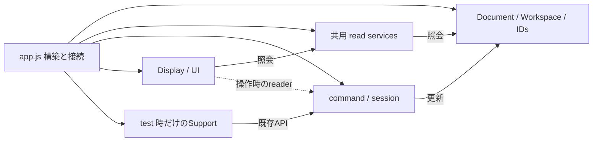

# Composition rootの残存責務と依存監査

## 基準と扱い

2026-10-20、develop `f37edc6`（実装commit `b6e825f`）を基準とする。`app.js`のGit blobは`16e825cb801589c272ff4b648a89e5e0217138f5`。この監査では実装を変更していない。

これは現在の構造と次の判断の記録であり、全体完了を示す文書ではない。合意した目標と停止・検証条件は[再開手順](refactoring-policy-and-resume.md)、現在の配置は[実装map](implementation-map.md)を優先する。以後の実装では行番号より関数・owner名を使って現物を再確認する。

## 監査後の反映

最後の性能traceは生成ownerのConstraintCommitCommandへ統合し、Document reset／test supportへclear／readを直接接続した。app.jsのletは九つになり、行数は3,386行。下記の集計・state表はf37edc6の監査基準を保持しており、最新の変更・検証・次の単位は再開手順section 8を参照する。

## 現在の大きさ

既存Playwright同梱のBabel parserで`app.js`のIIFEを解析した。追加のpackageやparserは導入していない。次の表の非空白行は重複しない。

| 分類 | 非空白行 | 集計条件 |
| --- | ---: | --- |
| create系factoryの構築・接続 | 1,564 | IIFE直下の変数宣言／代入で、右辺が`create*` methodの呼出し。232文、物理1,565行 |
| `installTestHooks` | 488 | 条件付き生成と既存APIの組立て。内部のfactoryもこの分類に含める |
| call一文の関数 | 261 | IIFE直下の関数で、本体が一つのcallのreturnまたは実行だけ。176関数 |
| その他 | 572 | static依存、その他の関数・alias・起動・設定など |
| 合計 | 2,885 | 非空白行 |
| 空白行 | 502 | 物理行との区別のため別集計 |
| 物理行 | 3,387 | 今回の変更前後で同じ |

IIFE直下の関数は226個。上記call一文の関数とtest hooksを除く49関数は計249物理行である。ただし、実処理は関数宣言以外にも残る。create系factoryのObject引数直下には446個の関数値があり、うち47個は複数statementを持つ。したがって、factoryの全行を「単なる接続」とは扱わない。

call一文の分類には、委譲入口のほかfactory構築や引数を組み立てる関数も含む。既定引数を評価する時機や、後で生成されるconstを操作時に参照する役割もある。上記の分類は機械的な削除候補リストではない。

test hooksとcall一文の関数を仮に全て外しても、非空白2,136行が残る。空行整理や小関数の移動だけでは、200〜500行のcomposition rootには届かない。現在の主要な残作業は、実際の機能境界に沿った構築依存の集約と、残る更新責務の所有者を揃えることである。

## 状態と後段接続の区別

IIFE直下の`let`は10個。代入数は初期化を除き、test hooks内の代入も数える。

| 名前 | 代入箇所 | 現在の役割と次の判断 |
| --- | ---: | --- |
| `model` | 1 | Workspaceの現在scopeへの別名。`activateEditingScope`が`solver.model`とcacheも同期する。データの本来のownerはDocument／Workspace |
| `mode` | 23 | command・入力・resetが参照／更新する操作mode。うち1箇所はテスト用。開始・取消・resetの契約を揃えてから既存lifecycleとの統合を判断する |
| `lastPointerWorld` | 4 | Canvas移動・context menuから記録し、Document／Sketch切替で解除する最後のworld位置。hoverやpreviewのpointerと同一と仮定しない |
| `lastAuthoringPerformance` | 2 | 拘束確定の成功時に記録し、Document resetで解除するtrace。計測を作る`ConstraintCommitCommand`との所有境界を揃えられる |
| `pngExportCommand`、`sketchMoveCommand`、`sketchContextController`、`commandPanel`、`derivedPanel`、`toolFlyouts` | 各1 | 後段で作るcomponentへの接続参照。操作sessionをもう一組保持しているわけではない |

この表は`let`の監査であり、constが指すDocumentやcomponentへの書込みが存在しないという意味ではない。Selection・draft・Parameter・Document更新のcallbackは別に確認する。modeやpointerをgetter／setterだけの容器へ移すことは、責務分離の完了とはしない。

## 実処理が残る境界

| 現在の入口 | 適切な所有範囲と維持する契約 |
| --- | --- |
| `activateEditingScope` | Workspaceの切替、Sketch移動の終了、Solverのmodel接続、read／projection cache無効化の順。既存のDocument固定参照と現在scope参照を一括置換しない |
| `ensureModelState`、`serializeModel`、`historySnapshot` | 単位・Sketch・外観・Block・描画順の準備、snapshot、履歴からの名前／時刻除外。保存と履歴を同じmetadata方針へ統合しない |
| `DocumentSnapshot.constraintData`、`decorateSerializedConstraint` | 所属・reference metadataの付与と無効な値の短絡。codecの形式所有と現在編集scopeの適用を区別する |
| `GeometryDeletionCommand.endInteraction` | 削除時の入力／drag／mode解除。Document resetやSketch切替とは解除範囲が異なる |
| `ClipboardPayload.detachedAnnotation` | 表示中の文字・Leader geometry・anchor位置をコピー値へ反映する変換。元Annotationのmaterializationと取り違えない |
| `AnnotationCommand.validateParameter`等 | 仮の評価、戻し、確定、表示更新。単にcallbackを別fileへ移すのでなく、既存Parameter編集ownerとの依存を整理する |
| `refreshSketchMoveGeometry` | projection／read／Hatch cache、拘束再接続、解析と参照有効性の更新順 |
| `isBlankCommandPanelPoint`等 | ヒット照会と空白double clickの判定。通常の単一clickによる配置／選択を妨げない |

一方、Hatchのcontent／Layerは既存`HatchRenderer`で役割が分かれている。現時点では、それらを一つの薄い新fileへ包むだけの変更を優先しない。

## 初期化順を拘束している依存

| 先に生成するもの | 後で参照するもの | 現在維持している接続 |
| --- | --- | --- |
| `AnnotationSpatialQuery` | viewport、Annotationの文字layout／Leader geometry、Annotation drag | scale・layout・resize可否のcallback。生成時には評価しない |
| `ApplicationRefresh` | Annotation drag、PropertiesView、Tree、寸法入力 | 更新時に既存ownerへ委譲するcallback |
| `BlockEditingFeature` | viewport、Block履歴snapshot、後段のview／dialog | `readViewport`と履歴生成入口、後段の`createCommands` |
| `AnnotationDisplay` | Annotation command、Annotation drag | previewとresize可否の遅延reader |
| `DimensionDisplay`の基礎計算 | Dimension drag、hover、pending、PNG | 後段の`createTraversal`でreaderを受ける |
| `DocumentApplication`や既存reset callback | 全てのreset対象component | `DocumentEditingReset`は全owner生成後、test hooks／起動reset前に構築する |

後段constをcallbackから直接Objectへ置き換える際は、生成時のTDZを再確認する。「createは常に副作用がない」と全moduleへ一般化しない。既存の`start()`にもDOM登録・表示更新があり、一括で順序を変えない。

## 機能単位で束ねる方向

現状の主要な関係は次のとおり。矢印は全ての依存を列挙したものではない。

以後の構築単位では、既存のGeometryReadServices、viewport、Selection、namespace、ID ownerを再生成しない。静的な型やcodecは構築側で接続できるが、現在scope・preview・export状態は明示readerまたは狭いowner APIを使う。

- Document／編集scope／読込・履歴: Documentデータと編集sessionを区別し、保存と履歴、load成功後のresetを同一owner間で調整する。
- 描画・空間照会: 共有read ownerを使い、CanvasSurface、表示器、hit／boundsとPNGの接続を整理する。GeometryReadServicesをCanvas専用に閉じ込めない。
- Properties: 既存PropertySelection・PropertyEditingFeature・PropertiesDisplay・Palette・Controllerが共有する接続を機能境界として検討する。各commandやViewの状態を複製しない。
- Canvas入力・context menu: query／候補表示／対象選択／操作dispatchを既存ownerへ接続し、modeやpointerの更新契約と一緒に扱う。全commandを自由に操作できるcontextを渡さない。
- test hooks: 既存`src/testing/`の支援groupごとに生成・公開APIを揃える。通常機能をテスト専用実装へ移さず、production featureからtestingへ依存を反転させない。
- 起動: 上記の構築と、必要なbind／start、初回reset・表示・履歴・file session開始を明示的に接続する。

これらは必要な機能領域であり、固定のfile数・task数ではない。構築fileを増やすだけで同じ大量callbackを横流しする場合は、owner APIの切り方を再検討する。

## 次の具体的な実装単位

最初に`lastAuthoringPerformance`の所有を、traceを作る`ConstraintCommitCommand`へ揃えるかを検証する。現在の書込みは同commandの`recordPerformance`通知とDocument reset、読取りはtest supportへの`readPerformance`一つである。

維持すべき点は、成功した確定のUI／draw／履歴が終わった時点だけ新traceを公開すること、失敗・冗長判定の短絡では以前のtraceを変えないこと、Document resetはnullへ戻すだけで追加通知しないこと、既存observerの契約とObject同一性を保つことである。計測値・Solver・性能基準は変更しない。単なる汎用state容器を新設せず、既存commandの処理と結果の保持を同じownerへ集める。

続いて、`ClipboardPayload.detachedAnnotation`など実処理の残るcallbackを既存ownerへ寄せる単位と、Properties／context menu等の機能組立てを検討する。前者だけを繰り返して200〜500行へ届くとは見積もらない。

## 数百行へ近づける際の判断

実現には、主に約1,500行の構築・接続を、上記の機能が狭いAPIを公開する形へ整理する必要がある。目標の行数は維持するが、現在の状態から到達を確約したり、全体完了と扱ったりしない。

集約の利点は、機能追加時の変更点と依存がまとまり、機能単位で生成／拒否／終了を検証できることである。代わりに、初期化順や共有ownerが構築fileの内側へ隠れやすい。明示した依存、生成とbind／startの段階、既存参照を使う境界テストが必要になる。

`app.js`全体を別のbootstrap fileへ移す、全stateと操作を渡すcontext／Service Locatorを作る、`mode`等をsetterだけへ移す、空行や既存テストの削減で数値を達成する、という方法は採用しない。

## 検証とリリースの扱い

この監査の基準実装では構文574ファイル、単体1,651件、関連E2E163件が成功している。これは全E2E成功の主張ではない。監査は文書のみで、今回これらを再実行していない。

再開後の全E2Eでは584件中583成功・1失敗の記録があり、middle-button panは178msで175ms未満の基準を超過した。変更前でも超過が再現しており、その後の限定した性能検証は成功しているが、最新実装の全体検証の代用にしない。現在mainは`5ee5f3f`で保留中。

残量50%未満で新たな分離を止める際も、最新コードの全体検証と未解決事項を確認する。mainの保留を解除するための検証を省略したことにはしない。main反映が可能になった場合はdevelop先行・main最後・直後のdevelop同期を守る。

監査後の実装では、code／spec／関連テスト／再開記録を一単位で更新し、Commit・Push・runtime-version再生成まで行う。数百行の組立て、状態owner、挙動・互換性、全体検証の全てが確認できるまで目標を未完了として継続する。
