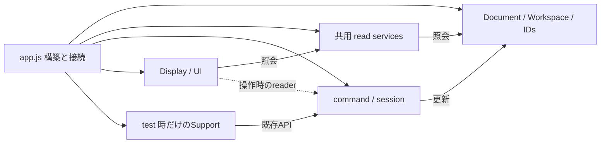

# Composition rootの残存責務と依存監査

## 基準と扱い

初回監査は2026-10-20、develop `f37edc6`（実装commit `b6e825f`）を基準とする。`app.js`のGit blobは`16e825cb801589c272ff4b648a89e5e0217138f5`。この監査では実装を変更していない。

これは現在の構造と次の判断の記録であり、全体完了を示す文書ではない。合意した目標と停止・検証条件は[再開手順](refactoring-policy-and-resume.md)、現在の配置は[実装map](implementation-map.md)を優先する。以後の実装では行番号より関数・owner名を使って現物を再確認する。

## 拘束テスト支援の段階的な生成接続（2026-10-30、c9ae976基準）

基準developはc9ae976。既存ConstraintTestDriverにcreateBrowserFactoriesを追加し、実Workspace／Sketch・Geometry・read services・solve scope／solving・analysis／solver・参照状態・operand値・Selection／Target session・寸法配置／checkpoint・Presentation等から子portを接続する。共通29項目から7creatorの85個の子portを組み立て、各生成呼出しは元のapp内の位置に残す。解析更新は元のoptions={}の既定値と一引数のanalysis.refresh(options)呼出しを窓口内で接続し、毎回の新しい既定objectとactor receiverを保つ。readSummaryとsolver分析も元のreceiver・引数数を保つ。modelはWorkspace.currentを操作時に読み、同期済みediting scopeや生成時modelへ置き換えない。全creatorと生のcreateModelSupport等の旧APIを維持し、観測・fixture実行・強制Solver結果注入の実装は既存raw helperに残す。新file・状態・scope／Selection／Solverの別コピーを増やさない。

app.jsは1,842→1,831行（11行減）、非空白1,392→1,381行、root416文／関数81個／可変参照三つ。test hooksは244→235行、外側bindingは262→256個（局所関数34、ObjectPattern alias 189、CallExpression初期化binding 28、その他5）。構築134文719非空白行、一文call関数77個99行、その他204文323行（文外5行）。移管で不要になったDistanceConstraint／PointOnLineConstraint／readSketchMembership／blockInstanceByIdの四aliasをrootから除去した。TEMP cad-constraint-test-factories-{proof,hierarchy,hook-audit}.cjsで全子port、refresh callbackの既定値・引数／receiver、元の呼出位置・順序、他appとraw helperのAST不変、未使用root bindingとfactory未定義globalなしを確認した。hooksと短い委譲を除いても1,047非空白行が残り、数百行目標は未達。

通常起動の構築は依然134文719非空白行ある。TEMP cad-constraint-test-factories-root-audit.cjs／root-constructors.jsonで再確認し、AnnotationFeature.createの48項目、blockEditingFeature.createCommandsの32項目、sketchEditing.createTreeの26項目など、通常機能側にも広い接続が残ると分かった。test生成だけを縮め続けず、次はこれらの実owner・循環参照・late callbackを調べ、まとまった通常機能の組立てへ重点を戻す。単に巨大な初期化fileや汎用contextへ移す構成は採用しない。

## Propertiesテスト支援の段階的な生成接続（2026-10-30、c35fa1c基準）

基準developはc35fa1c。既存PropertiesTestDriverにcreateBrowserFactoriesを追加し、実Workspace／Sketch、GeometryCreation、read services、CanvasInteraction、selection highlight、Presentation、GeometryDisplay、DimensionPlacementとviewportから子へ必要なAPIを接続する。共通26項目から11creatorの95個の子portを組み立てる。返すのは生成用関数だけで、各支援の生成は元のapp内の位置で呼び、他TestDriverとの順序を変えない。生のcreateAppearanceObservation等11入口も保持し、同じ実Selection／Hover・Workspace scopeと関数／actorを使う。生成窓口の構築やcreator呼出時にmodel・DOM・theme・履歴を照会せず、観測・fixture・編集操作は既存raw helperに残す。Default Appearanceの色照会とTheme、modelTypesによるFixed型の既定値は元の照会時点を維持する。新file・状態・model／sessionの別コピーやsetterを増やさない。

app.jsは1,852→1,842行（10行減）、非空白1,402→1,392行、root416文／関数81個／可変参照三つ。test hooksは253→244行、外側bindingは275→262個（局所関数34、ObjectPattern alias 198、CallExpression初期化binding 25、その他5）。構築134文719非空白行、一文call関数77個99行、その他204文325行（文外5行）。移管で不要になったroot alias十一個を除去した。TEMP cad-properties-test-factories-{proof,hierarchy,hook-audit}.cjsで11creatorの全子portと元の呼出位置・順序、その他appとraw PropertiesTestDriverのAST不変、未使用root bindingとfactoryの未定義globalなしを確認した。hooksと短い委譲を除いても1,049非空白行が残り、数百行目標は未達。

## ブラウザテスト公開契約の分離（2026-10-30、b02cda6基準）

基準developはb02cda6。src/testing/browser_test_api.jsのBrowserTestApi.createへ、window.__jot2dTestの公開名割当てとspreadの結合順を移した。既に準備されたTestDriver支援・診断API・履歴関数54個だけを14の用途別入力で受け、Document／モデル／Solver／session・DOMを渡さない。公開contractの追加・改名・上書き規則を通常appの組立てから独立して検証できる。返却値は従来どおり書換え可能な通常objectで、公開関数は元の参照・呼出時receiverを保ち、bindやwrapperで置き換えない。getter／spreadの評価順とlast-write優先、propertyの挿入順・通常data descriptorも維持する。構築途中の読取り例外では以前のwindow.__jot2dTestを保持する。module定義読込だけではAPI・fixtureを生成せず、test指定のguardとDocumentEditingReset生成後のinstall phaseはappのまま。indexの既存classic-script／cache回避queryと他script順は維持し、構文・単体の明示listへ新module／testを登録した。

app.jsは1,918→1,852行（66行減）、非空白1,468→1,402行、root416文／関数81個／可変参照三つ。test hooksは319→253行。構築134文719非空白行、一文call関数77個99行、その他204文326行（文外5行）は不変。TEMP cad-browser-test-api-boundary-{proof,hierarchy,hook-audit}.cjsで85個のproperty定義／spreadの旧公開objectとのAST一致、他app・test guard／install phaseの不変、src追加以外のscript順・HTMLと明示test登録以外のtool不変、root未使用bindingなしを確認した。

今回の54個は新しい可変app contextでなく、構築済みテスト支援の能力参照である。appはどの支援を接続するか、BrowserTestApiは何の名前・順序で公開するかを所有する。ただしtest支援の生成依存は減らしておらず、root外側275 binding（局所関数34、ObjectPattern alias 213、CallExpression初期化binding 23、その他5）は不変。hooksと短い委譲を除いても1,050非空白行が残る。行数差66を275依存の解消や数百行目標の達成と扱わない。

## 削除の編集環境からの組立て（2026-10-30、cce412f基準）

基準developはcce412f。既存DeletionFeatureにcreateForEditingを追加し、DocumentWorkspaceのWorkspace／Sketch、Geometry read services、CanvasInteractionの実Selection／access／scope／hover／PointUsage、OperationSessions、GeometryCreation、SketchSolvingとPresentationから既存三ownerへ限定APIを接続する。appの個別47項目を22項目のowner・操作依存へ整理し、既存createと同じremove／removeSelection／rejectReferencesを元の生成位置で返す。削除はWorkspace.currentを読む設計を維持し、Clipboardのediting scopeへ置き換えない。Geometry／Dimension／Annotation dragは後段生成なので、三reset callbackをappで遅延のまま渡す。analysis.stableも操作時に読み、生成時にscope・状態・drag・DOMを照会しない。Geometry／Selection削除のraw command・計画／適用・拒否通知・求解・履歴は変更せず、新file・可変context・状態の複製を増やさない。

app.jsは1,922→1,918行（4行減）、非空白1,472→1,468行、root416文／関数81個／hooks319行／可変参照三つ。構築134文719非空白行、一文call関数77個99行、その他204文326行（文外5行）。移管で不要になった三aliasをrootから除き、TEMP cad-deletion-editing-composition-{proof,hierarchy}.cjsで47の子接続の旧構成一致、その他appとraw DeletionFeatureのAST不変、root未使用bindingなしを確認した。hooksと短い委譲を除いても1,050非空白行が残り、数百行目標は未達。

条件付きtest hooksは319行に対してroot外側の275 bindingを参照する（局所関数34、ObjectPattern alias 213、CallExpression初期化binding 23、その他5）。TEMP cad-deletion-editing-composition-hook-audit.cjsとhook-{dependencies,alias-sources}.jsonに現物監査を保存した。275依存をまとめて新fileへ渡す抽出は採用せず、既存の役割別TestDriverへ共有ownerからの接続を集めてから公開境界を縮める。通常起動ではtest支援を生成せず、installTestHooksの実行はDocumentEditingReset生成後というphaseを維持する。

## Clipboardの編集環境からの組立て（2026-10-30、020f7db基準）

基準developは020f7db。既存ClipboardFeatureにcreateForEditingを追加し、DocumentWorkspaceの採番・Sketch・Parameter、Geometry read services、CanvasInteractionの実Selection／access／Lifecycle、GeometryCreation、Annotation rendererとPresentationから各子へ必要なAPIを接続する。appの個別45項目を23項目のowner・操作依存へ整理し、既存createと同じ七owner・同じsession／commandを元の生成位置で返す。同期済みediting scopeは呼出時のeditingScope.current、Parameter namespaceはWorkspace.currentとして区別し、viewport倍率・Block namespaceの反復照会・guard短絡とreceiverも維持する。拘束codec／装飾とGeometry Instance正規化は既存callbackの引数・既定値を保つ。新fileや全app context、状態の複製、早期model／DOM照会は増やさない。削除ownerとの統合は行わず、拒否されたCutのpayload保持と、append失敗／solve失敗で異なるmode・pasteCountの復元範囲も変更しない。

app.jsは1,926→1,922行（4行減）、非空白1,476→1,472行、root416文／関数81個／hooks319行／可変参照三つ。構築134文723非空白行、一文call関数77個99行、その他204文326行（文外5行）。Clipboard移管で不要になった六aliasをrootから除き、TEMP cad-clipboard-editing-composition-{proof,hierarchy}.cjsで45の子接続の旧構成一致、その他appとraw ClipboardFeatureのAST不変、root未使用bindingなしを確認した。hooksと短い委譲を除いても1,054非空白行が残り、数百行目標は未達。

## 作図開始許可とTrim hover解除の所有（2026-10-30、fec6c9a基準）

BasicDrawingTools.createLifecycleは実CanvasInteractionから未指定のLifecycle／開始許可／Trim hover解除を接続する。Select→create guard→Trim時のみselection structure guardという短絡、現在Sketchの呼出時評価と七fieldだけのhover解除を保ち、同じmode sessionへbindする。明示入力と旧直接注入APIは優先して維持し、後段Hatch callbackも遅延のまま渡す。構築時にstate／model／scope／DOMを照会せず、raw Lifecycle本体・通知と履歴・取消を変更しない。新file・state／setterや汎用contextを増やさない。

app.jsは1,928→1,926行、非空白1,478→1,476行、root417文／関数81個。構築134文726非空白行、hooks319行、一文call関数77個99行、その他205文327行（文外5行）。可変参照三つは不変。hooksと短い委譲を除いても1,058非空白行が残る。TEMP cad-authoring-lifecycle-policy-{proof,hierarchy}.cjsと再開記録section 8を参照する。

## Sketch切替resetと編集開始の組立て（2026-10-30、6bd13ab基準）

SketchEditingFeature.createForInteractionは実Workspace／read services、CanvasInteractionとOperationSessions、実拘束command／値入力／通知を共有し、reset→Sketch編集を元の順・位置で生成して実APIを返す。lockのpending→拘束→描画終了と、moveの拘束→pending→描画終了→hover全解除を別に持ち、Sketch切替resetの18操作・hover部分解除と統合しない。prepareMoveはprepare未指定時だけの既定値で、旧createと明示prepareは維持する。前段利用のclear callbackと後段drag／Tree／move参照は遅延のまま残し、Move公開→input bindの順を変えない。rootは既存sessionsの実返却を保持するだけで、新stateや汎用context・listenerを持たない。

app.jsは1,936→1,928行、非空白1,486→1,478行、root417文／関数81個。構築134文726非空白行、hooks319行、一文call関数77個99行、その他205文329行（文外5行）。可変参照三つは不変。hooksと短い委譲を除いても1,060非空白行が残る。TEMP cad-sketch-interaction-composition-{proof,hierarchy}.cjsと再開記録section 8を参照する。

## Document読込適用と正規化・採番復元の所有（2026-10-30、d841cc5基準）

DocumentWorkspace.createPersistenceが実loading／Document／preparation／placement／ID ownerを持ち、createApplicationが外部のreset・late Tree・妥当性更新・線長補正・logから同じDocumentApplicationを生成する。modelは元の生成位置でreadEditingScopeから一度取得し、寸法正規化は呼出時の編集scopeだけを読む。late Treeのcallbackはそのまま渡し、予約→Document ID復元の順と途中失敗状態を維持する。旧createPersistence時のcold構築と全利用前の寸法正規化API公開、旧loading／DocumentApplication.createも維持する。新model／session・独自採番や可変contextは持たず、形式・decode／installとreset・回復は各既存ownerに残す。

app.jsは1,946→1,936行、非空白1,496→1,486行、root420→417文／関数84→81個。構築135文737非空白行、hooks319行、一文call関数77個99行、その他204文326行（文外5行）。可変参照三つは不変。hooksと短い委譲を除いても1,068非空白行が残る。TEMP cad-document-application-composition-{proof,hierarchy}.cjsと再開記録section 8を参照する。

## Workspace求解機能の実owner接続（2026-10-30、72da23a基準）

SketchSolvingFeature.createForWorkspaceは実DocumentWorkspace・編集scope・ScopeQuery・参照状態／read services・投影編集／Geometry／checkpoint・解析／表示・履歴等の18portから従来createの34項目を接続し、元の実APIを返す。Workspace.currentは求解／現在Parameter namespace、編集scope.currentは保存定義を安定化する前の元scopeとして区別する。生成時にはscope／model／DOMを照会せず、受理predicateと結果state・閾値／安定化上限は同じものを共有する。activateの全引数とreceiver、解析refreshの既定値とreceiver、Hatch採番peekの時機、private create内の四生成順と各ownerの回復・通知・履歴の境界は維持する。旧createの直接利用も維持し、別Solverやstate・model／namespace・cache、可変contextを追加しない。

app.jsは1,950→1,946行、非空白1,500→1,496行、root420文／関数84個。構築135文742非空白行、hooks319行、一文call関数80個104行、その他204文326行（文外5行）。可変参照三つは不変。hooksと短い委譲を除いても1,073非空白行が残る。TEMP cad-workspace-solving-composition-{proof,hierarchy}.cjsと再開記録section 8を参照する。

## 寸法テスト支援の実owner接続（2026-10-30、4b2925a基準）

DimensionTestDriver.createForEditingは実GeometryCreation／DimensionDisplay／SketchContext／外観／Selection／viewport／配置command／layerとsession等の18portを受け、従来のcreateSupport→createFixturesへ同じ34項目を接続する。元のtest guardの内部で同じ順に生成し、返却supportとfixturesは実API。通常機能の状態やmodelを所有せず、constructor時のmodel／scope／DOM読取り・listener・独自採番や第二sessionは持たない。layout／draw／値入力継続は同じreceiverと引数で呼び、fixtureの例外とCanvas復元・途中modelの元の境界は変更しない。旧createSupport／createFixturesと後段のinteraction／display生成も維持する。

app.jsは1,954→1,950行、非空白1,504→1,500行、root420文／関数84個。構築135文746非空白行、hooks323→319行、一文call関数80個104行、その他204文326行（文外5行）。可変参照三つは不変。今回減ったのはtest hooks内で、hooksと短い委譲を除いても1,077非空白行が残る。TEMP cad-dimension-test-composition-{proof,hierarchy}.cjsと再開記録section 8を参照する。

## Propertiesの操作状態とcommand接続（2026-10-30、d277dd8基準）

PropertiesDisplay.createFeatureは実Lifecycle／InstanceSource／GeometryInstance／BlockPlacementから選択判定用readerを作る。後段createViewForEditingが表示用readerと実commandへの操作を接続し、選択用のdefinition IDと表示用の有効Sketch／回転lockを同じsnapshotへ混ぜない。元の状態形・読取順とlive評価、guardの引数、寸法／Spline wrapperのreceiverと返却・例外を維持する。新stateや汎用app contextは持たず、操作・取消・履歴は各commandに残す。旧selectionOperationとcreateView／createWithControllerは直接利用でき、Controller／View本体・生成位置は不変。

app.jsは1,959→1,954行、非空白1,509→1,504行、root421→420文／関数85→84個。構築135文746非空白行、hooks323行、一文call関数80個104行、その他204文326行（文外5行）。可変参照三つは不変。hooksと短い委譲を除いても1,077非空白行が残る。TEMP cad-properties-operation-bindings-{proof,hierarchy}.cjsと再開記録section 8を参照する。

## 寸法入力とドラッグの生成接続（2026-10-30、daa1345基準）

ConstraintEditing.createCommandInput.createWithDraggingは、既存ConstraintCommandInputの生成直後にDimensionDragFeatureを生成する。同じplacement／Selection／guard／valueInput.sync／通知を共有し、明示portはviewport・currentScope・SketchContext・GeometryReadServices・DragPointer・snap解除・UI更新・履歴の八つ。元の子接続21項目と同等で、実入力／drag APIを返し、別の状態・model・Selection・scopeやlistenerを持たない。生成時の無照会、入力生成失敗でdrag未生成、drag生成失敗で例外の同一性を維持する。実操作の履歴・threshold・reset・寸法群照会・continuationは各既存ownerに残す。旧createFeatureとDimensionDragFeature.createも維持する。

app.jsは1,964→1,959行、非空白1,514→1,509行、root422→421文／関数85個。構築135文750非空白行、hooks323行、一文call関数81個105行、その他204文326行（文外5行）。可変参照三つは不変。hooksと短い委譲を除いても1,081非空白行が残る。TEMP cad-dimension-input-drag-composition-{proof,hierarchy}.cjsと再開記録section 8を参照する。

## Pointer commandの接続所有（2026-10-30、3e5db6f基準）

CanvasCommandInputs.bindPointerForEditingが実commandとidentity選択、式参照APIを既存Pointerのpress／activationへ接続する。CanvasInteractionFeature.bindEditingPointerは同じPointer／Preview／identityを共有する。生成順は変えず、model／scope／DOMを先読みせず、座標・gesture・操作確定のownerも変更しない。寸法の三つの委譲はmethod receiverと引数を保持し、ほかは同じ関数値を使用する。appは九つの不要aliasと一つの委譲関数を保持せず、旧bindPointerの直接利用は維持する。接続の集約であり、別の巨大contextや第二sessionは導入しない。

app.jsは1,974→1,964行、非空白1,524→1,514行、root424→422文／関数86→85個。構築136文755非空白行、hooks323行、一文call関数81個105行、その他204文326行（文外5行）。可変参照三つは不変。hooksと短い委譲を除いても1,086非空白行が残る。TEMP cad-pointer-command-bindings-{proof,hierarchy}.cjsと再開記録section 8を参照する。

## 固定操作の二段階生成（2026-10-30、bc59973基準）

ConstraintEditing.createFixedEditingは共有する編集guard・Sketch所属・Line固定照会・Selection・通知と、明示されたcurrentScope／固定操作portから既存FixedToggleCommand.createOperandを生成する。返すoperandは実APIで、後段createSelectionはsnapshot／restore・求解・履歴などの遅い依存を受けて既存選択固定commandを生成する。二つのraw commandの生成位置・順序はappが従来どおり選ぶ。固定対象batchと全固定判定は同じConstraintSelectionQueryのmethodを操作時に呼び、戻り値・receiverを維持する。scope／Selectionを生成時に読まず、モデル・固定状態・採番・cacheや第二sessionは所有しない。guard拒否・投影対象・Block固定・失敗復元・履歴は既存FixedToggleCommandに残し、旧createOperand／createSelectionも変更しない。

app.jsは1,981→1,974行、非空白1,531→1,524行、root426→424文／関数88→86個。構築136文755非空白行、hooks323行、一文call関数82個106行、その他205文335行（文外5行）。可変参照三つは不変。hooksと短い委譲を除いても1,095非空白行が残る。TEMP cad-fixed-constraint-composition-{proof,hierarchy}.cjsと再開記録section 8を参照する。

## 編集Canvas sceneの生成階層（2026-10-30、b3cd0ca基準）

CanvasDisplayのworkspace.createSceneForEditingは操作対象のGeometryPresentation、Sketch状態の表示方針、既存createSceneのGeometry／Overlay／Bounds／Fitをこの順に生成する。実CanvasInteractionのLifecycle・Selection・Hover・PointUsage、Constraint target／pending、SketchContext・GeometryReadServices、求解結果owner・ConstraintAnalysisを共有し、子へ必要な照会だけを接続する。Panel選択とmode・operands・constraint／pendingは操作時に読む。型・参照比較・Hatch表示の静的関数は既存namespaceの同じAPIを使う。六つの返却値は各実APIへの参照で、モデル・操作状態や描画cacheを複製しない。旧createSceneの直接注入API、可視性・順序・強調の優先順位とPNG表示を維持する。照会例外は同じまま伝播し、rendererの既存途中状態を組立て層で復元する処理は追加しない。

app.jsは1,988→1,981行、非空白1,538→1,531行、root428→426文／関数88個。構築136文760非空白行、hooks323行、一文call関数84個108行、その他205文335行（文外5行）。可変参照三つは不変。hooksと短い委譲を除いても1,100非空白行が残る。TEMP cad-editing-canvas-scene-{proof,hierarchy}.cjsと再開記録section 8を参照する。

## Hatchの作図owner共有（2026-10-30、a23e325基準）

BasicDrawingTools.createAuthoring.createHatchは共有するcurrentScope／SketchContext、DrawingPreview、DrawingSnap、Selection、取消・表示通知・履歴を使い、後段で実HatchCommandを生成する。外部portはHatchGeometryQuery、mode照会、最後のpointer、DocumentIds、status更新、領域error表示の六つとする。採番はGeometryIdsではなく同じDocumentIds.allocate／peekを使い、scopeとactive Sketch・previewは操作時に読む。生成時にscope／pointer／IDを照会せず、作成・境界再指定・拒否・例外後の途中状態はHatchCommandに残す。未使用だったSketch切替依存を渡さず、別Sketchの境界再指定を自動切替で許可しない。返すAPIは実HatchCommandのままで、追加draft・mode・cacheを持たず、旧HatchCommand.createの個別port APIも変更しない。

app.jsは1,992→1,988行、非空白1,542→1,538行、root428文／関数88個。構築138文766非空白行、hooks323行、一文call関数84個108行、その他205文336行（文外5行）。可変参照三つは不変。hooksと短い委譲を除いても1,107非空白行が残る。TEMP cad-hatch-authoring-composition-{proof,hierarchy}.cjsと再開記録section 8を参照する。

## Sketch求解結果の明示owner（2026-10-30、6242858基準）

SketchSolving.createStateは結果Mapを非公開で所有し、setSketchSolveOk／setSketchSolveError、sketchSolveState／hasError、単一clear／clearAllを公開する。appは最初の削除接続より前にこのownerを作り、SketchSolvingFeatureのsolveState portを経て実SketchSolvingへ同じownerを渡す。求解・削除・表示は同じMapを共有する。生成はMapの準備だけで、モデル・scope・UIを読まない。createへstateを渡さない従来の呼出しは独立ownerを生成し、既存APIを維持する。createResultAcceptanceは許容値を束縛した既存の判定を返し、resultの真偽、有限errorNorm、許容値以下という条件とgetter読取り順を維持する。success flagは受理条件へ追加しない。

app.jsは1,996→1,992行、非空白1,546→1,542行、root428文／関数91→88個。構築138文770非空白行、hooks323行、一文call関数84個108行、その他205文336行（文外5行）。可変参照三つは不変。hooksと短い委譲を除いても1,111非空白行が残る。TEMP cad-sketch-solve-result-owners-{proof,hierarchy}.cjsと再開記録section 8を参照する。

## 描画診断の遅延接続（2026-10-30、eca6341基準）

CanvasRenderProbe.createForSceneは実GeometryReadServicesとGeometryDisplay／dimension layerの遅延readerを受け、既存createへ接続する。Geometry ID照会は同じread serviceを使い、各診断描画の直前に現在のownerを取得してメソッドとして呼ぶ。生成時は後段の描画ownerを読まない。これによりappの前方参照用描画委譲を除き、通常のLine／Circle／Arc／Spline描画は同じGeometryDisplayの公開関数を直接共有する。これらの関数はreceiverに依存せず、描画filter・順序・options・戻り値を維持する。既存createの個別port API、計測とfinally復元、式マークのネスト時の解除規則は変更しない。

app.jsは2,004→1,996行、非空白1,554→1,546行、root435→428文／関数98→91個。構築136文768非空白行、hooks323行、一文call関数85個109行、その他206文341行（文外5行）。可変参照三つは不変。hooksと短い委譲を除いても1,114非空白行が残る。TEMP cad-canvas-probe-scene-owners-{proof,hierarchy}.cjsと再開記録section 8を参照する。

通常のroot関数90個のうち85個はcall一文の委譲である。残る五つはisGeometryMode（常時true）、resultIsAccepted（求解許容値）、sketchHasSolveError（solve状態）、hitBlockRotationHandle（常時null）、updateBlockUI（Block準備後にrender）と確認した。これらの削除だけで数百行には届かず、次は構築136文768非空白行の機能単位の依存共有を中心に扱う。resultIsAccepted／sketchHasSolveErrorは既存求解ownerの照会との重複を確認する候補であり、updateBlockUIの準備とrenderの順序、前方callbackの生成位置を維持する。定数応答の二関数を無断の機能廃止や仕様変更へ混ぜない。

## Pointerの式参照候補照会（2026-10-30、0cdffa2基準）

ExpressionInputController.pointerReferencesはPointer pressへ接続する四つのread／insert portをfrozen groupで公開する。追加の寸法／注記hit照会は毎回のフォーカス入力が式入力として有効な場合に限り、activeOnly:falseを渡す。Parameter draftのnamespaceがCanvasと異なる場合も候補照会を抑制せず、挿入時の既存error処理へ渡す。生成時には入力・namespace・hitを読まない。Pointer側の通常dimension hit優先と、寸法挿入拒否後の注記fallbackはPointerInteractionControllerに残す。Parameter dialog用pickCanvasの、先にhitを読む順序と寸法hit時は注記へfallbackしない規則は維持する。

app.jsは2,008→2,004行、非空白1,558→1,554行、root436→435文。構築136文769非空白行、hooks323行、一文call関数92個116行、その他206文341行（文外5行）。関数98個と可変参照三つは不変。hooksと短い委譲を除いても1,115非空白行が残る。TEMP cad-expression-pointer-references-{proof,hierarchy}.cjsと再開記録section 8を参照する。

## 通常Parameter編集UIのworkspace接続（2026-10-30、02f473c基準）

ParameterEditor.createForWorkspaceは実DocumentWorkspaceのDocument／ParameterNamespaceとApplicationSettingsを受け、既存の書式serviceとbrowserのInputElement／Eventを接続して同じcreateへ委譲する。編集中scopeとBlock Editor状態は明示read portのまま保持し、workspace.currentへ置き換えない。定義と言語は操作時に読み、applyDraftとpickDimensionは後段への遅延callbackを維持する。新しい状態・listener・contextやfileは増やさず、旧createによる個別port注入も維持する。

app.jsは2,015→2,008行、非空白1,565→1,558行、root437→436文。構築136文769非空白行、hooks323行、一文call関数92個116行、その他207文345行（文外5行）。関数98個と可変参照三つは不変。hooksと短い委譲を除いても1,119非空白行が残り、目標は未達。接続式と旧本体のAST同値性・root未使用bindingなしをTEMP cad-parameter-editor-workspace-{proof,hierarchy}.cjsで確認した。

## 参照画像test支援の実feature共有（2026-10-30、c94f514基準）

ReferenceImageTestDriver.createBrowserSupportが、実ReferenceImageFeatureのinteraction／inputとBlockEditingFeatureのsession／editing、Selection・scope・History・Viewportを使い、観測・読込・Block fixtureを元の順で生成する。rootの三生成・19項目は一生成・12項目になり、二つのtest専用bindingを除いた。旧API、画像状態、採番、公開四API名、Block open／completeの明示操作、非同期読込と例外・cloneの境界を維持する。

app.jsは2,019→2,015行、非空白1,569→1,565行、root438→437文、hooks326→323行。構築136文773非空白行、一文call関数92個116行、その他208文348行（文外5行）。関数98個・可変参照三つは不変。hooksと短い委譲を全て除いても1,126非空白行が残る。証跡はTEMP cad-reference-image-browser-support-{proof,hierarchy}.cjs、検証と次は再開記録section 8を参照する。

## Parameter test支援の実owner共有（2026-10-30、8d7dc17基準）

ParameterTestDriver.createBrowserSupportが、同じ実DocumentWorkspaceからDocument root・workspace.current・Parameter namespace・DocumentIdsを受け、同じGeometryと限定操作でfixture／observation／interactionを元の順で生成する。rootの三生成・39項目は一生成・21項目になり、三つの不要なnamespace関数bindingを除いた。DocWorkspace返却値を保持する一constを加え、旧各APIの分解は同じ実objectから行う。新モデル・可変contextや採番は作らず、旧APIと公開test hooksは維持する。

app.jsは2,026→2,019行、非空白1,576→1,569行、root437→438文、hooks333→326行。構築136文773非空白行、一文call関数92個116行、その他209文349行（文外5行）。関数98個・可変参照三つは不変。hooksと短い委譲を全て除いても1,127非空白行が残る。証跡はTEMP cad-parameter-browser-test-support-{proof,hierarchy}.cjs、検証と次は再開記録section 8を参照する。

## Geometry生成と作図の共有（2026-10-30、6b77cf0基準）

BasicDrawingTools.createGeometryがGeometryCreation→Endpoint resolverを生成し、後段createAuthoringへ同じscope・ID・Geometry・endpoint・最小長を直接接続する。rootの三生成・45項目は二生成・38項目になる。唯一の利用先への端点接続を内側へ移し、他の編集・保存で使う実Geometry APIと既存の個別createAuthoringは維持する。snapshotや後段hit／BlankGestureへの遅延callback、二段階の生成位置、既存command／state ownerは変えない。

app.jsは2,028→2,026行、非空白1,578→1,576行、root438→437文。構築136文774非空白行、test hooks333行、一文call関数92個116行、その他208文348行（文外5行）、関数98個・可変参照三つ。hooksと短い委譲を全て除く仮定でも1,127非空白行が残る。証跡はTEMP cad-authoring-geometry-foundation-{proof,hierarchy}.cjs、検証は再開記録section 8を参照する。

## Sketch求解の組立て階層（2026-10-30、5662046基準）

SketchSolvingFeatureがSketchSolving、ParameterStabilization、stored-definition stabilization、SolveRefreshCommandの生成順と実API共有を所有する。appの四生成・40項目は一生成・33項目になる。求解状態Map・Parameter反復・scope復元・表示／履歴順は既存ownerに残る。通常model／Parameter namespaceと一時editing scopeを区別し、Profilerの二phaseと受理誤差・反復定数を維持する。証跡はTEMP cad-sketch-solving-feature-{proof,hierarchy}.cjs、検証は再開記録section 8を優先する。

app.jsは2,039→2,028行、非空白1,589→1,578行、root441→438文。構築137文776非空白行、test hooks333行、一文call関数92個116行、その他208文348行（文外5行）。関数98個・可変参照三つは不変。hooksと短い委譲を全て除いても1,129非空白行であり、今回の四ownerの組立てだけで200〜500行目標を満たすとは扱わない。

## Canvas入力の操作基盤共有（2026-10-30、d562501基準）

CanvasInteractionFeatureのoperation sessionsが、入力feature生成・Pointer bind・Keyboard生成でも実ownerを共有する。rootの指定項目は入力42→32、Pointer 11→10、Keyboard 25→20（計78→62）。同じ状態を渡す16項目を除き、入力固有のcommand／query、Keyboardの取消command、入力用clearSnapを明示portとして維持する。raw ownerに処理本体を残し、既存の生成・bind・start位置を維持する。APIや状態のコピー、可変context、後段setterは増やさない。

app.jsは2,040→2,039行、非空白1,590→1,589行。root441文、構築140文787非空白行、test hooks333行、一文call関数92個116行、その他208文348行（文外5行）、可変参照三つ。hooksと短い委譲を全て除く仮定でも1,140非空白行が残るため、まとまった機能の生成階層とtest公開境界の整理が引き続き必要である。証跡はTEMP cad-canvas-input-session-{proof,hierarchy}.cjs、最新検証は再開手順section 8を参照する。

## Canvas操作基盤の生成階層（2026-10-30、45a1ea5基準）

CanvasInteractionFeatureが、同じCanvasの操作基盤を三段階で生成する。全ownerの操作本体と実状態は既存moduleに維持し、9生成・41portをappの三つの生成入口・29portへ整理する。TEMP cad-canvas-interaction-foundation-proof.cjsで全接続式・生成順と九raw ownerのGit blob不変、その他appのAST不変を確認した。全E2Eの進行・結果は再開資料section 8を優先する。

~~~mermaid
flowchart TD
  C[create] --> L[Lifecycle session]
  C --> S[Selection feature and access]
  C --> U[PointUsage]
  C --> H[Hover]
  C -->|生成入口を返す| O[createOperationSessions]
  O --> P[Preview and Pending]
  O --> T[Constraint targets and Pointer session]
  O -->|生成入口を返す| V[createSelectionPresentation]
  V --> X[Highlight and clearing and Document reset]
~~~

三段階の公開値は同じAPI参照で、公開groupやoptions objectを可変app contextとして後から書き換えない。内部でmodel／sessionをコピーせず、callbackの実行時機を保つ。後段のLifecycle／Pointer bind、command取消の違い、通常clearとDocument resetの対象差は維持する。PointUsageは元のreadServicesのreaderを使い、Hoverは元のisEndpointPointを使う。

| 分類 | 45a1ea5 | 操作基盤集約後 |
| --- | ---: | ---: |
| 物理行 | 2,051 | 2,040 |
| 非空白行 | 1,600 | 1,590 |
| root直下の文 | 447 | 441 |
| root関数 | 98 | 98 |
| 構築文／非空白行 | 146／799 | 140／788 |
| test hooks／非空白行 | 1／333 | 1／333 |
| 一文call関数／非空白行 | 92／116 | 92／116 |
| その他の文／非空白行 | 208／347 | 208／348 |

文外の5非空白行は両者共通。hooksと短い委譲を全て取り除く仮定でも1,141非空白行が残り、200〜500行目標は未達である。基盤を新たな巨大rootへせず、既存機能の責務に沿った生成階層を進める。

## Canvas Sceneの組立て階層（2026-10-30、ef069e9基準）

同じ分類条件でef069e9とScene集約後を比較した。TEMP cad-canvas-geometry-scene-hierarchy.{cjs,json}に計測scriptと結果を保存した。構築はcreateで始まるmember／bare呼出しを直接initializerに持つroot文、hooksと一文call関数を先に分離し、残りをその他とする。表の非空白合計に含まない文外の5行は両者共通。全E2Eの進行・結果は再開資料section 8を優先する。

| 分類 | ef069e9 | Scene集約後 |
| --- | ---: | ---: |
| 物理行 | 2,104 | 2,093 |
| 非空白行 | 1,653 | 1,642 |
| root直下の文 | 465 | 461 |
| root関数 | 111 | 111 |
| 構築文／非空白行 | 150／825 | 147／815 |
| test hooks／非空白行 | 1／345 | 1／345 |
| 一文call関数／非空白行 | 105／129 | 105／129 |
| その他の文／非空白行 | 209／349 | 208／348 |

このScene部分の生成関係は次のとおり。四つのAPIと元の生成順を保持し、同じ範囲APIをfitへ渡す。workspaceはViewport・Surface・export frameを既存ownerのまま共有し、Sceneはモデル・cache・操作sessionを新たに持たない。

~~~mermaid
flowchart TD
  W[Canvas workspace] --> S[createScene]
  S --> G[GeometryDisplay]
  S --> O[InteractionOverlayRenderer]
  S --> B[DrawingBounds]
  S --> F[DrawingFit]
  B -->|same bounds API| F
~~~

対象のroot生成4→1、入力46→24。TEMP proof.cjsで全portのowner／methodとnested callback、workspaceの実ctx／Viewport／Surface／export renderer、相対生成順、実四APIの返却と他のapp／CanvasDisplay不変を確認した。後段Geometry drag／Spline編集・Annotation boundsは生成時に読まず、既存callbackを使う。特にDrawingFitの可視fitを前段Navigationへ渡すhoisted入口は残し、新しいconnect setterや巨大contextで初期化順を隠さない。

hooksと一文委譲を全て除く仮定でも1,642−345−129＝1,168非空白行が残る。147のroot構築と残る接続・起動を、既存ownerを共有する機能階層へさらに整理する必要がある。単に空白451行を削ったり、全factoryを別のrootへ移したりして200〜500行へ到達扱いにはしない。Sceneのように同じread ownerと基盤を使う具体的な部品のまとまり、段階ごとの生成とbind／start、通常機能とtest公開の境界を次も確認する。

## 求解入口整理後の再集計（2026-10-30、4f9fbc0基準）

app.jsのworking treeをBabel ASTで再集計した。物理2,130行・非空白1,679行、root直下465文・関数111個。root各文を重複なしで、createで始まるmember／bare呼出しを直接initializerに持つ構築、installTestHooks、単一callを返す／実行する関数、その他の順に分類した。計測scriptと出力はTEMP cad-solve-operation-bindings-hierarchy.{cjs,json}。文外のIIFE・冒頭等5非空白行は表に含めない。

| 分類 | root文数 | 非空白行 |
| --- | ---: | ---: |
| 構築・接続 | 150 | 840 |
| 条件付きtest hooks | 1 | 351 |
| call一文の関数 | 105 | 129 |
| その他（型／API取込、定数、起動等） | 209 | 354 |

一文委譲とhooksを全て除く仮定でも1,679−129−351＝1,199非空白行が残る。今回の8入口直接接続は責務の再配置というより、既に分離されたownerへの接続整理であり、この方法だけを繰り返して200〜500行へ到達するとは見積もらない。空白451行を削っても責務分離は進まない。

大きい構築はGeometryDragFeature19行、BlockEditingのcreateCommands18行、SketchEditingのcreateTree17行、ConstraintEditing16行、DimensionValueCommand15行。次はこの実機能と共有ownerの契約・生成段階を優先して監査する。全factoryを巨大contextに包む案や、早期依存をsetterで隠す案は採用しない。新しい機能階層を採用する場合は、共通の実ownerを持つ理由、root外へ移す判断／変換、狭い公開API、初期化前のcallback捕捉の有無を実コードから確認する。数百行への到達は未完了である。

## 保存基盤の集約後と次の生成段階（2026-10-24、2ed4adc基準）

同じcad-document-workspace-hierarchy-audit.cjsの分類条件で、2ed4adc（app blob 872e0381338429ef34c7e534211af2ab35fde9fa）とDocument保存基盤を集約したworking tree（blob 9d126d5c55c9b5fad4836e036b271e862882bd11）を比較した。TEMP cad-document-persistence-hierarchy-audit.{cjs,json,log}へ結果を保存した。検証・統合の進行は再開資料section 8を優先する。

| 分類 | 2ed4adc | 保存基盤集約後 |
| --- | ---: | ---: |
| 物理行 | 2,504 | 2,486 |
| 非空白行 | 2,042 | 2,024 |
| 構築・接続（非空白） | 953 | 931 |
| test hooks（非空白） | 440 | 440 |
| call一文の関数（非空白） | 209 | 209 |
| その他（非空白） | 440 | 444 |
| member形式create構築文 | 154 | 149 |
| root関数 | 170 | 170 |
| 構築Object直下callback | 251 | 248 |
| 複文callback | 11 | 11 |
| root let | 6 | 6 |

今回のcreatePersistenceはbare形式であり、この従来分類では「その他」に入る。対象6構築→1の個別監査とmember形式だけの154→149を混同しない。空白462行は変更していない。hooksと一文委譲を全て除く仮定でも2,024−440−209＝1,375非空白行が残るため、小さなadapter移動だけでは200〜500行へ到達しない。次も実ownerの内部構築と機能間接続を区別し、巨大な別rootへ移して達成扱いにしない。

最大の構築文はBlankCanvasGesture.create（25非空白行、callback27）、依存参照の多いものはCanvasContextInteraction 63・Tree 56・CanvasCommandInputs 51・ConstraintEditing 50・GeometryDragFeature 49・AnnotationFeature 48。これはproperty数やAPI数とは異なるAST上の参照数である。rootの六つのletは引き続き後段接続slotであり、操作状態の集中と同一視しない。

次の候補はBlankCanvasGestureの生成段階である。現物はroot早期で作られるが、最初の直接捕捉はsceneHitQueries.createInteraction付近の後段にあり、前段BasicDrawingTools.createAuthoringへ渡すresetBlankCandidateは遅延callbackである。Gesture constructorもcandidate／抑止flagを初期化して関数を返すだけでcommandを照会しない。生成を後段へ置けるかを確認し、通常のoperation／pending／Selection／transientの実ownerを共有して多数の遅延wrapperを減らす余地がある。BasicDrawingToolsのconstructorがresetを早期実行しないこと、全直接consumerの初期化順、既存receiver／引数・戻り値・呼出し回数、空白double clickの取消／確定優先順位と失敗時の途中状態を確認するまで移さない。clockや閾値、pointer gesture、draft rollbackの所有は維持する。これは本単位でまだ実装していない。

## 組立て階層の再監査とDocument基盤（2026-10-24、64348ff）

20fbe41と64348ffのGit blob、およびDocumentWorkspace追加後のworking treeを同じBabel AST条件で比較した。20fbe41の既報値を再現できることを先に確認した。root IIFE直下のmember形式create系構築文、test hooks関数、一文callだけの関数、その他を物理行の範囲で分類し、非空白行を集計する。factory引数直下の関数値と、そのBlockに複数statementがあるcallbackを区別する。これは全Call数や全Object port数の集計とは異なり、bare形式の生成関数も同一の「その他」条件で扱う。

| 分類 | 20fbe41 | 64348ff | DocumentWorkspace追加後 |
| --- | ---: | ---: | ---: |
| 物理行 | 2,622 | 2,555 | 2,552 |
| 非空白行 | 2,156 | 2,092 | 2,089 |
| 構築・接続（非空白） | 1,064 | 1,004 | 1,001 |
| test hooks（非空白） | 440 | 440 | 440 |
| call一文の関数（非空白） | 211 | 211 | 211 |
| その他（非空白） | 441 | 437 | 437 |
| root構築文 | 181 | 167 | 161 |
| root関数 | 174 | 173 | 173 |
| 構築Object直下のcallback | 295 | 271 | 271 |
| 複文callback | 13 | 11 | 11 |
| rootのlet | 6 | 6 | 6 |

64348ffのapp blobは2c1ac964cb6e998f638311fd801629f53b46d117、候補は3f8dd4e1b460005c3fef4ec19a2f77a2954471eb。補助診断は一時directoryのcad-composition-hierarchy-audit.cjs／.json／.log、cad-document-workspace-hierarchy-audit.cjs／.json／.log。後者のcandidateだけがworking treeを読み、他の基準はGit blobから取得した。結果と検証・統合状態は再開手順section 8を優先する。

候補でもtest hooksと一文callを全て除く仮定で2,089−440−211＝1,438非空白行が残る。行の圧縮、小さなadapterの移動、公開Object全体を広いcontext付きで別fileへ移すだけでは、200〜500行の目標に届かない。現在の大きな課題は、rootに残る機能間接続と、各機能の内部で完結できる構築を分けることである。

今回の最初の階層はDocumentWorkspace（src/application/document_workspace.js）とする。DocumentState→EditingWorkspace→ParameterNamespace→SketchContext→GeometryIds→DocumentIds→採番Reservationの七部品を、applicationText・constraintGraphNodes・遅延nextHatchIndexの三依存で生成する。Documentデータ／scope／namespaceとSketch照会／採番の実装とstateは各既存ownerに残し、七つの実体を明示的に返す。DocumentとDOM document、editing scopeと保存用snapshotSource、Geometry採番と添付要素採番を統合しない。新しいmodel state、ID表、広いapp context、起動／resetの代替処理は持たない。

七部品の相対順は維持する。Sketch照会とprivate採番ownerの生成だけが、ParameterEditorや他の機能の間から前段へ移る。SketchContextとParameterNamespaceは生成時にscope／command／翻訳callbackを照会せず、ID ownerのresetは自分のprivateな初期値だけを設定する。ReservationのHatch値は従来のgetterを保持し、scope予約を実行するまで取得しない。UIの生成・bind／start、scope切替・Document reset・保存／読込・履歴の実行位置は変えない。実componentの境界テストで初期値、実体共有、独立した複数組、local scope→復元に追従するSketch／Parameter照会、geometry→添付採番→Hatch値→scope採番の順序と失敗時の途中状態を確認した。

他の候補も比較した。Sketch TreeのObjects／View／Controllerは同じ表示を構成するが、現在は所属／制約／外観の読取りと操作portが多く、単純な二構築の合併では多数のroot依存が残る。まず公開する読取り／操作APIを整理する必要がある。Parameter全体は初期NamespaceとDOM Editor、後段のStabilization／Application、DocumentとBlockで異なるcheckpoint復元があり、一つの可変containerへ包まない。test hooksの最終公開Objectも、多数の実driverを受け取るだけの新しい巨大contextへ移さず、既存の支援groupごとの生成・公開境界を整理する。

候補の同じsourceを固定して、構文612ファイル・全単体1,903件・先行file URL起動1件と全587 E2Eが成功した（全E2E27.9分、exit 0）。専用serverの停止とsource hash一致も確認した。初期構築の安全性確認であり、数百行の目標達成とは区別する。

次は同様に実ownerの共有と初期化段階を確認して機能境界を育てる。各階層は狭い依存と実APIを持ち、通常機能をtestingへ移さず、applicationからdomain／編集／描画／UIの各ownerへ接続する。今回の3行減や七構築の集約は上位の組立てを始める単位であり、数百行の目標達成や全体完了とは扱わない。

## 再監査と矩形選択の構築境界（2026-10-24、20fbe41）

基準はdevelop 20fbe41（app blob a08e0a08f88c68c1eecf3f5a3f7efacddebbc806）。caf19a0と同じBabel AST条件を再利用し、今回の矩形選択組立て後のworking tree（app blob de76eacd93b81dd10a6f5ba188c30b8cdd0358eb）と比較した。補助診断は一時directoryのcad-rectangle-feature-{review,audit}.cjs／.log／review.json。最新の検証・統合状態は再開手順section 8を優先する。

| 分類 | 20fbe41 | 矩形選択の組立て後 |
| --- | ---: | ---: |
| 物理行 | 2,622 | 2,605 |
| 非空白行 | 2,156 | 2,141 |
| create系構築（非空白） | 1,064 | 1,053 |
| test hooks（非空白） | 440 | 440 |
| call一文の関数（非空白） | 211 | 211 |
| その他（非空白） | 441 | 437 |
| root構築文 | 181 | 178 |
| root関数 | 174 | 173 |
| 構築Object直下のcallback | 295 | 292 |
| 複文callback | 13 | 13 |
| rootのlet | 6 | 6 |

生成・接続が依然1,053行あり、test hooksと一文callを全部取り除く仮定でも2,141−440−211＝1,490非空白行が残る。小関数の移動だけで200〜500行へ到達するとは扱わない。letは後段接続用の六参照で、操作modeとpointerは既存Sessionの所有に移管済み。状態の所有と生成・接続の見通しは別々に評価する。

今回選んだのはRectangleSelectionQuery→CanvasSelectionInteraction.createRectangleSelection→InstanceCommandInput.createRectangleSources→SelectionRectangleの四部品である。通常選択と派生参照元追加が同じqueryを使い、矩形の一時stateは同じSelectionRectangleだけが持つ。appの四構築・51明示portから、RectangleSelectionFeature一構築・22portへまとめた。scope／Sketch／外観／幾何／投影は実際の既存ownerを渡し、不変な幾何計算は同じlibraryを参照する。queryとSession以外のadapterをrootへ公開せず、全app context・新たなSelection・独自のcancel／履歴は追加しない。

旧queryとSessionの間にはCanvas描画器の構築があった。四部品と描画器は生成時に操作callback・scope照会・描画・listener登録を行わず、GeometryReadModel等の共有APIは凍結済みの関数値であることを現物確認した。このため後二部品の生成を前へ寄せて四部品を一緒に構築する。前段SketchProjectionFeatureからqueryへの参照は従来どおりcallbackのままで、初期化前には実行しない。ASTでrootの未使用bindingと追加接続の初期化前参照がないことも確認した。

Parameter群も候補として確認したが、初期Namespace／Dialog UI、後段のStabilization／Application、DocumentとBlock編集中の異なるcheckpoint復元、ExpressionInputのCanvas接続が混在する。現在のParameterEditorというUI ownerと計算／編集ownerを同じ大きなcontextへ包む案は採用せず、生成段階と公開portを改めて確認する。起動末尾のbind／startや440行のtest hooksを一つの汎用contextで包む案も、通常機能の所有と公開境界が不明瞭になるため採用しない。次の単位も実際に共有するownerと依存方向から選ぶ。
## 再監査（2026-10-21、caf19a0）

この監査から選んだCommandPanelの構築境界は後続のcreateFeature単位で実装した。以下の数値と候補比較は監査時点の記録として保持し、最新実装・検証・次の単位は[再開手順section 8](refactoring-policy-and-resume.md#8-再開地点2026-10-20)を参照する。

基準はdevelop／origin/develop `caf19a04fee6d38d5190ee987b12aea1f5ba151c`、app.js blob `34f86fb8ebd97c5de904e808bcaf29a8ca07d000`。今回の監査では製品コードを変更していない。直近のTree／Properties／拘束解析等の整理後を、46dd77dと同じBabel ASTの条件で再集計し、旧表の全数値を再現した。

| 分類 | 46dd77d | caf19a0 | 差 |
| --- | ---: | ---: | ---: |
| create系構築（非空白） | 1,354 | 1,266 | -88 |
| test hooks（非空白） | 478 | 438 | -40 |
| call一文の関数（非空白） | 248 | 237 | -11 |
| その他（非空白） | 515 | 492 | -23 |
| 非空白合計 | 2,595 | 2,433 | -162 |
| 空白 | 493 | 491 | -2 |
| 物理行 | 3,088 | 2,924 | -164 |

root構築文216→209、root関数213→199、一文call関数171→162、その他の非test関数41→36（196→173物理行）。構築Object直下のcallback421→405、複文callback33→30。folder別の構築文／非空白行はcommands 41／326、editing 48／245、application 30／269、ui 34／183、その他56／243。合計209／1,266を確認した。構築数はroot直下のmember呼出しのうち名前がcreateで始まるものを数え、入れ子のcreateRoutingやtest関数内のfactoryを含めない。factory内への移管で呼出し自体が消えたとは扱わない。

後段constへの参照は123→117回で、全て関数内の遅延参照だった。これは生成時にcallbackが呼ばれない証明ではなく、集約する子factoryごとの確認を要する。letはmode・lastPointerWorldと六つの後段接続参照の八つ。modeの読取りは37参照、代入20箇所（うち一つはtest hooks）、pointer代入は4箇所のまま。Drawing系開始／取消、Instance／Block、寸法、Hatch、PNG、Document置換が異なる時機でmodeを更新している。DrawOperationLifecycleのstart／exit／cancel／Sketch変更／Document resetは、それぞれreset対象・rollback・履歴と通知が異なる。単一setterへ移すだけでは責務分離の完成にならない。

test hooksは438物理行で、85個のcreate系呼出しを含む。名前空間別ではConstraintTestDriverが16呼出し／30行／53 root参照、PropertiesTestDriverが11／27／56、SketchTreeTestDriverが8／21／38、DimensionTestDriverが3／22／73。参照は各群内で重複を除いたroot bindingであり、外部引数数ではない。最後の公開Objectは140行、構文上127項目（spread15を含む）。展開後のAPI件数とは区別する。test指定時のみ生成し、全driver生成後に一度だけwindow.__jot2dTestへ代入する条件・順序が現在の契約である。438行全体や公開Objectを巨大なcontext付きで移す案は採用しない。通常機能とtest支援を独立に整理する必要がある。

hooksと一文callを全て取り除いた仮定でも、2,433−438−237＝1,758非空白行が残る。起動末尾のreset／初回表示／言語・theme／version／resize／Surface開始／履歴・file checkpoint／file controls開始を包むだけでも数百行へは届かない。通常機能の構築を機能ごとの狭いAPIへ集約する必要がある。最終行数は依然200〜500行を目標とし、この監査や次の一単位だけで到達するとは見積もらない。

### 次の単位と、まとめない境界

| 現在の構築群 | root構築文 | 物理行 | 異なるroot binding参照 | 後段const参照 |
| --- | ---: | ---: | ---: | ---: |
| Derived／Hatch／Annotation panel＋共通CommandPanel | 4 | 26 | 27 | 0 |
| Canvas context query／presentation／cancel／drawing order／interaction | 5 | 39 | 102 | 1 |
| Parameter namespace／editor／ExpressionInputController | 3 | 16 | 29 | 4 |

群内生成物とcallback参照を含む静的和集合であり、この数の引数を持つ新factoryを提案しているわけではない。特にCanvas context群は異なる選択・権限・取消・表示・編集を102参照で結ぶため、まとめてcontextに入れる方針を見送る。Parameter群もWorkspaceとBlock編集中scope、後段ParameterApplicationと入力controllerの生成順を先に保つ必要がある。

次は既存`src/ui/command_panel.js`に機能の組立て入口を置く案を実装・検証する。4文に含まれる実際のfactoryはDerived→Hatch→Annotation→createRouting→共通DOMの5個で、同じ位置に連続している。3 adapterの生成は関数と不変APIの作成のみ、共通DOMのcreateで初めてsection追加とclick／input／change／keydownの4 listener登録を行う。生成時のmode／command照会を増やさず、この順序とDOM更新寿命を保つ。

返却は実際のderivedPanelとcommandPanelに絞る。前段のDimensionInputControllerはreadDerivedPanel／readCommandPanel、CanvasInputBindingはreadCommandPanelを操作時に取得しているため、二つの後段接続は必要なまま残す。新たなpanel state容器、コマンドの複製や独自取消を追加しない。既存SketchContextの所属／作図先／名称の照会と、既存commandの限定APIを共有し、各子へ必要な関数だけを接続する。modeはgetterのまま、Annotationのstyleは操作時にactive Sketchを補う現行契約を保つ。

Derivedのcancelはinstance-sources時にfinish(false)して即return、それ以外はexit→refreshAnalysis:falseのUI更新→取消hint→draw。Hatchのcancelはexit→同じUI更新→drawで追加hintがない。refreshはProperties更新→draw。これらの違いと旧create／createRouting API、PNG優先、Annotation優先、Hatch／派生振分け、引数・receiver・例外と短絡を維持する。UI表示stateは各adapter、draft／確定／rollbackは各command、共通DOMはCommandPanelという所有境界を変えない。単なるcallback一覧の移動で終わらせず、既存機能の生成と結線をこの入口の責務にする。

構文・全単体に加え、実adapter／DOMを使う組立て境界の検証と、command-panel、PNG、Annotation、Hatch、Sketch投影／派生／Instance参照元、既存UI・保存再読込の関連E2Eを予定する。生成時無照会・DOM登録順、同じ返却実体、最新mode、取消の順序／例外、既存公開名を確認する。変更後には引数／root参照／app行数を再集計する。新しいmoduleは不要な想定で、script読込方式は変更しない。

### 検証と今回の区切り

今回のapp.jsは2,924→2,924行（0行差）。文書だけの監査であり製品テストは再実行しない。旧表の再現・全分類とfolder別合計・mode代入と遅延参照・panel生成の実装／利用箇所を現物確認した。補助診断は一時directoryのcad-composition-oct21-{review,details}.cjs／.json。直前実装の構文588・単体1,797・関連E2E246成功はcaf19a0と同一製品コードの証拠として保持し、全E2E成功とは扱わない。mainは5ee5f3fで保留、全体目標は未完了。開始時の週枠使用36%／残量64%で停止条件未到達。

## 監査後の反映（46dd77dまで）

最後の性能traceは生成ownerのConstraintCommitCommandへ統合し、Document reset／test supportへclear／readを直接接続した。続いて注記コピーの表示値変換を既存ClipboardTransferへ統合した。共有外観UIのControls／Paletteと起動時Document設定の組立てはAppearanceUIへ集約した。PropertiesのController／Viewの結線も既存PropertiesDisplayへ集約した。Canvas context menuの操作componentの結線はCanvasContextInteractionへ集約した。拘束・寸法開始準備はDrawOperationLifecycle、角度間隔寸法の開始はDimensionPlacementCommandへ統合した。Geometry削除時の操作終了手順もGeometryDeletionCommandへ統合した。拘束の共有装飾とSnapshot用metadataはConstraintPersistenceへ統合した。Annotation Parameter候補の読取り検証はParameterNamespaceへ統合した。Canvas描画診断五部品の組立ても既存CanvasRenderTestDriverへ集約した。Canvas pressの選択事前判断はCanvasSelectionInteractionのidentity選択へ統合した。Canvas表示基盤の六部品の構築はCanvasDisplayへ二段階で集約した。command panel／PNGと通常pointerの振分けはCanvasInputBindingへ統合した。五つのcommand inputの生成結線はCanvasCommandInputsへ集約した。press／hoverのhit結線と注記interaction hit判定はCanvasHitInteractionへ集約した。特殊寸法編集と対象選択の支援は既存DimensionValueCommandへ統合した。PointUsageをGeometryPresentationへ共有し、同factoryのroot binding参照を33→27へ削減した（app行数差0）。command targets／Sketch styleも共有し、同factoryのroot binding参照を27→23へ削減し、未使用の委譲二入口を除いた。GeometryDisplayへ四つの描画構築と点／編集ハンドルの接続を集約した。24個の明示portから各子へ限定APIを接続し、新stateや全app contextを持たない。CanvasDisplay.createRenderingへ共通content／PNG出力／対話描画器の接続も集約し、Surfaceの実行・状態復元と既存rendererの責務は維持した。同期済みscopeとSolver切替手順はEditingScopeBindingへ移管し、Block host復元中のWorkspaceとの参照差も維持した。通常矩形選択のguard・内部選択解除・query結果反映はCanvasSelectionInteractionへ統合した。Instance参照元の矩形入力の候補取得・command選択はInstanceCommandInputへ統合した。三つの固定拘束照会は既存ConstraintReferencesへ統合した。拘束の所属付与とモデル挿入はConstraintCommitCommandへ統合した。operandのSketch関係照会は既存SketchContextへ統合し、表示用のID補完と返却値の違いは維持した。app.jsのletは八つ、行数は3,088行。初回監査の集計・state表はf37edc6を保持し、最新集計は次の46dd77d再監査節、以後の変更・検証・次の単位は再開手順section 8を参照する。

## 最新再監査（2026-10-20、46dd77d）

この監査から選んだscene照会の構築境界は、後続のCanvasHitInteraction.createScene単位で実装した。以下の比較・未実装表記は監査時点の判断を保持する。最新の実装と検証は[再開手順section 8](refactoring-policy-and-resume.md#8-再開地点2026-10-20)を参照する。

基準はdevelop `46dd77dd48b54b0f067534416b42a7e2dbc27190`、app.js blob `96a26cd59c4dd23357bf1469f02f6f6cd3f4c88a`。今回は文書のみで、app.jsは3,088→3,088行（0行差）。旧63c886cを同じBabel解析・分類条件で再集計し、旧表を再現した。

| 分類 | 63c886c | 46dd77d | 差 |
| --- | ---: | ---: | ---: |
| create系構築（非空白） | 1,376 | 1,354 | -22 |
| test hooks（非空白） | 478 | 478 | 0 |
| call一文の関数（非空白） | 264 | 248 | -16 |
| その他（非空白） | 547 | 515 | -32 |
| 非空白合計 | 2,665 | 2,595 | -70 |
| 空白 | 497 | 493 | -4 |
| 物理行 | 3,162 | 3,088 | -74 |

root構築文214→216、root関数226→213、一文call関数179→171、その他の非test関数46→41（227→196物理行）。構築Object直下のcallback422→421、複文callback38→33、root let9→8。mode代入20箇所、pointer代入4箇所、六つの後段接続各1代入は維持。後段constへの参照121→123回は全て関数内の遅延参照だが、constructorによる即時呼出しの有無は個別確認が必要。

定義元folder別の構築文／非空白行はcommands 41／326、editing 53／283、application 30／282、ui 36／212、その他56／251、合計216／1,354。memberのcreate系を数える旧条件を維持した。ownerを名前付きで保持してからAPIをdestructureするとalias行が構築からその他へ移る場合がある。分類上の減少と実際の削減を混同しない。

hooksと一文callを仮に全て外しても `2595 - 478 - 248 = 1869` 非空白行が残る。小関数の分離だけでは数百行へ収束しない。次は共有ownerを使った機能単位の構築境界を扱う。

### 次の候補と実装案（未実装）

| 構築群 | factory数 | 物理行 | 異なるroot binding参照 | 判断 |
| --- | ---: | ---: | ---: | --- |
| Sketch Tree Objects／View／Controller | 3 | 47 | 76 | 契約とlistener／後段menu接続を先に整理 |
| PropertySelection／PropertyEditingFeature／AppearanceUI／PropertiesDisplay | 4 | 38 | 90 | 既存ownerの照会・操作契約を先に整理 |
| Geometryのregion／dimension／instance／基本hit | 4 | 19 | 40 | 同じ照会群として構築候補 |
| scope policy＋上記4種＋operand hit | 6 | 30 | 62 | 二段階生成を維持できる場合の次の実装候補 |

参照数はcallbackと群内の生成物を含む静的和集合で、独立した外部引数数ではない。最後の群のObject直下のproperty総数69も共有・重複を含む。62引数の新factoryへ包む案ではない。

既存 `src/application/canvas_hit_interaction.js` にscene照会の構築入口を追加する案を次に検証する。現行createのpress／hover結線と注記interaction判定は維持し、幾何判定・cache・scope規則はGeometryHitQuery／OperandHitQueryに残す。

1. 現在のscope policy構築位置（app 1,044行目）でpolicyだけを生成し、policyと後段createQueriesを返す。
2. 現在のregion構築位置（1,399行目）でregion→dimension→instance→基本hit→operand hitを生成する。基本hit終了と現operand生成の間には11個の関数宣言しかなく、実行statementはない。
3. 既存SketchContextを一度だけ名前付きで保持し、他の共有ownerと渡す。利用名と必要なhoisted wrapper、呼出し時のreaderを維持する。

検討中の限定依存は25個：currentScope、dimensionScope、viewport、pointUsage、sketchContext、geometryAppearance、geometryReads、catalog、projections、hatches、dimensions、effectiveDimensionAppearance、dimensionLabelForConstraint、dimensionUsesExpression、annotationBounds、hitAnnotationElement、hatchAppearanceForDisplay、targetFromConstraint、drawingOrderOwner、referenceImageWorldToLocal、pointInExpandedBox、readMode、readPendingCommand、readConstraintCommand、operandValues。名称は実装前に現物へ合わせる。全app contextや新たな可変state／scope容器は渡さない。

Workspace currentとdimensionPresentationScopeは同一視しない。GeometryAppearance／DimensionDisplayのwrapperと子query間の呼出しはowner receiverを維持する。後段宣言は遅延callbackのままにし、可変長引数、undefined／null／options、毎回のscope／scale評価と例外伝播を維持する。共有ownerの再生成、modelの複製、新cache、選択規則の変更は行わない。

5種のGeometryHitQuery factoryは関数宣言と凍結API返却のみ、OperandHitQuery.createは引数のdestructureと関数宣言・凍結API返却のみで、生成時にquery／model読取りやlistener登録を行わないことをsourceとASTで確認した。実装時には二段階生成の無副作用、変更可能なscope／mode／viewport、参照同一性とreceiver、初期化順と例外を単体で確認する。構文・全単体と、選択、Sketch権限、投影／Instance、拘束operand、注記／寸法／Hatch／画像、保存再読込の関連E2Eを実行する。main前には最新全E2Eが必要。

### 今回の検証と未完了事項

分類合計・空白／物理行の一致、旧基準の再現、factory bodyのAST、製品source差分なしを確認した。診断の初回AST呼出しはfilename引数不足で失敗し、補って成功した。製品コードへの修正はない。今回は文書のみのため製品テストは再実行しない。直前実装の構文588・単体1,751・関連E2E187成功を今回の全体検証とは扱わない。mainは5ee5f3fのまま保留し、全体目標も未完了。

## 再監査（2026-10-20、63c886c）

基準はdevelop／origin/developの`63c886cfb553e57598f54a0555c4c9ec63469f71`。app.jsのblobは`881fd70a4785a78445236016d0c6b64d705a118a`。この再監査では実装・UI・保存形式を変更していない。旧f37edc6を同じPlaywright同梱Babel parserと集計条件で再解析し、下記旧表の全数値を再現してから比較した。

| 分類 | f37edc6 | 63c886c | 差 |
| --- | ---: | ---: | ---: |
| rootのcreate系構築（非空白） | 1,564 | 1,376 | -188 |
| test hooks（非空白） | 488 | 478 | -10 |
| call一文の関数（非空白） | 261 | 264 | +3 |
| その他（非空白） | 572 | 547 | -25 |
| 非空白合計 | 2,885 | 2,665 | -220 |
| 空白 | 502 | 497 | -5 |
| 物理行 | 3,387 | 3,162 | -225 |

rootの構築文は232→214、root関数は226のまま。一文callの関数は176→179、その他の非test関数は49→46（計249→227物理行）。構築Object直下の関数値は446→422、複数statementを持つものは47→38。これはapp内の分類であり、下位moduleへ集約したfactoryや関数がアプリ全体から消えたという意味ではない。memberのcreate系だけを数え、local関数のcreateCanvasWorkspace等は「その他」に入るという旧条件も維持した。

test hooksと一文callを仮に全て外しても、非空白`2665 - 478 - 264 = 1923`行が残る。小さな関数や結線の移動だけで200〜500行へ届くとは見積もれない。主対象は依然として1,376非空白行の構築と、その引数に残る実処理・相互依存である。

### 構築の内訳と広い契約

factoryのnamespaceを定義するsource folderで分類すると次のとおり。これは現在のowner位置を示す集計で、folder単位で一括移動する指示ではない。

| 定義元 | root構築文 | 非空白行 |
| --- | ---: | ---: |
| commands | 39 | 353 |
| editing | 51 | 278 |
| application | 27 | 255 |
| ui | 36 | 212 |
| その他（rendering／persistence／solver等とlocal method） | 61 | 278 |
| 合計 | 214 | 1,376 |

root構築文で参照される異なるroot binding数の上位はCanvasCommandInputs 63、CanvasContextInteraction 62、PropertiesDisplay.createWithController 57、GeometryDragFeature 49、PointerInteractionController 47、KeyboardInput 43。これはcallbackに捕捉された参照も含む静的な数であり、呼出し先の全依存やAPI引数数ではない。たとえばCanvasCommandInputsの64入口のうちglobal documentはroot binding数に含まれない。

GeometryPresentationのcommand targets／Sketch style／本体／line displayとGeometryRendererの本体／Layerの6構築は計24物理行でも、異なるroot参照の和集合は67。これらをそのまま67依存の新factoryへ包む案は採用しない。返すownerや行数が変わるだけで、構築契約が広いままになるためである。先に既存のPointUsage、command targets、Sketch style、GeometryReadServices等の責務が明確なAPIを共有できるか確認し、各子へ必要なAPIだけを接続する。初期化後のownerを早期に直接渡さず、必要なreaderと後段接続を残す。

### stateと初期化段階

再監査基準63c886cではroot letは9個で、初期化を除く代入はmodel 1、mode 20、lastPointerWorld 4、後段接続6個が各1。modeの20箇所のうち1箇所はtest support、19箇所は通常機能である。

| mode更新を持つowner群 | 代入箇所 |
| --- | ---: |
| SketchProjectionFeature、GeometryInstanceCommand、InstanceSourceCommand、BlockPlacementCommand、BasicDrawingTools.createSpline、FilletFeature、BlockEditingFeature.createCommands | 7 |
| DrawOperationLifecycle（selectMode／setMode） | 2 |
| ConstraintTargetCommand、DimensionPlacementCommand | 2 |
| ConstructionCommand | 1 |
| GeometryDeletionCommand、ClipboardCommand、SketchCommand.createInteractionReset、SketchMoveCommand、CanvasCommandCancellation | 5 |
| PngExport、DocumentEditingReset、test support | 3 |

lastPointerWorldの記録元はCanvasContextInteractionとPointerInteractionController、解除元はDocument用Canvas resetとSketch切替resetである。DrawingPreview.pointerやhoverと同じ値・解除時機とは仮定しない。後段接続のpngExportCommand／sketchMoveCommand／sketchContextController／commandPanel／derivedPanel／toolFlyoutsは操作stateの重複ではない。

同じroot構築文の引数から後段constを参照する箇所は121回で、全てfunction内の遅延参照だった。ただし静的な捕捉の検査であり、constructorがcallbackを即実行しないことまで保証しない。callbackをowner Objectへ置換する場合は、取得時機を個別に確認する。

- CanvasDisplay.createはviewport→navigation→Zoom listenerを構築し、TransientAuthoringを挟んでcreateWorkspaceを呼ぶ。surface.startは最後の起動段階に残る。
- DimensionDisplayの計測／配置／描画基盤は早期、Selection bounds／LayerのcreateTraversalは後段で、同じ計算ownerへ接続する。
- BlockEditingFeatureは早期のsession／projectionと後段createCommandsを分ける。AnnotationDisplayとGeometryPresentationのdrag／preview／exportは操作時に読む。
- bindClipboard→Sketch移動binding→Sketch／Canvas context controller→Canvas input／寸法入力→keyboard／各UI bindingの順がある。create時にlistenerを登録するmoduleもあり、全bind／startを一律に末尾へ移さない。
- DocumentEditingReset生成→test hooks→初期reset→UI／draw→言語／theme→runtime version→resize→surface.start→履歴／file checkpoint→DocumentFileFeature.startの最終段階を維持する。

### 次の実装単位と採用基準

最初にDimensionValueCommand.createへ渡すsubmitSpecialDistance／commitSpecialPropertyと編集対象選択のcallbackを分析する。同構築は38物理行で、特殊寸法の分岐、式の評価、例外、履歴をappが持つ。既存のDimensionValueCommandまたは寸法編集の限定ownerへ、Instance角度間隔／Annotation寸法／Annotation anchor距離の特別扱いを集める。単なるcallback fileを作らず、一般の値編集と特殊値編集の入口・適用結果を明確にする。

維持する契約は、特殊処理の非対象null／拒否false／成功の区別、対象kind・propertyによる短絡順、現在scopeでの式評価、Annotation側のnull constraint評価、setValue失敗時のhint、既存の履歴回数、pending解除／入力表示／UI更新を一般command側へ返す時機である。submitとProperties編集の異なる例外境界も一律化しない。仕様変更は行わない。

その次は、広い構築契約を既存ownerのAPIで減らしてから、描画・入力・編集のまとまった生成を整理する。単一の可変app context／Service Locatorを作らない。生成、相互接続、bind／startを分ける場合も既存順をテストし、phase分割そのものを新しい巨大bootstrapへの移動にしない。独立した操作・照会API、同じstate owner、必要な遅延参照が説明できる単位だけを採用する。

### 今回の検証と限界

今回の変更は監査／再開文書のみで、app.jsは3,162→3,162行（0行差）。Git blob、AST分類の和、旧値の再現、state代入元、選んだ構築群と初期化順を現物で照合した。監査用script／JSONは一時ディレクトリのcad-composition-current-audit.{cjs,json}へ出力し、packageや実装toolは追加していない。

基準コード63c886cは前単位で構文584ファイル・単体1,708件・関連E2E189件が成功済み。この監査ではそれらを再実行しておらず、全E2E成功の根拠にもしていない。mainは5ee5f3fで保留中。最新版の全体検証と未解決事項の確認がmain反映の条件である。

## 旧監査基準の大きさ（f37edc6）

以降は初回監査の記録である。既に実装した候補や古い次単位を現状へ適用せず、上の最新再監査と再開手順section 8を優先する。

既存Playwright同梱のBabel parserで`app.js`のIIFEを解析した。追加のpackageやparserは導入していない。次の表の非空白行は重複しない。

| 分類 | 非空白行 | 集計条件 |
| --- | ---: | --- |
| create系factoryの構築・接続 | 1,564 | IIFE直下の変数宣言／代入で、右辺が`create*` methodの呼出し。232文、物理1,565行 |
| `installTestHooks` | 488 | 条件付き生成と既存APIの組立て。内部のfactoryもこの分類に含める |
| call一文の関数 | 261 | IIFE直下の関数で、本体が一つのcallのreturnまたは実行だけ。176関数 |
| その他 | 572 | static依存、その他の関数・alias・起動・設定など |
| 合計 | 2,885 | 非空白行 |
| 空白行 | 502 | 物理行との区別のため別集計 |
| 物理行 | 3,387 | 今回の変更前後で同じ |

IIFE直下の関数は226個。上記call一文の関数とtest hooksを除く49関数は計249物理行である。ただし、実処理は関数宣言以外にも残る。create系factoryのObject引数直下には446個の関数値があり、うち47個は複数statementを持つ。したがって、factoryの全行を「単なる接続」とは扱わない。

call一文の分類には、委譲入口のほかfactory構築や引数を組み立てる関数も含む。既定引数を評価する時機や、後で生成されるconstを操作時に参照する役割もある。上記の分類は機械的な削除候補リストではない。

test hooksとcall一文の関数を仮に全て外しても、非空白2,136行が残る。空行整理や小関数の移動だけでは、200〜500行のcomposition rootには届かない。現在の主要な残作業は、実際の機能境界に沿った構築依存の集約と、残る更新責務の所有者を揃えることである。

## 状態と後段接続の区別

IIFE直下の`let`は10個。代入数は初期化を除き、test hooks内の代入も数える。

| 名前 | 代入箇所 | 現在の役割と次の判断 |
| --- | ---: | --- |
| `model` | 1 | Workspaceの現在scopeへの別名。`activateEditingScope`が`solver.model`とcacheも同期する。データの本来のownerはDocument／Workspace |
| `mode` | 23 | command・入力・resetが参照／更新する操作mode。うち1箇所はテスト用。開始・取消・resetの契約を揃えてから既存lifecycleとの統合を判断する |
| `lastPointerWorld` | 4 | Canvas移動・context menuから記録し、Document／Sketch切替で解除する最後のworld位置。hoverやpreviewのpointerと同一と仮定しない |
| `lastAuthoringPerformance` | 2 | 拘束確定の成功時に記録し、Document resetで解除するtrace。計測を作る`ConstraintCommitCommand`との所有境界を揃えられる |
| `pngExportCommand`、`sketchMoveCommand`、`sketchContextController`、`commandPanel`、`derivedPanel`、`toolFlyouts` | 各1 | 後段で作るcomponentへの接続参照。操作sessionをもう一組保持しているわけではない |

この表は`let`の監査であり、constが指すDocumentやcomponentへの書込みが存在しないという意味ではない。Selection・draft・Parameter・Document更新のcallbackは別に確認する。modeやpointerをgetter／setterだけの容器へ移すことは、責務分離の完了とはしない。

## 実処理が残る境界

| 現在の入口 | 適切な所有範囲と維持する契約 |
| --- | --- |
| `activateEditingScope` | Workspaceの切替、Sketch移動の終了、Solverのmodel接続、read／projection cache無効化の順。既存のDocument固定参照と現在scope参照を一括置換しない |
| `ensureModelState`、`serializeModel`、`historySnapshot` | 単位・Sketch・外観・Block・描画順の準備、snapshot、履歴からの名前／時刻除外。保存と履歴を同じmetadata方針へ統合しない |
| `DocumentSnapshot.constraintData`、`decorateSerializedConstraint` | 所属・reference metadataの付与と無効な値の短絡。codecの形式所有と現在編集scopeの適用を区別する |
| `GeometryDeletionCommand.endInteraction` | 削除時の入力／drag／mode解除。Document resetやSketch切替とは解除範囲が異なる |
| `ClipboardPayload.detachedAnnotation` | 表示中の文字・Leader geometry・anchor位置をコピー値へ反映する変換。元Annotationのmaterializationと取り違えない |
| `AnnotationCommand.validateParameter`等 | 仮の評価、戻し、確定、表示更新。単にcallbackを別fileへ移すのでなく、既存Parameter編集ownerとの依存を整理する |
| `refreshSketchMoveGeometry` | projection／read／Hatch cache、拘束再接続、解析と参照有効性の更新順 |
| `isBlankCommandPanelPoint`等 | ヒット照会と空白double clickの判定。通常の単一clickによる配置／選択を妨げない |

一方、Hatchのcontent／Layerは既存`HatchRenderer`で役割が分かれている。現時点では、それらを一つの薄い新fileへ包むだけの変更を優先しない。

## 初期化順を拘束している依存

| 先に生成するもの | 後で参照するもの | 現在維持している接続 |
| --- | --- | --- |
| `AnnotationSpatialQuery` | viewport、Annotationの文字layout／Leader geometry、Annotation drag | scale・layout・resize可否のcallback。生成時には評価しない |
| `ApplicationRefresh` | Annotation drag、PropertiesView、Tree、寸法入力 | 更新時に既存ownerへ委譲するcallback |
| `BlockEditingFeature` | viewport、Block履歴snapshot、後段のview／dialog | `readViewport`と履歴生成入口、後段の`createCommands` |
| `AnnotationDisplay` | Annotation command、Annotation drag | previewとresize可否の遅延reader |
| `DimensionDisplay`の基礎計算 | Dimension drag、hover、pending、PNG | 後段の`createTraversal`でreaderを受ける |
| `DocumentApplication`や既存reset callback | 全てのreset対象component | `DocumentEditingReset`は全owner生成後、test hooks／起動reset前に構築する |

後段constをcallbackから直接Objectへ置き換える際は、生成時のTDZを再確認する。「createは常に副作用がない」と全moduleへ一般化しない。既存の`start()`にもDOM登録・表示更新があり、一括で順序を変えない。

## 機能単位で束ねる方向

現状の主要な関係は次のとおり。矢印は全ての依存を列挙したものではない。

以後の構築単位では、既存のGeometryReadServices、viewport、Selection、namespace、ID ownerを再生成しない。静的な型やcodecは構築側で接続できるが、現在scope・preview・export状態は明示readerまたは狭いowner APIを使う。

- Document／編集scope／読込・履歴: Documentデータと編集sessionを区別し、保存と履歴、load成功後のresetを同一owner間で調整する。
- 描画・空間照会: 共有read ownerを使い、CanvasSurface、表示器、hit／boundsとPNGの接続を整理する。GeometryReadServicesをCanvas専用に閉じ込めない。
- Properties: 既存PropertySelection・PropertyEditingFeature・PropertiesDisplay・Palette・Controllerが共有する接続を機能境界として検討する。各commandやViewの状態を複製しない。
- Canvas入力・context menu: query／候補表示／対象選択／操作dispatchを既存ownerへ接続し、modeやpointerの更新契約と一緒に扱う。全commandを自由に操作できるcontextを渡さない。
- test hooks: 既存`src/testing/`の支援groupごとに生成・公開APIを揃える。通常機能をテスト専用実装へ移さず、production featureからtestingへ依存を反転させない。
- 起動: 上記の構築と、必要なbind／start、初回reset・表示・履歴・file session開始を明示的に接続する。

これらは必要な機能領域であり、固定のfile数・task数ではない。構築fileを増やすだけで同じ大量callbackを横流しする場合は、owner APIの切り方を再検討する。

## 初回監査で選んだ実装単位

最初に`lastAuthoringPerformance`の所有を、traceを作る`ConstraintCommitCommand`へ揃えるかを検証する。現在の書込みは同commandの`recordPerformance`通知とDocument reset、読取りはtest supportへの`readPerformance`一つである。

維持すべき点は、成功した確定のUI／draw／履歴が終わった時点だけ新traceを公開すること、失敗・冗長判定の短絡では以前のtraceを変えないこと、Document resetはnullへ戻すだけで追加通知しないこと、既存observerの契約とObject同一性を保つことである。計測値・Solver・性能基準は変更しない。単なる汎用state容器を新設せず、既存commandの処理と結果の保持を同じownerへ集める。

続いて、`ClipboardPayload.detachedAnnotation`など実処理の残るcallbackを既存ownerへ寄せる単位と、Properties／context menu等の機能組立てを検討する。前者だけを繰り返して200〜500行へ届くとは見積もらない。

## 数百行へ近づける際の判断

実現には、主に約1,500行の構築・接続を、上記の機能が狭いAPIを公開する形へ整理する必要がある。目標の行数は維持するが、現在の状態から到達を確約したり、全体完了と扱ったりしない。

集約の利点は、機能追加時の変更点と依存がまとまり、機能単位で生成／拒否／終了を検証できることである。代わりに、初期化順や共有ownerが構築fileの内側へ隠れやすい。明示した依存、生成とbind／startの段階、既存参照を使う境界テストが必要になる。

`app.js`全体を別のbootstrap fileへ移す、全stateと操作を渡すcontext／Service Locatorを作る、`mode`等をsetterだけへ移す、空行や既存テストの削減で数値を達成する、という方法は採用しない。

## 検証とリリースの扱い

この監査の基準実装では構文574ファイル、単体1,651件、関連E2E163件が成功している。これは全E2E成功の主張ではない。監査は文書のみで、今回これらを再実行していない。

再開後の全E2Eでは584件中583成功・1失敗の記録があり、middle-button panは178msで175ms未満の基準を超過した。変更前でも超過が再現しており、その後の限定した性能検証は成功しているが、最新実装の全体検証の代用にしない。現在mainは`5ee5f3f`で保留中。

残量50%未満で新たな分離を止める際も、最新コードの全体検証と未解決事項を確認する。mainの保留を解除するための検証を省略したことにはしない。main反映が可能になった場合はdevelop先行・main最後・直後のdevelop同期を守る。

監査後の実装では、code／spec／関連テスト／再開記録を一単位で更新し、Commit・Push・runtime-version再生成まで行う。数百行の組立て、状態owner、挙動・互換性、全体検証の全てが確認できるまで目標を未完了として継続する。
